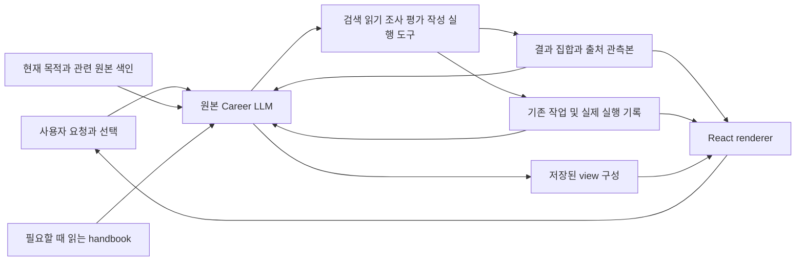

# Harper Career 사용자 경험 구현 설계

2026-11-13 · 구현 제안 · 좋은 기회 발견과 획득 가능성 개선에 우선 집중

**지금 가장 중요한 제품 목표는 사용자에게 정말 좋은 기회를 찾아주는 것과, 그 기회를 실제로 얻을 가능성을 높이는 것이다.** 첫 번째는 그 사용자가 원하는 보상·역할·동료·회사·다음 경력·생활 조건을 가진 기회를 발견하고 판단하는 일이다. 두 번째는 사용자와 상대의 상황에서 무엇이 그 기회를 얻는 데 걸리는지 이해하고, 기여 입증·접근·준비·지원·후속 진행·조건 협의 중 필요한 행동을 수행하는 일이다. 실제 결과는 채용의 합격·오퍼, 공고 없는 역할의 합의, 프로젝트 계약 등으로 나타날 수 있다.

팀은 **원본 Career LLM이 이 두 목표를 위해 판단하고 실행할 수 있는 작업 환경**을 만든다. 개인 자료와 공개 근거를 다시 쓰고, 큰 집합을 검색·조사·평가하며, 사용자에게 중요한 대상과 근거를 보여주고, 선택한 기회를 얻기 위한 행동을 이어갈 수 있게 한다. 어떤 도구를 어떤 순서로 사용할지, 어디에 시간을 더 쓸지, 무엇을 제안할지는 LLM이 결정한다.

UI 자유도·Memory·문서·작업 관리·prompt·handbook은 두 목표에 기여하는 수단이다. 면접 준비와 커리어 상담도 중요하며, 특히 좋은 기회를 얻는 데 필요하면 핵심 실행에 포함한다. 독립적인 상담·코칭·내부 성장 지원을 모두 같은 우선순위의 개발 과제로 확장하지 않는다. 이미 가능한 직접 요청은 그 범위에서 수행하고, 범용 구조는 유지한다.

이 문서는 아래 세 대화의 마지막 결론과 사용자의 교정을 종합한 구체 설계다. 기존 제안의 항목 수를 합치는 대신 저장 원본, 실행 입력, 호출 계약, 화면 동작, 비용이 발생하는 단위를 결정했다. 코드 근거는 현재 로컬 checkout 기준이다. 제안한 기능의 구현·배포·성능 검증은 아직 하지 않았다.

- [career-side 가치 제공 방식 탐색](thread://01a1cf75-9baa-70a2-ac37-e1847c5634a1?hostId=local)
- [커리어 에이전트 가치 확장](thread://01a1cf82-0ad0-7781-a08a-c3f27f40f0ad?hostId=local)
- [재설계 Career 가치를 중심으로](thread://01a1cf1f-f13b-7cf2-8a4d-f003c26f42a7?hostId=local)

구현 결론은 1절, 시나리오에 대입한 판단과 한계는 2절, 개인 정보와 발견·조사·평가는 5–8절, 화면과 작업은 9–11절에 있다. 실제 prompt 초안은 12절, DB와 도구 계약은 14–15절, 원가 계산과 구현 순서·완료 기준은 16–18절에 있다.

2026-11-13 재점검: [Javier Ng의 실제 입력에서 첫 사용·3일 뒤·일주일 뒤까지 따라간 설계 검토](career-agent-javier-sequence-review-ko.md)를 추가했다. 실제 사용자 기록·공개 근거와 가상 실행을 구분하고, 호출·결과물·후속 예약·과금 단위를 대입했다. 그 과정에서 조사 내부 비용, 외부 메일 답장, 재개·사용자 전달 계약을 보완했다. 기존 세 대화의 온보딩 관련 제안보다 최근 사용자 교정이 우선한다. 가입·`/career/onboarding`을 거친 이후의 대화를 개선한다.

## 1. 최종 구현 결정

| 결정 | 실제로 만드는 것 | 사용자가 얻는 변화 |
| --- | --- | --- |
| 개인 맥락을 필요한 깊이로 읽는다 | 기존 Profile·Brief·Memory·Documents의 내용 검색, 근거 연결, 읽은 범위와 정정의 전달 | 원하는 역할을 맡을 수 있다는 실제 기여를 찾아 지원·소개·면접에서 입증 |
| 큰 검색 결과를 서버의 집합으로 다룬다 | 검색·평가·조사·화면이 공유하는 `set_ref`, 묶음 조회·선택·차집합 연산 | 익숙한 공고 밖의 좋은 회사·역할을 넓게 발견하고 검토 |
| 공개 조사는 사용자 수만큼 반복하지 않는다 | 출처 관측본, 질문별 근거, 동시 수집 합치기, 변경된 부분의 재수집 | 실제로 좋은 역할인지 판단하고, 상대의 수요·팀·접근 경로를 확인 |
| 대량 판단을 Decisions 계산으로 제공한다 | 기존 Jev/OpenAI Decisions adapter를 대상·질문·근거 집합에 적용하는 범용 평가 서비스 | 중요한 회사 수천 곳을 검토하면서도 메인 모델 비용을 통제하고, 유력한 대상에는 충분한 주의를 씀 |
| 결과의 구성과 상호작용을 agent가 정한다 | 새 기회는 view 단위, 내 기회는 저장·진행 중인 기회 단위. 같은 기회를 여러 view에서 참조하고 그룹·순서·상세·행동을 구성 | 지역·고용 형태 등 원하는 기준으로 제안을 이해하고, 선택한 기회는 화면 재구성과 무관하게 이어감 |
| 맡은 일을 현재 사실에서 이어간다 | 기존 work·operations·forms·schedules에 일반 대상과 사용자 소유 작업 조회를 연결 | 실제 반응을 읽고 접근·준비를 바꾸며 오퍼·역할 합의까지 진행 |

간결한 목적 prompt, 발견 가능한 handbook, 실제 출력에 대한 개발 평가는 이 여섯 능력의 사용 품질을 책임진다. 따로 거대한 전략 agent·작성 agent·심사 agent를 항상 실행하지 않는다.

새 데이터나 tool의 개발 우선순위는 **어떤 좋은 기회를 더 발견·판단하게 하는가, 또는 그 기회를 얻는 어떤 장애물을 줄이는가**로 정한다. 두 목표에 필요한 반복 계산·수집을 줄이는 기능도 이 기준으로 설명한다. 범용성은 다른 상황에서도 같은 능력을 쓸 수 있다는 뜻이며, 모든 커리어 서비스를 동시에 확장한다는 뜻은 아니다. 두 목표를 하나의 `가치 × 합격확률` 공식으로 고정하지 않는다. 현재 얻기 어렵더라도 접근과 준비를 개선할 가치가 있는 기회가 있고, 쉽게 얻을 수 있어도 사용자에게 좋지 않은 기회가 있다.

### 앞선 제안에서 이번에 확정하거나 바꾼 점

1. **scoring은 유력한 일부만 읽는 보조 장치로 축소하지 않는다.** 원본 LLM이 정한 질문을 많은 대상에 하나씩 적용하는 핵심 계산 능력으로 만든다. 작은 모델에게 무엇을 평가할지까지 독립적으로 다시 결정시키지는 않는다.
2. **큰 집합을 view 안에만 저장하지 않는다.** 화면을 만들기 전에도 검색 결과에 평가·조사·재개·차집합이 필요하다. 집합은 실행 데이터, view는 표현이다. view가 집합의 항목을 다시 복사하지 않도록 한다.
3. **새 talent-opportunity todo 테이블은 만들지 않는다.** 현재 work·외부 실행 기록과 사용자 action item이 이미 있다. 실제 맡은 일의 범용 target 연결을 보강하고 화면에서 합성한다.
4. **기존 추천 테이블의 `role_id`를 곧바로 nullable로 바꾸지 않는다.** 기존 Role 추천과 연결·지원 상태는 유지한다. 공고 없는 제안은 `career_opportunities`에 사용자 소유 identity를 두고 집합·view·저장·진행이 같은 ref를 읽는다. 공고 없는 회사를 보여 주려고 가짜 Role을 생성하지 않는다.
5. **Memory와 Documents를 제품의 중심 화면으로 만들지 않는다.** 이들은 판단·작성의 재료다. 전면에는 사용자의 목적, 검토할 선택지, 맡긴 일, 지금 필요한 결정을 보여 준다.
6. **작업 기록 전부를 agent의 자유 메모에 맡기지 않는다.** 실제 실행 사실은 자동 저장하고, 무엇을 다시 읽기 좋게 남길지는 agent가 결정한다. 자유 메모가 발송·검색 범위·동의의 유일한 원본이 되면 안 된다.

### 1.1 기회 화면에 대한 구현 결정

2026-11-13 후속 대화 반영. 새 기회에서 view를 배제한다는 이전 대화의 제안은 채택하지 않는다. view는 제목만 있는 폴더로 제한하지 않으며, 사용자에게 보여 주는 제안의 구성 단위로 사용한다.

| 구분 | 구현 |
| --- | --- |
| 새 기회 | LLM이 게시한 view들을 순서대로 표시. view마다 제목·설명·기회 미리보기를 보여 주며 전체 view 또는 개별 기회로 진입 가능 |
| 묶는 기준 | 지역·고용 형태·추천 우선순위 등 실제 데이터와 LLM 판단으로 구성. 한 view 안에서 그룹을 나누거나 여러 view로 제안할 수 있음. 특정 분류를 필수 탭으로 코드화하지 않음 |
| 개별 상세 | 공통 패널에 사용자별 제안 내용·근거·조건·다음 행동. JD·회사·인물·행사는 해당 원본을 연결. source 종류에 따라 존재하지 않는 정보를 강제로 채우지 않음 |
| 내 기회 | 사용자가 저장하거나 진행을 맡긴 기회. 준비된 문서·실행 결과·필요한 사용자 입력·다음 예약을 기존 원본에서 연결 |
| 버튼 | LLM이 현재 기회에 맞는 메인 요청의 문구와 내용을 작성. 클릭은 정확한 대상과 사용자 요청을 원본 Career LLM에 전달. 저장·숨김·열기는 서버가 직접 처리 |
| 기회 identity | 기존 Role은 기존 추천 원본. 일반 제안은 `career_opportunities`. view를 바꾸거나 숨겨도 저장·진행 기록은 같은 기회를 계속 가리킴 |

앞선 다섯 테이블 설계에는 일반 기회를 view 밖에서 저장·진행할 원본이 빠져 있었다. 현재 `opportunities/save`는 posting Role을 받고, `opportunityHistorySql.ts`는 `company_roles`를 join한다. `career_opportunities`는 이 빈칸을 채우는 여섯 번째 테이블이다. 검색한 회사 전부나 LLM의 잠정 생각을 저장하는 곳이 아니며, 실제로 게시·저장·진행할 제안의 원본이다. todo·전략 테이블은 추가하지 않는다.

## 2. 어떤 경험을 완성하려는가

현재 제품 개발의 중심은 좋은 기회를 발견하고 그 기회를 실제로 얻도록 돕는 경험이다. 아래에는 그 과정에 필요한 도움과 같은 기반으로 지원할 수 있는 다른 목적도 함께 있다. 모든 행을 같은 우선순위로 구현하는 목록이 아니며, 별도 workflow로 만들지도 않는다.

| 사용자 목적 | Harper가 실제로 끝내야 할 일 | 필요한 공통 능력 |
| --- | --- | --- |
| 현재보다 보상과 경력 전망이 좋은 곳으로 이동 | 경력 유사성에 그치지 않고 회사·팀·역할의 가치와 현실적 접근을 확인하고 진행 | 넓은 발견, 대량 평가, 선택적 조사, 연락·자료 작성 |
| 목표가 막연함 | 이미 있는 경험을 읽고 실제 선택지를 통해 원하는 변화를 구체화 | 개인 자료 검색, 부분적인 탐색, 자연스러운 대화 |
| 특정 역할로 전환 | 드러나지 않은 경험을 찾아 적절한 자료로 만들고 필요한 빈칸만 확인 | 비공개 경험 재사용, 문서 편집, 근거 연결 |
| 현재 회사에서 승진·보상 개선 | 기여 근거와 상대의 평가 기준을 확인하고 협의 자료와 다음 행동 준비 | 개인 자료, 방법 자료, 문서·일정·작업 관리 |
| 내일 면접 준비 | 실제 업무와 자신의 사례를 연결하고 부족한 답변을 연습 | 필요한 원문 읽기, 코칭, 준비 자료. 새 검색 집합은 없어도 됨 |
| 여러 지원을 동시에 맡김 | 각 대상에 필요한 준비·제출·회신을 병렬로 처리하고 사용자 입력만 모아 요청 | 집합 선택, 독립 work, 공유 자료 revision, 실제 실행 영수증 |
| 이직 의사는 약하지만 좋은 변화는 놓치기 싫음 | 맡긴 범위에서 달라진 사실을 확인하고 의미 있는 변화가 있을 때만 다시 판단 | 공개 변경 관측, 기존 위임, 차분 계산, 예약 |
| 프리랜서 수입·좋은 고객 확보 | 적절한 수요를 찾아 제안하고 응답·자료·기한을 관리 | 회사·사람·웹 탐색, 조사, 외부 연락, 작업 재개 |
| 역할·지역·조직 중 무엇을 바꿀지 결정 | 대안의 실제 차이와 불확실성을 밝혀 선택을 돕기 | 임시 비교 기준, 근거, 유연한 화면 |
| 입사 후 더 큰 역할을 맡고 싶음 | 현재 기대와 기여를 정리하고 합의·실행을 이어가기 | 사용자 맥락, 문서, 작업·예약. 공고와 회사 검색은 필수 아님 |

결과를 평가할 때 사용자가 실제로 얻는 역할·보상·동료·성장·안정성·생활 조건과 사용자의 우선순위를 본다. 과거 경험과 회사 업종이 비슷하다는 사실은 여러 판단 재료 중 하나다. 어떤 회사에 자신을 팔 수 있는지와 그 회사가 자신에게 좋은 선택인지는 다른 질문이다.

### 2.1 시나리오를 대입한 평가

[30가지 사용자 시나리오](career-value-scenarios-ko.md)는 설계의 사고 범위를 확인하는 자료다. 아래 평가는 코드 실행이나 모델 benchmark 결과가 아니다. 검토에서 발견한 공통 빈칸은 보완하되, 출시 우선순위는 좋은 기회 발견과 획득 가능성 개선에서 정한다. 각 사례를 전용 workflow로 만들거나 모두 지원해야 출시할 수 있다는 뜻도 아니다.

**공통 구조는 대부분의 목적에 사용할 수 있다. 그러나 기존 초안은 발견·조사·표시에 비해 ‘현재보다 실제로 좋아지는가’, ‘공개 자료로 알 수 없는 조건을 어떻게 확인하는가’, ‘제한된 시간에 무엇을 끝내는가’의 연결이 약했다. 효율 역시 저장소와 cache의 존재만으로 보장되지 않았다.** 이번 수정은 그 연결과 비용 발생 경로를 보완한다.

| 시나리오에서 드러난 요구 | 기존 설계로 가능한 부분 | 재검토한 빈칸과 반영 위치 |
| --- | --- | --- |
| 01·09·14·19: 좋은 보상·팀·다음 경력으로의 이동 | 넓은 발견, 대상별 평가, 공개 근거와 개인 경험 연결 | 지원 가능성과 이동의 가치를 분리하고, 현 직장/현재 대안과 비교할 실제 근거를 입력에 연결. 2.2·8.3절 |
| 04·18·28: 승진·권한·입사 후 역할 | 개인 기여 자료, 문서, 대화와 후속 실행 | 문서 완성이 실제 권한·자원·평가 기준 합의로 오인되지 않도록 상대의 답과 적용 범위를 이어 읽음. 7.6·10.6절 |
| 03·06·10·12·13: 시간·지역·접근성 등 생활 조건을 지키는 이동 | 조건을 가진 검색과 사용자별 판단 | 회사 단위 정보로 특정 팀의 근무·통근·지원 조건을 확정할 수 없음. 그 조건의 정보원과 확인 경로를 선택하며, 조건 때문에 다른 야망을 낮추지 않음. 2.2·7.6절 |
| 07·08·15·23: 방향 탐색·경험 전환·지원 부진 | 개인 자료 재사용, 다양한 역할 발견, 표현 수정 | 근거 부족·실제 역량 부족·시장 상황을 같은 문제로 취급하지 않음. 필요한 연습/작은 시도와 실제 결과를 연결하되 소수 응답으로 인과를 단정하지 않음. 10.6·13절 |
| 02·17·20: 비공개 이동·관계 기반 접근·공고 없는 역할 | 회사/사람 ref, 조사, 기존 연락 실행 | 공개 이메일을 찾는 것과 적절한 소개 경로를 확보한 것은 다름. 실제 연결·공유 권한, 역할·보상·자원에 대한 상대의 확인이 필요. 7.6·10.6절 |
| 05·24·25: 생활비 기한·내일 면접·여러 채용 과정 | 독립 준비, 자료 버전, 예약과 재개 | 사용자 가용 시간과 실제 마감을 판단 context에 넣고 먼저 쓸 결과를 제공. 단기 수입과 장기 이동의 조건을 전역 Brief 하나로 덮어쓰지 않음. 10.7·12.2절 |
| 16·26·27·29·30: 프로젝트·오퍼·협상·사업 시도 | 자료·조건 조사, 문서·메일·후속 작업 | 총보상 숫자나 긍정적 답장을 결과로 삼지 않음. 계산 전제, 최신 조건, 실제 계약/수입/시간·반복 수요를 읽고 판단. 10.6절. 전문 계산·영상 이해는 2.3절의 한계 |
| 21·22: 큰 시장의 탐색과 조용한 장기 관찰 | 집합·view·공유 관측·증분 평가 | 전체 목록에 개인 설명을 생성하지 않고, 기준을 재사용하며, 변화 이벤트를 모아 필요한 때 판단. 작은 요청은 같은 비용 구조를 거치지 않음. 4.1·8.5·10.4·16절 |

이 대응표만으로 좋은 리크루터처럼 판단한다고 결론 내릴 수 없다. source에 실제 팀 정보가 없거나, 모델이 현재의 좋은 직장을 비교에서 빼거나, 연락 후 조건을 구체화하지 못하면 도구 호출이 모두 성공해도 경험은 실패한다. 개발에서 볼 대상은 그 사용자가 얻은 선택·준비·합의의 변화다.

### 2.2 비교할 현재 상태와 서로 다른 목적을 함께 읽는다

이동·승진·협상처럼 비교가 필요한 요청에서는 원본 LLM이 현재 상태를 근거로 읽을 수 있어야 한다. 현재 보상, 실제 업무, 팀, 권한, 시간 부담, 이미 가진 선택지는 기존 Brief·Memory·문서·메일에 둔다. 현재 보상을 매번 필수 질문으로 묻거나 `career_baseline` 테이블을 신설하지 않는다. 알려진 것과 모르는 것을 그대로 전달한다.

평가 입력의 `sourceRefs`에는 필요한 현재 상태와 검토 대상의 근거를 함께 연결한다. 현 직장 유지·내부 이동·다른 진행 중 제안도 의미 있는 대안이면 판단에 포함한다. 이를 모든 검색의 필수 가상 후보로 생성하지 않는다. `사용자가 원하는 변화`, `그 변화가 일어날 실제 조건`, `그 기회를 얻을 접근 가능성`을 한 개의 유사도 점수로 대체하지 않는다. 질문을 나눌 필요가 있는지는 원본 LLM이 정한다.

서로 다른 목적을 병행할 때는 이번 의뢰와 기존 작업의 scope를 사용한다. 예를 들어 6주 안에 현금 흐름을 만드는 단기 프로젝트의 조건이 장기 정규직 탐색 조건을 덮어쓰지 않아야 한다. 일반 Brief는 현재의 공통 상황, 각 작업의 원문/자료는 해당 목적과 조건을 제공한다. 목적마다 별도 profile이나 전략 상태를 만들지 않는다.

### 2.3 이번 구조만으로 충분하다고 말하지 않을 범위

| 범위 | 지금 가능한 경로 | 추가 능력을 넣을 조건 |
| --- | --- | --- |
| 11의 부부 공동 이동 | 사용자가 제공할 수 있는 공통 조건으로 비교하고, 상대방 자료는 실제 공유된 범위에서만 활용 | 두 계정의 공동 작업이 반복적으로 필요하면 명시적 공유·철회·reader가 있는 협업 계약을 별도 설계. 가족 관계를 계정 접근 권한으로 쓰지 않음 |
| 10·21의 지도·실제 통근 | 확인된 사업장 주소와 외부 지도 링크, 일반 collection으로 검토 | 통근 시간 계산/지도 조작이 선택에 실질적으로 필요하면 해당 provider와 component 추가. 본사 주소나 직선거리로 통근을 계산했다고 하지 않음 |
| 07·29의 코드·영상 등 작업물 깊은 평가 | 실제 reader가 지원하는 파일과 공개 자료를 읽고 기여 범위 확인 | 실행·멀티미디어 reader가 필요한 경우 capability를 추가하고 확인한 범위를 표시. URL 저장이나 텍스트 요약만으로 작품 전체를 이해했다고 하지 않음 |
| 12·26·30의 전문 조건·복잡한 계산 | 공식 원문, 실제 계약, 확인된 숫자와 전제를 읽어 비교하고 필요한 전문가 연결을 탐색 | 세금·체류·복잡한 지분 조건의 확정 판단이나 정확한 수치 실행이 필요하면 검증 가능한 계산/전문 서비스 연결. 현재 도구가 있다고 가정하지 않음 |

이 네 능력을 모두 첫 출시의 선행 조건으로 넣지 않는다. 기존 범용 능력으로도 유용한 결과를 낼 수 있는 범위부터 수행하고, 확인하지 못한 부분은 실제 한계로 남긴다.

### 2.4 좋은 기회를 얻는 데 걸리는 문제를 바꾼다

두 번째 목표는 지원을 기록하고 회신을 기다리는 기능만으로 달성되지 않는다. 원본 LLM이 해당 기회를 얻기 위해 지금 바꿀 수 있는 것을 판단하고 실행해야 한다. 다음은 판단에 필요한 사실과 실제 수단의 예이며, 자동 분류나 필수 단계가 아니다.

| 현재 걸리는 문제의 예 | 읽을 사실과 사용할 수단 | 확인할 변화 |
| --- | --- | --- |
| 사용자의 관련 기여가 상대에게 드러나지 않음 | 개인 경험 원문, 상대의 실제 수요, 기존 문서·소개·메일 작성 | 주장 가능한 기여가 해당 역할의 근거로 전달됐는지, 상대가 무엇을 더 확인하는지 |
| 적절한 상대에게 접근할 경로가 없음 | 공개 담당자 정보, 사용자가 공유한 관계, 실제 소개 가능 여부, 기존 연락 도구 | 관심 있는 역할을 논의할 상대와 접촉했는지. 연락처 발견과 연결 성립은 구별 |
| 좋은 회사지만 맞는 공개 공고가 없음 | 팀의 수요와 책임자, 사용자의 기여, 역할 제안과 대화 | 역할·예산·채용 의사에 관한 실제 논의가 생겼는지 |
| 채용 과정에서 필요한 증거·준비가 부족함 | 상대의 평가 과정, 실제 답변·작업물·경험, 관련 자료 작성과 연습 | 해당 과정에 필요한 설명·증거·역량의 빈칸을 줄였는지 |
| 조건 때문에 좋은 기회를 받아들이기 어려움 | 실제 오퍼·수요·결정권자의 답, 사용자 조건, 협의와 후속 연락 | 사용자에게 필요한 조건이 실제 제안/합의에 반영됐는지 |

공통으로 필요한 입력은 사용자가 원하는 기회, 사용자의 실제 기여, 상대가 필요로 하는 것, 지금 접근 가능한 경로, 이미 시도한 일과 상대의 반응이다. 기존 자료·메일·작업과 source refs로 연결한다. `합격 장애물` enum이나 대상별 전략 상태 테이블은 만들지 않는다. 필요한 사람이나 정보에 실제 접근할 수 없다면 그 결손은 connector/source 또는 실행 능력의 문제이며 메모 저장으로 해결됐다고 하지 않는다.

LLM은 지금의 적합성과 준비를 바꿔 얻을 가능성을 함께 생각한다. 검증되지 않은 합격 확률을 생성해 낮은 대상으로 일괄 제외하지 않는다. 원본 질문으로 수행한 Decisions 계산은 이 판단의 재료이고, 실제 개선은 해당 기회를 향한 준비·접근·상대 반응에서 확인한다.

### 2.5 `/jobs` 유입자의 온보딩 이후 대화

**`/jobs/...` → 회원가입 → `/career/onboarding`은 그대로 거친다. 여기서 다루는 것은 그 이후 Harper와 이어지는 대화다.** 사용자가 보고 온 공고를 알고, 온보딩에서 이미 받은 자료와 실제 요청을 활용해 해당 기회를 진행한다. 가입이나 `/career/onboarding`을 생략하는 설계가 아니다.

현재 코드에도 이 기반이 있다. [officialJobs/index.ts](../src/lib/officialJobs/index.ts)가 유입 공고를 로그인 경로로 전달하고, [onboarding/start](../src/app/api/talent/onboarding/start/route.ts)가 해당 대화의 `official_jobs_signup_intent` 이벤트에 slug를 남긴다. [postOnboardingContext.ts](../src/lib/career/postOnboardingContext.ts)는 그 이벤트에서 회사·공고명과 현재 유효한 내부 Role ID를 복원한다. [postOnboardingGuide.ts](../src/lib/career/prompts/postOnboardingGuide.ts)에도 유입 공고와 실제 요청을 이어가라는 안내가 있으며, [conversationPlan.ts](../src/lib/career/prompts/conversationPlan.ts)와 온보딩 완료 후 실행이 이를 사용한다. 따라서 유입 처리나 전용 agent를 새로 만드는 대신, 이 경로가 아래 경험으로 연결되는지 확인하고 필요한 입력을 보완한다. 이는 로컬 코드 확인이며 실제 대화 품질을 검증했다는 뜻은 아니다.

**대화에서 달라질 것**

- 사용자가 관심 여부를 아직 말하지 않았다면 보고 온 회사·역할을 바탕으로 유용한 질문을 한다. 이미 연결해 달라고 했다면 같은 관심 질문을 반복하지 않고 그 요청을 이어간다.
- 해당 기회를 진행하기로 했다면 기존 `apply_to_internal_role`로 개인 기회에 저장할 수 있다. 이 도구의 성공은 회사에 소개했다는 뜻이 아니다. 연결을 요청했고 공유 대상·자료에 대한 기존 실행 조건이 갖춰졌다면 `contact_company`로 진행한다. 자료 버전을 선택할 필요가 있으면 기존 `assign_to_role`을 사용한다.
- 이력서·경험·조건이 더 필요하면 온보딩에서 확보한 사실과 문서를 먼저 읽고, 해당 진행에 빠진 정보만 확인한다. 추가 면접이나 전체 검색을 먼저 끝내는 것을 일괄 조건으로 두지 않는다.
- 다른 기회 탐색이 도움이 되면 현재 요청과 진행 상황에 맞게 제안하거나 맡은 범위에서 시작한다. 유입 공고에 대한 요청을 잊고 일반 추천으로 전환하거나, 매번 같은 추가 탐색 권유를 붙이지 않는다.

이 항목들은 대본이나 순서대로 실행할 workflow가 아니다. 다음 질문·행동·제안의 시점은 원본 LLM이 판단한다. 이를 위해 첫 후속 실행에 제공할 사실은 다음과 같다.

| 필요한 사실 | 기존 원본과 reader | 보완할 계약 |
| --- | --- | --- |
| 이 대화가 어느 공고에서 시작됐는지 | 대화에 연결된 signup intent 이벤트 → `fetchCareerPostOnboardingContext` | 정확한 slug와 회사·공고명 유지. 다른 대화의 최근 클릭으로 덮어쓰지 않음 |
| 그 공고를 지금 진행할 수 있는지 | `official_jobs`와 내부 Role의 현재 상태 | 기존 active/non-test 확인 유지. 검증된 Role ID와 현재 확인되지 않는 부분을 구별 |
| 사용자가 실제로 무엇을 요청했는지 | 대화 원문과 실제 제출된 action | Talk to Harper 클릭·자동 작성된 입력 초안을 연결 요청이나 공유 동의로 바꾸지 않음. 이미 한 요청은 다시 묻지 않도록 원문 연결 |
| 이미 확보한 경험·조건·자료 | 온보딩에서 저장한 Profile·Brief·Memory·Documents | 관련 사실과 문서 ref 제공. 이미 받은 내용을 다시 전부 질문하지 않음 |
| 이 기회에서 이미 한 일 | 기존 개인 기회·자료 선택·소개·회사 대화 기록 | 개인 저장, 실제 소개, 상대 응답을 구분해 읽고 완료한 실행을 반복하지 않음 |

새 table이나 `/jobs` 전용 tool은 필요 없다. `entryOpportunity`와 기존 관련 기회·자료 context를 사용한다. 상세 JD와 자료는 일반 read tool로 읽고, 이 경로 때문에 시장 전체의 검색·대량 평가·새 view를 먼저 생성하지 않는다.

prompt는 기존 `postOnboardingGuide.ts`의 목적과 실행 계약을 정리한다. 일반 추천 수나 회사당 개수처럼 첫 대화의 내용을 고정하는 지침은 그 원본에서 제거하고, 위 사실을 `conversationPlan.ts`에 전달한다. 온보딩 완료 이벤트로 시작하는 실행과 이후 사용자 메시지 실행에서 같은 공고·사용자 요청·진행 상태를 읽는지 함께 확인한다. `/career/onboarding`의 진입·완료 요건은 이번 변경 대상이 아니다.

## 3. 현재 코드에서 재사용할 것과 실제 빈칸

아래는 새 기능이 있다는 주장이 아니라 출발점을 확인한 표다. 기존 작업 트리의 미커밋 변경을 포함한다.

| 현재 경로 | 확인한 동작 | 이번 변경 |
| --- | --- | --- |
| [mainPrompt2.ts](../src/lib/career/prompts/mainPrompt2.ts) | 이미 목적·주도성·Memory·위임을 설명하는 Career main prompt가 있음 | 비슷한 선언을 덧붙이지 않고 업무 절차·화면 설명·실행 계약의 위치를 정리 |
| [conversationPlan.ts](../src/lib/career/prompts/conversationPlan.ts), [capabilities/server.ts](../src/lib/career/capabilities/server.ts), [gmailToolSelection.ts](../src/lib/career/gmailToolSelection.ts) | 온보딩 상태와 채널이 capability/Gmail 노출에 관여 | 온보딩 이후에는 필요한 일반 도구로 요청을 이어감. 가입·`/career/onboarding` 흐름과 실제 채널 지원·권한 경계 유지 |
| [postOnboardingContext.ts](../src/lib/career/postOnboardingContext.ts), [postOnboardingGuide.ts](../src/lib/career/prompts/postOnboardingGuide.ts) | 대화별 `/jobs` 유입 공고를 복원하고 온보딩 이후에 사용 | 이미 받은 자료·실제 요청·해당 기회의 실행 상태를 함께 읽음. 2.5절의 후속 대화 연결 확인 |
| [agentTurnRuntime.server.ts](../src/lib/career/agentTurnRuntime.server.ts) | 문서·프로필·matching·예약·폼의 색인을 이미 조립 | 관련 집합·조사·작업을 찾는 색인과 원문 링크 보강 |
| [talentContexts.ts](../src/lib/talentOnboarding/talentContexts.ts), [documentTool.ts](../src/lib/talentOnboarding/documentTool.ts), [sources.ts](../src/lib/documents/sources.ts) | Memory 검색·중요도·문서 revision·일부 source 관계가 존재 | 비공개 자료의 본문 검색, source 범위·정정 연결, 공유 시점 버전 연결 |
| [companies/server.ts](../src/lib/career/companies/server.ts) | workspace 이름/LinkedIn 검색과 회사 follow | 회사 원본의 넓은 검색과 공개 근거 편집 경로. follow를 새 기능처럼 다시 만들지 않음 |
| [matching/tools.ts](../src/lib/career/matching/tools.ts), [externalSearch.ts](../src/lib/career/matching/externalSearch.ts) | 외부 Role 검색과 평가가 연결. 조회·재개·취소와 캐시가 있음 | retrieval-only 서비스 분리, 기존 경로도 이를 조합하도록 변경 |
| [externalRecommendationsV2/decisions.ts](../src/lib/externalRecommendationsV2/decisions.ts) | Jev/OpenAI 요청 변환과 항목별 결과 파싱, 현재 Role·rubric 중심 | transport·usage·ID 매핑 재사용, 일반 대상과 agent가 작성한 기준을 받는 adapter |
| [companySnapshot.ts](../src/lib/career/companySnapshot.ts) | 공유 snapshot을 읽어도 개인 보고서 모델 호출로 이어지는 경로가 있음 | 근거 읽기와 개인 보고서 작성 분리. 읽을 때 새 보고서를 자동 생성하지 않음 |
| [documentCache.ts](../src/lib/tools/documentCache.ts) | URL별 본문을 갱신하는 최신 cache | 당시 근거를 보존할 관측본과 최신 pointer 분리 |
| [NewOpportunityList.tsx](../src/components/career/history/NewOpportunityList.tsx) | `recommendedAt` 내림차순 후 internal/external 그룹 | view가 정한 강조·그룹·순서와 사용자 정렬을 표시 |
| [matching migration](../supabase/migrations/20261029183004_career_matching_workspaces.sql) | membership에 이미 explanation·rank가 있지만 Role/recommendation FK를 요구 | 기존 Role 원본 보존, 일반 집합·화면에서 adapter로 참조 |
| [work/tools.ts](../src/lib/career/work/tools.ts), [work/store.ts](../src/lib/career/work/store.ts) | 현재 work는 독립 위임 실행, 조회가 conversation에 묶임 | 일반 책임 기록과 실행 분리, 사용자 소유 작업 발견·재개 연결 |
| [externalOperations/store.ts](../src/lib/career/externalOperations/store.ts) | owner·parent·idempotency key·request/result·revision·provider refs가 있음 | 묶음 조사·평가 영수증, 대상 refs와 부모 책임을 같은 원본에 연결 |
| [actionItems.ts](../src/lib/career/actionItems.ts) | 사용자에게 제안할 행동과 표시 우선순위가 이미 있음. 실행 큐와는 구분됨 | view/작업 refs를 연결하되 클릭으로 시작하는 실제 효과는 기존 계약 유지 |

2026-11-12의 [이전 조사](career-redesign-evidence-ko.md)는 회사 행 318,558개 중 설명이 있는 행 53,330개를 보고했다. 이번에 운영 DB를 다시 집계한 수치는 아니다. 이 기록이 말해 주는 것은 데이터 규모와 검색 가능한 정보량이 다르다는 점이다. 전체 회사에 embedding만 붙이면 시장 이해가 완성된다는 가정을 하지 않는다.

## 4. 공통 연결 계약

### 4.1 대상과 집합을 모델의 긴 인자 목록에서 꺼낸다

아래 타입은 제안하는 서버 계약이다. 모델에게 DB JSON을 그대로 출력하는 형식이 아니다.

```ts
type ResourceRef = {
  kind: string;       // resolver가 실제 지원하는 resource 종류
  id: string;         // server가 반환한 정확한 ID 또는 정규화된 URL identity
  revision?: string; // 특정 관측/문서/표시 버전을 읽을 때
};

type Selection =
  | { refs: ResourceRef[] }
  | { setRef: string; revision: number; selector?: StoredSelector };

type StoredSelector = {
  memberRefs?: string[];
  excludeMemberRefs?: string[];
  filter?: FieldPredicate[];
  orderBy?: FieldOrder[];
  take?: number;
};
```

`kind`는 직군·기회 유형 taxonomy가 아니라 resolver routing이다. 모르는 외부 대상은 `web` ref로도 읽고 표현할 수 있다. 회사·사람·공고의 기존 ID는 그대로 유지한다. 회사 이름만으로 동일 엔티티라고 병합하지 않는다. 공식 도메인과 기존 식별자를 먼저 찾고, 모호하면 별개 후보로 남겨 LLM이 원문을 더 읽게 한다.

`StoredSelector`에는 서버가 조회할 수 있는 필드만 사용한다. 임의 SQL이나 JS를 받지 않는다. `연봉이 좋은 회사` 같은 의미 판단은 SQL 조건으로 해석하지 않고, LLM이 사실 필드 또는 평가 질문으로 구체화한다.

여러 호출에 걸친 처리·대량 평가·화면에서 안정된 membership이 필요하면 검색은 `set_ref`를 반환한다. 평가·조사는 그 ref와 selector를 받고, 화면은 같은 집합을 페이지로 읽는다. 사용자 선택도 서버 ref로 전달하므로 500개 ID를 메시지와 모델 인자에 다시 나열하지 않는다.

**모든 검색과 클릭에 새 집합을 생성하지 않는다.** 한 문서에서 사실을 찾거나 몇 개의 정확한 ref를 읽는 요청은 일반 tool result와 실행 trace로 끝낼 수 있다. `search_resources`는 `resultMode: page | set`을 지원하고, page는 결과 refs·coverage·cursor, set은 지속 가능한 membership ref를 반환한다. 같은 서비스로 조회하되 필요한 소비자가 있을 때 집합을 materialize한다. 작은 선택은 interaction receipt 안의 직접 refs로 보존해도 된다. 크기 threshold를 의미 판단 규칙으로 두지 않으며, provider의 일회성 cursor만 남긴 결과를 재개 가능한 집합이라고 부르지 않는다.

### 4.2 실행 사실과 화면 표현을 나눈다



이 그림은 필수 처리 순서가 아니다. 설명만 필요하면 LLM 답변으로 끝낼 수 있다. 이미 가진 근거로 문서를 만들 때는 검색·평가·view가 필요 없다.

## 5. 사용자 경험과 자료를 재사용하는 방법

### 5.1 기존 원본의 역할을 유지한다

| 정보 | 저장 위치 | 저장하지 않을 곳 |
| --- | --- | --- |
| 회사에 공개할 경력 표현 | 기존 Profile와 선택한 공유 문서 | 비공개 조사 내용을 자동으로 Profile에 병합하지 않음 |
| 현재 탐색 조건과 전제 | `talent_contexts`의 Brief | 일회성 미국 시장 조사로 전역 조건을 자동 교체하지 않음 |
| 재사용할 사용자 사실·배경 | `talent_contexts`의 Memory | 행동을 보고 추정한 선호를 확인된 사실로 쓰지 않음 |
| 긴 프로젝트 설명, 상세 경험, 조사된 개인 자료 | 비공개 `talent_documents` | 모든 경험을 별도 경험 테이블의 필수 필드로 분해하지 않음 |
| 원문 이메일·첨부·외부 자료 | 권한 있는 source 참조와 필요한 관측본 | 전체 받은편지함을 공용 회사 지식으로 복사하지 않음 |
| 실제 지원·발송·선택 | 기존 원본과 operation receipt | Memory의 자유 문장을 실행 상태로 사용하지 않음 |

Memory는 재사용에 필요한 사실과 상세 자료로 가는 참조를 담는다. 긴 자료를 Memory와 문서에 두 번 복사하지 않는다. 이미 적절한 문서나 경력 메모가 있으면 그것을 갱신한다. source refs의 존재와 공유 가능 여부는 서로 다르다.

### 5.2 경험 발견에서 다음 사용까지

ML Engineer 경력이 있는 사용자가 FDE 지원을 맡긴 경우를 한 번의 실행 흐름으로 보면 다음과 같다. 이 순서를 FDE workflow로 코드화하지 않는다.

1. 원본 LLM은 관심 공고와 사용자의 현재 자료를 읽는다. 필요한 customer-facing 경험이 이미 충분하면 바로 작성한다.
2. 부족하면 기존 문서 본문·Memory를 검색한다. Gmail이 연결됐고 실제 위임 범위에서 유용하면 관련 프로젝트·고객·기간을 검색한다. 처음부터 전체 이메일을 다운로드하지 않는다.
3. 검색한 thread에는 원문 위치·참여자·기간·첨부 refs를 보존한다. 이메일에 고객과 대화한 사실이 있다는 것과 그 사람이 전체 도입을 주도했다는 것은 구분해 읽는다.
4. 나중에도 쓸 상세 경험은 기존 비공개 문서를 보강하거나 새 비공개 자료로 정리한다. 제목과 본문 구조는 agent가 정한다. 아직 확인되지 않은 역할이나 성과는 그 상태로 쓴다.
5. 필요한 경우 Memory에는 짧은 재사용 사실과 문서 ref를 남긴다. 공개 Profile은 해당 공개 표현을 바꿀 이유와 권한이 있을 때 별도로 편집한다.
6. 이력서·메일에는 실제 사용한 개인 자료 revision과 원문 refs를 연결한다. 공개 가능한 범위를 확인한 산출물만 실행 도구에 전달한다.
7. 다음 지원에서는 관련 자료가 검색된다. 이전 조사에서 확인한 source 범위와 시점을 읽고, 추가 최신 경험이 필요한 경우 그 이후의 자료를 찾는다. 이전 검색을 전부 다시 수행하지 않는다.

메일 검색의 `after`만 바꾸면 완전한 증분 조회가 되는 것은 아니다. 예전 thread에 새 답장이 붙거나 검색 index가 늦게 반영될 수 있다. connector가 제공하는 변경 cursor가 있으면 사용하고, 없으면 관련 thread ID 재조회와 기간이 겹치는 검색으로 보완한 뒤 message ID로 중복을 제거한다. `검색 결과 없음`은 그 질의·계정·시점의 관측이다.

### 5.3 검색 인덱스와 원문 읽기

문서 목록의 파일명·설명뿐 아니라 본문을 검색할 수 있게 한다. 재생성 가능한 `career_resource_index`에는 resource ref, source revision/hash, 권한 scope, title, 검색 text 또는 chunk, embedding version을 둔다. 사용자 사실의 새 정본이 아니라 기존 원본의 검색용 projection이다.

문서 생성·수정·삭제 시 index 작업을 기존 outbox에 기록한다. 조회는 owner/권한 조건을 먼저 적용하고 lexical·semantic 결과를 합친다. 중요 Memory와 최근 정정은 검색 유사도에만 맡기지 않고 기본 맥락에 전달한다. 검색 결과가 일부인지, 다음 페이지나 원문이 있는지도 반환한다. 한국어·영어 혼합 경력은 exact 이름·프로젝트명 검색과 다국어 semantic 검색을 함께 사용하며, 영어 형태소 검색만으로 충분하다고 가정하지 않는다.

원문을 읽을 때 chunk 주변 문맥과 전체 문서로 확장할 수 있어야 한다. source가 갱신되면 index가 늦어도 최신 원문을 확인하고, 삭제된 원문을 오래된 index로 부활시키지 않는다. Supabase의 [hybrid search](https://supabase.com/docs/guides/ai/hybrid-search)와 [권한을 적용한 검색](https://supabase.com/docs/guides/ai/rag-with-permissions)을 구현 기반으로 쓰되 문서의 예제 top-k나 차원을 제품 규칙으로 복사하지 않는다.

### 5.4 정정과 공유

사용자가 기여 수치를 정정하면 그 사실을 소유한 원본을 수정한다. 새 자료 작성과 후속 실행은 최신 원본을 읽고, 이전 관측을 사용하는 파생 자료에는 그 의존성이 변경됐음을 반환한다. 의미상 문서를 다시 써야 하는지는 LLM이 판단한다.

이미 제출한 이력서는 제출 당시 버전 그대로 남는다. 현재 문서를 바꿨다는 이유로 외부에 보낸 자료가 바뀌었다고 말하지 않는다. source 삭제·연결 해제 때에는 해당 원문·검색 projection·파생 cache의 접근 가능성을 함께 갱신한다. 사용자가 별도로 보관한 산출물과 실제 제출 기록의 보존은 해당 원본의 보존 계약을 따른다.

## 6. 넓은 발견과 데이터에 기반한 최적화

### 6.1 검색은 발견이고 추천은 판단이다

`search_opportunities`의 내부 구현에서 retrieval 서비스와 evaluation 서비스를 분리한다. 기존 빠른 검색+평가 호출은 두 서비스를 조합하는 호환 경로로 유지할 수 있다. 새로운 공통 검색 계약 `search_resources`는 여러 adapter를 통해 평가 없는 결과 refs 또는 집합을 반환한다.

| adapter | 실제 조회 원본 | 이 경로가 해결하는 문제 |
| --- | --- | --- |
| company | `company_db`, 연결된 workspace, 공개 조사 index | 이름을 모르는 회사도 사업·시장·팀·공개 성장 근거로 발견 |
| role | 외부 `company_roles` 검색과 허용된 기존 내부 추천 | 현재 외부 공고 자산 활용. 미추천 회사 비공개 inventory 접근은 열지 않음 |
| person | 공개 출처가 확인되고 사용 가능한 사람 데이터, 공개 웹 | 담당자·동료·전문가를 찾되 candid 전체를 연락처 DB로 공개하지 않음 |
| personal | 허용된 문서·Memory·기존 작업의 검색 projection | 과거 경험·결정·맡긴 일을 찾음 |
| web | 기존 `web_search`·`open_url` 및 묶음 수집 adapter | 내부에 없는 회사·활동·기관·프로그램 등 발견 |

`search_resources`는 위 adapter를 감싼 일반 조회 capability다. 실제 provider가 지원하는 검색 조건은 그 schema로 노출한다. 자연어를 숨은 intent classifier로 분류해 workflow를 선택하지 않는다. 원본 LLM이 source와 검색 질문을 고르고, 서버는 그 계약대로 조회한다. 기존 조회 도구는 호환 진입점으로 남기되 동일 turn에 같은 능력의 중복 설명을 여러 개 주지 않는다.

### 6.2 큰 시장에서 좋은 대상을 놓치지 않는 방식

회사 설명의 similarity 상위 N개만으로 후보군을 끝내지 않는다. LLM이 서로 다른 관점의 검색 집합을 만들고 union할 수 있게 한다. 원하는 역할의 채용 기업, 좋은 인력의 이전·현재 회사, 관련 제품군, 투자·사업 확장 소식, 지역의 실제 고용 기반 등은 필요한 경우의 발견 경로다. 특정 투자사나 유명 브랜드를 좋은 회사의 보편적인 proxy로 고정하지 않는다.

서버는 다음 사실을 돌려준다.

```text
집합 S18, revision 1
회사 1,240개. 내부 회사 검색과 공개 웹 결과를 합쳤음.
검색 범위: 한국에서 근무 가능한 제품 엔지니어 조직 탐색.
내부 설명이 있는 대상 730개, 이름·주소 수준인 대상 510개.
웹 source 하나는 요청 실패. 그 범위는 아직 확인되지 않음.
결과는 미평가. 회사 상세·추가 조사·집합 평가·화면 표시 가능.
현재 페이지 40개, 다음 cursor …
```

대상의 정보 부족은 데이터 coverage다. 나쁜 회사나 낮은 개인 적합성으로 변환하지 않는다. 집합을 읽을 때 정보 부족 대상만 따로 볼 수 있게 하고, agent가 그쪽을 더 조사할 수 있게 한다. 검색 순위는 retrieval 순위로 표시하고 추천 정도와 섞지 않는다.

### 6.3 사전 수집은 사용할 가능성과 실제 변경에 집중한다

처음부터 모든 회사의 상세 정보를 채우지 않는다. 기존 원본의 이름·주소·설명·공개 링크를 먼저 index하고, 실제 검색에 걸리거나 맡긴 목적에서 필요해진 대상의 근거를 보강한다. 동일 공개 source를 여러 목적이 사용하면 수집 결과를 공유한다.

검색 원본의 수정 시각과 content hash를 이용해 index를 증분 갱신한다. `updated_at`이 바뀌었다고 내용이 같은 row의 embedding을 다시 만들지 않는다. 반대로 row를 바꾸지 않는 외부 페이지의 변경은 별도 source 확인이 필요하다.

사용량은 수집 순서·cache 보관에 쓰되 회사 가치나 추천 적합성 점수로 쓰지 않는다. 자주 클릭된 회사만 데이터가 풍부해지는 편향은 검색 평가에서 정보 부족 집합과 새 대상을 함께 살펴 발견한다. 배경 수집 범위를 넓히는 시점은 실제 누락과 반복 비용을 보고 결정한다.

### 6.4 외부 회사 추가와 메모

공식 URL만 가진 회사도 web ref로 바로 조사·표시할 수 있다. 재사용할 공개 회사 원본이 필요하면 `write_resource`의 company adapter로 등록한다. 필수 입력은 확인된 identity/source이고, 채워지지 않은 회사 필드는 null로 남긴다. 회사 workspace나 company-side 계정은 생성하지 않는다.

공개 사실 수정은 source ref와 관측 시점을 함께 받는다. 기존 필드의 source와 충돌하면 양쪽 관측을 보존하고 해당 필드를 확인할 수 있게 한다. 자유 메모는 개인 작업/문서에 둔다. `내가 보기에 이 회사는 지금 민수님에게 별로다`를 공용 description에 쓰지 않는다. 공유 조사 본문은 누구에게나 같은 공개 사실로 읽을 수 있어야 한다.

## 7. 질문별 조사와 공유 근거

### 7.1 조사 도구의 계약

`research_resources`는 하나 또는 집합의 대상에 대해 **알아낼 질문, 사용할 source, 현재성 요구**를 받는다. 메인 LLM이 연구 질문을 정한다. 회사마다 고정 10개 필드, 반드시 founder·연봉·뉴스를 모두 수집하는 규칙은 없다.

```ts
research_resources({
  selection: { setRef: "S18", revision: 1, selector: { memberRefs: ["m4", "m19"] } },
  questions: [
    "서울에서 일하는 해당 팀의 역할 범위와 실제 업무",
    "이 레벨의 공개 보상 근거와 적용 지역",
    "이 조직의 최근 확장 근거와 그 근거가 확인하지 못한 점"
  ],
  sourcePolicy: "public", // public/private의 권한 결정은 server가 검증
  freshness: { observedAfter: "2026-11-01" }
})
```

이 예의 날짜·질문 수는 제품 기본값이 아니다. `observedAfter`는 수집 시점이고, 출처의 발표일은 별도로 반환한다. 오늘 읽은 오래된 뉴스가 최신 사업 상황을 보장하지 않는다. 새 사실을 얻을 필요 없이 기존 조사만 읽으려면 read 도구를 쓴다.

실행기는 먼저 해당 대상의 기존 observations와 `company_snapshot`을 조회한다. 같은 질문의 정확한 cache hit는 재사용하고, 유사한 과거 조사는 근거 후보로 반환한다. 질문 의미가 같다는 것을 문자열 유사도만으로 확정하지 않는다. 처음 보는 질문은 기존 원문으로 답할 수 있으면 추가 수집 없이 처리하고, 부족한 부분을 외부에서 찾는다.

### 7.2 수집과 합성의 비용을 분리한다

알려진 여러 URL은 Contents adapter로 묶어 가져온다. 출처를 모르는 질문에는 Search를 쓴다. 이미 가져온 원문의 분류·필요한 근거 선택은 작은 모델 또는 Decisions로 처리할 수 있다. 해석이 필요한 전문 내용이나 서로 충돌하는 근거는 메인 LLM이 읽거나 명시적으로 조사 작업에 맡긴다.

Exa의 [Search](https://exa.ai/docs/reference/search)는 검색과 구조화된 결과를, [Contents](https://exa.ai/docs/reference/get-contents)는 URL 묶음의 본문·발췌를 제공한다. 이를 기존 `webSearch.ts`·`exaClient.ts` 뒤의 adapter로 사용한다. 한 API 호출에 넣었다고 내부 검색·페이지 읽기·합성의 과금이 한 번으로 줄었다고 계산하지 않는다. provider usage와 실제 과금 단위를 기록한다.

2026-11-13 확인한 Contents 계약은 한 요청의 URL을 최대 100개로 제한한다. Search의 `outputSchema`는 `lite`를 제외한 검색에서 지원하며 전체 property 수와 중첩 깊이에 제한이 있다. 이런 한계는 provider adapter가 분할·조립할 실제 계약이다. Harper가 조사할 전체 대상 수나 질문 수의 상한으로 옮기지 않는다. 구조화 합성만 필요하지 않은 조회에는 해당 옵션을 켜서 추가 합성 비용을 쓰지 않는다.

반복 가능한 실행기 경로는 `기존 관측 조회 → 필요한 source 요청 → 항목별 결과 저장`이다. 그 안에서 새로운 조사 방향을 판단해야 한다면 기존 work의 독립 실행으로 넘길 수 있다. 단순한 1,000개 URL 읽기에 agent 1,000개를 생성하지 않는다.

`research_resources` 구현에서 **공개 근거를 가져오는 경로와 독립 조사 agent를 실행하는 경로의 원가를 구별한다.** 이미 주어진 질문과 URL이면 batch contents·기존 cache와 필요한 사실 발췌로 처리할 수 있다. source 발췌에 소형 모델을 쓰면 원문 locator·읽은 범위·사용량을 남기고, 적합성 판단이나 연락 전략을 몰래 위임하지 않는다. 새 source나 조사 방향의 선택이 필요할 때 기존 agent 또는 외부 Agent API를 사용한다. 회사마다 고정된 Agent API 호출을 숨겨 붙이지 않는다.

조사 receipt에는 `provider/mode`, 실제 요청 수, 새로 읽은/재사용한 페이지 수, 합성 모델 사용량, 실패·미처리 범위와 과금 상태를 남긴다. 메인 모델에는 해당 판단에 필요한 근거와 재사용/신규/미확인 범위를 반환한다. 운영 trace에는 전체 사용량을 보존한다. 같은 tool 한 번이라도 48개 URL 묶음 읽기와 96개 독립 고강도 조사는 다른 원가이며, 전자를 후자의 성능이라고 설명하지 않는다.

### 7.3 무엇을 보존하는가

관측본에는 source identity, 정확한 표현/접근 scope, observed_at, published_at, content hash, 본문 또는 필요한 발췌, locator를 저장한다. 최신 URL cache는 이 관측본을 가리킨다. hash만 남기고 본문을 버리면 과거 판단의 근거를 복원할 수 없으므로 그것을 근거 보존이라고 부르지 않는다.

조사 결과에는 질문 원문, 실제 검색/조회 범위, 관측 refs, 확인한 내용, 아직 모르는 부분을 저장한다. 회사 조사 결과는 기존 `company_snapshot.content`를 확장하고, 회사가 아닌 공개 대상은 일반 조사 operation의 결과를 사용한다. 공용 결과에는 사용자 이름·경력·개인적 판단을 넣지 않는다.

적용 범위는 자연어와 source 원문으로 보존한다. 보상은 팀·레벨·지역·시점의 범위, 기술 리더는 해당 재직 시점, 행사 정보는 일정과 참가 조건이 함께 읽혀야 한다. 이를 모든 직군에 공통인 복잡한 fact taxonomy로 강제하지 않는다.

### 7.4 cache와 동시성

| 재사용 단위 | key에 들어갈 것 | 다시 작업할 조건 |
| --- | --- | --- |
| 공개 URL 관측 | 정규화 URL, locale/representation, fetch 계약 version, 공개 접근 scope | 현재성 요구를 만족하지 않거나 source 변경 확인이 필요 |
| 개인 원문 | 계정/tenant/owner, connector resource ID, source version, 권한 generation | 새 버전·권한 철회·보존 제한 변경 |
| 검색 결과 | source, 질의와 실제 filters, locale, provider 계약, 검색 시점/유효 범위 | 새 검색 시점이 필요하거나 다른 범위·질의 |
| 질문별 조사 | 대상 identity, 질문·source 정책, 사용한 관측 versions, 조사 계약 version | 질문/원문/중요한 시간 조건 변경 |
| 개인 평가 | 해당 사용자, 정확한 기준·개인 입력·대상 근거·model/rubric versions | 소비한 입력이 하나라도 달라짐 |

TTL 하나로 정확성을 해결하지 않는다. 변하지 않는 근거의 cache와 외부 변화 확인을 구분한다. 화면 열람에는 관측 시점을 보여 주며 기존 자료를 빠르게 제공할 수 있다. 마감 직전 제출이나 현재 재직자에게 연락하는 판단에는 필요한 사실을 다시 확인할 수 있어야 한다.

같은 수집은 DB의 unique request key와 lease로 한 번 claim한다. claimant는 원문을 가져오고, 다른 caller는 같은 결과를 기다린다. lease 만료 후 takeover는 fencing token을 갱신해 뒤늦은 이전 writer가 결과를 덮어쓰지 못하게 한다. 공개 수집의 claim은 사용자 필수인 `talent_external_operations`에 억지로 넣지 않고 기존 `documents`의 cache slot에 `fetch_key`, `lease_token`, `lease_until`, `fetch_status`를 확장해 관리한다. 개인 조사 operation이 그 공개 key와 관측본을 참조한다. cache slot에는 개인 query를 넣지 않는다. 한 사용자의 취소는 그 사용자의 대기를 끝낼 뿐 다른 사용자가 기다리는 수집을 취소하지 않는다.

네트워크 실패·차단·부분 읽기·0개 발견을 구분한다. 실패를 `채용 없음`으로 cache하지 않는다. 0개 발견도 질의·source·기간 범위를 가진 관측으로 남긴다. 누군가 그 회사의 다른 역할을 찾는 데 영구 제외 조건이 되지 않는다.

### 7.5 왜 추천하는지를 설명할 재료

모든 대상에 장문 보고서를 만들지 않는다. 유저에게 제시할 판단에는 메인 LLM이 선택한 근거가 연결된다. `공식 발표에서 아시아 사업 확장을 확인`, `사용자가 해당 고객군 도입을 담당한 경험`, `공개 보상은 미국 기준이라 서울 조건은 미확인` 같은 사실을 함께 읽고 설명할 수 있어야 한다.

현재 `getOrCreateCompanySnapshot`의 공유 cache 읽기 후 개인 보고서 생성은 일반 read 경로에서 분리한다. 새 read는 근거와 refs만 반환한다. 현재 대화를 알고 있는 원본 LLM이 카드·메일·채팅의 설명을 작성한다. 사용자에게 보존할 상세 보고서가 필요할 때만 문서로 만든다. 추천 이유를 잘 쓰라는 문장을 늘리는 것보다 **좋은 이유와 반대 근거를 실제 입력에 제공하는 것**이 먼저다.

### 7.6 공개 조사로 해결되지 않는 질문

실제 팀의 야간 대응, 파트너의 수익 배분, 특정 역할의 예산·권한, 원격근무 예외 승인처럼 웹에 답이 없을 수 있는 질문이 있다. 조사 결과는 실제 읽은 범위와 남은 질문을 제공하고, 원본 LLM은 더 검색할지, 사용자 자료를 읽을지, 해당 조건을 아는 상대에게 물을지 판단한다. source를 바꾸지 않고 같은 질문으로 검색 문구만 계속 바꾸는 것은 새로운 근거가 아니다.

상대 확인이 필요하면 기존 연락·메일·브라우저·예약 도구를 사용한다. 누가 그 조건을 알거나 결정할 수 있는지, 지금 접근 가능한 연결인지, 무엇을 공개할 수 있는지는 실제 자료에서 확인한다. 비공개 이동에서 소개자를 찾지 못했다는 이유로 공개 이메일에 민감한 경력을 보내는 경로로 자동 전환하지 않는다. 외부 연락은 사용자의 실제 위임 범위를 따른다.

질문과 답변은 해당 작업의 자료 refs와 원문 thread에 연결한다. 별도 ‘미확인 조건 상태 머신’을 만들지 않는다. 담당자가 “협의 가능”이라고 한 답과 실제 승인자가 범위·시점을 확정한 답은 원문 그대로 구별해 읽는다. 비공개로 얻은 조건은 개인 범위에 남기며, 회사 공용 사실로 승격하지 않는다. 중요한 질문이 남은 상태에서도 사용자에게 유용한 부분 결과를 먼저 제공할 수 있다.

## 8. Decisions를 범용 대량 판단 도구로 만든다

### 8.1 메인 LLM과 평가 실행기의 책임

메인 LLM은 현재 목적, 평가할 질문, 사용할 사용자 맥락, 평가 범위, 결과를 어떻게 활용할지를 정한다. 평가 실행기는 그 질문을 대상별로 같은 입력 계약에 따라 처리한다. 회사 탐색뿐 아니라 많은 경력 자료에서 관련 근거를 찾기, 프로젝트 수요 비교, 행사·프로그램 탐색, 공개된 연락 후보 검토에도 같은 계산을 쓸 수 있다.

판단 결과는 추천·공개·연락의 허가가 아니다. 실행 권한은 기존 인증·동의·공유 계약으로 확인한다. 사람에 대한 평가에는 해당 목적에서 허용되는 정보만 전달하며, 비공개 company-side 기준이나 사람 데이터를 임의로 Career 입력에 추가하지 않는다.

### 8.2 호출의 최소 형태

```ts
evaluate_resources({
  selection: { setRef: "S18", revision: 1 },
  context: {
    purpose: "사용자가 현재보다 좋은 제품 엔지니어 경력을 만들 수 있는 회사를 검토한다",
    sourceRefs: ["brief:current", "profile:p2@4", "document:d9@3"]
  },
  questions: [
    {
      id: "value",
      instructions: "현재 목적과 제공된 근거에서 이 이동이 사용자에게 갖는 가치를 평가한다.",
      type: "score",
      levels: [/* 이번 판단에 사용할 의미가 명확한 단계 정의 */]
    },
    {
      id: "evidence",
      instructions: "현재 근거만으로 위 판단을 내릴 수 있는가?",
      type: "choice",
      choices: ["판단 가능한 근거가 있음", "중요한 근거가 부족함"]
    }
  ]
})
```

질문·단계 정의는 사용자 목적과 실제 자료에 맞춰 원본 LLM이 작성한다. 도구는 지원하는 Decisions type과 machine-readable ID를 검사한다. 정성적 기준 내용의 길이나 특정 단어로 품질 검열을 하지 않는다. 위 두 질문은 필수 rubric이 아니며, 기존 공고 평가가 맞는 작업에는 검증된 기존 rubric을 그대로 선택할 수 있다.

공통 기준은 run에 한 번 보존한다. 서버가 `brief:current`를 실제 rows/revisions로 고정하고 입력 manifest를 만든다. 모델이 내부 source hash를 직접 조립하지 않는다. source refs가 달라졌다는 이유로 서로 다른 원문을 같은 입력이라고 주장할 수 없게 한다.

반복 실행에는 `questions`를 다시 쓰는 대신 `criteriaFromEvaluation: "E22"`를 전달할 수 있다. 이 ref는 해당 평가에 보존된 목적·질문·단계·model 계약을 읽으며, 새 기준 저장소를 만들지 않는다. 도구는 새 질문과 기존 기준 ref 중 하나를 받는다. 사용자 맥락과 대상 근거는 이번 실행에서 선택·확인해 다시 manifest로 고정한다. 이전 기준을 재사용한다고 예전 사용자 상태까지 자동 고정하지 않는다. 목적이나 중요한 조건이 바뀌어 기준도 바꿔야 하는지는 원본 LLM이 판단한다.

### 8.3 평가 입력을 만드는 방법

각 대상의 입력은 다음으로 조립한다.

- 공통: 현재 의뢰의 원문 또는 정확한 범위, 사용자가 원하는 변화, 실제 소비할 Brief·개인 근거, 필요한 현재 상태/대안, 질문과 단계 정의.
- 개별: 해당 대상의 사실, 적용 범위와 시점, 관측 refs, 부족한 정보.
- 제외: 전체 채팅 이력, UI 구성 JSON, 모든 과거 평가, provider receipt와 내부 queue metadata.

기존 추천 Worker의 Profile + 전체 Brief + 같은 version의 Behavior Context 계약은 그 경로에서 유지한다. 일반 대량 평가에는 관련 작업의 scope와 필요한 source를 명시한다. Worker용 잠정적 선호를 모든 문서 작성과 개인 대화에 자동으로 주입하지 않는다.

하나의 회사에서 여러 공고를 평가하면 공통 회사 근거를 한 번 넣을 수 있다. 반면 회사 1,000개의 본문을 하나의 prompt에 넣고 질문 1,000개를 붙이는 식으로 비용을 옮기지 않는다. 대상별 또는 충분히 작은 묶음으로 나누며, 묶음 안의 다른 항목을 비교 기준으로 사용하지 않는 독립 평가 계약을 유지한다. 목록 내 상대 비교가 필요한 질문은 비교할 집합 version까지 입력에 포함하는 별도 호출로 다룬다.

### 8.4 실제 실행과 재사용

1. 서버가 집합 revision과 입력 manifest를 고정하고 항목별 fingerprint를 계산한다.
2. 같은 owner·fingerprint의 완료 결과는 재사용한다. 진행 중이면 같은 실행에 붙는다.
3. 미평가 항목을 provider의 실제 질문 수·입력 한계와 관측된 payload 크기에 맞춰 나눈다. 현재 Role adapter의 `1–10` 검사를 범용 제품 한도로 복사하지 않는다.
4. 기존 Jev/OpenAI adapter로 요청한다. provider 선택은 배포된 평가 계약에서 결정하며, run 중 실패했다고 다른 모델의 값을 같은 점수 체계로 조용히 섞지 않는다.
5. 항목 ID·질문 ID별 결과를 저장하고, 정상 완료 항목을 즉시 읽을 수 있게 한다. transport 실패와 응답 schema 실패만 해당 항목/묶음에서 복구한다. 마음에 들지 않는 점수 때문에 재평가하지 않는다.
6. 메인 LLM에는 분포, 완료·재사용·실패·미평가 수, 중요한 항목의 짧은 목록과 상세 read 경로를 반환한다.

```text
평가 E22 / 집합 S18 revision 1
1,240개 중 기존 입력과 같은 900개 재사용, 320개 새 평가 완료, 20개 처리 실패.
이번 기준: value, evidence. 정의와 단계는 아래에 한 번만 표시.
현재 페이지: value 내림차순 40개. 근거 부족 항목은 별도로 조회 가능.
각 항목: 대상 ref, 짧은 사실, 평가값/라벨, 근거 ref.
20개 실패는 부적합 판정이 아니며 재개 가능.
```

점수만 반환하는 provider 결과에서 존재하지 않는 `reason`을 만들어 붙이지 않는다. 필요한 설명은 실제 대상 근거와 평가 기준을 읽은 원본 LLM이 작성한다. 평가 결과의 확률분포는 채용 확률이나 실제 합격률이 아니다.

### 8.5 저장 원본과 invalidation

기존 Role 평가는 현재 평가 원본을 유지한다. 일반 대상 평가는 `talent_external_operations`의 계산 operation과 결과 집합을 사용한다. run 부모에는 공통 기준·사용자 input snapshot·model 계약을 한 번 보존하고, 새 대상 계산에는 그 입력 ref와 대상 관측 refs·fingerprint·질문별 raw 결과 묶음·usage를 보존한다. 모든 자식에 같은 개인 본문을 복제하거나 질문 하나마다 책임 task를 만들지 않는다. 같은 owner와 fingerprint의 idempotency key로 재사용하고, 항목별 저장은 서버 bulk write로 처리한다. 이 제안을 위해 회사별 개인 적합성의 새 정본 테이블을 추가하지 않는다.

재사용한 계산의 `parent_id`를 새 run으로 옮기지 않는다. 새 run의 결과 membership이 기존 계산 ref를 가리킨다. 계산이 참조한 원래 입력 manifest도 보존한다. 계산 operation은 사용자 책임인 work와 구분되는 kind를 사용하고, work 목록·기본 context에 대상별 계산 1,000개가 나타나지 않게 reader를 분리한다. 항목마다 메인 LLM을 깨우지 않으며, 실제 대기 중인 묶음의 완료·실패 또는 요청한 부분 결과가 준비될 때만 dependency를 전달한다. 취소한 run의 구독을 끝내는 것과 다른 caller가 사용하는 동일 계산을 취소하는 것은 구별한다.

cache key는 다음 입력의 정규화된 표현을 hash한다.

```text
owner / access scope
실제 평가 목적과 기준의 내용 및 version
실제로 사용한 개인 source 내용 또는 immutable revision
대상 관측 내용 또는 immutable revision
provider + model revision + adapter/prompt version
판단에 실제 들어간 시간 전제
```

실시간 시각을 무조건 넣으면 매번 cache miss가 난다. 시간에 의존하지 않는 평가는 시각 없이 재사용하고, 채용 상태·마감처럼 시간에 의존하는 경우 그 전제를 입력에 포함한다. 거대한 사용자 전역 revision 하나보다 **실제 소비한 입력**을 기준으로 한다. 단, 당시 읽지 않았던 새 중요 Memory나 새 사용자 정정도 평가 목적을 바꿀 수 있으므로, 새로운 의뢰 실행 때는 context를 다시 선택하고 그 새 manifest로 비교한다. 이전 source 목록만 고정해 새 정보를 영원히 무시하지 않는다.

새 선호로 같은 1,000개 회사를 다시 평가하면 공개 수집은 대부분 재사용할 수 있지만 개인 평가는 다시 필요할 수 있다. 일부 source만 읽었다고 기록해 비용을 아끼면서 실제로는 더 많은 정보를 판단에 사용한 것으로 설명하면 안 된다.

cache를 실제로 쓸 수 있게 하는 조건도 구현에 포함한다.

- 정기 run context에는 이전 평가의 기준 ref와 당시 소비한 source manifest를 제공한다. agent가 매번 같은 기준을 조금 다르게 다시 작성하면 exact cache는 miss한다. 이를 별도 의미 판정 모델로 ‘같은 기준’이라고 합치는 대신 기존 기준을 직접 재사용한다.
- 새 set ID·페이지 순서·view 수정·run ID는 독립 항목 평가의 입력이 아니다. 같은 대상에 같은 근거와 기준을 적용했다면 집합이 바뀌어도 계산을 재사용한다. 실제 상대 비교 평가에는 비교 집합이 입력이 된다.
- `brief:current` 같은 alias는 source resolution 후 비교한다. 본문에 변화가 없고 시간 전제도 같으면 단순히 다시 읽었다는 이유로 재평가하지 않는다. 기준에 필요한 조건이 바뀌면 비싼 재평가도 수행한다.
- source 검색 결과와 새 사용자 메시지는 현재 실행에서 다시 확인한다. 기존 manifest만 읽는 최적화로 새 중요한 사실의 발견까지 생략하지 않는다.

### 8.6 좋은 대상을 초반에 버리지 않기

평가 순위, 근거 부족, 이미 본 대상, 새 대상은 조회 가능한 별개의 사실이다. 서버가 `70점 미만은 삭제` 같은 보편 규칙을 두지 않는다. agent는 필요하면 낮은 점수의 근거나 정보 부족 항목을 읽고 추가 조사할 수 있다. 사용자에게 보여 줄 순서 역시 점수와 같을 필요가 없다.

메인 LLM이 최종 후보 몇 개만 읽는 최적화는 후보 발견과 싼 평가가 중요한 대안을 보존할 때 유효하다. 개발에서는 익숙한 이름뿐 아니라 정보가 적은 유력 대상, 비슷하지만 좋지 않은 대상, 기준 변경 후 순위가 달라져야 하는 대상을 포함해 확인한다. 이를 매 운영 run의 별도 심사 모델로 만들지 않는다.

## 9. agent가 구성하는 실제 화면

### 9.0 새 기회와 내 기회

기회 화면의 상위 탭은 `새 기회 / 내 기회`로 정리한다. 진행·저장·종료 등은 내 기회 안의 필터로 제공한다. 현재 UI의 internal/external 구분과 시간순 정렬을 새로운 정보 구조의 고정 기준으로 옮기지 않는다.

**새 기회는 view 단위의 목록이다.** 각 view는 제목·설명과 포함된 기회의 미리보기를 가진다. view를 열면 그 전체 구성·그룹·근거·선택 행동을 읽고, 미리보기의 기회를 누르면 바로 해당 상세를 연다. 길이 때문에 생기는 펼치기·페이지 이동은 renderer가 처리한다. LLM이 모바일별 개수나 픽셀을 생성하지 않는다.

예를 들어 같은 사용자에게 한국·미국과 파트타임·풀타임이 모두 가능하면, LLM은 다음 중 필요한 구성을 만들 수 있다.

- 한 view 안에 `파트타임 / 풀타임` 그룹을 두고 지역을 각 카드에 표시.
- `한국에서 일하는 기회 / 미국에서 일하는 기회`라는 별도 view를 만들고 각각 고용 형태를 표시.
- `한국 풀타임 / 한국에서 가능한 미국 원격 계약`처럼 실제 조건을 조합한 view를 구성.
- 지역·고용 형태와 무관하게 우선 추천할 기회를 모은 view를 함께 표시.

위 네 개를 항상 만들거나 모든 조건의 조합을 생성하지 않는다. LLM이 목적과 발견한 결과를 보고 구성한다. 국가·고용 형태처럼 확인된 필드는 selector로 묶고, 역할의 매력처럼 의미 판단이 필요한 묶음은 기존 평가나 원본 LLM의 선택을 사용한다. 미국 회사라는 사실만으로 한국 원격 근무가 가능하다고 분류하지 않는다. 조건을 모르면 알려진 사실과 미확인 내용을 보존한다.

사용자는 view에 연결된 대화에서 `지역별로 다시 보여줘`라고 요청할 수 있다. 이미 있는 데이터로 재구성할 수 있으면 `manage_views`만 수정한다. 정렬·페이지·선택·펼치기·현재 제공된 필터는 LLM 없이 동작한다. 화면을 바꿔 달라는 요청을 전역 Brief 변경이나 새 시장 검색으로 자동 해석하지 않는다.

**내 기회는 기회 단위의 목록이다.** 저장한 제안, 진행을 맡긴 대상과 실제 결과를 읽는다. 같은 기회가 두 view에 있어도 내 기회에는 한 번만 나타난다. view를 archive하거나 항목을 숨기는 행위와 진행 중인 지원·연락을 취소하는 행위는 별개다. 기존 제출·소개·메일·문서의 실제 기록으로 진행을 표시하며, 추천 문장의 낙관적 표현으로 진행 상태를 만들지 않는다.

현재 탐색 기준은 기존 Brief에서 열어 읽고 수정할 수 있게 한다. 각 view의 설명에는 그 제안을 구성한 목적·기준과 중요한 미확인 조건을 원본 LLM이 작성할 수 있다. 사용자에게 보여 줄 판단 요약이며 내부 추론 전문이나 매번 작성해야 하는 전략 문서는 아니다.

### 9.1 화면 구조는 안정적으로 두고 내용을 바꾼다

기존 Career shell·채팅·홈·기회 진입점을 유지한다. 새 기회 탭은 저장된 view를 읽고, 채팅에도 같은 view 링크를 붙인다. view 전체와 개별 기회는 오른쪽 패널에서 열고 모바일에서는 같은 내용을 전체 화면으로 연다. 브라우저 뒤로가기와 원래 목록 위치를 보존한다. 사용자는 다시 들어와도 같은 제안과 자신의 선택을 찾을 수 있다.

첫 UI 범위는 좋은 기회의 우선순위, 사용자에게 중요한 이유와 조건, 여러 대상의 선택, 맡긴 진행과 필요한 참여다. 화면의 표현 자유도는 이 판단과 진행을 개선하는 데 필요한 만큼 제공한다. 더 많은 layout이나 block을 지원하는 것 자체를 첫 출시의 목표로 두지 않는다.

첫 renderer는 다음 능력을 제공한다. 컴포넌트별 페이지를 새로 만드는 방식이 아니라, data source와 선택적인 본문을 연결하는 방식이다.

| block | 표시와 상호작용 | 주된 data source |
| --- | --- | --- |
| collection | 카드/행, 그룹·정렬·필터·접기·다중 선택·페이지 | 집합 또는 기존 matching adapter |
| narrative | agent가 작성한 설명, 근거 링크, 필요한 강조 | view revision의 본문과 source refs |
| detail | 선택 대상의 중요한 내용, JD·회사·자료의 기존 상세 | resource resolver + 선택적 개인 설명 |
| work | 실제 진행, 준비된 결과, 입력 대기, 다음 예약 | 기존 operations·forms·schedules |
| document | 작성된 자료 읽기·검토·편집 연결 | `talent_documents`의 정확한 revision |
| interaction | 자유 입력, 선택한 대상에 대한 요청, 기존 form 열기 | 서버가 보존한 action과 selection |

기존 [공통 디자인](../src/styles/Design.md), `TalentCareerModal`, opportunity card·form·document 컴포넌트를 재사용한다. LLM은 임의 HTML/JS/CSS를 생성하지 않는다. 정보 구조에 필요한 실제 renderer 계약만 검사한다. 제목·본문의 분량이나 추천 이유의 개수를 schema로 강제하지 않는다.

### 9.2 공고 수백 개를 한 번에 보여 주는 호출

```ts
manage_views({
  action: "create",
  title: "다음 경력에서 검토할 회사들",
  blocks: [
    {
      id: "first",
      component: "collection",
      source: { setRef: "S24", revision: 2 },
      layout: "cards",
      orderBy: [{ field: "presentation.order", direction: "asc" }],
      fields: ["name", "role", "presentation.note"],
      selection: true
    },
    {
      id: "market",
      component: "collection",
      source: { setRef: "S18", revision: 1 },
      layout: "rows",
      fields: ["name", "location", "description"],
      selection: true
    }
  ]
})
```

S24는 원본 LLM이 선택하고 정리한 집합, S18은 더 넓게 탐색하는 집합일 수 있다. 전체를 추천으로 등록하지 않는다. 이미 있는 matching/search run은 `source: { matchingRef }` 또는 `{ searchRunRef }` adapter로 연결할 수 있다. UI 표시를 위해 Role ID를 일일이 tool 인자로 복사하지 않는다.

LLM은 별도 집합을 만들지 않고 한 source에서 selector로 여러 그룹을 만들 수도 있다. 집합 union·filter·snapshot·차집합은 서버가 처리한다. 대량 항목에 같은 표시 규칙을 주면 selector에 한 번 적용하고, 예외 항목에만 override를 쓴다. 질적인 그룹 분류가 필요하면 Decisions에 한 번 평가를 요청해 그 결과 필드를 읽는다.

검색·조사 결과를 읽는 일반 view와 새 기회 탭에 게시하는 제안 view는 표시 위치로 구분한다. 새 기회의 대상은 기존 Role 추천 ref 또는 일반 기회 ref를 resolve할 수 있어야 한다. `upsert_opportunities`에 검색 집합과 selector를 넘겨 게시 대상을 묶음으로 만들고 결과 기회 집합을 받는다. 기존 matching adapter는 기존 Role 원본을 그대로 resolve한다. `manage_views` 자체가 추천을 게시하거나 사용자의 저장 상태를 바꾸지는 않는다.

`manage_views`는 create/read/list/update/archive와 `expected_revision`을 지원한다. definition에는 title·introduction·feed order·blocks와 source binding을 저장한다. collection마다 selector·order·표시 필드·선택 기능을 두며, 필요한 항목만 설명·강조·메인 행동을 override한다. title·introduction은 사용자에게 실제 보여 주는 내용이다. 별도 숨은 전략 state를 같은 필드에 넣지 않는다.

### 9.3 우선순위와 추천 정도

표시 순서, 추천 의견, 시간 민감도, 실제 진행 상태는 다르다.

- view 순서는 view의 feed order, 내부 그룹·항목의 순서는 view definition의 selector·order·override로 정한다. 집합의 `presentation.order`는 공통 기본값으로만 쓴다. 같은 집합의 한 view를 바꾸었다고 다른 view도 바뀌게 하지 않는다. 사용자가 바꾼 정렬과 pin은 보존한다.
- 추천 의견은 자유로운 짧은 설명이나 label로 쓸 수 있다. 보편적인 5등급 taxonomy와 threshold를 만들지 않는다.
- 마감 등 실제 시간 사실은 source에서 읽는다. 필요하면 강조하지만 높은 추천 정도가 긴급을 뜻하지 않는다.
- 저장·거절·지원·소개 상태는 기존 decision/실행 원본에서 읽는다. `좋아 보임`으로 표시한 사실은 지원한 사실이 아니다.

사용자가 일곱 곳을 한 번에 훑고 마음에 드는 것을 고르는 경험을 지원한다. 선택 후에는 `선택한 곳 더 알아보기`처럼 실제 요청을 보내거나 자유 입력으로 맡길 수 있다. 어느 버튼을 둘지는 LLM이 목적과 현재 가능한 효과를 보고 정한다. 시스템은 버튼이 가리키는 정확한 대상과 효과를 보존한다.

### 9.4 상세에서 왜 좋은지를 이해하게 한다

기존 상세의 고정 순서 앞에 view별 `detail` 구성을 붙인다. 원본 LLM은 보상·팀·업무·회사 변화·개인 경험의 연결 중 이번 사용자의 판단에 중요한 내용을 먼저 놓을 수 있다. JD는 여전히 source로 열 수 있다.

예를 들어 한 카드에는 다음과 같은 설명이 들어갈 수 있다. 아래 회사와 값은 구조를 설명하는 가상 자료다.

> Orion의 제품 도입 조직을 우선 검토하고 싶습니다. 현재 경력에서 좋아했던 고객 문제 해결을 계속하면서, 구현만 맡던 범위를 운영과 제품 의사결정까지 넓힐 여지가 있습니다. 공개된 서울 공고의 기본급 범위는 현재 희망과 겹칩니다. 다만 고객별 출장 빈도와 이 역할의 실제 권한은 아직 확인하지 못했습니다.

사용자가 누르면 원본 공고의 보상 범위, 회사가 공개한 업무 설명, 사용자의 관련 경험 자료를 해당 권한 범위에서 읽는다. 회사 성장 소식만으로 역할 권한을 확정하거나 회사 전체 평균 연봉을 해당 직무 오퍼처럼 쓰지 않는다. 이 문단의 형식·순서·길이를 prompt 템플릿으로 넣지 않는다.

상세를 열 때마다 별도 LLM 보고서를 생성하지 않는다. 게시된 기회 본문·view별 설명과 연결된 source, 최신 실행 사실을 렌더링한다. 새로운 조사가 필요한 경우 사용자가 요청하거나 맡긴 작업의 LLM이 내용을 갱신한다. 데이터가 없는 영역은 빈 JD·빈 연봉·빈 지원 단계로 채우지 않는다. 내 기회에서도 같은 상세를 사용하고 문서·회신·예약을 이어 보여 준다.

### 9.5 선택과 수정의 정확성

사용자 interaction은 다음을 저장한다.

```ts
{
  viewRef: "V5", viewRevision: 4,
  blockId: "first", selectionRef: "SEL9",
  actionId: "ask-about-selection",
  userText: "이 중 첫 두 곳을 진행해줘",
  displayedAction: { label: "선택한 곳 진행하기", effect: "send_message" }
}
```

`SEL9`는 그 화면 revision에서 고른 정확한 membership/resources의 snapshot set이다. 큰 선택은 기존 집합 저장 계약을 사용하고, 작은 선택은 동일 interaction receipt 안의 `refs`로 대체할 수 있다. 별도 selection DB를 만들지 않는다. 화면이 재정렬돼도 다른 회사로 바뀌지 않는다. 사용자 메시지와 선택 맥락이 agent inbox로 들어가고, authority는 실제 메시지와 보존된 action 효과에서 해석한다. client가 보낸 label만 믿어 메일을 바로 발송하지 않는다.

view는 CAS revision으로 patch한다. 사용자가 입력 중인 text·선택·스크롤 위치는 client state로 유지한다. source가 바뀌면 최신 자료가 있음을 표시하고, 검토 중인 항목을 자동 교체하지 않는다. `모두 선택`은 현재 페이지인지 당시 필터 결과 전체인지 명확하게 표시하고 snapshot selection으로 보존한다.

화면 숨김은 view 노출만 바꾼다. 추천 거절, 작업 취소, 메일 취소, 일정 중단은 각각의 원본 명령이다. 이 효과를 한 archive 버튼에 숨겨 합치지 않는다. 지원하지 않는 block revision은 기존 자료 링크와 읽을 수 있는 본문으로 표시하고 선택된 대상은 유지한다.

같은 대상이 다른 집합에 다시 나타나면 저장·거절·연락 이력은 기존 원본 identity로 조회한다. 한 view에서 숨긴 사실을 모든 목적의 영구 거절로 확장하지 않고, 기존 거절을 새 검색이라는 이유로 없애지도 않는다. 무엇을 다시 제안할지는 원본 LLM이 그 이유와 현재 조건을 읽고 판단한다.

### 9.6 버튼에서 실제 실행까지

기회 상세의 강조 버튼은 현재 가장 유용한 행동 하나를 원본 LLM이 정한다. `지원 준비 맡기기`, `소개 요청하기`, `참가 가능 여부 문의하기` 등은 문구 예시이며 업무 enum이 아니다. 기다리는 중이라 유용한 행동이 없으면 버튼을 억지로 만들지 않는다. `저장`, `이 view에서 숨기기`, 원문 열기는 공통 보조 조작이다. view 전체에서도 선택한 기회들에 한 번에 요청할 수 있다.

action definition은 실행 코드를 받지 않는다. `id`, 사용자에게 보이는 `label`과 요청 내용, 대상 refs 또는 selection binding, `request | open_resource` 같은 실제 renderer 동작을 저장한다. request의 내용은 사용자가 확인할 수 있어야 하며, 보이는 문구보다 넓은 지원·발송·자료 공유 권한을 숨겨 넣지 않는다. 직접 제출을 의미하는 기존 버튼은 기존 executor의 명확한 실행 계약을 그대로 사용한다.

1. 클릭 시 서버는 owner와 사용자가 본 view/action revision을 확인하고 당시 선택된 기회 refs를 고정한다. 버튼의 label·요청 내용·선택·원래 conversation을 기존 interaction/event 원본에 기록한다. 변경된 버튼을 예전 동의로 실행하지 않는다.
2. 저장·숨김·페이지 이동은 LLM을 호출하지 않는다. 저장은 해당 기회 원본의 사용자 결정에 기록한다. 단순 저장은 지원·연락 의뢰가 아니다.
3. 진행을 맡기는 request는 해당 기회를 내 기회에서 찾을 수 있게 보존하고 기존 Career 대화로 전달한다. 원본 LLM이 사용자 요청·정확한 대상·최신 자료·현재 권한·완료 사실을 읽고 기존 도구로 수행한다. 새 UI 전용 agent를 만들지 않는다.
4. 이미 요청과 자료가 충분하면 바로 수행한다. `소개 요청하기`를 눌렀는데 다시 관심 여부를 묻는 절차를 추가하지 않는다. 실제 연락처·공유 자료·조건이 부족하면 필요한 사실만 묻거나 조사한다.
5. 문서 작성·발송·제출·외부 응답은 각각 기존 receipt로 남고 내 기회가 이를 읽는다. `request 접수`, `준비 완료`, `실제 발송`을 같은 상태로 표시하지 않는다. 중복 클릭은 같은 interaction/effect key로 처리한다.

**같은 UI를 위한 구체 호출 예:** 사용자가 한국·미국, 파트타임·풀타임 모두 가능하다고 말함 → 실제 조건과 기존 Brief 확인 → `search_resources`로 회사·공고 집합 S1 조회 → 필요하면 `research_resources`, `evaluate_resources` → `upsert_opportunities(selection=S2)`로 선택한 제안을 게시하고 기회 집합 O1 받기 → `manage_views`에 O1을 source로 연결하고 지역 또는 고용 형태 selector를 구성. 사용자가 `지역별로`라고 바꾸면 기존 O1을 읽어 view만 수정한다. 이후 여러 대상을 선택해 `지원 준비 맡기기`를 누르면 선택 ref를 읽고 각 대상에 필요한 준비를 기존 도구로 수행한다. 이 흐름은 설명용 예이며 검색·평가를 모든 요청의 필수 단계로 만들지 않는다.

## 10. 맡긴 일과 사용자에게 보이는 할 일

### 10.1 세 가지를 구분한다

| 의미 | 원본 | 예 |
| --- | --- | --- |
| 제안 또는 사용자가 선택할 다음 행동 | 기존 `career_action_items`, view 본문, form | 추가 경험 알려주기, 초안 검토하기, 관심 대상 선택 |
| 실제 맡은 책임 | 기존 work 기반 `talent_external_operations` | 선택한 대상의 지원 준비와 제출, 다음 면접 준비 |
| 실제 실행과 결과 | 외부 operation·문서·제출·발송 원본 | 이력서 revision 4 완성, message ID 발급, 실제 제출 receipt |

앞으로 해 볼 만하다는 생각을 모두 work로 저장하지 않는다. 실행하지 않은 계획 단계마다 task row를 생성하지 않는다. agent가 사용자에게 약속한 산출물·미결 질문·실제 대기를 지속해야 할 때 책임을 기록한다.

현재 대화에서 답변·문구 수정·면접 연습을 바로 마칠 수 있으면 기존 conversation과 산출물로 충분하다. 여러 turn에 걸친다는 이유만으로 별도 delegate나 work를 생성하지 않는다. 기존 pending reply/checkpoint로 충분한 대기도 재사용한다. 별도의 발견 가능한 책임이 필요할 때만 work를 사용한다.

### 10.2 기존 work를 확장하는 구체 방법

현재 `manage_work`의 start는 독립 Career 실행을 뜻한다. **책임을 보존하는 것과 독립 실행을 시작하는 것을 분리**한다.

- `manage_work start`에 `execution: current | background`를 추가한다. current는 현재 실행이 책임을 맡고, background는 기존 delegate invocation을 만든다. 모든 지원에 delegate를 만들지 않는다.
- 기존 `target` 호환 입력을 `subject_refs`와 `selection_ref`로 확장한다. 외부 회사·문서·웹 대상도 사용할 수 있다. Role executor가 필요할 때만 정확한 Role ref를 요구한다.
- request에는 실제 의뢰 source refs, 책임의 목적, 필요한 자료 refs를 둔다. 상태 전환·완료 결과·대기 원인에는 기존 receipt 계약을 쓴다.
- `list`는 사용자 소유 범위에서 열린 책임을 발견할 수 있게 한다. read/update/cancel은 owner를 확인하고 원래 의뢰 conversation과 최신 정정을 함께 읽는다. 새 대화의 origin과 기존 책임의 authority를 혼동하지 않는다.
- 하나의 책임 아래 실제 실행·계산 결과는 기존 parent/ref relation으로 연결한다. 독립적인 Career 판단을 맡길 필요가 있으면 주 대화가 기존 delegate를 시작한다. 현재 delegate 안에서 또 delegate를 시작하는 제한을 없애 재귀 위임을 기본값으로 만들지 않는다. 이는 실행 관계이며 `지원은 조사→이력서→메일` 같은 고정 업무 상태 머신이 아니다.
- 완료는 delegate의 말만으로 기록하지 않는다. 파일·발송·제출의 효과는 해당 executor receipt를 연결하고, 답변/준비 자체가 결과인 작업은 그 산출물을 연결한다.

operation의 실행 중·대기·완료 상태는 실행기와 UI가 소비하는 기술 상태다. 각 executor의 실제 상태 계약을 유지한다. `지원 쉬움`, `고난도`, `연락 먼저` 같은 전략 분류를 저장해 workflow를 결정하지 않는다.

`execution: current`는 schema 옵션만 추가해서 구현되지 않는다. 현재 [work 도구](../src/lib/career/work/tools.ts)는 `context.workId`와 실행 시작 revision을 사용하며 executor만 wait/finish할 수 있고, [event reader](../src/lib/career/work/events.ts)는 원래 conversation의 source와 결과를 읽는다. 다음 변경을 같은 범위에서 수행한다.

1. current start는 책임을 생성/재사용하고 현재 invocation과 executor binding을 원자적으로 연결한다. 별도 delegate invocation은 만들지 않는다. 메인 실행도 자신이 맡은 책임에 대해 결과·대기를 기록할 수 있도록 RPC의 executor 검사와 context를 함께 바꾼다.
2. 실행이 끝나거나 중단되면 완료 산출물, 실제 의존성, 재개 checkpoint를 보존한다. 프로세스가 끝났다는 이유로 책임을 completed로 바꾸지 않는다. 재개 시 기존 invocation lease와 CAS로 실행 주체를 확보해 두 대화가 같은 효과를 동시에 수행하지 않게 한다.
3. 새 대화에서 read/list는 사용자 소유 책임을 찾되, 실행에는 원래 의뢰와 새 지시를 함께 읽는다. source ID 검증과 event routing도 원래 conversation 참조를 지원해야 한다. store의 conversation filter만 없애고 검증을 우회하지 않는다.
4. current 결과는 해당 호출/재개 응답으로 한 번 전달한다. 이미 그 결과를 읽은 주 대화에 delegate 완료 이벤트를 다시 넣어 같은 설명·발송을 반복하지 않는다. background 결과는 기존 event 전달 계약을 유지한다.

현재 실행에서 완료되는 작은 요청을 처리하기 위해 이 확장을 선행할 필요는 없다. 실제로 오래 맡은 책임을 한 실행 방식에서 다른 방식으로 이어야 할 때 필요한 변경이다.

### 10.3 하나의 지원과 다섯 개 지원

사용자가 다섯 곳을 맡기면 LLM이 각 대상의 차이를 보고 작업을 구성한다. 공통 이력서가 충분한 대상은 그 버전을 재사용한다. 다른 표현이 필요한 대상은 별도 산출물로 분기한다. 부족한 경험 질문이 겹치면 사용자에게 한 번 물을 수 있고, 답을 기다리는 동안 나머지 준비를 진행한다.

동시에 같은 이력서 현재본을 다섯 작업이 덮어쓰지 않는다. 공통 경험 원문은 공유하고 제출용 artifact는 목적에 맞게 버전을 고정한다. 사용자 정정은 모든 열린 책임의 현재 사실로 읽히되, 이미 발송된 자료를 재발송하는 명령으로 해석하지 않는다.

사용자 화면은 작업 그래프 전체가 아니라 실제 결과와 필요한 참여를 보여 준다. 예를 들어 준비된 초안, 제출 완료한 대상, 추가 자료가 필요한 한 곳, 회신 대기 중인 연락을 합성한다. Harper가 할 수 있는 조사·작성까지 전부 사용자 todo로 넘기지 않는다.

### 10.4 후속 실행과 정기 확인

기존 schedules·inbox·daily sources를 재사용한다. 새 메시지, 실제 대기 중인 실행 완료, 예약 시점에는 관련 원본 LLM을 재개한다. 자료/source 변경은 의뢰의 확인 시점과 긴급성에 따라 모아 전달한다. 재개 입력에는 위임 원문/범위, 최신 조건, 변경된 사실, 완료 effects, 관련 view/자료 refs를 준다. 새 이벤트가 새 동의를 만들지는 않는다.

3일마다 기회를 확인하는 의뢰라면 반복할 것은 동일한 100개 검색과 100개 결론이 아니다. 저장된 source/query coverage, 관측 시점, 기존 결과 집합, 당시 평가 입력을 읽고 바뀐 부분을 확인한다. 이미 완료한 부정 결과도 다시 읽을 수 있다.

서버는 맡긴 작업이 참조한 source들의 변경 version과 마지막 소비 cursor를 비교한다. exact no-change인 내부 source는 새 평가 없이 완료 관측을 기록할 수 있다. 외부 시장 전체가 안 바뀌었다는 판단은 내부 hash 비교만으로 하지 않는다. 새로운 대상 발견을 포함한 예약이라면 기존 대상의 diff뿐 아니라 해당 검색 source의 새 결과 확인도 한다. 소스에서 변경 이벤트가 없으면 필요한 범위의 scheduled fetch가 실제로 발생한다.

변경을 관측하는 작업은 공개 source별로 공유하고, 개인에게 중요한 변화인지의 판단은 해당 사용자의 목적에서 수행한다. 모든 공개 변경마다 모든 사용자를 호출하지 않는다. 현재 위임·follow·집합의 실제 참조를 통해 영향받는 실행에 전달한다. 더 넓은 발견은 사용자가 맡긴 탐색의 예약이 담당한다. 소음이 많은 정보의 전달 빈도는 기존 채널/예약 계약과 사용자 선호를 따른다.

같은 공개 source를 여러 예약이 참조하면 필요한 현재성 범위를 충족하는 수집을 공유한다. source 변경을 즉시 사용자별 실행으로 fan-out하지 않고, 각 의뢰가 다음에 확인할 시점까지 변경 cursor를 모은다. 명시된 마감이나 즉시 알려 달라는 기존 위임은 해당 시점에 재개한다. 개인 판단과 알림 여부는 원본 LLM이 결정한다. source-level debounce는 의미 판단을 대체하는 ‘중요 뉴스 분류기’가 아니다. 사용자의 중단/연결 해제는 관련 개인 구독과 대기에 반영하되 다른 사용자의 공개 수집을 없애지 않는다.

### 10.5 실제 효과의 안전한 재개

메일·지원·연락에는 기존 idempotency와 provider refs를 사용한다. 발송 응답이 끊겼으면 같은 operation의 provider 상태를 먼저 확인한다. 결과를 확인하기 전 새 발송을 시작하지 않는다. 취소는 아직 시작하지 않은 효과를 차단하고, 이미 실행 중이거나 완료된 효과를 별도로 표시한다.

사용자가 승인한 구체적 문서/수신자와 실제 제출할 대상의 revision이 다르면 기존 승인 범위와 최신 요청을 읽는다. 변경됐다는 이유만으로 모든 준비를 처음부터 승인받거나, 반대로 옛 승인으로 새로운 범위를 실행하지 않는다. 의미는 LLM이 해석하고, owner·현재 revision·receipt·중복 실행 경계는 executor가 검사한다.

### 10.5.1 외부 메일·재개·사용자 전달의 구체 계약

현재 `contact_company`는 Harper 내부 회사 agent와 연락하는 경로다. 외부 회사의 공개 이메일이나 지인에게 보낼 때는 기존 `write_email`을 사용하며, 현재 구현은 사용자의 Gmail 발송 연결을 요구한다. Gmail이 없어도 Harper가 사용자에게 보내는 `contact_user(channel=email)`은 가능하지만, 이를 외부 담당자에게 보낼 수 있는 도구로 해석하지 않는다. 대상·자료·권한이 아직 없으면 준비된 초안과 실제 남은 요구를 남긴다.

로컬 [emailWriting/tool.ts](../src/lib/career/emailWriting/tool.ts)는 새 메일 발송 인자와 `account_id`·`message_id` 저장을 제공하지만, 기존 thread에 답장하는 입력은 없다. 후속 연락을 위해 다음을 확장한다.

| 위치 | 추가·수정할 계약 | 실제 소비자 |
| --- | --- | --- |
| `write_email` | 선택적 `reply_to_message_ref` 추가. 생략하면 기존 새 메일 발송. 값이 있으면 해당 계정의 실제 메시지·thread를 resolve하고 현재 수신자/본문/자료로 답장 | 이메일 executor의 reply 경로 |
| `talent_external_operations.provider_refs` | 발송 계정·message ID와 provider가 반환한 thread ID 보존. 누락되면 exact message read로 보완. 아직 모르면 미확인으로 유지 | 후속 read, 예약의 thread 조회, 답장 executor |
| 기존 schedule `target_refs` | 관련 work/operation·provider thread refs, 실제 마지막 확인 시점과 소비한 message ID 연결 | 예약 실행 context와 관련 thread reader |
| 실행 context | 연결 가능 여부, 실제 의뢰 원문, 마지막 확인 이후 메시지, 당시 보낸 문서 revision, 이미 완료한 effect 제공 | 원본 Career LLM |

[Composio의 Gmail 도구](https://docs.composio.dev/toolkits/gmail)는 thread 조회와 reply 기능을 제공한다. 실제 사용 중인 pinned provider version의 인자·첨부 지원은 구현 시 확인한다. 지원하지 않는 첨부 답장을 성공한 것으로 처리하거나 새 메일로 몰래 바꾸지 않는다. 정확한 계정/thread 소유권과 기존 중복 실행 경계는 executor가 검사한다. counterpart의 답을 사용자의 새로운 동의로 취급하지 않는다.

**기록을 저장하는 것과 다음 실행을 예약하는 것은 다르다.** 사용자가 후속 확인을 맡기면 `upsert_schedule` 또는 이미 연결된 수신 이벤트가 실제 실행을 깨워야 한다. 하나의 추천마다 새 예약을 만들 필요는 없다. 관련 대상들을 같은 목적의 예약 `target_refs`로 묶을 수 있다. 간격·일회성 시각·마감은 의뢰와 실제 상황에 따라 LLM이 정한다. ‘3일’은 제품 공통 주기가 아니다.

외부 Gmail 실시간 수신 이벤트가 해당 계정에 연결됐다는 증거가 없으면 즉시 반응한다고 약속하지 않는다. 초기 구현은 기존 예약 실행에서 정확한 thread를 읽는 것으로도 동작한다. source를 읽지 못한 실행은 `답장 없음`이 아니라 `확인 실패`다. 사용자에게 읽기·발송 연결을 다시 요청할지, 제공받은 답변으로 이어갈지는 실제 상황에 따라 판단한다.

정기 시장 탐색과 해당 연락 확인이 같은 시각에 겹치면 기존 예약 결합 계약 안에서 함께 처리하고 각각의 실행 사실은 보존한다. 정확한 마감 시각을 늦추지 않는다. 같은 reply가 예약과 이벤트 양쪽에서 관측되면 메시지 identity와 기존 effect receipt로 중복 답장·중복 알림을 막는다.

사용자 전달도 실행해야 한다. 현재 [scheduledWork.ts](../src/lib/career/prompts/scheduledWork.ts)의 예약 실행은 최종 assistant text를 자동 전달하지 않는다. 원본 LLM이 알려줄 내용이 있다고 판단하면 자료/view·다음 예약을 먼저 저장한 뒤 `contact_user(channel=email)` 또는 기존 `deliver_career_email`로 실제 전달한다. 성공한 발송이 해당 invocation을 끝내는 계약을 유지한다. 기존 전달 결과는 Career 이력에도 남긴다. 새 view를 이메일에 넣으려면 owner 인증이 적용되는 안정된 view URL과 reader를 함께 구현해야 한다.

### 10.6 상대의 답과 실제 결과에서 다음 판단으로 이어간다

검색이나 자료 완성 이후에도 같은 원본 LLM이 실제 결과를 읽을 수 있어야 한다. existing operation·activity·문서·메일을 대상 ref와 provider thread/message ID로 연결하고, `read_resources`/work read가 당시 보낸 자료 revision과 그 뒤의 답을 함께 찾게 한다. 모든 답변을 새 정형 협상 테이블에 옮기지 않는다. 메일 연결이 없다면 사용자가 제공한 답변이나 해당 source로 이어가며, 보지 못한 회신을 자동 관측했다고 하지 않는다.

| 상황 | 다시 읽을 사실 | 원본 LLM이 다음에 판단할 것 |
| --- | --- | --- |
| 공고 없는 역할 제안 | 보낸 제안·수신자·답변, 확인된 수요·예산·책임자 | 구체적인 역할 논의를 이어갈 가치가 있는지, 어떤 조건을 더 확인할지 |
| 승진·권한 협의 | 기여 근거, 상대의 실제 답, 합의된 책임·자원·평가 시점 | 더 많은 일을 맡은 것인지, 실제 권한과 보상으로 이어지는 합의인지 |
| 오퍼·원격 조건 협상 | 버전별 실제 조건, 결정권자의 답, 서면 반영 여부·마감 | 필요한 조건이 확보됐는지, 무엇이 아직 열려 있는지, 기존 좋은 선택지를 어떻게 지킬지 |
| 여러 지원에서 낮은 반응 | 실제 지원 대상·제출물 revision·날짜·응답, 아직 관측되지 않은 결과 | 표현·대상 선택·시장·역량 중 무엇을 더 알아볼지. 응답률만으로 원인이나 목표 하향을 확정하지 않음 |
| 프리랜서·사업의 작은 시도 | 실제 제안·계약 범위·지급 조건·실수입·사용 시간·후속 수요 | 한 번의 관심이나 매출이 지속 가능한 경로의 근거인지, 무엇을 더 시험할 가치가 있는지 |

숫자 비교에는 단위·기간·가정·원본을 함께 보존한다. 기본급, 조건부 보너스, 아직 실현되지 않은 지분을 근거 없이 하나의 확정 연봉으로 합치지 않는다. 반복 산술을 검증 가능한 계산기로 실행할 능력이 필요하면 해당 capability를 추가하고, 현재 없는 계산·전문 자문을 이미 지원한다고 쓰지 않는다. 이런 계산의 결과도 사용자의 선택을 대신하는 보편 점수는 아니다.

연습과 역량 보강도 실제 결과를 읽는 같은 방식으로 진행한다. 면접 질문에 대한 사용자의 답, 작성한 코드/자료, 작은 프로젝트 결과를 원본 LLM이 보고 필요한 피드백과 다음 시도를 고른다. 모두에게 강의·포트폴리오·새 프로젝트를 추가하지 않는다. 대화에서 끝나는 연습은 별도 학습 진도 DB 없이 진행하고, 나중에도 쓸 실제 기여나 사용자 확인 사실만 기존 Memory/자료에 남긴다. 별도 심사 LLM이나 자동 ‘준비 완료’ 점수로 다음 행동을 통제하지 않는다.

### 10.7 사용자 시간과 마감도 실행의 자원이다

현재 요청의 실제 마감·시간대, 사용자가 말한 가용 시간, 관련 열린 약속을 context에 제공한다. `내일 면접, 지금 90분`이면 확보된 JD와 경험으로 유용한 준비를 시작할 수 있어야 하며, 큰 시장 조사·새 view·전략 문서 완성을 기다리게 하지 않는다. 충분한 자료로 우선 연습하고 필요한 사실만 추가 확인하는 선택은 원본 LLM이 한다.

여러 의뢰가 동시에 있으면 각 작업의 목적과 마감, 기다리는 외부 결과, 사용자에게 남은 참여를 읽는다. 같은 경험 질문을 중복 요청하거나 동일 시간에 두 면접을 잡지 않도록 기존 form·예약·작업을 발견할 수 있게 한다. 다른 기회의 존재를 협상에서 사용할 때는 실제 제안과 기한을 읽는다. 서비스가 사용자 대신 중요도를 숫자로 결정하는 전략 scheduler를 새로 만들지 않는다.

실행기에는 실제 deadline과 예약 시점, 남은 계산 예산을 전달할 수 있다. 긴 대량 계산이 대화형 작업을 모두 막지 않도록 queue의 실행 용량을 나누고, 이미 사용할 수 있는 부분 결과를 읽게 한다. 정확한 시각을 요구받은 예약은 일괄 처리 지연으로 넘기지 않는다. 사용자와 합의한 마감, provider timeout, 모델 실행시간 제한은 서로 다른 사실로 기록한다.

## 11. agent가 자신의 작업을 기억하는 방법

**시스템이 남길 기록은 실행 관측이고, agent가 남길 기록은 다시 읽는 데 도움이 되는 맥락이다.** 둘 중 하나만으로는 충분하지 않다.

| 자동으로 남길 사실 | agent가 선택해서 남길 내용 |
| --- | --- |
| 실제 query·filters·source·페이지 범위·관측 시간 | 왜 이 범위를 봤는지, 다음에 어디를 읽으면 되는지 |
| 결과 집합 membership과 revision | 사용자에게 전달한 판단과 현재 남은 중요한 불확실성 |
| 실제 소비한 기준·근거와 평가 결과 | 여러 실행에 걸쳐 유용한 작업 맥락 |
| 호출 실패·부분 완료·provider cursor | 다시 검토할 필요가 생기는 조건을 자연어로 기록 |
| 생성한 자료·발송·제출·취소의 실제 receipt | 사용자와 합의한 진행 방향 및 자료 연결 |

자동 사실은 기존 execution history와 operation request/result에 둔다. agent의 지속 메모는 해당 work의 note 또는 기존 비공개 문서에 둔다. 필요한 경우 `manage_work update(note, refs, expected_revision)`와 문서 편집을 사용한다. 회사를 조사했다고 사용자 Memory에 회사 보고서를 저장하지 않는다.

기본 context에는 관련 work의 목적·마지막 결과·메모 존재·원문 ref를 넣는다. 모든 과거 메모 전문을 자동 주입하지 않는다. agent는 현재 목적에 따라 메모를 줄이거나 갱신하고 원문을 읽는다. `매 run 반드시 전략 요약을 작성하라` 같은 의무는 없다.

LLM이 메모를 쓰지 않아도 실제 검색 범위와 완료 effects는 남는다. 메모가 오래됐거나 틀려도 새 원문과 정정으로 확인할 수 있다. 과거 판단을 현재 사실처럼 재사용하지 않도록 당시 기준과 근거를 연결한다. `이번 조사에서 보상 근거를 못 찾음`은 `영구적으로 보상이 나쁨`이라는 제외 규칙이 아니다.

## 12. prompt와 context를 실제로 조립하는 방법

### 12.1 목적 prompt 초안

아래는 기존 main prompt를 정리할 때 사용할 목적 본문이다. 기존의 실제 권한·실행 계약을 삭제하라는 뜻은 아니다. 그 계약은 해당 capability와 executor에 유지한다.

> 당신은 사용자에게 정말 좋은 기회를 찾고, 그 기회를 실제로 얻도록 돕는 Harper다. 사용자가 원하는 변화와 현재 상황을 이해하고, 기회의 가치와 그것을 얻는 데 걸리는 문제를 판단해 필요한 일을 수행한다. 사용자의 구체적인 요청과 쓸 수 있는 시간에 맞게 일하며, 방법이나 준비물을 모두 알아서 지시할 필요가 없도록 한다.
>
> 현재 대화, 사용자가 제공한 사실, 사용할 수 있는 자료와 도구를 바탕으로 판단한다. 중요한 불확실성은 확인하고, 이미 아는 사실과 완료한 일은 이어서 활용한다. 사용자의 실제 우선순위와 위임 범위를 존중하며, 사실과 가능성, 준비와 실제 결과를 구분한다.
>
> 사용자와 상대방이 지금 이해하거나 결정해야 할 것을 생각하며 소통한다. 무엇을 강조하고 어떤 형태로 전달할지는 상황과 목적에 맞게 정한다. 맡은 일이 끝나거나 더 진행하려면 새로운 입력 또는 외부 결과가 필요한 지점까지 책임진다.

여기에 `인사로 시작`, `이유부터`, `3개 요약`, `모든 추천에 장단점`, `항상 다음 단계 제시`를 붙이지 않는다. 좋은 설명이 나오지 않으면 그 모델이 실제로 어떤 사용자 목적·근거·상대방 맥락을 받았는지 먼저 본다.

### 12.2 context는 세 층으로 공급한다

| 층 | 넣는 내용 | 조립 방식 |
| --- | --- | --- |
| 안정된 앞부분 | 목적 prompt, 역할/신뢰 경계, capability와 handbook의 짧은 목록 | version이 같은 동안 순서·내용 안정. provider prompt cache 사용 가능 |
| 현재 요청에 필요한 사실 | 사용자 요청/정정, Profile 요점, 전체 현재 Brief, 중요한 관련 Memory, 유입 공고/현재 선택, 관련 view의 제목·구성·revision, 관련 work/이벤트와 실제 마감·가용 시간 | 기존 formatter로 원본 사실 projection. 별도 turn별 요약 LLM은 없음 |
| 필요할 때 읽는 상세 | 긴 경험, 원문 메일, 회사 근거, 집합의 다른 페이지, 평가 상세, handbook 본문 | tool read. 읽지 않은 자료가 있다는 coverage와 ref 유지 |

현재 Brief와 이번 작업의 기준은 둘 다 구분해 제공한다. 다른 지역을 가정해 보는 일회성 작업은 작업 scope에 남고, 사용자가 실제로 방향을 바꾸면 원본 LLM이 Brief를 수정한다. 저장된 matching 조건은 당시 snapshot이지 현재 Brief의 자동 대체물이 아니다.

UI 요청에서는 사용자가 본 view와 선택 집합, 누른 버튼의 정확한 요청 내용을 제공한다. 예: `V7 revision 3, 현재 파트타임/풀타임 그룹. 사용자는 지역별 재구성 요청. O12는 이미 저장, O18은 소개 메일 발송 후 회신 대기.` 전체 목록이나 모든 이력 전문은 기본 입력으로 넣지 않는다. 기회 상세를 읽을 때 `read_resources`가 해당 원본·공개 근거·기존 진행을 함께 반환한다. 새 실행이 화면을 다시 만드는지, 기존 구성을 수정하는지 판단할 수 있도록 기존 view의 존재를 숨기지 않는다.

선택된 기회나 work가 있으면 해당 목적·source refs를 관련 검색의 기준으로 사용한다. 검색 결과에 없는 중요한 정정과 현재 사용자가 강조한 조건을 버리지 않는다. 관련 자료 선택은 text/semantic retrieval로 돕되 원본 내용을 몰래 재작성해 새로운 선호를 만들지 않는다.

현재 상태와 대안, 상대가 답한 조건, 진행 중인 다른 약속도 해당 요청에 필요할 때 같은 방식으로 읽는다. 전체 작업 목록과 모든 오퍼 전문을 매 turn에 넣지 않는다. 정기 실행에는 이전 검색 coverage·기준 ref·소비 cursor·변경 source 색인을 주어 같은 기준과 관측을 직접 이어 쓸 수 있게 한다. 원본이 부족하면 부족한 사실을 드러내고, 짧은 목적 prompt에 사례별 행동 명령을 추가해서 빈칸을 감추지 않는다.

### 12.3 모델에 들어가는 실제 projection의 예

아래는 합성 자료로 만든 입력 예다. 문장 모양을 사용자 출력에 강제하지 않는다.

```text
현재 요청
서울에서 일하면서 지금보다 보상과 역할이 좋은 곳을 검토하고 싶다.
회사 이름보다 실제 업무와 좋은 동료를 중요하게 본다는 최근 정정이 있음.

현재 탐색 기준
[2] 근무: 서울, 출근 빈도는 협의 가능.
[5] 보상: 현재 기본급보다 높아지는 이동을 기대. 구체 희망은 원문 참조.

관련 사용자 사실
[memory 18] 고객 도입 중 모델 품질 문제를 직접 해결한 경험.
상세: 비공개 document d9 revision 3. 기여 범위 일부는 본인 확인이 필요함.

현재 작업
work W3: 선택할 회사들을 조사해 보여 주기로 한 의뢰.
관측된 결과: 집합 S18 revision 1, 평가 E22, 공개 조사 R7.
아직 실제 지원이나 연락을 실행한 기록 없음.

이번에 읽은 회사 근거
Orion: 서울 공고의 공개 보상 범위와 업무 내용. observation O31.
제품 도입 팀 확장 발표. observation O33. 역할 권한은 확인하지 못함.
Nimbus: 같은 경험을 활용할 수 있으나 공개 보상은 미국 기준. O41.
공개 source만 공유 재사용 가능. 개인 자료는 이 사용자 범위.

사용 가능한 결과
이 view의 구성을 바꾸거나, 집합의 다른 대상·근거를 읽거나,
필요한 질문을 더 조사하고 사용자 선택을 받을 수 있음.
```

여기서 좋은 추천 설명은 source와 사용자 목적을 연결하는 판단이다. 회사의 좋은 점만 들어 있으면 표현 지침만으로 균형 잡힌 설명을 만들 수 없다. 반대로 불확실성을 결과에 중복해서 여러 번 주면 모델이 모든 답변을 면책문처럼 쓰기 쉽다. 필요한 사실을 한 위치에 정확히 둔다.

모든 tool result는 전용 텍스트 projection을 거친다. raw JSON은 DB/UI/trace에서 쓰고, 모델에는 필요한 facts·ID·revision·cursor·실패 범위만 준다. 점수의 의미와 평가 기준은 응답 앞에 한 번, 대상별로는 값과 관련 근거만 제공한다. 날짜는 [공통 formatter](../src/lib/llm/promptDateTime.ts)를 사용한다.

### 12.4 문체와 메일 작성

메일에도 같은 Career 판단을 사용한다. 수신자, 관계, 이전 대화, 이번 연락의 목적, 실제 보낼 수 있는 자료와 주장 가능한 근거가 필요하다. 사용자에게 설명하는 맥락과 외부 수신자에게 공개할 맥락을 분리한다. 회사 비공개 평가값·내부 queue·tool 이름은 외부 작성 입력에서 제외한다.

기본 작성은 원본 LLM이 맡는다. 성공 tool result를 받은 뒤 별도 formatter LLM이 문체를 다시 쓰거나, 서버가 고정 성공문으로 덮어쓰지 않는다. 정확한 첨부·링크·발송 receipt는 실행 사실로 제공한다. 사용자가 작성한 본문을 그대로 보내 달라고 한 경우 그 본문은 보존한다.

좋은 리크루터다운 판단이 부족한 경우 개발 검토에서 다음을 분리한다. 사용자의 바람을 놓친 것인지, 회사 사실이 부족한 것인지, 수신자와 이전 연락을 모르고 쓴 것인지, 너무 긴 tool result에 중요한 근거가 묻힌 것인지, 기본 모델의 작성 능력 문제인지 확인한다. 각 원본을 고치고 같은 입력으로 비교한다. 출력의 인사·접속사·문장 수를 검사하는 런타임 규칙을 만들지 않는다.

### 12.5 실제로 제거하거나 재배치할 입력

| 원본 경로 | 수정 방향 | 반드시 확인할 후속 경로 |
| --- | --- | --- |
| 활성 `APPLICATION_HANDBOOK` | 최대 3회 검색, 이메일 우선, 특정 규모의 회사에 대한 필수 경로 등 품질 판단을 고정하는 지침을 제거/재작성 | `registry.ts`가 실제 import하는 본문. 비활성 `...2`만 고치지 않음 |
| `mainPrompt2.ts`의 업무·화면·운영 설명 | 목적 본문과 필요한 실행 계약을 분리하고 중복 설명 정리 | `buildCareerMainPrompt`와 채팅/메일/예약 입력 조립 |
| `conversationPlan.ts`와 capability gating | 가입·`/career/onboarding`을 거친 뒤 기존 일반 도구로 실제 요청을 이어가게 연결. 추가 정보 수집을 모든 행동의 선행 조건으로 두지 않음 | 완료 후 첫 실행과 다음 메시지의 실제 도구, voice에서 실제 지원되는 도구 |
| `postOnboardingContext.ts`, `postOnboardingGuide.ts`, 완료 후 handoff | 대화별 유입 공고·실제 요청·현재 진행 사실 사용. 기존 안내의 고정 추천 수/회사당 개수 제거 | 완료 이벤트 실행과 직접 채팅에 같은 사실이 도달하는지. 로그인·`/career/onboarding` 통과는 유지 |
| `gmailToolSelection.ts` | 온보딩 이후 해당 요청에 필요한 연결 자료를 읽을 수 있게 확인·보완 | 연결·scope·채널 지원 경계 유지 |
| `opportunitySearch.ts`와 검색 도구 설명 | 검색·평가·표시·동의를 구분하고 새 집합 계약 설명 | 결과 formatter와 재개 결과에 옛 고정 추천 수가 남는지 |
| 활성 채널 prompt·기회 formatter·UI interaction context | 공고마다 `[posting](roleId)`만 출력해야 한다는 표시 경로를 view/일반 기회 ref도 전달하는 경로로 확장. 실제 선택된 prompt 원본을 수정 | 채팅·예약·이메일에서 같은 view/기회를 다시 열 수 있는지. 옛 표기 의무와 새 표기 안내를 함께 넣지 않음 |
| `companySnapshot.ts` | 근거 읽기에서 개인 보고서 작성/고정 follow-up 분리 | 카드, 문서, 완료 이벤트의 실제 writer |
| documents/browser capability 안내 | 이력서/지원이 모든 사용의 목적이라고 전제하는 부분을 축소 | 하위 browser task prompt, 문서 authoring guide |
| `background/prompt.ts`, schedule payload | 현재 로컬에서 이미 완화된 지침은 보존. 위임·변경 사실과 일반 capability 연결 | 저장된 옛 instruction, daily source, resume/checkpoint projection |

이 변경은 C 전체를 A/B로 되돌리는 작업이 아니다. [현재 지침 선택](agent-guidance/career-guidance-selection.md)을 유지하면서 실제 문제 원본만 수정한다. 이미 진행 중인 실행은 자기 contract version으로 마무리하고, 새 실행부터 새 계약을 사용한다.

## 13. handbook은 방법을 발견하고 도구를 쓰는 데 도움이 되어야 한다

기존 `load_handbook`과 registry를 사용한다. 기본 context에는 각 자료가 어떤 질문에 도움을 주는지 보여 주는 설명만 둔다. 도구를 먼저 골라야만 관련 방법 지식이 보이는 구조를 피한다.

기능 사용법과 커리어 방법 지식을 구분해 제공한다.

| 자료 | 담을 내용 | 담지 않을 내용 |
| --- | --- | --- |
| 집합·평가 사용법 | set ref, source coverage, Decisions 질문 정의, 결과 읽기/재개 계약 | 모든 검색에 필수 평가, 보편 score cutoff |
| 기회 화면 사용법 | 일반 기회와 Role ref, 게시와 저장의 차이, view source·selector·group·order·patch, 정확한 선택과 버튼 요청 계약. 기존 `opportunitySearch.ts`와 capability 설명에 반영 | 파트타임이면 별도 view 같은 분기, 필수 카드 개수·그룹·문구·매번 새 view 생성 |
| 자료·경험 사용법 | 비공개 원문·문서·Profile의 효과와 공유 버전 | 모든 경험을 특정 양식에 맞추라는 지시 |
| 실행 사용법 | 실제 발송/제출·권한·재개·취소의 계약 | 회사 규모나 직군에 따라 무조건 정해진 순서 |
| 이동과 역할 판단 자료 | 보상·역할·동료·회사의 질을 확인할 때의 근거와 한계 | 업종 일치가 항상 좋다는 규칙, 명성만의 순위 |
| 접근과 기회 형성 자료 | 공고·직접 연락·관계·공개 활동이 유용했던 조건과 반례 | 특정 채널이 언제나 최고라는 순위 |
| 내부 성장·면접·협의 자료 | 사용자 기여·상대 기대·정보 격차, 실제 합의와 준비를 구분하는 방법 | 모든 사용자에게 이직/지원부터 권하는 절차 |
| 근거 보강·연습·작은 시도 자료 | 드러나지 않은 경험, 실제 역량 부족, 시장의 불확실성을 구별하는 데 쓸 질문과 사례. 시도의 비용과 관측 가능한 결과 | 모든 전환에 새 학위/프로젝트를 요구하거나 소수 응답을 인과적 증명으로 쓰는 규칙 |

방법 자료의 본문은 필요한 근거와 조건을 설명하는 글이다. 직군·국가별 enum이나 `상황 → 실행 버튼`의 규칙표를 만들지 않는다. 확인 시점, 공개 출처, 적용 한계가 있는 versioned 파일로 시작한다. 새로운 자료는 registry에서 발견되고 load 후 실제 판단에 쓰이는지 확인한다.

모든 run에서 handbook을 읽거나 전략 문서를 만들 필요는 없다. 모르는 주제는 외부 원문을 조사할 수 있고, 공식 자료의 확인이나 전문인의 도움이 필요한 경우 그 능력의 한계를 현재 작업에 반영한다. 외부 expert 서비스가 필요하다면 일반 링크·연락·예약 도구로 접근 가능 여부부터 확인하며, 존재하지 않는 연결을 약속하지 않는다.

방법 개선은 팀원이 실제 출력과 결과를 읽고 원인에 맞는 입력·도구·자료를 고치는 개발 작업이다. 클릭/답장 수를 성공으로 삼아 handbook을 자동 갱신하지 않는다. 사용자의 실질적 선택지와 진행이 개선됐는지, 불필요한 연락이나 부담을 만든 것은 아닌지 함께 본다.

## 14. DB와 저장 계약

### 14.1 새로 필요한 저장 구조

전체 설계에서 제안하는 신설 테이블은 아래 여섯 개다. 이 이름과 필드는 설계안이며 아직 migration이 아니다. 실제 reader가 연결되는 구현 단계에서 도입한다. 모든 source의 전문 검색 index를 첫 경험의 선행 조건으로 만들지 않는다. 회사별/직군별/지원 난이도별 테이블은 없다.

| 테이블 | 최소 필드 | 다른 원본으로 복원할 수 없는 사실과 reader |
| --- | --- | --- |
| `career_opportunities` | id, owner_id, subject_refs JSON, title, content text/JSON, evidence_refs JSON, primary_action JSON, saved_at, dismissed_at, revision, timestamps | Role 없는 사용자별 제안의 identity·게시 내용·사용자 저장/거절. view를 바꿔도 유지되는 상세·내 기회·작업 target reader. 기존 Role 추천은 기존 테이블을 사용 |
| `career_result_sets` | id, owner_id, title, purpose text, source_manifest JSON, revision, operation_ref, timestamps, archived_at | 해당 검색·선택이 만든 집합의 identity와 당시 범위. 조사·평가·UI·재개가 읽음 |
| `career_result_items` | set_id, member_id, resource_ref JSON, source_revision, observed facts JSON, presentation JSON, revision | provider cursor가 사라져도 보존해야 하는 membership과 사용자가 보관한 구성. 페이지 조회·선택·차집합 reader |
| `career_views` | id, owner_id, title, definition JSON, revision, timestamps, archived_at | 사용자에게 보여 준 화면 구성과 source binding. renderer·interaction handler |
| `resource_observations` | id, scope/owner, source identity, representation, source_version, observed_at, published_at, content_hash, content/object ref, locator, metadata JSON | 나중에 source가 바뀌어도 그때 읽은 근거. evidence reader·cache·재검증 |
| `career_resource_index` | resource_ref, source_revision/hash, access scope/owner, title, chunk text, lexical/embedding data, index_version | 원본에서 재생성 가능. 본문 검색의 실제 비용/속도를 낮추기 위한 파생 index이며 권위 있는 사실 원본이 아님 |

`career_opportunities`는 회사 데이터의 복사본이 아니다. 예를 들어 회사 C1을 대상으로 `아시아 사업 운영 역할을 논의하기`라는 게시된 제안을 O1에 보존하고 원문은 C1·관측 refs에서 읽는다. 같은 O1을 지역별·고용 형태별 view가 참조하며 저장·후속 작업도 O1을 가리킨다. 회사가 같아도 별개 제안일 수 있으므로 company_id로 무조건 합치지 않는다. 기존 제안 수정은 정확한 ref로, 최초 생성 재시도는 기존 operation idempotency key로 중복을 막는다. source가 같은 검색을 했다는 이유만으로 기존 제안의 사용자 결정을 초기화하지 않는다.

이미 Role 추천이 있는 기회는 그 원본을 resolver가 읽고 새 테이블에 이중 저장하지 않는다. 일반 기회와 기존 Role의 통합 상세·내 기회 reader를 만들고, 기존 Role의 지원·소개 executor는 정확한 Role ref를 받을 때만 사용한다. 새 일반 기회의 준비·연락·예약은 기존 operation의 subject refs로 연결한다. `saved_at`·`dismissed_at`은 사용자 선택이며 `내 기회`를 읽는 서버에서 직접 소비한다. 실제 지원·발송·합의 상태는 이 테이블의 자유 문장이 아니라 각 실행 원본에서 읽는다.

result item에 원문을 전부 복사하지 않는다. 일반적으로 resource/source refs와 표시할 최소 관측 facts를 저장한다. 외부 검색의 짧은 결과가 유일한 최초 관측이면 그 발췌를 보존하고, 이후 읽은 원문과 구분한다. presentation에는 집합의 공통 표시 기본값을 두며 특정 view의 그룹·순서·숨김·설명 override는 view가 소유한다. 내부 추론 과정을 저장하지 않는다.

view는 set membership을 복제하지 않고 source binding과 layout만 소유한다. set마다 사용자/목적이 다를 수 있으므로 이름이나 회사가 같다고 서로의 개인 집합을 합치지 않는다. 동일 공개 원문과 source 관측만 안전한 scope에서 공유한다.

### 14.2 기존 저장소의 확장

| 기존 원본 | 추가/수정 계약 |
| --- | --- |
| `talent_contexts` | 새 경험 원본 대신 기존 source_refs·revision 활용. 관련 긴 자료로의 연결 |
| `talent_documents` | 비공개 작업 자료, source refs/revisions, 검색 index 연결. 기존 작성·수정 도구 재사용 |
| `documents` URL cache | 최신 관측 pointer와 관측 시점. 과거 참조가 최신 덮어쓰기로 변하지 않음 |
| `company_snapshot` | 공개 질문·coverage·observations 연결, 재사용 가능한 공개 조사. 개인 report는 분리 |
| `company_db` | 확인된 공개 기본 사실과 source provenance. 조직 workspace와 분리 |
| `talent_external_operations` | 일반 조사·평가 receipt, 책임과 실행 모드, subject/selection refs, 입력 manifest와 usage |
| work·inbox·schedule 원본 | 사용자 소유 조회, 대상 refs, 관련 source 변경과 실행 완료 연결 |
| 이메일 operation의 `provider_refs`와 schedule `target_refs` | exact message/thread·보낸 문서 revision·관련 실행·마지막 확인 연결. 새 reply/관찰 테이블 없이 10.5.1절의 reader로 소비 |
| `career_action_items`·forms | 기존 의미 유지. 해당 view/work/자료 참조와 정확한 사용자 interaction |
| 추천·membership·decision 원본 | 기존 Role identity와 효과 유지. view resolver가 기존 rank·explanation·실행 상태를 읽음 |
| `upsert_opportunities`와 feedback/save reader·writer | 일반 기회 ref와 set selection 지원. 기존 Role은 기존 원본, 일반 기회는 `career_opportunities`로 routing. 화면·저장·작업이 같은 identity를 소비 |

일반 평가 데이터를 기존 Role FK 테이블에 넣기 위해 nullable migration을 하거나, 별도의 `talent_company_fit`, `experience_fde`, `opportunity_todos`, `strategy_state`를 만들지 않는다. 계산과 실제 실행은 기존 operation receipt로, 사용자에게 보여 준 판단은 그 view/문서 본문으로 남긴다.

### 14.3 필요한 인덱스와 원자적 변경

- 집합 항목: `(set_id, member_id)` identity, stable order와 member_id를 사용하는 keyset paging. 같은 source 대상의 중복은 resolver가 정확한 identity로 처리한다. 이름 유사성으로 unique constraint를 만들지 않는다.
- view/work 목록: owner + active/archive + updated_at + id. 기본 색인은 소유 범위로만 읽는다.
- 일반 기회 목록: owner와 saved/dismissed 조회 조건, stable id. 진행은 owner-scoped operation target 조회와 연결한다. view마다 저장 상태를 복제하지 않는다.
- 관측: source identity + scope + representation + content hash, 최신 조회용 observed_at. 공개와 개인 source의 key namespace를 분리한다.
- 검색 index: 권한 scope/owner와 source ref, 필요한 lexical/semantic index. 데이터가 바뀐 것만 갱신한다.
- operation: 기존 owner/idempotency index 재사용. 계산 종류와 request fingerprint 조회에 필요한 index만 추가한다. 완료 결과를 읽기 위해 전체 result JSON scan을 하지 않는다.
- 집합 변경·view patch·사용자 결정: 기대 revision 확인, receipt 저장, revision 증가를 같은 transaction에서 처리한다. 충돌하면 변경된 현재 사실을 반환하고 agent가 다시 결정한다.

대량 대상의 읽기·조사는 병렬 처리할 수 있지만, 같은 문서·집합·사용자 선택의 쓰기를 서로 덮어쓰는 방식으로 병렬화하지 않는다. membership과 그 membership에 대한 선택 이벤트가 같은 revision을 가리키는지 검사한다.

### 14.4 권한과 공개 범위

첫 구현은 기존 서버 API 경로를 통해 owner를 강제하고 새 테이블의 직접 client 쓰기는 열지 않는다. exposed schema에는 RLS를 활성화하고 grant를 명시한다. service-role reader는 RLS 우회 여부와 무관하게 모든 입력 ref의 소유권·source 접근 범위를 검사한다. 사용자 scope는 모델 인자가 아니라 인증된 요청에서 공급한다.

public observations는 connector/source 계약으로 공유 가능함이 확인된 원문만 수용한다. 개인 맥락이 들어간 검색 질의·합성 결과는 기본 개인 범위에 둔다. 그 과정에서 발견한 공개 URL은 개인 정보가 없는 별도 수집으로 공개 관측을 만들 수 있다. 개인 source를 마지막에 `public=true`로 표시해 승격시키지 않는다.

연결 해제·삭제·정정은 해당 source의 index와 파생 cache 접근성에도 반영한다. 공개 원문과 같은 URL이라는 이유로 로그인 세션의 개인 내용을 합치지 않는다. 비공개 관계를 통해 알아낸 연락처와 공개 연락처를 구분한다. 회사 데이터가 존재하는 것과 실제 소개 권한이 있는 것도 구분한다.

### 14.5 revision의 실제 보존과 데이터 수명

revision 숫자만 증가시키고 본문과 membership을 덮어쓰면 과거 선택을 복원할 수 없다. 작업 중 집합은 CAS로 수정할 수 있지만, 고정된 view·평가가 소비하는 membership은 `snapshot`으로 보존한다. 같은 원본 revision의 snapshot은 재사용하고 대상 원문은 refs로 연결한다. 설명 수정·정렬 변경만으로 membership 수천 행을 매번 복사하지 않는다. live source binding은 최신 목록임을 명시하고, 실제 사용자의 선택은 그때의 refs/선택 snapshot으로 고정한다.

view의 과거 definition과 source binding은 화면 게시/수정 receipt에 보존하고 현재 행은 최신 pointer 역할을 한다. 문서·관측본·평가 입력도 실제 immutable 원본으로 resolve돼야 한다. 초기 구현에서 지원하지 않는 과거 revision은 최신 원본으로 조용히 바꾸지 않고 읽을 수 없다는 사실을 반환한다.

검색 중간 결과·계산 cache와 사용자가 저장한 자료·실제 실행 근거는 수명이 다르다. view·열린 work·제출 receipt 등이 참조한 snapshot과 source manifest를 먼저 확인하고, 참조가 끝난 임시 집합·중복 파생 index는 운영 보존 정책과 실제 저장 비용에 따라 정리한다. active view가 읽는 집합을 일괄 TTL로 지우지 않는다. 반대로 사용자가 보지 않은 모든 조사/계산을 영구 보관하지도 않는다. archive는 노출을 바꾸며, 개인정보 삭제·권한 철회는 별도 삭제 계약으로 source와 파생물까지 반영한다. source를 보존할 수 없는 경우에는 과거 receipt에 삭제/만료 사실을 남기고 내용을 다시 노출하지 않는다.

## 15. 도구와 구현 파일의 경계

새 이름은 제안하는 canonical 도구다. 기존 도구는 해당 capability 안에서 같은 서비스로 연결하고 새 계약이 활성화된 turn에 동의어 도구를 중복 노출하지 않는다.

| 도구 | 입력 핵심 | 결과와 실제 효과 | 구현 위치 제안 |
| --- | --- | --- | --- |
| `search_resources` | source, query/실제 filters, resultMode, optional previous search | refs·coverage·cursor 또는 미평가 set ref. 추천·외부 행동 없음 | 새 `career/resources/search.ts`, 기존 company/role/personal/web adapters |
| `read_resources` | refs 또는 set/selector, 필요한 상세 | 권한 있는 사실·원문·근거·현재 상태. 새 보고서 생성 없음 | 새 `career/resources/read.ts`, 기존 read 도구 재사용 |
| `write_resource` | 정확한 identity, patch, source refs, revision | source가 있는 공개 회사 기본 정보 갱신. private note는 기존 문서 도구로 | `career/resources/write.ts` + company adapter |
| `research_resources` | 대상, 질문, source/freshness 범위 | 기존 근거 또는 조사 operation, 완료/부분 결과 refs | 새 `career/research/`, `companySnapshot.ts` 분리 |
| `evaluate_resources` | selection, 개인 source refs, 목적·질문 또는 이전 기준 ref | 항목별 Decisions 평가와 operation. 추천·연락 없음 | 새 `career/evaluation/`, 기존 Decisions transport |
| `manage_result_sets` | create/snapshot/union/filter/diff/patch/read | 서버 집합 연산과 실제 표시 annotation. 의미 분류는 수행하지 않음 | 새 `career/resultSets/` |
| `manage_views` | source bindings, blocks/patch, revision | 저장된 화면 구성. source 상태와 외부 effects는 변경하지 않음 | 새 `career/views/` |
| 기존 `upsert_opportunities` 확장 | 기존 Role 입력 또는 일반 기회의 대상·본문·근거·행동, set selection, 기대 revision | 일반 기회 게시/수정과 결과 기회 집합 반환. 기존 Role 추천 writer는 그대로 사용. 게시 자체는 사용자 저장·발송·지원 아님 | `career/matching/tools.ts`와 store adapter, 새 `career/opportunities/` |
| 기존 feedback·save 계약 확장 | 정확한 Role/일반 기회 ref와 사용자 선택 | 저장·거절 원본 변경. UI 직접 요청과 LLM 도구가 같은 owner-scoped 서비스를 사용 | 기존 feedback/save 경로 + 일반 기회 adapter |
| 기존 Memory·document 도구 | 검색 query, 원문/수정, source refs | 개인 사실/자료 저장·조회·공개 범위 유지 | 기존 talentOnboarding/documents |
| 기존 `manage_work` | 의뢰 원본, 대상, 실행 모드, 결과/대기 refs | 실제 책임과 필요한 background 실행 | 기존 `career/work/` |
| 기존 email/browser/contact/schedule/forms | 원본 도구의 실제 계약 | 외부 실행·예약·사용자 입력 | 기존 executor 유지 |

기존 `write_email`에는 10.5.1절의 reply ref를 추가한다. 신규 tool 이름을 늘리지 않는다. `manage_views` 결과에는 인증된 사용자가 다시 열 수 있는 URL을 반환한다. 별도 이메일 작성 모델 없이 원본 LLM이 그 URL과 필요한 결과를 기존 사용자 전달 도구에 넣을 수 있게 한다.

`read_resources`의 resolver가 기존 `read_document`·`read_matching` 등을 사용할 수 있지만, 작성·발송 도구까지 하나의 무제한 `execute`로 합치지 않는다. 모델은 각 도구의 실제 효과와 현재 연결 상태를 알 수 있어야 한다. capability catalog에는 대량 집합 처리와 근거 재사용이 가능하다는 점이 드러나야 한다.

새 서비스 함수는 먼저 TypeScript의 Career runtime에서 연결한다. 현재 Python Worker의 해당 추천 경로가 같은 계약을 소비해야 하는 경우 versioned JSON schema와 저장 형식을 공유하고 existing worker adapter를 연결한다. 단순 병렬 I/O를 위해 별도 agent runtime이나 새 workflow 제품을 도입하지 않는다. 기존 장기 실행·outbox·lease를 재사용하되 새 일반 계산이 현재 추천 슬롯을 고갈시키지 않도록 provider별 큐와 실행 예산을 분리한다.

## 16. 비용과 지연을 어디서 줄이는가

### 16.1 전체 비용 모델

한 번의 사용자 목적을 수행하는 비용을 다음과 같이 기록한다.

```text
총비용 = 메인 LLM 판단/작성
       + 새 대상의 Decisions 평가
       + 새 공개 source 수집
       + 개인 source 조회/처리
       + 필요한 자료 작성/외부 실행
       + 저장·검색·변경 확인

새 평가 수 = 이번 범위 중 정확한 입력 fingerprint의 완료 결과가 없는 항목 수
새 수집 수 = 이번 질문과 현재성 요구에 필요한 source 중 재사용 가능한 관측이 없는 수
```

집합 크기 자체가 모든 항목에 비싼 메인 모델을 호출한다는 뜻이 되지 않게 한다. 메인 모델은 기준을 작성하고 결과를 해석하며 필요한 대상과 불확실성에 집중한다. Decisions는 많은 개별 판단을, 수집 adapter는 반복되는 source 접근을 맡는다.

단순히 1,000개를 10개씩 묶었다고 100배 싸지는 것은 아니다. 실제로 공통 입력을 한 번 읽는지, 각 질문이 어떻게 과금되는지, 본문이 반복되는지, provider cache가 적중했는지 확인한다. 기존 usage ledger에 모델·입력/출력·질문/항목 수·provider 요청 수·SaaS 과금·cache 적중과 실패 재시도를 연결한다.

한 사용 sequence의 계산에는 사용자가 보낸 메시지 수가 아니라 **도구 결과 이후 이어진 모든 모델 호출**을 포함한다. 각 호출의 반복 입력·reasoning을 포함한 과금 출력, source 발췌 모델, 위임 실행, 실패 재시도, 사용자에게 결과를 보내는 작성까지 같은 원래 의뢰의 usage attribution으로 모은다. 새 DB를 만들기보다 기존 operation parent·run/usage 기록을 연결한다. provider 원가를 모르면 `unpriced`로 남겨 합계가 불완전함을 표시한다. cache 저장을 무료 계산으로, 무료 quota를 영구 원가 0으로 계산하지 않는다.

### 16.2 산술 예시

아래 단가는 설계의 비용 계산을 보여 주는 **가정값**이다. Jev·OpenAI·Exa의 실제 현재 가격이나 측정 결과가 아니다. 배포 판단에는 실제 usage와 계약 단가를 넣는다.

특정 사용자 sequence에 적용한 더 구체적인 계산은 [Javier 검토의 비용 절](career-agent-javier-sequence-review-ko.md#6-비용을-호출과-사용량으로-계산한다)에 있다. 그 계산도 실행 실측이 아니라, 확인한 공개 단가와 명시한 예상 사용량을 조합한 것이다. 아래 단순 표의 `$0.30`을 모든 사용자 대화의 메인 모델 비용으로 고정하지 않는다.

| 단위 | 가정 |
| --- | ---: |
| 대상 1개에 필요한 Decisions 질문 묶음 | $0.0004 |
| 기존 근거가 부족한 대상 1개의 공개 보강 묶음 | $0.03 |
| 첫 run의 메인 판단·결과 작성 합계 | $0.30 |
| 다음 run의 변경 판단·작성 합계 | $0.15 |
| run의 DB/cache/index 접근 | $0.02 |

동일한 가정값에서도 어떤 재료를 이미 가지고 있는지에 따라 원가가 다르다.

| 상태 | 계산 | 예시 비용 |
| --- | --- | ---: |
| 공개 근거 대부분이 있는 첫 개인 평가: 1,000개 평가, 40개 보강 | `1,000 × 0.0004 + 40 × 0.03 + 0.30 + 0.02` | $1.92 |
| 같은 기준의 다음 실행: 60개 새/변경 평가, 5개 보강 | `60 × 0.0004 + 5 × 0.03 + 0.15 + 0.02` | $0.344 |
| 개인 조건이 달라져 1,000개 재평가, 공개 근거는 그대로 | `1,000 × 0.0004 + 0.15 + 0.02` | $0.57 |
| 공개 근거도 없는 새 시장: 1,000개 모두 보강·평가 | `1,000 × 0.03 + 1,000 × 0.0004 + 0.30 + 0.02` | $30.72 |

마지막 행은 **scoring을 싸게 제공해도 조사비가 지배적일 수 있다**는 반례다. 검색 provider 비용, 실제 페이지 수, 문서/메일 실행이 추가되면 더 커진다. 이 표는 입력 크기와 질문 수가 같은 묶음이라고 단순화한 계산이며, 긴 개인 자료나 질문이 늘면 평가 단가도 고정되지 않는다.

공개 정보가 빈약한 시장에서는 목록/기본 facts를 싼 source에서 넓게 발견하고, 현재 판단을 바꾸는 질문과 유력하지만 근거가 부족한 대상에 다음 수집을 배분한다. 이미 준비된 부분 결과를 먼저 쓸 수 있게 한다. 전체 1,000개에 깊은 조사가 실제로 필요하면 그 비용은 사라지지 않는다. 현재 운영 예산에서 처리할 범위와 미처리 범위를 반환한다. 비용 예시에 맞추려고 무조건 40개만 조사하거나, 데이터가 없는 대상을 나쁜 대상으로 버리지 않는다.

여러 사용자에게 공용인 source 수집은 서비스 원가에 한 번만 기록하고 각 개인 run에는 재사용 관계를 남긴다. 사용자가 여럿이라는 이유로 같은 비용을 중복 집계하거나, 공유 수집 비용을 모든 개인 run에서 빼서 어디에도 나타나지 않게 하지 않는다.

### 16.3 병렬 처리

| 병렬화 대상 | 실행 방식 | 병렬화하면 안 되는 의존 |
| --- | --- | --- |
| 개인 기본 맥락·기존 원본 색인 | 기존 `Promise.allSettled` 경로. 누락과 실패를 구분 | 읽기 실패를 빈 데이터로 바꿔 쓰기 |
| 독립 공개 URL | provider별 bounded concurrency와 batch | 같은 fetch key의 중복 수집 |
| Decisions 항목 | provider limit·관측 latency·예산에 맞는 작은 묶음 큐 | 같은 입력 재시도의 중복 과금, 모델 변경 결과 혼합 |
| 여러 대상의 독립 준비 | 필요한 경우 기존 background work | 같은 source 문서 현재본을 동시 덮어쓰기 |
| 사용자 입력을 기다리는 동안 다른 준비 | 의존 없는 책임만 계속 | 아직 답하지 않은 사실을 확정해 외부 제출 |

동시성을 `100개`처럼 prompt에 박지 않는다. server limiter는 provider rate limit·429·실제 payload 크기·메모리/DB connection·진행 중 비용 예약을 보고 운용한다. 큐에 들어갔다고 완료로 표시하지 않고, 부분 완료와 읽을 수 있는 결과를 제공한다. 병렬 처리는 주로 대기 시간을 줄이며, 재사용과 입력 축소가 총비용을 줄인다.

### 16.4 prompt cache와 application cache

안정된 목적 prompt와 도구 schema는 앞에 둔다. 자주 변하는 시간·사용자 입력·집합 결과는 뒤에 둔다. 같은 도구 순서를 유지하고 개인 정보를 공통 prefix에 섞지 않는다. provider의 실제 cached token usage를 보고 효과를 확인한다.

application cache는 source version과 권한을 확인한 사실/계산 결과를 재사용하는 것이다. prompt cache가 hit하더라도 외부 사실이 최신이라는 뜻은 아니다. 사실을 최신으로 읽었다고 provider의 과금이 자동으로 줄었다는 뜻도 아니다. 두 지표를 분리한다.

### 16.5 예산과 중단

실행기는 실제 운영 예산과 provider 한계에서 concurrency·batch 크기·dispatch 여부를 제어한다. 예산은 토큰 한도나 추천 개수를 정성적 품질 규칙으로 바꾸는 장치가 아니다. LLM에는 지금 가능한 실행 범위와 남은 작업을 사실로 반환한다.

계속 조사할 수 없는 실제 한계에 도달하면 완료한 결과·미처리 범위·재개 ref를 보존한다. 원본 LLM은 현재 요청에 맞춰 그 결과를 전달하거나 남은 선택을 판단한다. 사용자마다 모든 큰 검색을 승인 팝업으로 막지 않는다. 추가 결제나 새로운 외부 효과처럼 실제로 별도 동의가 필요한 경우에만 해당 계약을 따른다.

### 16.6 작은 요청과 큰 처리가 같은 고정비를 내지 않게 한다

| 작업 규모/성격 | 가능한 실행 | 피해야 할 반복 비용 |
| --- | --- | --- |
| 이미 아는 내용으로 한 문장 수정·질문 답변 | 현재 context와 기존 writer/대화 | 새 work·set·view·평가·handbook 호출을 기본 생성 |
| 내일 면접, 일부 경험 확인과 연습 | 관련 refs 읽기, 원본 LLM의 준비와 피드백 | 전체 메일 수집, 전 시장 검색, 별도 작성/심사 모델 |
| 많은 회사를 훑고 선택 | 넓은 retrieval → 필요한 자료 보강/Decisions → 집합 조회·선택적 원문 읽기 | 메인 prompt에 전 항목 본문 투입, 모든 항목에 개인 보고서 |
| 같은 목적의 다음 예약 | 최신 의뢰 확인, 이전 기준/coverage와 새 source 비교, 필요한 재평가 | 기준 재작성으로 cache miss, 기존 관측만 보고 외부 변화 확인 생략 |
| 선택한 여러 대상의 준비 | 공통 개인 근거 재사용, 대상별 필요한 산출물, 실제 의존만 대기 | 질문/자료/발송 중복, 대상마다 새 전략 agent |

이 표는 서버가 요청을 분류해 실행 순서를 강제하는 router가 아니다. LLM이 도구를 선택할 수 있도록 도구 계약과 비용/완료 사실을 드러내고, 불필요한 자동 생성 경로를 없애는 기준이다. cache hit 수만으로 효율을 평가하지 않는다. 처음 쓸 수 있는 결과까지의 시간, 사용자에게 남긴 일, 실제 청구 비용을 함께 본다.

## 17. 구현 순서와 각 단계의 완료 조건

단계는 제품 개발의 순서다. 사용자가 거쳐야 하는 퍼널이 아니다. **먼저 좋은 기회를 발견해 그 가치를 이해하고, 그 기회를 얻는 데 필요한 행동까지 이어지는 구현을 만든다.** 개인 index·범용 UI·작업 관리 전체를 먼저 완성하지 않고, 이 경험에서 필요한 계약부터 연결한 뒤 대량·장기 작업으로 확장한다. 독립적인 상담·코칭·내부 성장 기능의 확대는 첫 출시 범위에 넣지 않는다. 기간은 팀원 수와 현재 작업 의존성을 확인하지 않고 임의로 확정하지 않는다.

### 1단계 좋은 기회 발견과 획득을 위한 행동을 함께 연결

**변경:** 회사·Role·문서·웹 ref를 읽는 resolver와 Role 없는 기회의 identity, 필요한 집합/관측 저장, 질문별 근거 조회를 연결한다. 새 기회는 view 단위, 내 기회는 저장/진행 원본 단위로 읽고 collection·detail·narrative와 기존 interaction을 연결한다. 회사 snapshot read에서 개인 report 자동 생성을 분리한다. 선택한 기회를 얻는 데 필요한 사용자 근거·상대 수요·접근 경로를 읽고, 자료 작성·연락·지원을 기존 executor로 이어간다. `/jobs` 유입자는 가입·`/career/onboarding` 이후 해당 공고의 요청을 이어가도록 2.5절의 context·활성 guide·도구 연결을 확인한다.

**파일:** `companySnapshot.ts`, `tools/documentCache.ts`, `tools/webSearch.ts`, 새 `resources/*`·`resultSets/*`·`research/*`·`views/*`·`opportunities/*`의 필요한 경로, 기존 `matching/tools.ts`와 save/feedback reader·writer, `inlineUi.ts`, `CareerOpportunityTabs.tsx`, `NewOpportunityList.tsx`, `HistoryOpportunityDetailContent.tsx`, 내 기회 reader, `conversationPlan.ts`, 관련 capability·guide. 기존 Memory/document/email writer 재사용.

사용자가 맡긴 다음 확인이 사라지지 않도록 기존 schedule·외부 message/thread receipt·사용자 전달도 이 단계에서 연결한다. 이는 3단계의 work 실행 구조 전체 개편을 앞당기는 뜻이 아니다. 첫 출시에서 ‘며칠 뒤 이어서 확인한다’고 약속할 범위는 실제 예약 → source 확인 → 기존 의뢰 재개 → 필요한 전달까지 완성해야 한다.

**완료 경험:** 현재보다 나은 이동을 의뢰한 사용자가 내부 공고가 없는 회사도 실제 역할·조건의 근거와 함께 검토하고, 선택한 기회를 얻는 데 필요한 접근과 준비를 Harper가 판단해 수행한다. 왜 이 기회가 좋은지와 어떤 행동이 획득 가능성을 높일 수 있는지가 실제 입력·산출물·실행에서 연결돼야 한다. 완료한 준비/위임한 실행과 기다리는 외부 반응은 구별한다. 단순한 화면 표시나 범용 지원 메일 발송만으로 이 경험을 완료했다고 보지 않는다.

이미 `/jobs`에서 공고를 선택하고 온 사용자는 온보딩을 마친 뒤 그 공고에 대한 관심 확인·저장·필요 자료 준비·요청한 연결을 진행할 수 있어야 한다. 전체 시장 탐색은 이 경로의 선행 조건이 아니다. 가입 및 `/career/onboarding`을 통과했다는 사실과, 회사 소개를 요청했다는 사실은 각각 기존 원본으로 확인한다.

집합의 페이지·정렬·선택은 LLM 없이 동작한다. 본문 검색 index 전체나 모든 source adapter 완성을 기다리지 않고 기존 권한 있는 검색과 정확한 refs부터 사용한다. 이 단계에서 대량 평가와 장기 관찰까지 완성했다고 보고하지 않는다. 검색 endpoint와 빈 renderer만 존재하는 상태도 완료가 아니다.

### 2단계 더 넓은 기회 탐색과 설득 근거 준비를 저렴하게 처리

**변경:** 넓은 retrieval과 generic Decisions 계약, 기준 ref 재사용, 항목별 cache·bulk write·부분 재개를 연결한다. 실제 개인 자료 재검색이 필요한 경로에는 `career_resource_index`와 source revision/정정 연결을 추가한다. 기존 Role 검색+평가는 같은 서비스 조합으로 연결한다.

**파일:** `resources/search.ts`, `resultSets/*`, 새 `evaluation/*`·개인 index adapter, 기존 `matching/externalSearch.ts`, `externalRecommendationsV2/decisions.ts`, `matching/formatters.ts`, `talentOnboarding/documentTool.ts`, `documents/sources.ts`, `agentTurnRuntime.server.ts`.

**완료 경험:** 회사·외부 Role의 큰 집합을 메인 context에 모두 넣지 않고 평가하고, 근거 부족·실패·재사용 항목을 읽는다. 500개 목록을 페이지·정렬·선택해도 개별 ID를 모델이 다시 작성하지 않는다. 이 숫자는 검증 데이터 크기이지 제품 상한이 아니다. 이전에 찾은 비공개 경험은 다음 목적에서 바로 찾고 필요한 최신 정보만 추가한다.

같은 기준의 다음 평가, 기준이 달라진 평가, 공개 근거가 없는 첫 시장의 비용을 따로 관측한다. 이 단계가 있어야 대량 탐색을 저렴하게 지원한다는 주장을 검토할 수 있다.

### 3단계 상대의 응답에서 실제 역할과 오퍼까지 이어가기

**변경:** 사용자 소유 work 발견, `manage_work`의 책임/실행 분리와 executor binding, 일반 subject refs, 원래 의뢰·새 지시·완료/수신/예약 event를 연결한다. 기존 operation과 provider thread를 읽어 당시 자료와 후속 조건을 함께 찾게 한다.

**파일:** `work/tools.ts`, `work/store.ts`, `work/events.ts`, `work/inbox.ts`, 관련 work RPC·invocation claim, `externalOperations/store.ts`, `schedules/server.ts`, `background/*`, 기존 email/browser/contact adapters와 action/form projection.

**완료 경험:** 여러 대상 중 한 곳은 준비 완료, 한 곳은 추가 경험 질문, 한 곳은 상대 회신 대기로 진행된다. 새 대화에서도 정확한 책임을 찾아 이어가고, 실제 반응에서 필요한 근거·준비·접근을 바꾼다. 역할 논의·채용 과정·오퍼/계약의 실제 조건까지 읽어 사용자에게 좋은 기회를 확보하는 방향으로 후속 진행한다. 긍정적 답장과 실제 조건 합의는 구분한다. 취소·정정·발송 결과 불명확 상황에서 중복 effect가 없다.

### 4단계 반복 실행과 사용자 증가에 따른 원가 확인

**변경:** source/query coverage와 기존 집합의 diff, 공유 변경 관측, 사용자별 재개 시점에 변경 모으기, usage에 맞는 queue tuning·참조 기반 정리를 연결한다. 같은 사실과 기준의 정확한 cache 재사용은 앞 단계에서 이미 구현하고, 여기서는 예약과 여러 사용자에 걸친 운용을 완성한다.

**완료 경험:** 같은 목적의 다음 run이 전체 조사를 반복하지 않으며, 회사 변화나 사용자 조건 변경에는 필요한 부분을 다시 판단한다. 새 대상 발견도 수행한다. 다른 사용자도 공개 근거를 재사용하지만 개인 판단과 비공개 경험은 섞이지 않는다. 변경 없는 알림을 계속 보내거나 계산 항목마다 메인 실행을 깨우지 않는다.

방법 자료와 실제 모델 입력 확인은 1단계부터 한다. 개인 자료를 바로 읽어 특정 기회의 면접 준비나 짧은 수정을 끝내는 경로도 기존 능력으로 유지한다. 새로운 독립 코칭 제품의 완성을 출시 조건으로 만들지 않는다. 필요한 판단 지식은 실패 원인에 맞춰 보완하며 전 직군 handbook 완성을 마지막 관문으로 두지 않는다. 첫 완결 경험은 검토 가능한 시작점이고, 문서가 제안한 대량·장기 효율을 완료했다고 하려면 해당 단계의 실제 관측이 필요하다.

### 데이터 전환

처음에는 기존 추천/matching을 새 view의 read adapter로 보여 준다. 옛 추천·feedback·소개·발송 원본은 복사해서 새 source로 바꾸지 않는다. 새 일반 대상은 result set으로 작성한다. writer 전환은 해당 reader·formatter·UI가 준비된 뒤 실행한다.

기존 URL cache는 처음 읽거나 갱신할 때 observation을 만들어 연결한다. 기존 본문에 실제 수집 시점이 있으면 그 시점으로, 없으면 관측 시점 불명으로 표시한다. migration 시각을 과거의 확인 시점으로 꾸미지 않는다. 모든 과거 원문을 일괄 재수집하지 않는다.

실행 중인 search/work는 저장된 계약 version으로 완료하고 새 요청부터 새 adapter를 사용한다. 호환 경로는 이관을 위한 것이며 영구 이중 writer로 유지하지 않는다. 새 화면이 꺼져도 실제 제출/발송/책임 원본은 남아 기존 UI와 read 도구로 복구할 수 있어야 한다. migration은 후속 구현 요청의 범위에서, 운영 배포는 해당 요청에 명시적인 배포 승인이 있을 때 수행한다.

## 18. 의미 있는 검증

제품 평가는 두 목표를 우선 확인한다.

- **기회의 질:** 현재 사용자 목적과 조건에서 가치 있는 회사·팀·역할을 발견했는지, 실제 조건과 중요한 반대 근거를 확인했는지. 익숙하거나 접근하기 쉬운 대상만 보여주면서 합격률을 높이는 방향으로 바뀌지 않았는지.
- **획득 가능성을 높이는 수행:** 사용자에게 부족했던 근거·접근·준비를 해당 기회에 맞게 개선했는지, 상대의 실제 반응에서 다음 행동을 바꾸는지. 준비된 문서·발송·회신·역할 논의·오퍼/계약을 각각의 관측 사실로 읽는다.

실제 결과가 쌓이면 확보한 기회의 조건과 과정의 진전을 함께 본다. 지원 수·답장 수·면접 수만 높아졌다고 두 목표를 달성했다고 하지 않는다. 결과가 아직 안 나온 사례는 관측 중으로 구별하고, 대상 선택·기간·관측 범위가 다른 집단의 합격률을 바로 비교하지 않는다. 단일 성공 사례나 모델 점수로 인과적인 확률 개선을 주장하지 않는다. 기능 검증 단계에서는 무엇을 개선했는지 원문·산출물·실행으로 확인하고, 실제 성과 판단은 이후 결과와 연결한다. 이를 위해 새 합격 확률 모델이나 평가용 상태 머신을 추가하지 않는다.

### 18.1 모델 품질과 기계적 경계를 나눠 확인한다

owner·revision·idempotency·source refs·페이지·권한·lease·선택 snapshot은 자동 검증 대상이다. 어떤 회사가 좋은지, 질문이 적절한지, 메일이 좋은 리크루터처럼 쓰였는지는 실제 입력과 전체 사용자 출력을 읽고 판단한다. 키워드나 문장 수로 합격시키지 않는다.

재사용 가능한 모델 평가는 [평가 registry](evaluation/README.md)에 등록하고 관련 task README의 입력·runner 계약을 따른다. 새 평가를 만들 때는 고정된 비식별/합성 fixture와 version을 두고, 제품의 canonical runtime으로 실행한다. 내부 Role fixture를 쓴다면 기존 test-only 격리 계약을 적용한다. 이 문서의 예시 자체는 평가 실행 결과가 아니다.

### 18.2 변경 경로를 대표하는 검증 묶음

| 확인할 경험 | 실제로 볼 것 | 비용/성능 반례 |
| --- | --- | --- |
| `/jobs` 유입 후 온보딩을 마친 대화 | 가입·`/career/onboarding` 통과, 동일 공고·기존 답변 유지, 실제 요청에 따른 개인 저장/연결 또는 필요한 질문 | 온보딩 우회, 이미 한 요청 재확인, 일반 탐색으로 유입 목적 유실, 클릭만으로 회사 소개 |
| 유입 공고가 종료됐거나 이미 진행한 경우 | 현재 Role 상태와 기존 소개/회신을 읽고 가능한 진행 선택 | 오래된 URL로 연결 약속, 완료 이벤트 재개나 재방문 때 중복 소개 |
| 비공개 경험 발견과 다음 지원 | 원문에서 문서/Memory로 이어지는 사실, 다음 입력의 retrieval, 공유되지 않은 Profile | 새 지원 때 원문 전체 재독해, 정정 전 수치 재사용 |
| 넓은 시장에서 좋은 이동 | 경험은 맞지만 조건이 나쁜 회사와, 업무 전환이 있으나 목적에 유리한 대안의 판단 | similarity/유명 회사 편향으로 좋은 대안 누락 |
| 자료가 적은 회사 | 미확인과 부적합 구분, 필요한 추가 조사 | 작은 모델의 낮은 값 때문에 영구 제외 |
| 공고 없는 대상 | URL/회사 ref → 근거 → view → 사용자 선택 → 기존 연락 준비 | 가짜 Role 생성, 회사 선택만으로 자동 발송 |
| 대량 집합 표시 | 수백 항목의 source binding, paging, 다중 선택, 사용자 정렬 유지 | 모델이 모든 ID/개별 카드를 작성, 클릭마다 재생성 |
| 회사 검색 없는 도움 | 기존 자료로 면접 준비 또는 내부 협의가 실제 완료 | 모든 요청에 검색·전략 문서·view를 강제 |
| 여러 책임의 동시 진행 | 기다릴 것만 기다리고 독립 준비 계속, 공통 source 정정 반영 | 같은 문서 덮어쓰기, 중복 사용자 질문 |
| 세 번째 정기 run | 이전 coverage·새 source·새 후보·변경된 조건만 필요한 만큼 소비 | 이전 관측을 읽고 외부가 변하지 않았다고 주장 |
| 공유 cache 동시 요청 | 실제 한 번 수집, 서로 다른 개인 판단, 취소와 lease takeover | 사용자 간 private data 누출, 공용 수집 취소 |
| 외부 실행 중 오류 | 준비/제출/수신의 실제 receipt와 unknown 복구 | timeout 후 새 메일 중복 발송 |
| 외부 연락 후 다음 확인 | 연결 여부·exact thread·저장된 다음 실행, 기존 의뢰에 따른 답장과 사용자 전달 receipt | Gmail 미연결인데 발송/회신 관측 주장, 저장만 하고 실행 없음, 예약의 final text만 생성하고 전달 누락 |
| 짧은 문구 수정 | 요청한 문구가 적절히 바뀌고 끝남 | 불필요한 작업 row·자료 검색·방법 안내 |
| 동일 목적의 채팅과 이메일 | 같은 사실·위임을 바탕으로 수신자에 맞는 유용한 결과 | 별도 작성기에서 사용자 맥락/불확실성 유실 |
| 현재 상태와 새 역할의 비교 | 현 직장/내부 대안, 실제 보상·권한·시간 조건을 읽고 사용자의 이익 판단 | 지원 가능성이 높다는 이유만으로 조건이 나쁜 이동 권장 |
| 상대에게 확인해야 하는 조건 | 실제 답과 발신자·적용 범위·수정된 자료를 읽고 후속 판단 | 웹 검색만 반복, 협의 가능 답장을 확정 합의로 처리 |
| 시간 제한이 있는 준비 | 가용 시간 안에 쓸 답변 연습/자료, 필요한 확인만 추가 | 큰 조사와 기반 준비 때문에 첫 유용한 결과가 마감 뒤에 도착 |
| 반복 평가의 기준 재사용 | 기준 ref 유지, 새 중요한 source 반영, 같은 계산을 새 집합에서도 참조 | 문구 재작성/집합 ID 때문에 전체 cache miss, 반대로 새 사용자 조건 무시 |
| 계산과 사용자 책임의 분리 | bulk 결과 저장, 묶음 dependency, 정확한 work 목록 | 항목 수만큼 메인 호출/알림, 재사용 계산의 parent 덮어쓰기 |
| 같은 기회를 여러 view로 구성 | 지역별·고용 형태별 view가 같은 기회 ref를 참조. 재그룹·archive 뒤에도 저장·자료·진행 유지 | view별 중복 지원, 회사가 같다는 이유로 다른 제안 병합, 화면 재구성에 전 시장 재평가 |
| 일반 기회 버튼과 내 기회 | 공고 없는 제안의 저장, 선택된 view/action revision의 요청 전달, 실제 문서·발송 receipt 연결 | 저장을 소개 동의로 처리, 준비 버튼으로 자동 제출, 새 기회 게시만 되고 내 기회에서 사라짐 |

각 변경은 두 목표에 직접 연결되는 묶음부터 검증한다. 회사 검색 없는 도움과 짧은 수정은 기존 직접 요청을 불필요하게 복잡하게 만들지 않는지 확인하는 사례이며, 독립적인 제품 확장의 출시 조건이 아니다. 전체 기존 평가를 항상 돌리거나 모든 직군의 사례를 release gate로 만드는 것은 기본 절차가 아니다. 서로 다른 원인이 남아 있을 때만 검증 범위를 넓힌다.

### 18.3 비용 절감을 품질과 함께 측정한다

고정된 사용자 목적과 source snapshot에서 다음을 비교한다.

1. 현재 경로와 새 경로의 실제 provider 입력, tool 결과, 최종 채팅/메일/view.
2. 중요한 대안·개인 조건·반대 근거의 보존과 실제 수행 범위.
3. 첫 유용한 결과까지의 시간, 전체 완료 시간, p50/p95와 사용자 대기.
4. 메인 LLM·Decisions·수집 SaaS·DB별 원가. 공개 근거도 없는 cold, 공개 근거는 있으나 개인 평가는 없는 첫 run, 같은 기준의 warm, 기준이 바뀐 run을 분리.
5. 재사용된 관측/평가, 실제 재수집/재평가, 실패 재시도와 미처리 범위.
6. 사용자가 다시 설명한 정보와 직접 해야 했던 일, 잘못된 공유·중복 실행 여부.

처음에는 실제 청구와 trace의 단위가 맞는지부터 확인한다. 목표 latency와 원가 예산은 이 기준값과 제품 운영 조건에서 정한다. 아직 측정하지 않은 절감률이나 추천 개선율을 설계 효과로 쓰지 않는다.

cache 실효성을 확인할 때는 결과가 비슷한지만 보지 않는다. 예를 들어 대상 근거 하나만 바꾼 입력에서 어느 평가가 실제 재실행됐는지, 기준을 바꿨을 때 필요한 전체 평가가 갱신됐는지, view의 순서만 바꿨을 때 provider 요청이 없었는지를 trace에서 확인한다. snapshot/관측 정리 후에도 사용자가 저장한 결과와 실제 제출 근거가 읽히는지 해당 저장 경로에서 검증한다. 이 검증을 매 사용자 실행의 추가 LLM 심사로 옮기지 않는다.

## 19. 이 설계가 감수하는 절충과 남은 결정

| 선택 | 얻는 것 | 실제 대가와 보완 |
| --- | --- | --- |
| 원본 LLM이 기준과 최종 판단을 맡음 | 사용자 목적과 표현의 일관성 | 모델이 좋은 접근을 모를 수 있음. 필요한 근거·방법 자료·실제 출력 검토가 필요 |
| Decisions에 개별 대량 판단 위임 | 메인 context와 비용 절약 | 작은 모델의 누락/오판 가능. 원문·미평가/불확실 집합을 읽고 깊이 조사할 경로 유지 |
| 처음부터 모든 회사를 조사하지 않음 | 사용하지 않을 수집·갱신 비용 절약 | 새 분야의 첫 탐색은 느릴 수 있음. 실제 필요한 범위부터 보강하고 공유 |
| 집합과 view를 별도 저장 | 화면 없이도 대량 평가/재개 가능, 여러 화면에서 재사용 | 원본 관계와 revision 관리 필요. membership을 이중 저장하지 않음 |
| 제한된 renderer 조합 | 안정된 조작·모바일·접근성, 작은 생성 비용 | 임의의 모든 UI를 즉시 만들 수 없음. 실제 부족한 상호작용이 확인될 때 component 추가 |
| 기존 work/operation을 확장 | 실행·동의·영수증의 이중 원본 방지 | 현재 delegate 중심 의미를 명확히 분리하고 reader 변경 필요 |
| 공개 source 관측을 공유 | 사용자 수 증가에 따른 반복 수집 비용 축소 | identity·scope·현재성·출처 권한을 잘못 합치면 손실이 큼. reader와 claim 경계에 검증 집중 |

구현 전에 실제 데이터로 좁혀야 할 결정은 source별 검색 coverage, provider별 대량 평가 품질/단가/한계, 공개 사람 데이터의 사용 가능 범위, 현재 연결 서비스의 변경 cursor 지원이다. 각각 검색 adapter·Decisions adapter·source 권한·connector의 선택에 영향을 준다. 이 불확실성 때문에 전체 구조를 다시 미정으로 두지 않는다. 위 계약으로 구현하고 해당 adapter에서 실제 값을 확인한다.

사용자가 결정하면 구현 범위와 비용이 크게 달라지는 선택은 아래 네 가지다. **권고이며 확정된 변경은 아니다.**

| 결정할 것 | 넓게 만들 때의 대가 | 권고 |
| --- | --- | --- |
| 첫 UI 범위 | 여섯 component와 자유로운 조합을 모두 먼저 만들면 renderer·선택·revision·모바일 대응이 커짐 | 기회 목록의 우선순위·이유·근거·다중 선택·진행 표시부터. 같은 view/source 계약 위에서 필요한 component를 확장 |
| 첫 검색 데이터 범위 | 회사·공고·사람·이벤트·프로그램 각각의 수집·검색·갱신 품질을 동시에 책임져야 함 | 회사·공고와 지원 근거인 개인 자료를 우선. 담당자·이벤트 탐색은 기존 웹 도구로 가능하게 두고 전용 데이터 구축은 수요 확인 후 |
| 첫 결과를 주기 전 조사 깊이 | 넓은 후보를 모두 깊게 조사하면 초기 대기와 수집 비용이 커짐. 반대로 빠른 결과만 추구하면 중요한 조건을 놓침 | 근거가 갖춰진 유력 후보부터 보여주고 필요한 조사를 이어감. 사용자에게 중요한 미확인 조건은 최종 추천·진행 판단 전에 확인. 시간·비용 목표는 실제 첫 탐색 측정 후 결정 |
| 작업 실행 구조의 개편 시점 | `manage_work`의 책임/독립 실행 분리와 대화 간 재개까지 첫 출시 조건으로 넣으면 executor·claim·취소·중복 실행 검증 범위가 커짐 | 첫 경험은 기존 실행·기록으로 연결. 3단계에서 확장하되, 처음부터 여러 기회를 장기간 맡는 것이 출시 요건이면 앞당김 |

좋은 회사의 채용 수요, 상대의 응답, 실제 오퍼와 내부 승진 결정은 시스템이 보장할 수 없다. Harper가 책임질 것은 그 가능성을 더 잘 발견하고, 중요한 정보를 확인하고, 사용자의 선택과 위임을 실제 준비·접근·후속 실행으로 이어가는 것이다. 그 과정에서 같은 사실과 같은 계산에 반복 비용을 내지 않도록 만드는 것이 이 설계의 효율화다.

## 20. 기존 설계와의 관계

제품 목적은 [Career의 목적과 설계 방향](career-value-and-agent-direction-ko.md)을 따른다. [핵심 변경안](career-core-changes-proposal-ko.md), [최소 구현 결정](career-minimal-implementation-decisions-ko.md), [이상적 구조](career-ideal-architecture-ko.md)는 이전 논의의 근거다. 이 문서는 그중 저장 구조와 계산·표현·실행의 연결이 열려 있던 부분에 구체적인 제안을 둔다.

특히 집합을 view와 분리하는 결정, 일반 평가를 기존 operation에 보존하는 결정, work의 책임/독립 실행 분리, 여섯 신설 테이블과 기존 원본 확장 범위는 이번 구현안의 선택이다. 시나리오 재검토에서는 현재 상태/대안과 실제 조건의 연결, 결과를 읽는 후속 판단, 사용자 시간, 기준 재사용과 작은 요청의 비용, 첫 완결 경험을 앞당기는 구현 순서를 보완했다. 후속 UI 논의에서 새 기회를 view 단위로 구성하고 Role 없는 제안의 identity를 독립적으로 보존하는 계약을 추가했다. 이전 문서의 반대 제안을 동시에 구현하지 않는다. 실제 제품 변경이 시작되면 해당 기능 정본에 채택된 계약과 검증 결과를 반영한다.

이 설계의 완료 판단은 **사용자에게 실제로 가치 있는 기회를 발견했는가, 그 기회를 얻는 데 걸리는 문제를 줄이고 필요한 행동을 끝까지 이어갔는가**다. UI·데이터·도구의 범용성과 원가 개선은 이 두 목표를 더 잘, 지속 가능하게 수행하는 데 기여하는지로 판단한다.
