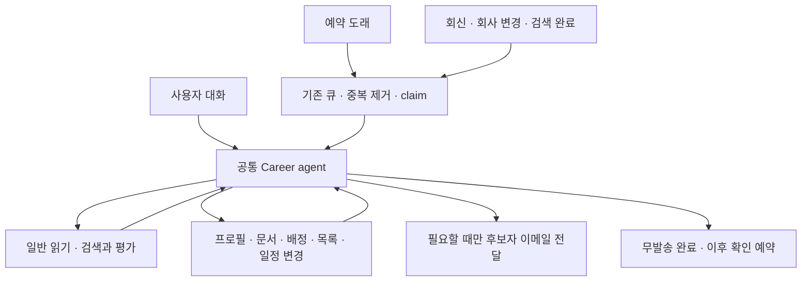

# Career 공통 에이전트 · 내부 지원 · 프로필 버전 · 팔로우 · 예약 · 매칭 구현 계획

문서 기준: 2026-11-02. 최초 로컬 구현 범위와 검증 경계는 21절, 이후 운영 적용 기록은 23절을 따른다. **2026-11-02 일정·Gmail 확장의 DB 변경 2개는 운영에 적용했다. 웹·Worker는 미배포이며 24절 마지막 적용 기록을 따른다.**

조사 기준은 `harper_beta`의 `4a14635e` 위 로컬 작업 트리와 현재 `harper_worker` 작업 트리다. beta 브랜치는 `codex/org-inbox-review-ux`이며 다른 작업의 미커밋 변경이 많다. 초기 설계 조사에서는 운영 코드를 조회하거나 DB·웹·Worker를 변경하지 않았다. 후속 구현은 같은 두 checkout의 로컬 코드와 migration 파일에만 반영했다.

참조 채팅 [할 일 탭 안내 문구 제거](thread://01a186e7-e994-7a42-8d31-ab3b6e7026b9?hostId=local)를 직접 읽고 재검토 때 최신 내용도 확인했다. 그 채팅의 범용 지원 도구·Decisions·handbook 구현은 아래 로컬 코드와 대조했다. 실제 외부 지원서 입력·첨부 일부는 확인됐지만 미리보기·자동 완료 답장 등 확인이 남았고, 지원을 돕는 대화 지침도 수정 중이다. 해당 작업 전체가 검증 완료됐다고 전제하지 않는다. 운영 DB 적용은 repository AGENTS와 해당 채팅에 기록돼 있지만 이 문서 작업에서는 운영 DB를 재확인하지 않았다.

## 1. 이번에 결정하는 것

Career의 원본 LLM이 현재 목적과 사실을 읽고 필요한 도구를 선택한다. 사용자 대화, 예약 시각, 회사 회신, 팔로우한 회사의 변경, 검색 완료는 같은 에이전트를 실행하는 서로 다른 계기다. 질문·자료 작성·검색·추천·연락의 순서를 코드가 고정하지 않는다.

목적은 **사용자가 맡긴 커리어 일을 실제로 진전시키면서, 상황이 바뀌어도 같은 능력으로 이어가는 Harper**다. 도구 개수나 추천·메일 생성량이 성공 기준이 아니다. 설계와 구현은 다음 결과로 판단한다.

- 이미 아는 사실과 준비한 자료를 활용해 사용자의 설명·수정 부담이 줄어든다.
- 도움을 요청한 일은 가능한 범위에서 끝까지 진행한다. 적합성을 평가해 달라는 요청과 지원을 도와달라는 요청의 차이는 원본 LLM이 읽고, 부족한 근거는 유용한 보완으로 연결한다.
- 새 공고가 없거나 지금 연락할 이유가 없으면 불필요한 생성·발송을 하지 않으면서 맡은 지속 업무는 유지한다.
- 사용자에게 현재 기준·자료·추천·예약과 실제 수행 결과가 보이고, 변경·중지·복원이 가능하다.
- 새로운 유사 요청에도 같은 context와 일반 도구를 조합할 수 있다. 사례를 추가할 때마다 새 intent·분기·상태가 필요하면 설계를 수정한다.

아래의 케이스는 이 결과를 확인하는 예시이며 가능한 모든 대화를 열거한 목록이 아니다. 코드에 맡긴 경계는 소유권·공유·실행 무결성이고, 판단의 세부 순서는 평가 사례에서만 확인한다.

1. `apply_to_internal_role`은 정확한 내부 Role을 즉시 평가하고 사용자 검토 목록에 올린다. 낮은 fit 때문에 요청을 막지 않으며, 이 호출 자체는 회사 소개·수락이 아니다.
2. Profile은 기본 프로필과 목적별 프로필, 각 프로필의 변경 이력을 지원한다. 기존 writer를 확장하고 새 별도 작성 LLM은 만들지 않는다.
3. `assign_to_role`은 특정 Role에 사용할 정확한 프로필·문서 버전을 선택한다. 실제 수락 때 전달본을 고정하고 모든 회사 reader가 같은 전달본을 읽는다.
4. 회사 팔로우는 기존 `talent_company_follow`를 확장한다. 회사별 변경 감지와 동일 입력 평가 재사용으로 팔로워별 반복 검색 비용을 줄인다.
5. 일반 일정은 LLM이 조회·수정할 수 있는 실행 약속이다. 고정 3일·6일과 무반응 횟수에 따른 자동 lifecycle 변경을 새 경로에서 제거한다.
6. Opportunity Worker는 기존 큐·lease·복구·실행 슬롯을 유지하되, 최상위 업무 판단을 공통 Career tool loop에 맡긴다. 원본 agent는 대화에 저장된 Text LLM 선택을 공통으로 사용하며, 선택이 없으면 `textChatModelConfig.ts`의 기본 모델·추론 설정을 사용한다.
7. 외부 추천은 기존 batch scoring을 재사용한다. 숨은 검색 계획 LLM·최종 rerank LLM·final writer를 원본 Career LLM의 판단과 도구로 대체한다.
8. 매칭 기준, 검색 실행, 평가, 현재 추천 목록, 사용자 결정은 서로 다른 사실로 관리한다. 현재 목록의 초기화·교체·보관·복원도 최초 구현 범위에 포함한다.

“원본 LLM 1회 호출”은 **도구 왕복과 checkpoint 재개를 포함한 논리 실행 하나**다. provider API 요청 한 번으로 제한하거나, planner → 의사결정기 → 작성기라는 별도 agent 체인을 만드는 뜻이 아니다. 기존 대규모 fit scorer와 재생성 가능한 Behavior Context builder는 전문 계산으로 유지한다. 모든 예약에서 이들을 무조건 실행하지 않는다.

Career의 텍스트 답변은 직접 채팅·버튼 후속 응답·재방문 인사·온보딩 안내·작업 완료 안내·백그라운드 원본 agent에 같은 모델 선택 계약을 적용한다. 브라우저 요청은 Dev Controls 선택을 서버에서 권한 확인하고, 서버 사건은 같은 사용자·대화의 메시지에 저장된 최근 선택을 읽는다. 재개되는 작업은 원래 선택을 유지한다. 실시간 음성 및 검색·평가·선로딩 등 전문 계산의 모델 계약은 별도다.

### 경험을 판단할 세 가지 예시

아래는 가능한 좋은 흐름이며 필수 실행 순서나 도구별 분기가 아니다. 이미 충분한 사실·위임이 있으면 agent는 불필요한 질문을 생략할 수 있다.

**역할에 맞춰 소개 준비하기.** 사용자가 “이 Role로 연결받고 싶어. 내 강점을 잘 보여줄 수 있게 도와줘”라고 한다. Harper는 해당 Role을 평가·검토 목록에 넣고, 공개 설명과 내부 업무 요구·평가를 읽는다. 관련 경험의 근거가 부족하면 “이 역할에서는 프로젝트를 직접 이끈 경험을 더 보여주면 좋겠어요. 맡았던 범위와 결과를 알려주실래요?”처럼 사용자 자신의 경험을 묻고 필요하면 form을 제안한다. 답변을 바탕으로 역할용 프로필과 보충 문서를 만들고 배정한다. 사용자가 “이 버전으로 소개해줘”라고 하면 그 버전을 실제 수락 경로에 연결한다. 낮은 점수 자체나 회사의 비공개 문구를 노출하지 않으며, 준비한 것을 이미 공유했다고 말하지 않는다.

**관심 회사를 계속 살피되 연락할 이유가 있을 때 알리기.** 사용자가 “이 회사에 관심 있어. 새 공고나 중요한 변화가 있으면 알려줘”라고 한다. Harper는 정확한 회사와 실제 감시 source를 확인해 follow한다. 처음에는 기존 활성 공고도 살피고 이후 source·follow·평가 입력이 그대로라면 추가 모델 호출을 하지 않는다. 새 관련 사실이 생기면 기존 평가와 최근 대화에 이어 유용한 행동을 고른다. “지난번 관심 있던 업무와 연결되는 새 역할이 생겼어요. 다만 근무지는 확인이 필요해요”처럼 차이와 미확인 사항을 설명할 수 있다. 일반 재확인은 실제 일정으로 관리하고, 반응이 줄면 사용자 위임 안에서 다음 점검 간격을 조정한다.

**탐색 기준과 현재 추천을 함께 관리하기.** 사용자가 “지금 추천은 정리하고, 이번에는 국내 원격 역할 위주로 보자”라고 한다. Harper는 현재 매칭과 사용자 결정을 읽고, 달라진 기준을 가진 새 매칭에서 검색·평가한다. 도움이 되는 결과를 선택하고 이전 현재 목록을 보관할 수 있다. “이전 추천은 다시 볼 수 있게 남기고, 이번 조건의 결과로 정리했어요. 저장하거나 지원한 공고는 그대로예요”라고 실제 변경을 설명한다. 이후 “같은 조건으로 더 찾아줘”에는 같은 매칭에 누적하고, “이전 후보를 다시 보여줘”에는 당시 결과와 현재 유효성을 구별해 읽거나 복원한다.

## 2. 현재 구현에서 재사용할 것과 실제로 대체할 것

| 확인한 현재 코드 | 현재 의미 | 이번 결정 |
| --- | --- | --- |
| `career/chatTurn.ts`, `agentTurnRuntime.server.ts`, `agentReplyWorker.ts` | 웹·서버 adapter, 논리 reply claim, 정확한 transcript checkpoint와 재개 | 백그라운드용 trusted invocation을 추가하고 같은 실행기 재사용 |
| `career/capabilities/{registry,decisions,runtime}.ts` | 기능 묶음과 Decisions 선로딩, 원본 LLM의 추가 loader | 새 능력만 등록. 별도 intent classifier 추가 없음 |
| `career/handbooks/{registry,runtime}.ts` | `resume`, `application`, 실제 전달 답변 3회 수명 | 기존 두 handbook 확장, 검색·지속 업무 가이드 두 개 추가 |
| `career/forms`, `documents/authoring.ts`, `career/browser`, `career/email` | 일반 form·문서·브라우저·Gmail 도구 | 내부 지원에서도 필요한 조합을 원본 LLM이 선택 |
| `talentOnboarding/tools.ts`의 priority review·재검토 도구 | 점수·보류 상태에 따른 복잡한 접수·재검토·review 진입 | 정확한 Role에 대한 `apply_to_internal_role`로 대체 |
| `opp/matching/worker_inputs.py`, `worker_evaluations.py` | 회사 검색·Opportunity의 공통 1·2차 평가와 입력 fingerprint | 직접 지원과 팔로우 평가도 같은 계산·원장 재사용 |
| `talent_users`와 경력·학력·기타 행 | 현재 프로필을 직접 수정 | 불변 revision 원본을 만들고 기본 프로필의 기존 reader 호환 유지 |
| `org/server.ts`의 후보 상세·공유 이력서 reader | 최신 프로필과 현재 공개 문서를 다시 읽음 | Role별 전달본을 우선하는 공통 material resolver로 전환 |
| `career/companyWatchlist.ts` | ID 기반 회사 상세·follow/unfollow·목록은 존재. Worker의 follow 소비는 확인되지 않음 | 원본 재사용, 이름/URL 검색·실제 변경 감지·평가·agent 사건 연결 추가 |
| `opp/worker.py`, `opp/settings.py` | 고정 점검 주기, active/passive/stopped 자동 변경 | due 일정·실제 사건 실행으로 전환. 명시적 수신 거부는 보존 |
| `externalRecommendationsV2/engine.ts` | 별도 검색계획·scoring·요약·rerank·추천 저장 결합 | retrieval/scoring 실행 능력과 원본 agent의 선정·저장을 분리 |
| `externalRecommendationsV2/daily.ts` | Career 방문 시 별도 추천을 생성·저장 | 방문만으로 자동 발행하는 경로 제거. 필요한 현재 사실만 agent에 제공 |
| `careerSessionData.ts` | negative feedback을 archived로 분류 | agent 보관과 사용자 거절을 별도 사실로 읽기 |

기존 [지속 업무 구현 계획](career-agent-delegated-work-implementation-plan-ko.md)의 “기존 active/passive 정책 유지”와 고정 일일 agent 검토 제안은 이번 범위에서 채택하지 않는다. 이번 문서가 새 연락 주기·Worker 전환의 정본이다. 기존 문서를 운영 구현 근거로 취급하지 않는다.

## 3. 공통 실행 구조



코드는 실제 소유권·동의·현재 자격·정확한 원본·동시 수정·멱등성·재개를 책임진다. 연락할 가치, 질문의 필요성, 프로필 선택, 조건의 의미, 다음 확인 시점은 원본 LLM이 판단한다. 행동 횟수·문장 길이·품질 점수로 실행을 통과시키는 별도 심사기를 만들지 않는다.

### 런타임 배치 결정

새 Python 대화 agent를 만들지 않는다. beta의 서버 전용 background adapter/endpoint와 기존 reply queue가 논리 invocation·tool transcript·continuation을 소유한다. Opportunity scheduler는 due/source 실행을 멱등 접수하고, Python Worker 슬롯은 실제 전문 평가·기존 전달 작업을 수행할 때만 점유한다. 새 endpoint의 인증·run ownership·lease fencing은 서버에서 확인한다.

장기 평가가 필요하면 원본 agent가 정확한 tool call/checkpoint와 평가 job 참조를 저장하고 실행 claim을 반납한다. Python job은 자체 run/lease로 평가를 완료한 뒤 같은 논리 reply ID를 재개한다. 부모의 대기를 완료로 처리하지 않고, 이미 수행한 도구를 다시 실행하지 않는다. 현재 Worker는 같은 사용자의 다른 running run이 있으면 claim을 막으며 평가 writer도 running lease를 요구하므로, 부모를 running으로 둔 채 자식을 기다리는 구조를 그대로 사용해서는 안 된다. 평가 job의 실행 소유권과 논리 agent의 대기를 구분하는 것이 전환 범위다.

HTTP 요청 하나가 긴 tool loop 전체를 붙잡거나 6개 Python 슬롯이 endpoint polling만 하게 하지 않는다. 기존 queue/claim에 기다리는 실행·자식 참조·재개 접수만 연결하고 새 업무 단계별 상태 머신은 만들지 않는다. 실제 외부 작업 완료는 durable 저장 후 continuation을 접수하며, 그 사이 실패도 같은 결과 참조로 복구한다.

## 4. 최종 도구와 capability 구성

도구 인자는 아래 책임을 표현할 최소 계약이다. 실제 camel/snake 표기는 기존 정본에 맞춘다. 자유로운 목적·기준·관심사를 enum으로 분류하지 않는다.

| capability | 노출 도구 | 결정 |
| --- | --- | --- |
| core | `read_talent_context`, `write_talent_context`, `update_setting`, `update_language_setting`, `load_career_capabilities`, `load_handbook` | 기존 유지. Brief/Memory와 설정을 새 저장소에 복제하지 않음 |
| profile | `list_profiles`, `read_profile`, `update_talent_profile` | 기존 capability ID 유지. 읽기 두 개 추가, 기존 writer를 버전·복사·기본값 관리로 확장 |
| internal_roles | `apply_to_internal_role`, `assign_to_role`, `get_internal_roles`, `get_role_context`, `update_recommended_opportunity_feedback` | 기존 조회·실제 결정 경계를 활용. priority·재검토 전용 도구 제거 |
| matching | `list_matchings`, `read_matching`, `upsert_matching`, `search_opportunities`, `upsert_opportunities` | 탐색 묶음 관리·검색/평가·사용자 목록 반영 분리 |
| opportunities | `get_role_context`, `read_recommended_opportunities`, `save_job_posting` | 공통 상세·관계·URL 가져오기 재사용. matching 목록 조회와 내용 중복을 줄임 |
| companies | `search_companies`, `follow_company` | 기존 회사 원본·follow 기능을 tool로 연결하고 감시 범위 명확화 |
| schedules | `list_schedules`, `read_schedule`, `upsert_schedule` | 생성·변경·일시중지·재개·취소 모두 지원 |
| career_delivery | `deliver_career_email` | Harper가 현재 후보자에게 보내는 이메일. background에만 기본 제공 |
| documents / forms | `list_documents`, `read_document`, `upsert_document`, `suggest_form` | 기존 범용 도구 재사용 |
| company_contact | `read_company_connections`, `contact_company` | 실제 연결된 회사에 승인된 연락 전달 |
| web_research / browser / email_writing | `web_search`, `open_url`, `use_browser`, `write_email` | 기존 채널·계정 권한을 유지 |
| connected_inbox / activity_history / career_coaching | 기존 도구 | 필요한 맥락을 일반 reader로 확장 |

같은 도구가 두 묶음에서 발견돼도 provider schema는 한 번만 노출한다. 내부 Role 조회와 일반 공고 상세를 이번에 모두 재명명하지 않는다. `read_matching`은 매칭의 평가·목록·실행을, 기존 Role reader는 단일 공고 원문과 실제 관계를 맡는다. `upsert_matching`은 사용자가 실제로 이어가거나 보관할 탐색 묶음 자체를 관리하는 능력이며 agent의 중간 사고를 저장하는 도구가 아니다. 도구 수를 줄이려고 무관한 side effect를 거대한 `manage_everything` 도구로 합치지 않는다.

### 제거·축소할 기존 surface

- `internal_role_priority_review`, `record_internal_fit_reevaluation_information`, `request_internal_role_reconsideration` 및 이들에 종속된 pending 질문·재검토 전용 노출 조건을 신규 실행에서 제거한다. 실제 현재 registry와 숨은 dispatch 분기도 함께 정리한다.
- `update_recommended_opportunity_feedback`의 `review`는 `apply_to_internal_role`에 흡수한다. like/dislike/keep 등 실제 사용자 결정은 보존한다. 일반 추천 수락과 회사 Request Intro 수락의 직접 전환 계약을 임의로 합치지 않는다.
- `recommend_job_postings`를 `search_opportunities`와 `upsert_opportunities`로 대체한다. `instant/bulk`, 목표 개수 채우기, 별도 `answerDraft`/최종 추천 답변 작성기 계약을 제거한다.
- 기존 웹 방문 daily producer, feedback/reengagement 전용 tool preset, Worker final-delivery 분기가 신규 추천을 우회 발행하지 않게 전환한다.
- 참조 채팅에서 이미 제거한 지원 전용 6개 도구와 apply mode를 다시 도입하지 않는다.

## 5. apply_to_internal_role: 요청한 Role을 실제 검토 가능하게 한다

### 입력과 효과

입력은 정확한 `roleId`만 받는다. 이 Role의 현재 assignment에 지정된 프로필 버전, 없으면 현재 기본 프로필로 평가하며 어떤 버전을 평가했는지 결과에 명시한다.

이 도구는 사용자가 특정 Role의 검토·지원·연결을 요청한 경우의 단축 능력이다. 팔로우·예약의 자발적 추천이 이 도구로 사용자 지원 요청 출처를 만들지는 않는다. 자발적 추천은 공통 검색/평가 결과와 `upsert_opportunities`를 사용하고, 추천 저장 executor는 두 경로가 공유한다.

1. 실제 internal Role인지, 활성·만료·소유권·회사 차단·공유 설정·test-only 자격을 확인한다. 기존 제품의 명시적 설정과 Role별 동의 예외를 그대로 따르고 새로운 의미 gate를 추가하지 않는다.
2. 공통 evaluator의 현재 입력 fingerprint에 맞는 완료된 1·2차 평가가 있으면 재사용한다. 과거 입력 점수는 과거 평가로 표시한다.
3. 평가가 없거나 선택한 프로필/역할 기준이 달라졌으면 같은 입력 builder·rubric·model·평가 원장으로 필요한 평가를 즉시 시작한다. 직접 요청에는 **1차의 의미상 낮은 fit도 2차 실행을 막지 않는다.** 실제 실행 불가 자격과 평가 점수는 별개다.
4. 성공한 결과를 바탕으로 같은 사용자×Role의 검토용 추천을 만들거나 기존 추천을 재사용한다. 낮은 점수는 이 사용자 요청의 추천 등록을 차단하지 않는다.
5. 원본 LLM에 실제 추천 생성/재사용 사실과 평가를 반환한다. 사용자가 소개를 원하면 기존 버튼이나 대화의 명시적 수락으로 진행할 수 있다.

도구 내부의 위 절차는 하나의 외부 능력을 실행하기 위한 데이터 처리다. 이후 반드시 질문→폼→프로필 수정→배정→수락 순서로 진행시키지는 않는다. 이미 충분한 자료가 있으면 그대로 이어갈 수 있다.

미추천 Role을 알아보기 위해 먼저 apply해야 하는 구조도 제거한다. `get_internal_roles`와 `get_role_context`의 hold·priority·기존 추천 존재에 따른 의미 gate를 정리하고, 현재 조회 가능한 Role의 공개 상세·내부 판단용 요구·실제 추천/연결 관계를 구분해 읽는다. 실제 비공개 Role 접근·회사 차단·test-only 경계는 유지한다. 조회만 한 것을 추천·지원·공유로 기록하지 않는다.

평가는 기존 `opportunity_discovery_run`에 직접 사용자 요청 출처를 연결해 소유권·lease·사용량·멱등성을 보존한다. 회사 검색 실행인 척 기록하지 않는다. 큐/실행시간 때문에 끝나지 못했다면 pending run과 재개 경로를 돌려주며, 평가·추천이 끝났다고 말하지 않는다. 완료는 같은 논리 작업에 돌아온다.

평가 중 Role이 닫히거나 실제 접근·공유 자격이 바뀌면 추천 등록·수락·전달 각각의 실행 경계에서 현재 자격을 확인한다. 이미 끝난 평가는 당시 사실로 보존하되 현재 실행 가능함의 증거로 쓰지 않는다. 평가 실패를 낮은 fit으로 취급하지 않으며, 프로필 저장까지 성공하고 배정이 실패한 경우도 각각의 실제 결과를 이어서 복구한다.

### 점수와 비공개 정보

사용자의 요청대로 fit 수치·라벨은 원본 Career LLM의 판단 자료로 제공하며 후보자 화면·메일·공유 문서에 직접 노출하지 않는 지침을 둔다. 다만 점수만으로 회사의 구체적인 거절 이유나 비공개 요구를 역추정하지 않는다.

현재 공통 Decisions 평가는 점수·라벨·분포를 반환하며 상세 서술 근거를 작성하지 않는다. 따라서 도구 결과에 존재하지 않는 “평가 당시 이유”나 “회사에서 실제로 요청한 질문”을 만들어 붙이지 않는다. 점수와 별도로, 해당 Role의 관련 업무 요구·평가 기준은 원본과 출처를 가진 내부 판단 자료로 제공한다.

원본 Career LLM은 공개 Role 설명, 해당 Role의 관련 비공개 업무 요구, 사용자의 프로필·답변을 함께 읽고 유용한 질문을 작성한다. 현재 `get_role_context`의 reasoning-only `internalRequest` 계약을 확장하되 불필요한 전체 Brief·다른 후보 정보·회사 개인메모를 덤프하지 않는다. 공개 사실과 내부 판단용 요구를 구분한 전용 projection을 사용한다. 회사가 미리 공개 질문을 작성해야만 코칭할 수 있게 만들지 않는다. 내부 요구를 그대로 전달하거나 비공개 문구를 인용하지 않고 사용자의 관련 경험과 근거를 묻는 것은 원본 LLM의 판단으로 처리한다. 별도 질문 생성·점수 해설 LLM은 추가하지 않는다.

비공개 점수를 원본 LLM에 제공하는 이상 “절대 언급하지 않음”은 prompt·실제 모델 검증으로 다루는 경계이지 수학적 보장이 아니다. 출력 키워드 검사·정규식 삭제·두 번째 검열 LLM으로 가리지 않는다. 질문·프로필 개선의 유용성과 비공개 정보 비노출을 함께 검증한다.

점수는 어떤 근거를 보완하면 도움이 되는지 판단하는 자료다. 지원 도움을 요청한 사용자에게 점수만으로 부적합 판정·재확인을 반복하는 절차를 만들지 않는다. 적합성 평가를 요청한 경우에는 근거와 차이를 설명할 수 있고, 실제 선택이 필요한 경우에는 질문할 수 있다. 두 경우의 판단과 표현은 원본 agent에 맡긴다.

### 재호출과 수락

- 같은 요청의 재시도는 같은 실행·추천을 반환한다. 설명만 바꾸려고 평가를 반복하지 않는다.
- 새로 확인된 사실로 프로필 revision을 바꾼 뒤 재호출하면 그 입력으로 평가할 수 있다. 별도 “재검토 신청 상태”는 필요 없다.
- apply는 프로필 선택 입력을 받지 않고 현재 assignment, 없으면 기본 프로필로 평가한다. 결과에는 평가한 버전과 현재 준비 자료가 표시되며, 이 호출이 assignment를 변경하지 않는다.
- apply/프로필 작성/assignment는 수락·프로필 공유를 대신하지 않는다. 첫 검토 추천 이후 사용자의 명시적 수락을 기존 실행 경로가 처리한다.
- 이미 수락·거절·연결된 관계라면 사실을 반환한다. 과거 거절을 조용히 지우거나 종료된 연결을 새로 만들지 않는다. 사용자의 새 요청에 따른 결정 변경은 기존 명시적 결정 도구로 처리한다.

## 6. 프로필의 여러 버전과 변경 이력

### 이름과 원본

`profile_id`는 하나의 프로필 정체성이고 `revision`은 그 프로필의 불변 저장본이다. “기본 프로필”, “A사 연구 역할용”처럼 여러 프로필이 존재할 수 있고 각각 수정 이력이 남는다. 버전 목록과 프로필 종류를 하나의 증가 번호로 혼동하지 않는다.

기본 프로필은 일반 탐색과 사용자의 기본 경력을 나타낸다. 역할용 복사본은 그 역할에 보여줄 표현·순서·강조점을 담는다. 역할용 프로필 생성·선택은 기본 Profile, Search Brief, Memory, 다른 회사의 전달본을 자동으로 바꾸지 않는다. 새 답변에 기본 경력에도 반영할 사실이 있으면 원본 LLM이 별도로 기존 공통 writer를 사용한다.

### 도구 계약

| 도구 | 입력 | 결과/효과 |
| --- | --- | --- |
| `list_profiles` | 조회어·기본/보관 범위·cursor | ID·제목·목적·최신 revision·기본 여부·관련 Role의 짧은 목록 |
| `read_profile` | profile ID, 선택적 revision·비교할 revision·구획 | 정확한 저장본, 선택한 이전 버전, 구조적 변경 내역, 원문 근거 참조 |
| `update_talent_profile` | create/copy/update/set_default/archive/restore, 대상 ID·기대 revision·내용/변경 | 원본 LLM이 작성한 내용을 저장, 새 revision 및 실제 변화 반환 |

별도 `generate_profile`, `improve_profile`, `review_profile` LLM 도구는 만들지 않는다. 기존 프로필 writer의 read 동작은 `read_profile`로 옮겨 효과를 명확하게 한다. 제안이나 질문은 `suggest_form`, 보충 자료는 `upsert_document`를 사용한다.

### 저장과 기존 reader 호환

프로필 identity와 불변 revision 저장소는 필요하다. 실제 보존할 사실은 **각 시점의 전체 표현, 사용자가 선택한 기본 프로필, 과거 전달 시 사용한 exact revision**이다. activity 요약만으로 재구성하지 않는다.

- `talent_profiles`: 소유자·제목·목적·현재 revision·보관 여부. 기본 선택은 사용자별 pointer로 관리한다.
- `talent_profile_revisions`: 전체 프로필 snapshot, 작성 출처, 기반 profile/revision, 기존 경력·학력·기타 원본 ref, 생성 시각.
- revision 저장소를 원본으로 삼고 기존 `talent_users`와 경력·학력·기타 행은 기본 프로필의 호환 projection으로 유지한다. 두 독립 writer가 서로 동기화하는 구조를 만들지 않는다.
- UI 직접 수정·온보딩·문서 import·음성·이메일·일반 도구의 모든 프로필 writer가 동일한 atomic 저장 경계를 사용한다. revision 생성과 기본 projection 갱신은 같은 transaction으로 처리한다.
- 기본 프로필 변경은 기존 매칭 입력을 dirty로 만들 수 있지만 사용자별 모든 공고를 즉시 전량 재평가하지 않는다. 필요한 실행이 최신 입력으로 평가하고 과거 점수임을 구별한다.
- 역할용 프로필 수정은 그 Role에서 선택한 입력과 향후 배정에만 영향을 준다. 과거 assignment와 전달본은 자동 최신화하지 않는다.
- 기본 프로필 보관은 대체 기본값을 같은 변경에서 선택하거나 기본 선택을 유지한 채 보관 미적용 사실을 반환한다. 서버가 임의의 다른 프로필을 기본값으로 고르지 않는다. 보관·기본값 변경은 과거 전달본 삭제가 아니다.
- 이관은 현재 프로필로 첫 snapshot을 만든다. 확인할 수 없는 과거 버전을 만들어내지 않는다. 기존 원문·row ID·참조는 손실 없이 보존한다.

## 7. assign_to_role: 준비 자료와 전달 자료를 끝까지 연결한다

### 배정 계약

`assign_to_role`은 `role_id`, `action=set/read/clear`, 정확한 `profile_id/revision`, `document_id/revision` 목록과 assignment의 기대 revision을 받는다. set은 전달할 자료 묶음 전체를 명시적으로 선택하고 read는 현재 선택과 과거 전달 참조를 보여준다. clear는 현재 준비 선택을 해제하는 새 revision이며 과거 material을 삭제하지 않는다.

대부분의 보충 내용은 기존 document로 작성한다. 소개문, 프로젝트 설명, 포트폴리오 해설을 위한 새 종류별 도구나 테이블을 만들지 않는다. 문서의 원본/생성 여부·PDF/다운로드 실제 준비 상태는 기존 문서 계약으로 확인한다.

프로필은 실제 회사 후보 카드의 본체이므로 문서만 배정한 경우에도 그 저장 transaction에서 기본 profile ID와 exact revision까지 함께 고정하고 결과에 표시한다. 선택된 문서를 회사 하나에 전달하는 것은 전역 `is_public=true`로 바꾸는 일이 아니다.

### 실제 수락 시점의 전달본

기존 후보자 수락/회사 Intro 수락 transaction에서 Role별 선택을 읽어 **불변 sharing pack**을 고정한다. pack에는 정확한 프로필 snapshot/revision, 문서 revision·당시 내용/파일 object, 사용자 승인 원문 참조, 대상 Role·회사·추천/Intro 참조가 들어간다. 선택이 없다면 이 시점의 기본 프로필 revision과 기존 승인된 공유 계약을 snapshot으로 사용한다.

기존 assignment가 있으면 버튼과 대화 수락은 사용자의 위임이 가리킨 exact material ID·assignment revision을 전달하고 같은 transaction에서 pin한다. 선택 없이 기본 프로필로 소개하도록 위임한 경우에는 수락 transaction에서 기본 프로필 revision을 읽어 material을 생성·고정한다. 사용자가 특정 버전을 지정했다면 그 exact revision을 사용한다. 사용자가 선택한 자료와 현재 assignment가 실제로 달라졌다면 최신본으로 조용히 치환하지 않고 현재 사실을 반환한다. 단순 추천 행의 unrelated `updated_at` 변경을 이유로 다시 막거나 모든 수락에 새 확인 질문을 강제하지 않는다.

문서가 revision별 불변 본문·파일을 아직 제공하지 않는 경로는 **assignment를 저장할 때** 선택한 내용과 이미 존재하는 파일 object를 material revision에 고정한다. 아직 PDF가 없다면 그 사실을 보존하고 이후 렌더링도 고정 본문에서 수행한다. 수락은 해당 exact material revision을 pin하고 전달 실행기는 이미 고정된 pack만 사용한다. 문서 ID만 남기고 나중에 최신 본문을 읽어서는 안 된다. private 문서 URL을 전역 공개 링크로 바꾸지 않고 해당 pair의 회사 권한으로 접근시킨다.

전달본의 열람·PDF 생성은 mutable 문서 reader가 아니라 material snapshot reader를 사용한다. 최초 파일 생성 시 material ID·본문 hash·renderer version·파일 object/hash를 연결한다. 동일 전달의 재시도·다운로드는 완성된 같은 파일을 재사용한다. 현재 원본 문서의 revision·global 공개 여부·soft delete로 이미 승인된 전달본을 다른 내용으로 바꾸거나 없다고 처리하지 않는다. 실제 공유 철회·계정 삭제·현재 회사 접근 권한은 별도 실행 경계로 확인한다.

수락 후 실제 전환은 기존 경로를 구별해 보존한다. 일반 추천 수락은 동의를 기록하고 짧은 지연 뒤 기존 실행기가 회사 소개를 준비·전달한다. 회사가 먼저 보낸 Request Intro의 후보자 수락은 기존 즉시 CC 연결 경로에서 고정 pack을 사용한다. 둘 사이에 별도 Harper 팀원 승인을 추가하지 않는다. 수락 기록, 전달본 확정, 회사 소개 전달, 회사 열람·응답은 각각 실제 사실로 구별한다.

### 반드시 바꿀 downstream

1. 회사 후보 상세와 프로필 drawer.
2. company-side LLM의 `read_talent`, 후보 목록·상세 projection.
3. 회사에 소개하는 Slack·이메일 작성 입력과 실제 첨부.
4. 공유된 이력서/문서의 웹 열람·다운로드 endpoint.
5. Intro·연결 이력과 재전달/재시도 reader.

공통 `resolveRoleSharedMaterials`와 같은 서버 resolver 하나가 pair의 전달본과 접근 범위를 결정하게 한다. 후보자 ID만으로 여러 Role을 읽는 회사 reader는 정확한 Role/pair를 선택하거나 Role별 pack 참조를 구분해서 반환한다. A사에 맞춘 자료가 B사 또는 같은 회사의 다른 Role에서 기본 프로필처럼 노출되지 않게 한다.

회사 선추천에서 이미 허용된 기본 프로필 검토와, 이후 후보자가 선택한 자료의 전달도 구분한다. 후보자가 아직 공유하지 않은 역할용 프로필은 회사측 기본 검색에 자동 노출하지 않는다.

이 구분은 프로필 본문뿐 아니라 **평가 점수와 선정 입력에도 적용**한다. 평가 행과 재사용 참조에 실제 profile/revision 또는 material revision을 남긴다. 회사측 평가 조회·현재 점수 선택·추천 발행은 그 회사와 Role에서 접근 가능한 기본 프로필 또는 전달본에 근거한 평가만 사용한다. 현재 일부 reader는 Role·talent·Brief별 최신 평가를 선택하므로 이 reader도 함께 변경한다. 동일 입력 cache 재사용과 결과를 읽을 공유 권한은 별개다.

전달 후 assignment 변경은 다음 공유를 위한 준비다. 이미 전달된 자료를 수정하려면 그 변경에 대한 사용자 위임 아래 새 pack을 전달하고 이전 전달 사실을 보존한다. 기존 공유 자료의 회수·계정 삭제는 별도 권한 계약이며 archive나 프로필 기본값 변경으로 대신하지 않는다.

이미 수락에 pin된 pack은 아직 미발송이어도 clear·프로필 archive·기본값 변경으로 바뀌지 않는다. 소개 중단 요청은 기존 Role 결정/전달 취소 경로에서 처리하고, 전달 실행기는 최신 취소·공유 권한을 확인한다. 자료를 정리하는 것과 소개를 취소하는 것을 혼동하지 않는다.

## 8. 회사 검색과 팔로우: 공유 감지, 개인 평가, 연락 판단

### 기존 회사 identity를 재사용한다

`talent_company_follow`에는 `company_db_id`와 nullable `company_workspace_id`가 이미 있다. 현재 `companyWatchlist.ts`의 대표 workspace 선택은 표시용 heuristic이며 실제 감시 범위를 결정하는 근거로 사용하지 않는다. 한 company DB 아래 여러 workspace가 연결될 수 있다.

| 도구 | 계약 |
| --- | --- |
| `search_companies` | 이름·홈페이지·LinkedIn URL로 저장 identity 검색. 정확한 company/workspace ID, 도메인, 실제 수집 범위, 모호한 매핑을 반환 |
| `follow_company` | `action=list`로 follow의 현재 상태·관심 목적·감시 범위·revision을 조회하며 `include_unfollowed`로 해제 이력, `offset`으로 다음 페이지를 읽음. `follow/update/unfollow`로 검색에서 확인한 정확한 회사/workspace ID와 자유 관심 맥락을 저장·변경 |

기존 company_db 단위 follow는 연결된 검증된 workspace 전체라는 범위를 유지한다. 사용자가 특정 workspace를 지정하면 그 범위로 저장한다. workspace-only 회사도 지원하도록 기존 identity 계약을 확장한다. 동명이인·모회사·계열사를 이름 유사도로 합치거나 기존 follow를 임의의 workspace 하나로 축소하지 않는다.

follow 원본의 identity/범위·소유권·중복 방지만 구조적으로 검증한다. 회사에 프로필을 공개하거나 지원·연락을 승인하는 효과는 없다. 수집 원본이 없는 회사는 외부 채용 source를 등록할 수 있는 일반 수집 경로와 연결하고, 실제 수집 준비 여부를 반환한다. 이름만 저장하고 추적 중이라고 안내하지 않는다.

follow의 중복 식별은 owner+정확한 회사 identity+감시 범위다. 신규 생성 응답이 유실되면 같은 원본 tool operation ID로 같은 follow를 반환한다. 회사 전체 follow와 특정 workspace follow가 겹쳐도 같은 사용자×Role의 평가와 같은 source 사건은 한 번만 접수하고, 어떤 follow에서 발견했는지는 보존한다. 관심 내용의 자연어 유사도로 사용자의 서로 다른 요청을 합치지 않는다.

### 일일 점검의 실제 비용 구조

1. 기존 수집기가 회사 공고를 갱신한다. 공유 scanner가 새/변경/종료 Role과 source revision을 읽는다. 신규·재개 follow와 사용자 Profile/Brief/Behavior 입력 변경도 같은 점검의 계기로 접수한다. 이 감지 단계에는 LLM이 없다.
2. 해당 회사의 활성 follow를 연결하고 사용자×Role의 평가 입력 fingerprint를 비교한다. 처음 follow한 회사의 기존 활성 공고와 회사 source가 그대로여도 사용자 입력이 달라진 pair를 함께 처리한다. dirty 입력은 합쳐 실제 재평가가 필요한 시점에 소비하며 사용자 전체 공고를 매 수정마다 동기 재계산하지 않는다.
3. 변하지 않은 성공 평가는 재사용한다. 새/변경 입력만 공통 내부 1·2차 또는 외부 batch scorer로 평가한다. 같은 사용자의 Brief·Behavior는 한 번 준비해 batch에서 재사용한다.
4. 새 평가와 원본 agent가 아직 처리하지 않은 관련 사실을 사용자의 pending 실행에 합친다. 평가의 현재 자격·추천 가능 사실은 제공하지만, 임의 새 점수선을 만들어 연락을 강제하지 않는다.
5. 원본 Career LLM이 현재 추천과 비교해 추가·재검토·질문·연락·이번 무발송을 선택한다. 기존 평가 중 나머지 후보도 일반 reader에서 확인할 수 있다.

매일 회사 데이터를 검사하는 것과 팔로워마다 매일 검색·scoring·대화 LLM을 실행하는 것은 다르다. **회사 source·follow·평가 입력이 모두 그대로인 점검에서 발생하는 추가 모델 호출은 0회**가 목표다. 사용자 본인이 특정 시각의 확인을 요청한 일정은 변경이 없어도 실행한다.

### 뉴스와 중요한 변화

채용 추적과 회사 뉴스 추적의 실제 지원 범위를 따로 반환한다. 기존 follow 저장 문구에 펀딩·Founder 글이 등장한다는 이유로 해당 수집기가 있다고 가정하지 않는다.

뉴스도 이번 설계에 포함하되 회사별 공용 수집 adapter로 구현한다. 공식 회사/채용 페이지·연결된 공공 소스·필요한 공용 검색 결과를 회사별 한 번 수집하고 URL/source revision으로 중복을 제거한다. 수집 주기·provider 호출은 회사 단위로 공유하며 팔로워 수만큼 Google 검색을 반복하지 않는다. 자유 관심 맥락은 원본 Career LLM이 읽는다.

“중요한 변화” 여부를 제목 키워드나 기사 점수로 결정하지 않는다. 공유 source의 새 사실은 아래의 사건 접수 계약으로 모으고 원본 agent가 알릴 가치를 판단한다. 실제 수집기가 준비된 범위만 활성화한다. 데이터가 없는 범위는 미지원/준비 중으로 정확히 표시하며, 임의의 매일 개인 검색 schedule을 몰래 추가하지 않는다.

source 확인·평가 완료·목록 반영·메일 발송은 서로 다른 cursor/실행 사실이다. source watermark는 durable enqueue 뒤에 이동하고 실패를 “변화 없음”으로 처리하지 않는다. unfollow 후 남은 작업은 현재 follow를 재확인해 신규 알림을 중단하되 과거 추천과 전달 이력은 보존한다.

## 9. 일반 일정과 agent가 관리하는 연락 주기

### 일정은 미래 실행 약속이다

| 도구 | 입력과 반환 |
| --- | --- |
| `list_schedules` | 현재·중지·종료 범위와 cursor. 제목·다음 실행·시간대·마지막 실제 실행의 짧은 색인 |
| `read_schedule` | schedule ID. 원래 사용자 위임, 자유 instruction, 관련 대상, 반복 규칙, revision, 최근 occurrence와 결과 |
| `upsert_schedule` | 생성/수정/일시중지/재개/취소, ID·기대 revision, 제목·instruction·시간대·다음 실행·필요한 반복 규칙·관련 참조 |

`talent_agent_schedules`는 새 원본으로 둔다. 보존할 사실은 **사용자가 또는 agent가 맡긴 미래 시각·목적·반복 약속·현재 취소 여부**이며, scheduler와 사용자 일정 UI가 읽는다. 대화 요약만으로 정확한 due 조회와 취소를 수행할 수 없으므로 저장소가 정당하다.

최소 필드는 owner, ID, 자유 title/instruction, 원본 메시지/대화, 관련 Role/company/matching ref, timezone, next_run_at, 반복 위임이 있을 때 recurrence, 실행 가능 상태·revision, 최근 run 참조다. 반복 위임에는 “계속 살펴줘”를 받아 agent가 정한 간격도 포함한다. 작업의 의미를 취업 단계·감정·의도 enum으로 분해하지 않는다.

- 일반 Harper 재확인은 지속 위임을 받은 agent가 선택한 간격·반복 규칙을 일정 하나에 저장한다. executor는 그 규칙으로 다음 occurrence를 계산하고 agent는 필요할 때 간격을 바꾸거나 pause한다. 무발송 또는 이번 실행에서 일정 도구를 쓰지 않았다는 이유로 다음 점검이 사라지지 않는다. 코드에 기본 3일/6일을 넣거나 매 실행마다 같은 일을 새 일정으로 만들지 않는다.
- “매주 월요일 9시”처럼 사용자가 고정 반복을 지정한 경우 recurrence를 실행기가 계산한다. 사용자가 정한 반복을 agent가 무반응만 보고 조용히 바꾸지 않는다.
- “다음 달 중순 다시 확인”과 같은 일회성 일정은 한 번 실행한 뒤 완료한다. 계속 확인할 필요가 있으면 원본 위임 범위에서 agent가 새 다음 시점을 정한다.
- 시간대·DST·과거 시각의 처리 결과를 정확히 반환한다. 서버 시간대를 사용자 시간대로 추측하지 않는다. 밀린 동일 반복 회차는 재시작 때 한꺼번에 메일 여러 개로 따라잡지 않고 missed occurrence와 실제 실행을 구분한다.
- 현재 occurrence는 시작 시점의 정확한 snapshot/ID로 고정한다. agent가 다음 `next_run_at`을 갱신하는 것은 다음 회차에 적용하며 현재 occurrence를 취소하지 않는다. 명시 취소나 현재 위임 변경은 영향을 받는 미시작 occurrence를 무효화하고 실행 중 occurrence의 아직 수행하지 않은 side effect를 중단·재판단하게 한다. 일정 revision 하나가 바뀌었다는 이유만으로 모든 현재 실행을 취소하지 않는다.
- 일정의 instruction은 업무 맥락이며 새로운 공유·지원·발송 동의를 만들어내지 않는다. 원래 위임과 최신 정정을 함께 읽는다.

신규 일정 생성도 원본 tool operation ID로 멱등 처리해 응답 유실 시 같은 schedule ID를 반환한다. 비슷한 문장이라는 이유로 두 일정을 자동 합치지 않는다. 사용자가 기존 일을 수정하는지 새 일을 맡기는지는 원본 agent가 현재 목록과 대화로 판단한다. 하나의 occurrence는 무발송이어도 한 번만 완료하며 실패 재시도는 같은 occurrence로 남는다. 일회성 일정은 완료 후 자동으로 반복되지 않는다.

### lifecycle 대체

새 경로에서 `worker.py`의 무반응 발송 수에 따른 active→passive→stopped 전환, 반응 시 고정 복귀, passive 간격 두 배와 batch 크기 조정을 제거한다. 원본 agent에는 최근 연락·사용자 답변·현재 위임·진행 중인 일·실제 수신 설정을 제공한다. agent가 다음 점검 시점을 결정하고 필요하면 기존 일정을 수정한다.

프롬프트는 무반응을 관심 없음이나 거절의 증거로 확정하지 않도록 하고, 현재 할 일이 부족하면 이후 확인을 늦출 수 있게 한다. “3회 무응답이면 2주”와 같은 새 표를 만들지 않는다. 상황에 따라 이번에는 메일을 보내지 않고 다음 점검만 남길 수 있다.

연락·공유 제한은 실제 적용 범위를 그대로 지킨다. agent가 연락 간격을 늘리는 것과 사용자 설정을 stopped로 바꾸는 것은 다르다. 이관 과정에서 과거 자동 stopped 계정의 외부 추천을 근거 없이 재활성화하지 않는다. 동시에 stopped를 새 전체 연락 차단으로 확대하지 않는다.

| 현재 원본 | 새 경로가 보존할 범위 |
| --- | --- |
| `talent_setting.status=stopped` | 기존 주기적 외부 추천 중단. 내부 제안·기존 연결·사용자가 따로 맡긴 일정까지 일괄 차단하는 값이 아님 |
| `get_external_recommendation` | 기존 외부 추천 수신 선택. 내부 공개·기존 공유 이력과 별개 |
| `profile_visibility` / 회사별 차단 | 실제 신규 내부 노출·공유 경계. 기존 소개·결정을 삭제하거나 자동 거절하지 않음 |
| 실제 이메일 unsubscribe·채널 수신 설정 | 해당 채널과 통지 종류의 발송 자격. 위의 추천 상태와 임의로 동일시하지 않음 |
| 일정 pause/cancel·사용자 최신 철회 | 해당 위임과 occurrence의 실행 범위. 다른 회사·검색·일정을 자동 종료하지 않음 |

새 위임이 기존 설정과 실제로 충돌할 때는 현재 범위를 원본 agent가 확인해 필요한 설정 변경 또는 설명으로 이어간다. 모호한 상태 하나를 모든 작업의 gate로 쓰지 않는다.

온보딩 완료 사건은 기존 초기 검색 producer를 **대체**한다. `opportunityDiscovery/store.ts`와 legacy 이메일의 완료→초기 run→고정 추천 수→검색 시작 메일 경로를 공통 invocation으로 연결하고 동일 completion 원본으로 중복 접수와 저장 후 접수 실패를 복구한다. 검색이 실제 시작되기 전에 별도 고정 시작 메일을 발송하지 않는다. 원본 agent가 필요한 초기 탐색과 다음 지속 점검을 정한다. 온보딩 내부 extraction·checklist·질문 진행은 유지한다.

## 10. 백그라운드 실행과 후보자 이메일

### 작은 현재 context

기본 입력에는 다음 중 이번 실행에 관련된 사실만 제공한다.

- 실행 계기와 정확한 schedule/event/run 참조, 이번에 새로 확인된 사실과 확인 시점.
- 원래 맡긴 목적·최신 수정/취소·최근 대화와 실제 수신/공유 범위.
- 기본 Profile ID/revision, 전체 현재 Search Brief, 필요한 Memory의 작은 색인.
- 현재 매칭의 짧은 기준·추천·실행 색인, 관련 Role의 실제 결정·assignment·전달 상태.
- 관련 follow·일정과 이전 실행의 실제 완료·미완료·이미 전달한 내용.

기본 context를 만들면서 기존 `current_state`의 전체 검색·선정·Behavior 재생성을 무조건 실행하지 않는다. Profile 전체·모든 Memory·모든 과거 추천·메일을 매번 주입하지 않는다. 추천 scorer는 실행에서 확정한 전체 Profile·적용 Brief·Behavior snapshot을 모든 batch/단계에 재사용한다. 과거 matching을 이어가는 경우 적용할 Brief는 아래의 완전한 matching snapshot이며 최신 전역 Brief를 조용히 끼워 넣지 않는다. Behavior는 기존 사용자별 cache를 필요한 때만 갱신한다.

사건은 서버가 확인한 사실로 넣고 가짜 사용자 발화로 저장하지 않는다. 현재 adapter의 `sourceMessage` 가정은 trusted invocation `{kind, sourceRefs, purpose}`를 지원하도록 일반화한다. 과거 사용자 메시지를 새 승인의 원문처럼 재사용하지 않는다.

background invocation도 시작 시 실제 관련 대화의 사용자 메시지 cursor를 기록하고, 재개할 때 그 뒤의 사용자 원문과 이미 수행된 변경을 읽는다. 현재 `readCareerContinuationUserContext`는 `sourceMessage`가 없으면 읽기를 생략하므로 이 계약에 맞게 확장한다. 대화 source가 없다는 이유로 최신 철회·정정을 놓치지 않으며, 형식만 맞추려고 가짜 사용자 메시지를 만들지 않는다.

### 최종 작성·전달 도구

`deliver_career_email`의 입력은 subject, Markdown body, 실제 관련 자료/공고/폼 링크, 현재 실행 참조다. 수신자와 발신 identity는 서버가 현재 후보자로 고정한다. 원본 LLM이 최종 본문을 직접 작성한다.

- 백그라운드의 중간 assistant 텍스트는 원본 trace에만 남고 사용자 채팅·메일에 출력하지 않는다.
- 메일을 보내려면 이 도구를 사용한다. 도구를 호출하지 않고 끝낸 실행은 정상적인 무발송 완료다. 필요하면 다음 확인 일정만 저장할 수 있다.
- 저장된 form/문서를 이메일에서 직접 interactive card로 렌더링하지 않는다. 실제 Career 접근 링크를 사용한다.
- 연결된 사용자 Gmail의 `write_email`과 분리한다. Harper 알림을 위해 사용자 Gmail 연결을 요구하거나 사용자의 주소로 임의 발송하지 않는다.
- 최종 답변 텍스트를 별도 writer LLM에 다시 넘기지 않는다. 언어/문체를 검사해 숨은 재작성을 하는 루프도 추가하지 않는다.

기존 `new_delivery_transport.py`의 네트워크 I/O 전 durable payload commit, provider idempotency key, lease fencing, 봉인된 payload 재사용을 유지한다. 재시도에서 본문을 다시 작성하거나 새 추천을 만들지 않는다. 발송이 불확실하면 기존 delivery receipt/key를 조회하고 미확인 사실을 남긴다.

메일에는 기존 수신·회신 대화 참조와 실제 artifact 링크를 연결한다. 최종 전달 사실과 본문은 기존 메시지/활동 reader에서도 조회되어, 사용자가 웹이나 이메일로 “아까 보내준 것”을 이어갈 수 있어야 한다. 중간 trace를 채팅에 노출하는 것과 실제 보낸 메일을 대화 사실로 보존하는 것은 다르다. 메일 링크에서 제출한 form 답변도 exact form ID/revision·원래 위임에 연결해 같은 원본 agent로 돌아온다.

회사 수락/거절 통지나 사용자가 맡긴 확인 결과처럼 알릴 책임이 있는 사건과 선택적인 추천 사건의 실제 출처·위임을 제공한다. 모든 background 실행에 무조건 침묵하거나 무조건 메일을 보내라는 공통 규칙은 두지 않는다. 수신 거부 범위는 실제 현재 설정을 executor가 지킨다.

### 사건의 접수·소비·전달

| 실행 계기 | 접수와 이어가기 |
| --- | --- |
| 사용자가 맡긴 정확한 schedule occurrence | due에 한 번 실행. 반복 규칙의 다음 회차 계산은 이번 발송 여부와 별개 |
| 원본 agent가 기다리던 검색·평가·브라우저 작업 완료 | 해당 checkpoint를 재개. 별도 새 추천 agent를 중복 시작하지 않음 |
| follow의 공고·뉴스·평가 입력 변경 | 같은 수집/평가 묶음의 source들을 사용자별 한 사건 묶음으로 접수. 실행 전 pending과 합치고, 해당 follow에 관련된 활성 점검 시각이 있으면 그 위임 범위에서 합침. 처리할 실행이 없으면 일회 실행을 접수해 영구 대기 방지 |
| 회사 회신·Intro 결과 등 이미 통지 경로가 있는 사건 | 기존 전달을 보존하고 실제 delivery ID·본문·시각·미전달 여부를 context에 제공. 이미 보낸 본문을 재전달하는 자동 producer를 추가하지 않음 |
| 온보딩 완료·명시적 새 탐색 요청 | 기존 생산 원본으로 한 논리 실행 접수. 초기 검색과 일반 periodic을 이중 생성하지 않음 |

**읽고 처리한 사건과 사용자에게 발송한 사건은 별개**다. 실행에 실제 제공한 exact source ID/revision은 무발송 완료에서도 소비 사실을 남긴다. 이후 같은 변화만으로 다시 wake하지 않는다. 나중에 다시 볼 필요가 있는 사실은 원본 agent가 일정 instruction/source 참조에 남기거나 일반 이력 reader로 읽는다. 처리 도중 들어온 새 revision과 실패한 실행의 사건은 소비 완료로 넘기지 않는다. 이 기록은 기존 run/checkpoint/source cursor에 두며 의미 판단용 별도 테이블은 만들지 않는다.

### 동시성·재개

기존 `opportunity_discovery_run`에 schedule occurrence와 실제 source key를 연결해 wakeup 원장으로 재사용한다. occurrence identity는 schedule ID·revision·예정 시각, source 사건 identity는 원본 ID·revision이다. 같은 사용자의 실행 전 사건은 출처를 보존하며 합친다. 실행 중 새로 들어온 사건을 처리한 것으로 삼키지 않는다.

기존 conversation claim에 더해 서로 다른 conversation에서 같은 후보자에게 발생한 background 전달을 사용자 단위 claim/CAS로 조정한다. 긴 LLM·평가 요청 동안 DB transaction lock을 유지하지 않는다. 최신 사용자 수정·취소·unfollow·수신 거부는 변경/발송 직전에 다시 확인한다.

외부 작업 대기 중에는 기존 reply별 checkpoint를 보존하고 active claim을 반납해 새 사용자 대화를 처리할 수 있게 한다. 기본 resource 색인도 현재의 browser/form뿐 아니라 진행 중인 검색·평가와 정확한 원래 위임 참조를 포함한다. 새 대화가 처리한 취소·자료 변경·이미 전달한 결과는 이전 작업의 resume에도 제공한다. 새 발화가 들어왔다는 이유만으로 모든 작업을 취소하지 않고 원본 agent가 일반 도구로 관련된 일을 변경한다.

실패의 운영 재시도와 agent가 선택한 미래 재확인은 다른 사실이다. timeout이 발생했다고 다음 연락 주기를 변경하거나 무발송 성공으로 기록하지 않는다. checkpoint에는 정확한 도구 결과·원문 승인·이미 수행한 효과를 보존한다.

신규 profile·matching·schedule 생성, assignment·목록 변경, 발송은 runtime의 원본 tool operation identity를 재시도에 보존한다. 응답 유실 뒤 같은 operation은 실제 기존 결과를 반환하고, 사용자 정정으로 시작한 새 작업은 새 operation으로 실행한다. 자연어 내용이나 실행 횟수로 둘을 추정하지 않는다.

## 11. 외부 매칭: 기준 아래 누적하고, 현재 추천은 별도로 관리한다

### 다섯 사실을 구별한다

| 사실 | 의미 | 다른 사실로 취급하면 생기는 오류 |
| --- | --- | --- |
| matching | 사용자가 이어갈 탐색 목적과 그 판단 기준 | 실행마다 새 매칭을 만들거나 다른 기준을 같은 결과로 섞음 |
| run | 이번에 실제 조회·평가한 범위와 완료 결과 | 검색 완료를 추천/발송 완료로 표현 |
| evaluation | 특정 입력·공고·scorer에서 나온 평가 | 오래된 점수를 현재 기준의 평가로 표시 |
| opportunity membership | 현재 추천/이전 매칭의 소속·설명·순서 | 목록 보관을 사용자 거절로 저장 |
| user decision/progress | 저장·거절·지원·연결의 실제 선택과 진행 | 초기화·복원으로 사용자 선택이나 회사 연결까지 변경 |

이것은 agent의 사고 단계를 상태 머신으로 저장하는 것이 아니다. 각각 다른 reader가 필요로 하는 실제 기록이다.

### 도구 계약

| 도구 | 입력 | 결과/효과 |
| --- | --- | --- |
| `list_matchings` | 현재/이전·조회어·cursor | 목적·기준 요약·최근 실행·목록 수·진행 중 실행과 상세 참조 |
| `read_matching` | matching ID, 선택적 run ID, overview/results/history, 공고·목록·평가 범위와 cursor | 기준·실행 통계·평가된 후보·현재 추천·과거 선택·다음 페이지 |
| `upsert_matching` | 생성/제목·설명 수정/보관/복원, ID·기대 revision, 생성 시 완전한 기준 snapshot·선택적 이전 matching 참조 | 탐색 묶음 자체 관리. metadata 수정으로 평가 기준을 바꾸지 않음 |
| `search_opportunities` | source=external/internal, 외부는 exact matching ID, 검색 계획/필터·Role IDs·평가 Profile 참조·이번 평가 범위. 기존 run의 재개/취소는 run ID | 조회·평가 결과와 정확한 run 참조. 외부는 해당 매칭에 누적, 내부는 공통 Role 평가 원장 사용. 목록 발행과 이메일 없음 |
| `upsert_opportunities` | 정확한 대상 매칭/목록 범위와 revision, 추가/수정/보관/복원/교체/초기화, Role/추천 ID, 작성한 설명·순서 | 원본 agent가 고른 목록 변경만 반영 |

동일한 목적·기준이면 기존 matching ID를 선택한다. 검색어·국가 후보를 넓혀 추가로 찾는 것만으로 새 매칭을 강제하지 않는다. 의미상 기준이 바뀌면 원본 LLM이 새 matching을 생성하고 이전 결과를 참고할 수 있다. 기준 변화의 중요성을 hash·키워드·별도 분류 모델이 결정하지 않는다.

매칭 생성 시 원본 agent가 전체 Search Brief와 이번 탐색 조건을 함께 반영한 **완전한 적용 기준 snapshot**을 저장한다. 부분 조건만 저장한 뒤 최신 전역 Brief와 숨은 규칙으로 합치지 않는다. 해당 matching의 scorer는 이 snapshot을 사용하며 현재 전역 Brief와의 차이는 원본 agent에게 새 matching 선택의 맥락으로 제공한다. 계속 같은 기준으로 찾을지 새 기준을 만들지는 agent가 최신 사용자 요청에 따라 선택한다. 일회성 탐색이 기본 Brief를 자동 변경하지 않는다.

Profile과 공고의 최신 정보로 같은 기준을 재평가할 수 있다. Behavior Context는 현재 사용자 원본과 행동 이력으로 관리하는 **기존 사용자별 파생 cache**를 유지하며 matching마다 별도 모델·cache를 만들지 않는다. 각 run에 사용한 text·version·source watermark를 snapshot으로 남기고 모든 scoring batch/단계에서 재사용한다. 해당 matching의 완전한 기준이 판단 기준이며 Behavior는 이를 덮어쓰지 않는 soft signal이다. 과거 run 조회는 당시 입력을 읽는다. 현재 전역 Brief와 matching 기준이 다르다는 사실도 원본 agent가 알 수 있게 한다.

복수 매칭을 동시에 이어갈 수 있다. matching 하나만 active여야 한다는 제약은 두지 않는다. 사용자 화면은 매칭별 현재 목록과 이전 결과를 볼 수 있고, 통합 현재 목록에서는 같은 Role을 중복 카드로 쌓지 않으며 어느 매칭에서 검토했는지 확인할 수 있다.

매칭 자체의 이름·설명 변경은 같은 identity의 metadata 수정이다. 기준 변경은 새 matching에 저장하며 과거 기준을 고치지 않는다. matching 보관/복원은 탐색 목록의 분류만 바꾸고 추천 membership·사용자 결정·실행 중 검색·관련 일정을 암묵적으로 변경하지 않는다. “이 탐색은 접어두자”에 필요한 목록 정리나 실행 취소는 원본 agent가 위임의 범위를 읽고 해당 일반 도구를 조합한다. 생성 응답 유실은 같은 operation으로 복구한다.

### 검색·평가에서 남길 것과 뺄 것

유지할 전문 계산은 현재 외부 Decisions batch scoring이다. `decisions.ts`·`scoringInput.ts`의 정본 점수 차원·rubric과 실제 batch 입력을 재사용한다. 회사측 pointwise 1·2차와 후보별 설명 writer를 외부 공고마다 복제하지 않는다.

원본 Career LLM이 탐색 목적과 실제 retrieval 조건을 작성한다. tool executor는 기존 FTS/벡터/국가·고용·급여 검색 및 공고 생존 확인, scoring, 저장을 수행한다. provider용 embedding과 공통 데이터 수집은 유지하며 숨은 search planner는 제거한다. 자유 요청을 받자마자 tool 내부 LLM이 별도 검색계획을 만드는 이중 구조를 남기지 않는다.

현재 상위 100개 요약→상위 25개 rerank→targetCount 발행, 회사당 하나, 점수선·후보 수에 따른 자동 충분 판정은 신규 경로에서 제거한다. 공통 회사/공고 요약은 수집 시 갱신하거나 선택한 상세 조회에서만 재사용한다. 조회 정렬은 저장 평가를 읽는 수단이고, 실제 추천 합격선이 아니다.

큰 결과는 목록 페이지로 읽는다. 반환된 페이지의 모든 ID·평가·상태·범위·cursor를 보존하고 원본 Career LLM은 공고 전문을 필요한 것만 조회한다. 임의로 결과를 잘라놓고 전체 조사 완료라고 말하지 않는다. 다음 페이지·추가 평가·특정 Role 재평가 중 무엇이 필요한지는 원본 agent가 선택한다.

이 축약은 부모 agent의 입력 전략이다. 전문 scorer에는 선택한 **전체 Profile snapshot·완전한 적용 기준·고정 Behavior snapshot·평가 대상 공고의 전체 scoring 원문·기존 회사 근거**를 제공한다. 외부 검색은 기본 프로필을 사용하고 다른 프로필을 선택할 때만 exact ID/revision을 지정한다. 짧은 카드로 full scoring 입력을 대체하지 않는다. 회사·공고 요약이 아직 없다는 이유로 평가·목록 반영을 막지 않고 원문 근거를 사용한다.

### cache와 기준 version

현재 V2의 fit cache는 최신 저장 평가를 입력 변화와 무관하게 재사용할 수 있으므로 그대로 신규 매칭의 현재 평가로 취급하지 않는다. 성공 평가의 fingerprint는 실제 Profile content/revision, 전체 기준 snapshot, Behavior version, Role 원문/source revision, 실제 scoring에 포함된 회사 근거의 version/hash, scorer model/prompt/input 계약을 포함한다. 원문이 그대로여도 투자·리더십 등 실제 평가 근거가 바뀌면 입력이 달라진 것이다.

fingerprint는 같은 입력인지 확인하는 기계적 식별자다. 새 매칭을 만들어야 하는 의미 판단을 대신하지 않는다. 이전 입력의 점수는 계속 읽을 수 있지만 과거 평가로 표시한다. agent가 과거 평가만으로 목록을 정리하는 것은 가능하다. “현재 기준으로 재평가”를 요청한 대상만 새 계산을 수행한다.

같은 매칭에서 새 공고가 추가돼도 기존 성공 평가를 다시 계산하지 않는다. Profile이나 공고가 바뀌면 같은 매칭 안에 새 evaluation 참조가 생길 수 있으며, 특정 과거 run 조회는 당시 참조를 유지한다. 당시 공고 원문 snapshot이 없으면 현재 원문을 당시 내용으로 위장하지 않는다.

### 초기화·제외·이전 매칭·복원

`upsert_opportunities`는 처음부터 아래 효과를 모두 지원한다.

- add: 선택한 공고를 해당 현재 목록에 추가.
- update: 설명·중요한 미확인 사항·순서 수정.
- archive: 현재 목록에서 내려 이전 목록에 보존.
- restore: 이전 추천과 실제 관계 ID를 재사용해 현재 목록으로 복원.
- replace: 명시된 범위의 전체 현재 목록을 선택 집합으로 원자 교체.
- reset: 명시된 범위의 현재 목록을 비우고 과거 이력 보존.

matching 하나의 교체와 모든 현재 목록의 초기화는 범위·revision을 명시해 구별한다. 하나의 matching에서 내려도 다른 현재 matching에 남아 있으면 통합 목록에 보일 수 있으며 결과에 그 사실을 제공한다. 전체 초기화는 명시된 전체 범위를 대상으로 한다.

사용자가 저장한 관심·거절·지원·연결 원장은 이 작업으로 변경하지 않는다. 진행 중인 지원·연결은 독립적으로 계속 찾을 수 있어야 한다. 내부 Role을 단순 보관해도 회사의 Intro 요청을 거절하거나 후속 관계를 종료하지 않는다.

외부 추천을 복원할 때 기존 추천/진행 record를 재사용한다. 최초 추천일과 새로 복원한 사실은 구별한다. archive 자체를 “이 회사 싫음”의 학습 사실로 쓰지 않는다. 당시 agent가 목록에서 내린 이유와 실제 사용자 피드백은 구분해 조회한다.

현재/이전 추천 화면과 count는 membership을 기준으로 읽고 저장·거절·지원·연결은 독립적인 상태와 필터로 표시한다. 거절한 공고를 복원해도 거절 표시·결정은 남으며, 저장·지원한 공고를 보관해도 관심/진행 화면에서 계속 찾을 수 있다. 목록·상세·count API는 같은 projection을 사용한다. 통합 목록에서 같은 Role의 대표 설명은 가장 최근에 반영한 현재 membership을 사용하고 해당 출처와 다른 매칭별 설명은 상세에서 읽을 수 있게 한다.

사용자가 지정한 내부 Role은 `apply_to_internal_role`이 평가·검토용 추천을 함께 처리한다. 팔로우·예약에서 자발적으로 발견한 내부 Role은 공통 평가 결과를 읽고 `upsert_opportunities`에 Role ID·정확한 평가 참조·실제 source run/event를 넘겨 추천한다. 새 평가가 필요하면 `search_opportunities`의 internal source가 기존 1·2차 evaluator를 실행한다. 외부 matching을 억지로 만들거나 사용자 지원 요청 출처를 날조하지 않는다. 내부 추천 저장은 실제 자격·원장 참조·중복을 검증하고 새 점수 합격선을 추가하지 않으며, 수락·공유를 대신하지 않는다.

membership은 matching이 있는 결과와 없는 내부/수동 저장 공고를 모두 표현한다. owner와 정확한 목록 범위를 두고, `matching_id`가 없으면 그 사용자의 기본 목록 소속으로 저장한다. 현재/보관 위치는 이 관계가 담당하고 feedback·지원·연결은 기존 원본이 담당한다. 따라서 전체 현재 목록 reset도 내부·외부·수동 공고를 같은 범위 계약으로 처리할 수 있다.

### 검색 완료와 이어지는 agent

외부 `search_opportunities`의 검색·재개는 같은 도구 호출에서 검색·평가 완료를 기다린 뒤 조회 시점에 만료되지 않은 공고의 mutual fit 점수순 상위 30개 평가와 유효 평가의 전체·남은 개수, 만료 공고 개수, 다음 페이지 cursor, durable run ID, 부분 실패를 반환한다. 만료 여부는 is_expired, expires_at, 마감 상태로 다시 확인하며 만료된 공고는 평가·추천 소속 목록에서 빼고 개수만 제공한다. read_matching의 평가 범위는 매칭 전체 검색 기록이며 검색 이력 페이지의 개수나 runCursor와 분리한다. 명시적인 runId를 전달한 경우에만 해당 검색으로 범위를 좁힌다. 추가 결과는 같은 run ID와 cursor로 조회하며 evaluationLimit(평가 대상 수)와 limit(조회 페이지 크기)은 별개다. 평가 결과 조회는 저장된 run의 평가 참조를 DB 안에서 연결하는 공통 POST 조회를 사용하며, 평가 ID 전체를 GET 주소로 다시 보내지 않는다. Worker의 Behavior Context 준비 작업은 생성하지 않고 저장된 Behavior snapshot을 사용한다. 원본 agent는 반환된 평가로 바로 선택할 수 있으며 `read`는 기존 실행·추가 페이지 조회에 사용한다. 내부 평가와 회사 follow의 백그라운드 실행은 기존 continuation을 사용한다. 어떤 범위를 평가했고 무엇이 아직 없거나 실패했는지 구분한다.

검색이 끝났다는 이유로 자동 추천·메일을 실행하지 않는다. 사용자가 중간에 “그 조건은 빼줘”라고 했다면 이전 결과는 당시 기준의 결과로 남고 agent가 현재 요청을 이어간다. 원래 요청을 잃지 않으면서 새 요청과 같은 실행의 재시도를 구분한다.

일부 평가 실패 시 성공 평가·실패 대상·미평가 범위를 따로 보존한다. 원본 agent는 성공 결과를 활용하거나 실패 범위만 재개할 수 있다. 검색 중 reset·교체·matching 보관이 일어나면 완료 사건에 시작 시점과 현재의 목록 revision·변경 사실을 제공한다. 이전 선택 명령으로 정리한 목록을 되살리지 않는다. reset은 검색 취소가 아니며 원본 agent가 요청 범위를 읽고 `search_opportunities`의 exact run 취소와 필요한 일정 변경을 따로 실행한다. 취소는 이미 완료된 평가를 삭제하지 않고 미시작 작업·향후 결과 발행을 중단하며, 진행 중 계산의 취소 가능 여부를 사실대로 반환한다.

## 12. capability와 handbook의 정보 배치

기능 목록에는 로딩 전에도 알 필요가 있는 능력과 효과를 짧게 둔다. apply는 검토용 추천이고 수락은 별도라는 사실, assignment는 공유 전 선택이라는 사실, 일정은 미래 실행 약속이라는 사실은 schema를 로드해야만 알 수 있게 숨기지 않는다.

Decisions는 기존처럼 최근 대화·이번 사건·짧은 현재 참조·직전 도구 결과·handbook 목록을 읽고 필요한 **묶음과 가이드만 선로딩**한다. 실제 실행, 동의 판단, 다음 단계 선택, 답변 품질 심사는 하지 않는다. 실패하거나 일부만 선택해도 원본 agent가 두 loader로 계속할 수 있다.

백그라운드마다 선로딩 모델을 반드시 추가 호출하지는 않는다. trusted caller가 확정한 invocation에는 core·일정·후보자 전달 능력과 `proactive_career` 가이드를 제공하고, exact source 참조로 이미 알려진 능력은 기존 로더 계약으로 준비한다. 추가 기능·가이드는 원본 LLM이 로드한다. 대화의 기존 Decisions 선로딩은 유지하되 checkpoint 재개에서 같은 선택을 반복 계산하지 않는다. 이는 발화 키워드 분류나 다음 행동을 정하는 라우터가 아니다.

기존 capability 식별자와 저장된 lease는 가능한 한 유지한다. schema와 해당 실행 policy는 같은 completion에 제공하며 로더 호출로 추가된 능력은 다음 completion부터 사용한다. 기존 turn 수명은 실제 전달 기준으로 계산하고 tool 왕복·재시도 횟수로 차감하지 않는다. 로딩 성공이 채널 권한·사용자 위임을 확대하지 않는다.

| handbook | 결정 | 맡는 내용 |
| --- | --- | --- |
| `resume` | 기존 ID 유지·확장 | 프로필/이력서의 목적별 표현, 사실과 원문, 유용한 수정 제안·질문. 새 역할용 copy가 기본 사실을 자동 변경하지 않는 원칙 |
| `application` | 기존 확장 | 내부 검토·자료 배정·소개 동의와 외부 지원·브라우저·메일의 효과 차이. 일반 능력을 조합해 사용자의 목적을 끝까지 수행 |
| `opportunity_search` | 추가 | 기준과 검색 범위, 평가 재사용, 과거/현재 점수, 목록 비교·초기화·복원, 비용을 쓰는 범위의 판단 |
| `proactive_career` | 추가 | 위임·최근 접점·새 사실에서 유용한 일을 고르기, 연락과 무발송, 다음 확인 약속, 독립적인 이메일 작성 |

내부 지원·회사 팔로우·일정 수정 각각에 전용 handbook을 만들지 않는다. 인자·권한·side effect는 도구 계약에 두고, handbook에 schema나 모든 분기를 복사하지 않는다. 상세 가이드 없이도 기본적인 효과와 현재 진행 상태를 설명할 수 있어야 한다.

기존 대화의 handbook 수명은 실제 전달 답변 3회로 유지한다. tool-loop completion이나 checkpoint 재시도는 차감하지 않는다. background의 독립 실행은 별도 invocation 범위에서 가이드를 선택하고 같은 실행의 재개에서 보존한다. 무발송을 가짜 전달 답변으로 기록하지 않으며 다음 독립 background 실행에 오래된 chat lease를 무조건 가져오지 않는다.

### 공통 지침의 핵심 초안

> 현재 사용자의 목적, 이전 위임, 최신 사실과 이미 수행한 행동을 바탕으로 이번에 도움이 되는 일을 선택한다. 필요한 정보는 일반 도구로 읽고, 위임된 범위에서 준비와 실행을 이어간다. 사용자가 결정해야 하는 실제 차이가 있으면 그 판단에 필요한 내용을 제시한다.
>
> 기존 평가와 자료를 재사용하고 새 정보가 필요한 범위에만 비용을 쓴다. 질문, 검색, 자료 작성, 추천의 개수나 순서를 미리 고정하지 않는다. 충분한 근거가 없으면 무엇이 확인되지 않았는지 보존한다.
>
> 사용자가 말한 사실과 Harper의 해석, 내부 평가와 공개 가능한 설명, 준비와 실제 공유·발송을 구별한다. 이번 호출의 결과와 현재 실행 사실을 기준으로 설명한다.
>
> background에서는 사용자에게 연락할 가치와 맡은 결과를 전달할 책임을 함께 판단한다. 전달할 내용이 있으면 후보자 이메일 도구로 완성본을 보낸다. 연락하지 않는 경우에도 필요한 확인이나 일정 변경은 수행할 수 있다. 미래 작업을 약속했다면 실제 일정을 저장한다.

이 초안은 책임과 판단 기준이다. 시나리오마다 정답 문장·질문 횟수·필수 성공 안내를 추가하지 않는다.

## 13. 모델용 tool result와 privacy 계약

모든 신규 도구에 전용 텍스트 projection을 둔다. 저장용 결과 객체·중첩 실행 객체를 통째로 JSON으로 provider에 보내지 않는다. 목록은 개요→정확한 참조→현재 관계→평가/실행 결과→필요시 상세 reader 순으로 읽을 수 있게 한다.

예를 들어 내부 지원 완료 결과의 정보는 다음 정도다. 이는 후보자에게 복사할 답변 템플릿이 아니다.

```text
대상: A사 / 제품 디자이너, role_id=<실제 ID>
검토용 추천: 생성 완료, recommendation_id=<실제 ID>
평가 입력: profile_id=<실제 ID>, revision=4, 평가 참조=<실제 ID>
평가: 1차 완료, 2차 완료; 현재 입력 평가 재사용 여부
내부 판단용 평가: 수치·라벨; 후보자에게 점수 자체를 공개하지 않음
내부 판단용 업무 요구: 해당 Role의 관련 요구와 원본 참조; 원문을 후보자에게 인용하지 않음
공개 업무 근거: 제품 문제 정의와 실험 설계 ...
현재 공유: 아직 수락·회사 소개되지 않음
다음에 읽을 자료: 정확한 Role / profile / assignment 참조
```

검색 결과는 기준과 점수 의미를 앞에서 한 번 설명하고 공고마다 반복하지 않는다. 부분 완료·실패·다음 페이지·오래된 평가를 숨기지 않는다. 원문 승인·식별자·revision·cursor는 실행 가능한 정확한 값으로 유지한다. 화면용 설명은 내부 상태값을 자연어 사실로 바꾼다.

날짜·시각은 `promptDateTime.ts` 정본을 사용한다. 시간대는 context에 한 번 명시하고 날짜는 일 또는 분까지 표시한다. 정확한 DB timestamp·실행 token은 원본에 보존하며 사람이 읽는 날짜와 섞지 않는다.

검증은 첫 completion, capability/handbook 로딩 후, 각 tool 결과 후, background resume의 **실제 provider 입력**을 렌더링해 확인한다. formatter 함수가 존재하는 것만으로 적용 완료로 보지 않는다.

## 14. 새로 필요한 지속 사실과 기존 원본 재사용

| 저장 계약 | 재사용/추가 | 보존할 지속 사실과 실제 reader |
| --- | --- | --- |
| `talent_profiles`, `talent_profile_revisions` | 추가 | 프로필 identity와 시점별 실제 내용. list/read/history, 평가, assignment가 읽음 |
| `talent_role_materials` | append-only 묶음 revision 추가 | Role별 선택된 exact 자료와 당시 승인/공유 대상. 수락·회사 reader·outbox가 exact material ID를 읽음 |
| `talent_company_follow` | 기존 확장 | 정확한 회사 범위·관심 맥락·현재 follow. scanner와 사용자 목록이 읽음 |
| 회사 source cursor/event | 기존 수집 원본 우선 확장 | 마지막으로 확인·durable enqueue한 실제 source revision. 수집 재개·실행 중복 방지가 읽음 |
| `talent_agent_schedules` | 추가 | 미래 약속·다음 실행·반복·취소 revision. scheduler와 일정 UI가 읽음 |
| `opportunity_discovery_run` | 기존 확장 | 일정 occurrence/사건 source·실행 소유권·처리 결과. Worker와 재개기가 읽음 |
| `talent_agent_runtime` | 기존 재사용 | 원본 tool transcript checkpoint·claim·handbook 실행 사실. 공통 agent가 읽음 |
| `talent_matchings` | 추가 | 여러 실행을 묶는 목적·고정 기준 snapshot·제목·보관 여부. 매칭 관리·검색·결과 reader가 읽음 |
| `external_recommendation_runs` | 기존 확장 | matching 참조·실제 입력·검색 범위·평가 참조·부분 완료. 검색 재개와 이력 reader가 읽음 |
| 외부 immutable evaluation 원장 | 추가 또는 기존 행형 원장 확장 | 과거 매칭에서 실제로 사용한 점수와 입력. run/history·cache reader가 읽음. 현재 pair cache를 이력 원본으로 사용하지 않음 |
| `talent_opportunity_memberships` | membership 관계 추가 | owner·목록 범위·nullable matching 참조·현재/보관·순서·설명. 내부/수동 공고는 기본 목록에 속하며 현재/이전 목록과 원자 교체가 읽음 |
| 기존 추천·feedback·progress·Intro | 보존 | 사용자의 실제 결정과 회사 관계. 목록 정리와 분리 |
| 기존 delivery outbox/receipt | 보존·연결 확장 | 정확한 발송 payload·멱등키·provider 결과. 전달 재시도와 이후 대화가 읽음 |

`talent_role_materials`의 준비 revision과 수락 때 고정한 revision은 같은 저장 계약을 사용한다. 새 “지원 준비 단계”, “회사 관심 판단”, “연락 계획”, “agent 의도” 테이블은 만들지 않는다. 각 revision의 승인·전달 참조는 기존 진행/연락/outbox에 연결한다.

FK·owner·pair identity·revision uniqueness·멱등 key·실행 claim은 실제 executor가 필요로 하는 제약이다. 자유 기준/관심사/질문/목적을 enum·길이·항목 수로 제한하지 않는다.

revision/CAS는 실제 덮어쓰기 충돌이 있는 프로필·assignment·일정·목록 교체에 사용한다. 무관한 metadata 갱신까지 충돌로 간주하거나, 이미 제거한 추천 수락의 일반 `updated_at` 검사를 되살리지 않는다. 불변 revision은 수정 이력의 의미이며 계정 삭제·공유 철회 등 기존 개인정보 처리 계약을 없애는 영구 보존 요구가 아니다.

## 15. 비용 설계와 관측

호출 수를 줄이는 순서는 다음과 같다.

1. 회사/공고 source·follow·평가 입력이 모두 그대로인 점검은 코드로 감지해 모델 호출을 만들지 않는다.
2. 공용 회사/공고 수집과 요약은 회사/공고 단위로 재사용한다.
3. 동일 입력의 pair 평가를 재사용하고 필요한 변경분만 batch scoring한다.
4. 원본 agent에는 짧은 결과 페이지와 현재 검토 목록을 제공하고 상세는 필요할 때 읽는다.
5. 한 사용자에게 겹친 사건과 검색 완료를 모아 같은 논리 실행에서 처리한다.
6. 고정 prompt/schema prefix는 안정적으로 유지하고 실제 캐시 사용량을 관측한다.

기존 외부 scorer의 batch 구조를 유지하고 회사측 후보별 full chain을 복사하지 않는다. 원본 Luna high가 수백 개 공고 전문을 받아 공고마다 긴 재평가를 반복하게 하지 않는다. 평가 원장과 compact 결과를 읽고 비교·선택한다.

전체 비용은 `source 수집 + 새 pair 평가 + 원본 agent의 모든 왕복 + 필요한 상세/문서 작업 + 실제 전달`로 측정한다. 비용을 tool 한 번 또는 최종 답변 토큰만으로 보고하지 않는다.

필수 관측은 무변경 follow 모델 호출 수, 회사별 수집 재사용률, 입력 일치 평가 cache hit, 새 pair 수, 원본 agent 전체 입력/출력·왕복·시간, 무발송 실행 비용, 검색→선택→발송 전체 비용이다. 공급자 사용량이 없으면 0원으로 기록하지 않는다.

출시 전 같은 동결 입력의 기존 경로와 새 경로를 비교해 품질·비용·지연을 확인한다. 현재 단가나 절감률을 이번 조사에서 측정하지 않았으므로 수치를 약속하지 않는다. 실제 비용 예산·provider concurrency·timeout은 운영 자원 경계로 둔다. 예산 소진 시 부분 완료/재개 가능 범위를 제공하고 품질 미달이나 완료로 위장하지 않는다. 임의의 tool 호출 횟수·추천 수·출력 길이를 업무 종료 조건으로 삼지 않는다.

## 16. 구현 순서와 파일 단위 작업

| 단계 | 구현할 결과 | 주요 파일/범위 | 완료 조건 |
| --- | --- | --- | --- |
| 1. 공통 실행 계약 | trusted background invocation, 무발송 완료, 명시적 이메일 delivery, 사건·일정 run 참조 | `career/chatTurn.ts`, `agentTurnRuntime.server.ts`, `agentReplyWorker.ts`, `capabilities/*`, `email/runtime/*`, Worker run/transport | 동일 사건 재개가 같은 tool 효과·메일을 중복 실행하지 않음 |
| 2. 프로필과 전달본 | 프로필 revision 원본, 기존 writer 전환, assignment와 회사 material resolver·평가 접근 범위 | `talentOnboarding/profileRows.ts`, `profileStore.ts`, `tools.ts`, `documents/{authoring,export}.ts`, `org/server.ts`, `org/agent/*`, `companyFirstSearch/{agenticSearch,publication/repository}.ts`, 회사 소개 writer | 본문·평가·첨부 모두 정확한 허용 버전을 사용하고 이후 원본 수정에 흔들리지 않음 |
| 3. 내부 지원 단순화 | 직접 apply, 공통 1·2차 평가, 낮은 fit의 검토용 추천, 기존 결정 연결 | `tools.ts`, `talentOpportunity.ts`, `opp/matching/{worker_inputs,worker_evaluations,company_requested,company_requested_decisions}.py`, legacy email adapter | 미평가/저평가/기평가/재호출 모두 같은 일반 계약, 동의 없이 공유되지 않음 |
| 4. 회사 follow·일정 | 기존 follow 확장, 공용 delta 감지·평가, 일정 CRUD와 due 실행 | `career/companyWatchlist.ts`, `companyFollowUpReply.ts`, 수집 adapter, `opp/worker.py`, `opp/settings.py` | 무변경 follow 모델 0회, 일정 취소/unfollow가 실행·발송 경계에 반영됨 |
| 5. 탐색과 목록 | matching/run/evaluation/membership, 묶음 관리·검색 전용 executor, 내부/외부 목록 편집 | `externalRecommendationsV2/{engine,contract,scoringInput,scoringBatches,decisions,retrieval,roleSql,runs,web,daily}.ts`, `jobPostingRecommendations.ts`, 공통 내부 evaluator, 목록 API/UI | 같은 기준 누적·새 기준 묶음·현재/이전 목록·검색 취소·점수 provenance 성립 |
| 6. 모든 producer 전환 | 고정 orchestration/lifecycle/자동 발행 제거, 새 agent 경로 통합 | `opp/new_harper_agent_v2.py`, `opp/agentic/*`, `opp/utils/external_recommendations_v2.py`, web daily/feedback/reengagement | 구 경로가 새 추천·메일을 우회 생성하지 않음 |
| 7. 실제 경험 검증·전환 준비 | 모델 입력·브라우저·메일·회사 화면까지 좁은 통합 검증 | 아래 확인 시나리오, 기존 evaluation 정본 | 실제 산출물과 발송 사실·비용·한계 확인 |

이 단계는 개발 순서이며 중간 상태를 곧바로 운영에 노출하라는 뜻이 아니다. 특히 Profile writer와 회사 reader, 검색 결과와 목록 writer는 양쪽이 준비된 상태로 전환한다. 각 단계에서 무관한 다른 기능의 전체 테스트·리팩터링을 요구하지 않는다.

### 대화와 화면이 읽을 같은 결과

도구 호출 성공만으로 사용자 경험이 완성되지는 않는다. 기존 Career 화면을 확장하고 직접 UI 변경도 같은 executor를 사용한다. 별도 UI 전용 원본이나 대화 전용 상태를 만들지 않는다.

| 사용자에게 필요한 경험 | 연결할 화면/reader |
| --- | --- |
| 어떤 프로필이 기본이고 무엇이 달라졌는지 확인·선택 | 기존 Profile workspace에 프로필 선택·revision 이력·비교. 새 프로필·기본값 변경이 실제 화면에 반영 |
| 이 회사에 무엇이 전달될지, 이미 무엇을 전달했는지 확인 | 기존 내부 Role 상세와 수락 동작에 exact 자료 미리보기·전달 이력. 버튼과 대화가 같은 material pin 계약 사용 |
| 현재 추천·이전 매칭·관심/진행을 구별하고 복원 | 기존 기회 목록·관심 보드의 공통 membership/decision projection. reset 후 count와 상세도 일치 |
| 어떤 회사를 어떤 범위로 추적하는지 확인·해제 | 기존 watchlist와 회사 상세에 실제 지원 source·follow 범위. 수집 실패를 변화 없음으로 표시하지 않음 |
| Harper가 언제 무엇을 확인할지 알고 수정·중지 | 기존 Career 관리 영역에서 일정 목록·시간대·상세·일시중지/취소. 도구만 있고 사용자가 찾을 수 없는 일정으로 남기지 않음 |
| 이메일·폼·백그라운드 결과를 이후 대화에서 이어가기 | 기존 메시지·artifact 링크·실시간 갱신 경로. 저장과 실제 화면 표시, 이메일 접수와 사용자 열람은 각각 확인 |

화면 구성은 `src/styles/Design.md`와 기존 shared component를 따른다. 새 설명은 실제 선택·현재 상태·공유 결과에 필요한 것만 제공한다. 모델명·run·queue·내부 평가 점수·tool 이름을 제품 UI에 노출하지 않는다.

### 놓치기 쉬운 제거 지점

- `externalRecommendationsV2/daily.ts`와 웹 `recommend_job_postings`의 자동 추천 저장.
- 검색 완료를 추천 저장까지 의미하게 하는 `complete_external_recommendation_run` 계약.
- 기존 추천을 retrieval·hydrate·completion에서 전역 제외하는 필터. 신규 중복 추천 방지와 과거 조회/재평가/복원을 분리한다.
- Worker의 control/V2 cohort와 오래된 planner/selector/final writer를 신규 경로에서 호출하는 분기. 과거 provenance는 유지한다.
- `chatToolPresets`와 추천 전용 finalizer, feedback·session 재인사 경로의 제한된 도구 구성.
- `companyFollowUpReply`가 실제 추적 없이 고정적인 추적 약속을 생성하는 경로.
- legacy 이메일/음성/버튼에 남은 priority review·review-only 단계 가정.
- 회사 상세·agent·Slack·메일·다운로드의 최신 프로필/전역 공개 문서 직접 읽기.

### 기존 생산 경로의 유지·대체 범위

| 실제 경로 | 이번 범위 |
| --- | --- |
| `conversation_completed`, `immediate_opportunity_requested`, `all_batch_feedback_submitted`, `preference_became_more_active`, `matching_refresh` 및 웹 방문/재인사 | source와 실제 사용자 위임은 보존하되 공통 invocation 접수로 전환. 고정 추천 수·자동 발행·별도 최종 작성 제거 |
| 내부 추천 follow-up, Career check-in, on-demand 후 cooldown, 무반응 lifecycle | 고정 회차·간격에 따른 연락 판단을 원본 agent와 일반 일정으로 대체. 실제 최신 응답·수신 범위·원래 위임은 제공 |
| 회사/후보자가 명시적으로 맡긴 Intro·인터뷰·연락의 due 작업 | 원래 승인·수신자·목적·예정 시각·취소를 유지하고 일반 일정 실행과 연결. 이미 발송된 건을 새 follow-up으로 복제하지 않음 |
| 회사측 Role 검색·회사 선추천·연결 대기 소개 writer | 이번에 선정/작성 아키텍처를 대체하지 않음. 후보자에게 넘어오는 사건과 exact profile/material·평가 reader 경계만 연결. 기존 회사 writer/outbox 예외 유지 |
| 온보딩 미완료의 질문 진행·extraction·checklist·완료 전 reminder | 기존 온보딩 예외로 유지. 일반 Career 지속 업무와 섞거나 완료 후 새 추천을 우회 발행하지 않음 |

`scheduled_company_followups.py` 같은 별도 due 소비자가 scheduler 교체로 사라지지 않게 접수 지도를 만든다. 같은 원본 업무는 기존 예약을 이관하거나 기존 소비를 끝내는 방식 중 하나로 소유권을 넘기며, 두 scheduler가 동시에 발송하지 않는다. 이 표는 기존 producer의 이관 목록이고 새 대화 intent 분기표가 아니다.

## 17. 전환·복구와 이관 계약

1. 새 원본·reader·executor를 준비하고 현재 데이터와 권한을 읽기 전용으로 대조한다. 과거 migration 파일의 존재나 이력 차이만으로 재적용하지 않는다.
2. 현재 프로필을 첫 불변 revision으로 만들고 기본 writer의 atomic 경계를 전환한다. 존재하지 않는 과거 버전은 복원하지 않는다.
3. 기존 추천은 ID·feedback·지원·연결을 보존해 legacy 매칭/목록에 연결한다. 확인할 수 없는 기준과 평가 입력은 legacy/unknown으로 표시한다. 같은 Role의 과거 중복 row를 임의 삭제하거나 최신 한 건으로 사용자 결정을 덮어쓰지 않는다.
4. 기존 follow identity 범위를 보존한다. 이미 추적됐다고 가정해 cursor를 앞으로 건너뛰거나 과거 공고를 모두 새 알림으로 보내지 않는다. 초기 source snapshot과 실제 신규 변화의 경계를 기록한다.
5. 기존 연락 설정과 예정된 실제 업무를 보존한다. 미처리 priority 요청은 원래 위임을 가진 일반 apply 실행으로 연결하고 중복을 막는다. 이미 취소된 요청을 부활시키지 않는다.
6. 신규 enqueue의 owner/cursor를 정해 구 scheduler와 새 scheduler가 같은 사용자 작업을 동시에 만들지 않게 전환한다. 새 권한·reader 준비 전 구 writer만 먼저 교체하지 않는다.
7. 실행 중 구 run은 그 release·venv로 끝내고 봉인된 outbox는 기존 payload로 전달/복구한다. 새 코드로 재선정·재작성하지 않는다. 구 run의 결과도 기존 ID를 유지해 새 목록에서 읽을 수 있게 한다.
8. 이후 신규 실행만 공통 agent 경로를 사용한다. 이전 정책으로 되돌리는 경우에도 새 프로필·자료 pack·매칭 원장을 버리거나 공유된 자료를 최신 기본 프로필로 덮어쓰지 않는다. 문제가 생기면 신규 enqueue를 중지하고 durable 결과를 보존한다.

운영 배포는 별도 명시적 요청이 필요하다. 일반 beta 배포는 intended commit을 `origin/main`에 push해 Git-triggered Vercel revision을 확인하는 경로다. Worker는 scheduler 하나와 독립 one-job 슬롯 최대 6개, `Restart=no`, `TimeoutStopSec=infinity`, 불변 release 교체·실행 중 구 release 보존 계약을 따른다. 이번 문서 작성에서 push·DB 변경·서비스 재시작을 하지 않는다.

실제 배포 후에는 배포 revision과 설정으로 동작을 확인하고 영향을 받는 Notion Career 기능·추천 로직·연결/공유·lifecycle 문서를 기존 규칙대로 갱신한다. 기획 단계 내용을 운영 문서에 먼저 쓰지 않는다.

## 18. 목적과 실행 경계를 확인할 범위

아래는 개발 때 관찰할 결과다. 각 사례를 운영의 if문·전용 도구·새 상태로 옮기지 않는다.

| 확인할 경험 | 통과를 판단할 실제 결과 |
| --- | --- |
| 미평가 내부 Role에 지원 요청 | 정확한 Role의 공통 1·2차 평가와 검토 추천, 아직 공유되지 않은 사실 |
| 1차·2차 fit이 낮은 Role | 요청한 검토 추천은 생성. 원본 LLM이 근거 있는 한계·질문을 선택하고 수치/비공개 원문을 노출하지 않음 |
| 지원 도움 요청 / 적합성 평가 요청 | 전자는 필요한 보완과 실제 준비로 진전, 후자는 근거 있는 평가. 점수만으로 훈계·반복 확인을 강제하지 않음 |
| 자발적 내부 추천 / 미추천 Role 조사 | 실제 source를 유지하며 일반 평가·목록 도구 사용. 조회가 apply를 요구하거나 사용자 지원 요청을 만들어내지 않음 |
| 질문 일부만 답하고 진행 | 전체 응답 완료 gate 없이 받은 사실과 위임으로 프로필/자료 작성 |
| 프로필 A/B를 서로 다른 Role에 배정 | 기본 프로필은 보존되고 회사별 실제 열람·첨부가 각 exact revision과 일치 |
| 비공개 역할용 프로필 평가 / 원본 문서 soft delete | 미공유 평가가 회사측 최신 평가를 대체하지 않음. 승인된 전달본은 권한 아래 exact snapshot/file로 조회 |
| 수락 직전·직후 문서 수정 | 승인한 revision이 고정되고 stale 선택을 최신 자료의 승인으로 확대하지 않음 |
| 평가한 프로필과 배정한 프로필이 다름 / 수락 후 clear | 실제 두 버전을 구분. 수락에 pin된 자료는 clear로 바뀌지 않고 소개 취소는 별도 결정으로 처리 |
| apply/수락/발송 도중 재시도 | 평가·추천·동의·전달의 중복 없음, 불확실한 실행을 거짓 성공으로 설명하지 않음 |
| 동일 회사 다수 팔로워, 변경 없음 | 공유 감지는 수행하되 추가 LLM·평가 호출 없음 |
| 신규 follow / 사용자 입력만 변경 / 겹치는 follow | 기존 활성 공고도 검토하고 필요한 pair만 평가. 같은 source를 중복 접수하지 않음 |
| 회사 workspace 여러 개·계열사 동명 | 선택한 실제 범위의 공고만 감시, 회사 identity 혼합 없음 |
| follow 취소 뒤 지연 결과 | 신규 알림 중단, 기존 관심·연결·추천 기록 유지 |
| 예약 변경·취소·실행 중 새 사용자 요청 | 최신 위임으로 이어가고 취소된 occurrence가 side effect를 실행하지 않음 |
| 무반응 사용자 재확인 | 자동 stopped 변경 없이 agent가 필요한 행동/다음 시각 선택, 무발송도 정상 완료 |
| 무발송 후 다음 점검 / 이미 처리한 뉴스 / 이미 전달된 회신 | 저장된 반복은 이어지고 소비된 사건은 재접수되지 않음. 기존 전달 사실을 읽어 중복 통지하지 않음 |
| stopped 사용자에게 별도 내부 요청·명시 일정이 있음 | 기존 외부 추천 제한만 적용하고 다른 위임을 이유 없이 차단하지 않음 |
| 동일 기준 추가 검색 / 조건 변경 | 같은 matching 누적과 새 matching 선택을 원본 LLM이 구별, 과거 점수를 현재로 위장하지 않음 |
| 현재 목록 초기화·교체·복원 | 이전 목록 조회·복원 가능, 사용자 거절·저장·지원·연결 보존, 동일 공고 중복 생성 없음 |
| matching 보관·이름 변경 / 검색 도중 reset·취소 | 기준 snapshot과 성공 평가 보존, stale 선택으로 목록을 되살리지 않음. 목록·묶음·실행의 효과를 구별 |
| 빈 검색·부분 평가 실패·Role 종료·source 장애 | 조회 범위와 실제 미완료를 구별하며 기존 성공 결과를 활용. 실패를 부적합·변화 없음·전체 완료로 바꾸지 않음 |
| Career 방문·feedback·검색 완료 동시 발생 | 서로 다른 producer가 추천과 메일을 중복 추가하지 않음 |
| 메일 provider 응답 유실 | 봉인된 본문과 idempotency key로 복구, 새 생성/중복 발송 없음 |
| 긴 tool loop와 resume | 실제 provider 입력의 텍스트 projection·날짜·정확한 refs·최신 사용자 정정 보존 |
| background가 장기 평가를 요청 / 신규 쓰기 응답 유실 | 부모 대기가 평가 슬롯을 막지 않으며 같은 checkpoint로 재개. 생성·변경은 같은 operation의 기존 결과 반환 |
| 이메일 자료·form을 웹에서 이어가기 | 실제 발송 본문과 exact artifact가 조회되고 답변이 원래 위임으로 연결. 중간 trace 노출 없음 |

실제 LLM 평가를 만들 때는 `docs/evaluation/README.md`와 관련 task README를 먼저 읽고 canonical runner·frozen input/gold·모델/비용·개인정보 경계를 등록한다. 이번 조사 중 일부 평가 문서가 작업 트리에서 삭제 상태여서 필요한 기존 계약은 Git HEAD로 확인했으며 삭제를 되돌리지 않았다. 새 평가를 실행하기 전에 그 시점의 registry 정본 위치를 확인한다. 문서 작성만으로 모델 평가나 production fixture를 실행하지 않는다.

테스트용 내부 Role은 생성 전에 `testOnly=true`, 안정적인 `testFixture`, 필요한 fixture account allowlist를 설정한다. 가능하면 비운영 환경을 사용하고 실제 사용자에게 추천·연락되지 않는 경계를 확인한다. 품질은 실제 대화와 저장/전달 산출물로 확인하며 운영에 숨은 답변 심사기를 추가하지 않는다.

## 19. 구현 후 확인 상태와 남은 범위

로컬 구현에서 확인한 사실과 운영 전환 시 확인할 사항을 구분한다.

- **현재 production revision/DB:** 이번 조사에서는 확인하지 않았다. AGENTS의 기존 DB 선반영 기록을 재적용하지 않고 실제 함수·권한을 대조한다.
- **문서 과거 revision 복구:** 전달 자료에 본문과 파일 참조를 불변 snapshot으로 보존하고 수락한 revision을 pin하도록 구현했다. 원본 수정·soft delete와 회사 reader의 분리 경계는 로컬 계약 검사로 확인했다. 실제 운영 파일 수신까지 확인한 것은 아니다.
- **회사 뉴스 수집:** 이번 팔로우는 저장 공고만 감시한다. 공용 뉴스 수집기는 추가하지 않았으며, 뉴스·펀딩·Founder 글을 지속 감시한다고 안내하지 않는다.
- **기존 자동 stopped의 출처:** 사용자 명시적 수신 중단과 과거 lifecycle 자동 변경을 기록으로 구별 가능한지 확인한다. 불명확하면 기존 외부 추천 중단 범위를 유지하며 전체 연락 차단으로 확대하지 않는다.
- **공통 runtime의 background resume:** claim·continuation·메일 adapter 경로와 평가 완료 후 같은 provider transcript 재개를 로컬 검사로 확인했다. 브라우저 로그인부터 실제 외부 전달까지의 운영 E2E는 실행하지 않았다.
- **모델과 비용:** 실제 provider 요청 직전의 payload에서 `gpt-6-luna/high`를 확인했다. 기존 외부 scorer를 재사용하며, live 모델 품질과 운영 비용 절감률은 측정하지 않았다.

## 20. 핵심 코드와 계약 참조

- 공통 정보 배치: [company-side 도구 정보 설계](company-side-tool-information-guide-ko.md), [Career Brief/Memory](talent-unified-memory-implementation-plan-ko.md).
- 참조 구현: [범용 도구·handbook·Decisions](career-general-tools-handbooks-decisions-plan-ko.md), [현재 capability registry](../src/lib/career/capabilities/registry.ts), [handbook runtime](../src/lib/career/handbooks/runtime.ts).
- 공통 실행: [chatTurn](../src/lib/career/chatTurn.ts), [agentTurnRuntime](../src/lib/career/agentTurnRuntime.server.ts), [이메일 adapter](../src/lib/email/runtime/prompt.ts).
- 내부 도구·수락: [tools](../src/lib/talentOnboarding/tools.ts), [talentOpportunity](../src/lib/talentOpportunity.ts), [공통 평가 입력](../../harper_worker/opp/matching/worker_inputs.py), [평가 원장 실행](../../harper_worker/opp/matching/worker_evaluations.py).
- 프로필·자료: [profileRows](../src/lib/talentOnboarding/profileRows.ts), [profileStore](../src/lib/talentOnboarding/profileStore.ts), [document authoring](../src/lib/documents/authoring.ts), [회사 상세/공유 reader](../src/lib/org/server.ts).
- 전달본/평가 reader의 전환 지점: [현재 문서 export](../src/lib/documents/export.ts), [회사 최신 평가 조회](../src/lib/companyFirstSearch/agenticSearch.ts), [발행 시 평가 조회](../src/lib/companyFirstSearch/publication/repository.ts).
- 팔로우: [companyWatchlist](../src/lib/career/companyWatchlist.ts), [follow 후속 응답](../src/lib/career/companyFollowUpReply.ts), [공고 수집 계약](opportunity-job-ingestion.md).
- 일정·전달: [Worker scheduler/lifecycle](../../harper_worker/opp/worker.py), [현재 최상위 agent](../../harper_worker/opp/new_harper_agent_v2.py), [기존 delivery transport](../../harper_worker/opp/utils/new_delivery_transport.py), [Worker pool 운영 계약](../../harper_worker/docs/opportunity-worker-pool.md).
- 외부 추천: [V2 engine](../src/lib/externalRecommendationsV2/engine.ts), [scoring](../src/lib/externalRecommendationsV2/decisions.ts), [run 저장](../src/lib/externalRecommendationsV2/runs.ts), [방문 daily producer](../src/lib/externalRecommendationsV2/daily.ts), [현재 목록 분류](../src/hooks/career/careerSessionData.ts).
- 추가 접수/입력 경계: [온보딩 초기 run](../src/lib/opportunityDiscovery/store.ts), [기존 회사 회신 전달](../src/lib/email/runtime/contact.ts), [사용자별 Behavior cache](../../harper_worker/opp/agentic/behavior_context.py), [추천 설정의 현재 적용 범위](../../harper_worker/opp/utils/new_retrieval.py).
- 비교할 회사측 계약: [회사 대화 기반 Role 검색](company/company-agentic-role-search-implementation-ko.md). 평가 전용 실행·원본 LLM 선택·명시적 발행 구조를 참고하되 외부 scoring 비용 구조는 별도로 유지한다.


## 21. 첫 로컬 구현 결과와 검증 경계

### 실행되는 경로

- `career/generalTools.ts`에 profile/internal applications/matching/companies/schedules를 등록하고 공통 capability loader에서 제공한다. 기존 `profile` ID를 유지했다. `opportunity_search`·`proactive_career` handbook은 검색/목록 관리·비동기 지속 업무의 판단 지침이며, 런타임 분기 목록이 아니다.
- `apply_to_internal_role`은 기존 Python 1·2차 evaluator의 직접 요청 경로를 사용한다. 대기 결과에는 정확한 child ID가 있고, 완료 후 원본 대화를 이어 실제 평가와 추천을 읽는다. 우선검토·보류 질문·재검토의 신규 LLM 도구와 고정 추천 도구는 제거했다. 과거 요청 조회·철회와 실제 회사 요청 이력은 보존한다.
- `talent_profiles`와 불변 revision, 역할별 전달 자료를 추가했다. 기본 프로필 writer·UI·문서 업로드 연결은 동일 snapshot 저장 경계를 쓰며, 소개 수락은 선택한 profile/document revision을 고정한다. 회사 화면·agent 조회·Worker 평가/소개·파일 export는 그 Role의 전달본을 읽는다. 역할용 private 평가가 회사의 최신 공개 평가를 덮지 않게 reader를 분리했다.
- 매칭은 기준 snapshot과 검색 실행/평가/추천 membership을 구분한다. 추가 검색은 같은 매칭에 누적할 수 있고, 보관·복원·리셋·교체는 사용자의 저장/거절/지원/연결 결정을 삭제하지 않는다. 현재 목록·과거 목록·count reader도 같은 membership을 사용한다. 검색 완료가 자동 추천 발행을 의미하지 않는다.
- Worker scheduler는 due 일정·회사 변경·실제 회사 후속 요청을 접수한다. 원본 실행은 `career/background/server.ts`에서 같은 Career runtime과 공통 Text LLM 선택을 사용한다. 중간·최종 일반 assistant text는 전달하지 않으며 `deliver_career_email`만 실제 이메일을 전달한다. 고정 3일/6일 전환, 방문만으로 새 추천을 발행하는 producer, 온보딩 직후 고정 개수·1시간 결과 약속을 새 경로에서 제거했다.
- 평가가 길면 정확한 provider transcript를 저장하고 실행 claim을 반환한다. 기존 Python Behavior builder가 공통 cache를 준비하고, 외부 scorer는 같은 version을 고정해 사용한다. child가 끝나면 기존 reply를 재개하며 새로운 사용자 발화를 만들어내지 않는다. 외부 follow도 매 사용자별 검색 agent를 호출하는 대신 공유 source 변화와 기존 evaluator를 사용한다.
- 이메일은 기존 outbox를 사용해 body/key를 고정한다. 전송 실패 뒤 새 사용자 맥락이 들어오면 원본 agent에 돌려보낸다. `read/retry/cancel`은 그 저장된 전송을 조회·재시도·중단하며 본문을 몰래 바꾸지 않는다. 전송 대기·실패·확인 불가와 실제 provider receipt를 구별한다. 메일 발송으로 회사 열람·채용 결정을 추정하지 않는다.
- 회사 후속 요청을 확인하고 이번에 연락하지 않은 사실은 기존 실행 원장에 남는다. 향후 재확인이 필요하면 원본 agent가 `target_refs.companyFollowupIds`를 포함한 일반 일정을 저장한다. 다음 실행은 회사 요청의 최신 원문·기한·권한을 다시 읽는다. 무발송을 회사 요청 종료로 바꾸지 않는다.

### 로컬 검증

- PGlite에서 프로필 revision/CAS·전달 자료 고정, 매칭 목록 관리와 결정 보존, 일정 occurrence·변경·중지·무발송 완료, 회사 scope·변경·test-only 제외, 백그라운드 handoff/checkpoint·메일 중복 방지 경계를 검증한다.
- 과거 추천이 새 Intro 카드로 대체된 경우에도 매칭 조회·복원·보관이 현재 추천 ID를 사용하고 원래 이력·거절·연결 상태를 보존하는 것을 확인했다.
- 실제 공통 LLM provider 요청 직전의 입력을 mock transport로 캡처해 전용 텍스트 결과, 정확한 ID/revision, 백그라운드 지침, 모델/추론 설정, 평가 후 동일 transcript 재개를 확인한다. 이 계약 테스트는 외부 모델·메일 provider를 호출하지 않는다. 별도로 합성 사례를 실제 대화 모델과 `gpt-6-luna/high`에 넣는 [실모델 평가](evaluation/career-agentic-runtime/README.md)를 실행했고, 모델이 받는 도구 결과와 최종 답변·메일도 읽어 확인했다. 저장·검색·발송 효과는 합성 executor이며 실제 발송으로 세지 않는다.
- 실행 정본: `src/lib/career/{profiles,matching,schedules,background}/*.test.ts`, `agentTurnRuntime.test.ts`, `agentReplyRecovery.test.ts`, 관련 capability/prompt tests 및 Worker `tests/test_career_agent_handoff.py`, `test_career_requested.py`, `test_role_materials.py`.
- TypeScript 타입 검사, 위 변경 경로의 Node 검사 102건과 Worker 22건을 통과했다. 프로필 복사본 수정 누락, 빈 목록 reset 경합, 예약·팔로우 no-op, 일부 source 취소 뒤 범위, 메일 최종 admission/늦은 receipt/lease 소유권 문제를 수정하고 재검증했다. 실모델에서 발견한 현재 Brief 갱신 누락과 외부 지원 기능의 잘못된 제한 설명은 도구·prompt·handbook에서 개선했다. 상세 실행 이력과 한계는 [검증 보고서](evaluation/career-agentic-runtime/reports/2026-10-30-diverse-inputs-ko.md)를 따른다.
- 실제 운영 데이터, 외부 공고 전문 scorer의 품질/운영 비용 비교, 브라우저 로그인→실제 회사 소개·메일 수신까지의 운영 E2E는 검증하지 않았다. 외부 공고 scoring 평가의 기존 동결 gold와 운영 비용 측정은 별도 출시 검증이다.

### 운영 전환 때만 실행할 것

이번 변경의 migration은 `20261029182857_career_profile_versions_and_role_materials.sql`, `20261029182909_career_company_follows_and_schedules.sql`, `20261029183004_career_matching_workspaces.sql`, `20261029215555_career_background_agent_delivery.sql`이다. 공통 runtime의 선행 migration `20261029163255_career_general_agent_runtime.sql`도 실제 적용 상태를 확인해야 한다. 파일 존재만으로 운영 미적용을 추정하거나 재적용하지 않는다.

기존 사용자 cadence 이관은 명시적인 별도 작업이다. `scripts/transition-career-agent-schedules.ts`의 dry-run으로 원래 다음 확인 시각과 범위를 먼저 확인한다. 실행 중 legacy 작업은 마칠 때까지 보존하고 이관 충돌을 피한다. 웹 queue consumer와 내부 endpoint, Worker 변경의 적용 순서·기존 작업 보존은 [Worker 전환 문서](../../harper_worker/docs/career-agent-cutover.md)를 따른다.

회사 팔로우의 현재 감시 범위는 연결된 저장 공고다. 뉴스·펀딩·Founder 글을 지속 수집하는 공용 소스는 이번에 추가하지 않았다. 명시적으로 맡긴 조사라면 원본 agent가 일반 웹 도구와 일정으로 수행할 수 있으나, 팔로우 등록만으로 뉴스 감시가 시작됐다고 안내하지 않는다.


## 22. 요구 전체 재감사와 짧은 입력 검증 (2026-10-30)

최신 확인은 [현실적 입력 41종 감사 보고서](evaluation/career-agentic-runtime/reports/2026-10-30-realistic-input-audit-ko.md)를 따른다. 앞 절의 22개 실모델·102개 Node 결과는 첫 구현 시점의 기록이다.

- 내부·외부 feedback을 모두 저장된 사실과 공통 capabilities를 제공하는 원본 Career 실행으로 통합했다. 별도 feedback 모델, 강제 질문·자동 회사 대안 조회, 내부 수락 뒤 별도 통화 안내를 제거했다. quiet 완료와 재시도·동시 실행·최신 사용자 발화 경계를 검증했다.
- 짧은 수락·거절·보관·팔로우 해제는 직전 대화의 범위에서 실제 도구로 처리한다. 최초 내부 지원 검토가 곧 소개 수락이 되지 않으며, 수락한 profile/document snapshot은 이후 새 초안으로 바뀌지 않는다.
- 미추천 역할 조회와 새 내부 지원 계약에 맞춰 오래된 안내를 정리했다. resume 파일 없음과 경력 없음도 구분했다. 뉴스 위임은 일반 조사 일정으로 실제 저장한다.
- 검색 재개에는 과거 queued receipt와 현재 dependency 결과를 구분하는 맥락을 제공한다. 완료 결과를 읽어 이어가며, 의미 판단을 코드 검사기로 구현하지 않는다. 같은 결과 반복 검색과 불필요한 프로필 재조회를 줄이는 가이드를 보완했다.
- 공통 Responses adapter가 생략된 상한을 4,000으로 바꾸던 기본값을 제거했다. 명시된 상한은 유지한다. 최신 전체 provider 요청에는 숨은 출력 상한이 없었다.
- 합성 사용자 대화 25개·버튼 사건 9개·background 7개, 총 41개를 실제 모델로 실행했다. 최신 전체 run 자동 41/41·의미 40/41 이후 검색 재개 사례를 수정·재검증해 41개 모두 최종 통과했다. source와 웹 fixture 보정도 관련 사례를 재검증했다. 전체 run 결과와 후속 run을 구분해 보존했다.
- Node 코드/DB 검사 170개, 마지막 provider/runtime 검사 54개, Worker unittest 20개 및 별도 단계 평가 2개, TypeScript 검사를 통과했다. 겹치는 재검사는 합산하지 않는다. 실제 모델 응답·메일과 provider 도구 결과 projection도 직접 읽었다.

기능 migration은 앞 절의 4개에 `20261030041000_career_feedback_event_idempotency.sql`을 더한 5개다. 이번 감사에서는 운영 DB에 적용하지 않았다. 동일 결정 버튼 재시도의 feedback 시각·후속 실행 중복을 막으며 실제 이유 변경은 보존한다. 공통 runtime 선행 migration은 별도 기반이므로 파일만 보고 재적용하지 않는다.

위 검사 당시 대화 모델은 저장소의 기본 설정을 따랐고, background는 `gpt-6-luna/high`였다. 이후 Text LLM 공통화 로컬 변경으로 현재 실행 계약은 1절을 따른다. 검사 중 일반 대화 기본값이 `claude-sonnet-5-5`에서 `gpt-6.1-sol/high`로 바뀐 사실을 각 run에 기록했다. 이 비교를 동일 모델의 blind 품질 향상으로 해석하지 않는다.

로컬 기능·실모델 합성 검증과 운영 출시 검증은 구분한다. 회사 전달·메일 수신·실제 외부 scorer 품질/운영 비용·기존 일정 이관은 이 테스트만으로 완료했다고 주장하지 않는다. 배포·운영 migration 적용·실제 회사 연락·Notion 갱신은 실행하지 않았다.

## 23. 운영 DB 반영과 조회 복구 (2026-10-30)

후속 사용자 요청으로 필요한 DB 변경을 적용했다. 앞 절의 운영 미적용 기록은 당시 상태이며 DB에 대해서는 이 절이 최신이다. 웹·Worker 코드는 배포하지 않았다.

| 로컬 migration | 운영 version |
|---|---|
| `20261029182857_career_profile_versions_and_role_materials.sql` | `20261030045029` |
| `20261029182909_career_company_follows_and_schedules.sql` | `20261030045050` |
| `20261029183004_career_matching_workspaces.sql` | `20261030045053` |
| `20261029215555_career_background_agent_delivery.sql` | `20261030045204` |
| `20261030041000_career_feedback_event_idempotency.sql` | `20261030045210` |
| `20261030045410_career_agent_worker_access.sql` | `20261030045500` |

회사 내부 Role 보드는 `talent_opportunity_recommendation.shared_material_id`를 조회했지만 운영에 컬럼이 없었다. Career 목록·건수 reader도 새 `talent_effective_opportunity_recommendations_v1`을 사용했지만 운영에 뷰가 없었다. 이미 적용된 공통 runtime 선행 migration은 재적용하지 않았다.

첫 프로필 migration은 실행 중 Worker의 조회 transaction 잠금 때문에 5초 lock timeout으로 모두 롤백됐다. 해당 transaction이 정상 종료한 뒤 재시도했다. Worker나 DB 연결을 강제 종료하지 않았다. 적용 후 발견한 Worker 권한 누락도 별도 migration으로 보완했다. 내부 평가의 프로필 읽기/최초 snapshot 생성, 전달 자료 읽기, 평가 추천 발행 및 기존 추천 INSERT·feedback UPDATE trigger의 membership 접근에 필요한 권한만 부여했다.

검증 결과:

- 기존 추천 214,203건을 membership에 연결했고 누락은 0건이다. 대상 사용자의 추천 36건은 추가된 컬럼을 제외한 전체 행 해시가 전후 같았다. 기존 팔로우 54건은 원래 company 범위를 유지했다.
- 함수 45개 본문은 로컬 정본과 모두 일치하고 anon/authenticated 실행은 차단돼 있다. 새 테이블 9개 RLS·서버 권한을 확인했고 신규 보안 WARN/ERROR는 없었다.
- 운영 DB·PostgREST에 실제 애플리케이션 reader를 실행했다. Career 총 36건·새 목록 33건 및 첫 10개 조회가 성공했다. 해당 Workspace의 기존 Owner 권한으로 회사 보드 45개, 연결 대기 3개와 상세 3개, 라벨·태그·단계 조회가 성공했다. 브라우저의 HTTP 응답을 직접 캡처한 것은 아니다.
- 실제 `harper_worker` 역할로 프로필·전달 자료·membership 조회가 성공했다. 최초 profile 초기화를 포함한 검증 transaction은 rollback했다. 실제 추천·소개·메일을 생성하지 않았다.
- 원본 상태와 검증 로그는 ignored `.local/career-db-20261030/`에 보관했다. 새 일정 이관·연락·웹/Worker 배포는 없으며, DB 준비를 전체 기능의 운영 배포 완료로 취급하지 않는다. 같은 migration을 재적용하지 않는다.

## 24. Career 실제 일정과 Gmail 기본 context (2026-11-02, 로컬)

`meeting_schedules`를 실제 약속의 정본으로 재사용한다. `scheduling_source=harper|external`은 **약속을 조율한 경로**이며 Role의 internal/external 구분과 독립적이다. 외부에서 조율한 면접도 내부 Role에 연결할 수 있다. 새로운 `talent_schedules` 테이블은 만들지 않았다.

- 기존 시간·제목·`role_id`를 재사용하고 내용·시간대·원본 참조·중복 식별 키를 추가했다. 회사·추천·조율 라운드 참조는 외부 일정에서 비워 회사 reader와 Calendar/초대/후속 연락 trigger에 유입되지 않게 한다. 기존 Harper 조율은 원래 경로를 유지한다.
- `read_talent_schedules`와 `upsert_talent_schedules`는 Career 대화·음성 및 백그라운드의 schedules capability에 들어간다. 본인 일정만 읽고, 외부 일정 생성·수정·취소를 지원한다. 수정 시 버전 충돌과 요청 멱등성을 확인한다. 시간 제안은 확정 일정으로 기록하지 않으며, 기존 Harper 미팅 변경은 기존 조율 도구의 책임이다.
- 공통 Career 입력에 앞으로 72시간의 일정 전체를 페이지 순회해 포함한다. 백그라운드는 시작 시 연결된 Gmail에 사용자가 제공한 검색식을 그대로 적용해 첫 50개 메일의 제목·발신자·일시·요약과 다음 페이지 cursor를 넣는다. 다음 페이지와 원문은 일반 Gmail 도구로 읽는다. 전체 메일함을 읽었다고 표현하지 않는다.
- 가까운 일정 및 실행 대상 일정의 Gmail thread는 검색식과 별개로 원문을 읽는다. 이 경로는 제목이 바뀐 회신과 발신 회신도 포함한다. 연결/권한 오류나 조회 실패는 알 수 없는 상태로 제공한다.
- 준비·리마인드의 필요성, 내용, 시각은 원본 Career LLM이 결정한다. 기존 `talent_agent_schedules`의 `target_refs.meetingScheduleIds`로 실제 일정에 연결하고, 실행 때 취소되거나 72시간 밖으로 이동한 일정도 다시 읽는다. 발송 전에 읽었던 일정 버전이 달라졌으면 오래된 이메일의 새 발송 시도를 중지하고 원본 agent에 판단을 돌려준다.
- 할 일과 공고 상세의 `다음 일정`은 같은 조회와 컴포넌트를 사용한다. 시간·공고·제목을 가볍게 보여주고 펼치면 내용과 참석 링크를 볼 수 있다. 종료 시간이 없으면 시작 시각만 표시한다. 공고 목록의 다음 일정에도 외부 일정을 반영한다.

검색식:

```text
newer_than:2y -in:sent {subject:interview subject:면접 subject:인터뷰} {subject:invitation subject:confirmation subject:schedule subject:일정 subject:안내 subject:결과 subject:합격 subject:초대} -category:promotions -category:social -in:spam -in:trash
```

구현: `src/lib/career/meetings/`, `src/lib/career/background/inbox.ts`, `src/components/career/UpcomingAppointments.tsx`. Migration: `20261102081607_career_meeting_schedules.sql`. 적용 전에는 기존 정기 Career worker의 공통 agent 경로와 선행 schedule/external-operation migration이 필요하다. 웹과 Worker의 새 배포나 운영 migration 실행은 이번 작업에 포함하지 않았다.

[검증 결과와 한계](evaluation/career-meeting-schedules/results-2026-11-02.md)를 참고한다. 새 한국어·영어 문구 5개는 로컬 사전에 반영했다. 전체 번역 검사에는 기존 `career.apply.start` 원문 충돌이 남아 있어 이번 키만 별도로 검사했으며, 배포 전 해당 기존 충돌을 해결하고 변경 키의 번역 DB 동기화를 진행해야 한다.

### 24절 후속 재검증

[재검증 보고서](evaluation/career-meeting-schedules/retest-2026-11-02.md)에서 웹/DB 101개, Worker 30개 및 실제 모델 6개 사례를 확인했다. 발송 전 사전 조회 이후 일정 변경이 생기는 경계를 `20261102084400_career_meeting_delivery_admission.sql`의 최종 DB admission 검사로 보완했고, 자정을 넘기는 일정의 종료 날짜 표시를 수정했다. 기존 번역 키 충돌은 정리했으나 다른 화면의 전역 번역 검사 문제는 보고서에 남아 있다. 두 migration 모두 이번 작업에서 운영 DB에 적용하지 않았다.

### 24절 후속 운영 DB 적용 — 2026-11-02 18:00 KST

후속 사용자 요청으로 `career_meeting_schedules`(운영 `20261102090009`)와 `career_meeting_delivery_admission`(`20261102090014`)을 적용했다. 위 구현·재검증 시점의 DB 미적용 기록은 이 절로 대체된다. 기존 일정 2건의 원본 필드 해시 보존, 함수 2개 본문 정본 일치, 제약조건·index·트리거·권한과 운영 PostgREST의 실제 일정 reader 조회를 확인했다. 신규 보안 점검 항목은 없다. [상세 적용 근거](evaluation/career-meeting-schedules/retest-2026-11-02.md#운영-db-적용--2026-11-02-1800-kst)를 참고한다.

웹·Worker와 번역 데이터는 반영하지 않았다. 따라서 이메일 기본 context·일정 도구·UI의 운영 사용 가능을 의미하지 않으며 같은 migration을 다시 적용하지 않는다. 새 팀원 대상 운영 동작이 없어 Notion 제품 문서는 변경하지 않았다.
