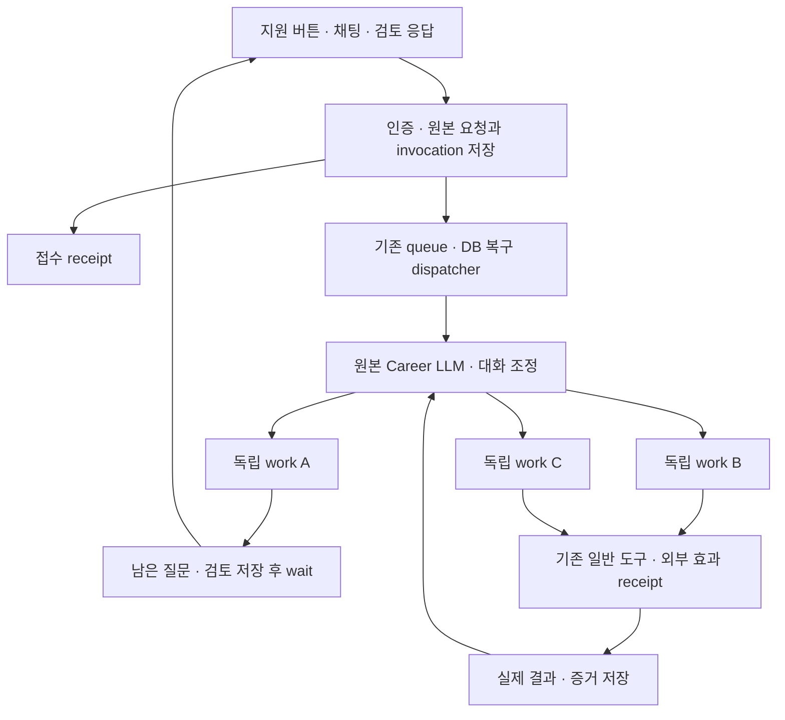

# Career 동시 위임 — 최소 UI 설계와 구현 기록

작성·구현 확인: 2026-11-03. 상태: **로컬 코드와 migration 구현, 로컬 검증 완료. 운영 DB 적용·배포·실제 회사 제출은 하지 않음.** 이 문서는 앞선 할 일 탭 확장 제안을 대체한다.

## 1. 최종 선택

사용자는 지금처럼 공고의 지원 버튼을 누르거나 채팅으로 맡긴다. 긴 실행은 대상별로 독립시키고, 같은 원본 Career LLM이 기존 도구로 계속 수행한다. 한 지원의 질문·검토·로그인 대기가 다른 지원과 채팅을 점유하지 않게 한다.

UI에는 채팅 입력창 위의 작은 **답변 대기 N개**, 선택한 확인 하나, 다음·닫기만 둔다. 할 일 탭에 새 작업 보드·작업 분류·상태 배지를 추가하지 않는다. 진행 내용과 결과는 대화로 전달하고, 남은 확인은 채팅 이력에 묻혀도 서버에서 다시 찾는다. 여러 브라우저가 생겨도 사용자가 선택한 화면 하나만 연결한다.

자연어 위임의 대상·의미·권한은 원본 LLM이 판단한다. `다 알아서 해`를 키워드로 승인 처리하거나 별도 심사 모델을 두지 않는다. 시스템은 요청 저장, 소유권, revision, 실행권, 중복 효과, 실제 실행 결과를 책임진다.

이 방식은 지원 10건 전용 절차가 아니다. 조사·문서 작성·면접 준비 등 독립적으로 끝낼 수 있는 책임에도 같은 `manage_work`를 사용할 수 있다. 사용자 의도가 필요한 경우를 제외한 모든 동작을 고정된 지원 단계로 만들지 않는다.

## 2. 기존 구현의 병목과 바뀐 부분

| 병목 | 구현한 변경 |
| --- | --- |
| 지원 버튼·채팅이 전역 실행 중 상태에 묶임 | 일반 채팅은 저장 후 202 receipt를 반환하고 서버가 이어간다. 버튼은 자신의 접수 중에만 잠긴다. |
| 대화 하나의 실행권이 긴 지원을 점유 | 대화의 조정 실행과 work별 실행권·checkpoint를 분리했다. 원본 `runCareerChatTurn`을 재사용한다. |
| 폼 저장 뒤 클라이언트의 두 번째 채팅 요청에 의존 | 폼 응답과 재개 invocation을 DB transaction으로 함께 저장한다. 클라이언트는 이력을 갱신한다. |
| suggestion의 모든 항목을 채워야 재개 | 항목별 응답을 즉시 저장한다. 건너뛰기·수정·재시도도 해당 항목의 독립 요청이다. |
| 마지막 assistant turn의 폼만 찾음 | 현재 미해결 revision을 DB에서 조회한다. 폼 생성 즉시 표시 원본을 저장한다. |
| 검토까지 브라우저를 오래 유지 | work, 검토 자료, 브라우저의 수명을 분리한다. idle 브라우저는 release하고 workspace와 파일은 재개에 사용한다. |
| 검토한 파일이 이후 편집으로 변함 | 실제 첨부 bytes를 private storage에 고정하고 hash·소유권·원본 존재를 확인한다. |
| 최종 제출은 무조건 재확인하는 지침 | application handbook의 원본 규칙을 수정했다. 명확한 제출 위임·기존 승인을 재사용한다. |
| 웹과 이메일이 서로 다른 중복 방지 범위 | work의 동일 `effect_key`로 실제 외부 실행 receipt를 연결한다. 불명 결과는 새 경로로 우회하지 않는다. |
| 여러 브라우저 마커가 화면 선택을 바꿈 | 마커는 열기 버튼으로 남고 현재 선택을 유지한다. viewer는 동시에 하나만 연결한다. |

## 3. 끝까지 고려한 44가지 조건

아래의 ‘근거’는 대응 구현을 확인한 범위다. **DB**는 실제 migration을 로컬 PostgreSQL 17에서 실행한 transaction 검사, **단위**는 provider·저장소 fixture를 쓴 제품 코드 검사, **모델**은 실제 모델과 합성 도구 결과를 사용한 실행, **UI**는 실제 공통 컴포넌트의 로컬 브라우저 조작이다. 코드상 대응이 있다는 사실을 외부 사이트에서 검증된 성공률로 해석하지 않는다.

### 접수와 준비

| ID | 고려할 조건 | 대응·근거·남은 한계 |
| --- | --- | --- |
| R01 | 서로 다른 지원 버튼 10개 연속 클릭 | 요청마다 원본 메시지와 receipt를 저장하고 대화의 열린 inbox에 합침. 다음 모델 호출에 미전달 입력을 한 user 메시지로 제공. DB 10건 동시 접수 검사. |
| R02 | 채팅 한 번으로 10개 맡김 | LLM이 정확한 대상별 work를 시작. 모델에서 distinct Role 10개·work 10개 확인. |
| R03 | 중복 클릭·두 탭·응답 유실 재전송 | 동일 client request ID는 같은 메시지, 동일 work identity는 같은 책임. 실패 재전송은 원래 ID·body 재사용. DB 중복 경합·채팅 hook 검사. |
| R04 | 같은 지원을 다른 문장으로 다시 요청 | 열린 work와 완료 이력을 읽고 이어갈 일반 도구 제공. 의미상 동일 대상 판별은 LLM 책임이며 서로 다른 identity를 자동 유사도 병합하지 않음. |
| R05 | DB 저장 직후 종료·queue publish 실패 | invocation이 DB에 남고 기존 복구 dispatcher가 재발행. DB·recovery 검사. 운영 dispatcher 주기는 적용 환경에서 확인 필요. |
| R06 | 잘못된 URL·동일 공고 별칭 | 기존 import/read로 canonical Role 확인 후 독립 위임. 잘못된 대상은 원문에 남김. 개별 대상 판별은 기존 LLM·import 계약; 새 live URL 묶음 검증은 미실시. |
| R07 | 진행 중 새 지원·우선순위 변경 | 새 접수와 기존 work update 분리, 원본 지시 참조 보존. 새 일반 지시가 해석되기 전 외부 효과 진입을 보류. 엄격한 우선순위 스케줄러를 추가하지 않음. |
| R08 | A 질문 대기 중 B 진행 | work별 실행권과 wait. DB에서 서로 다른 work claim 동시 획득 확인. |
| R09 | 여러 지원에 공통 사실 필요 | 기존 Memory·원본 답과 열린 폼 index 공유. 명시적으로 연결한 공통 응답은 모든 유효 work를 깨움. DB fanout 검사. |
| R10 | 비슷해 보여도 회사별 답이 다름 | 원문과 관련 work를 제공해 LLM이 적용 범위 판단. 문자열 기반 질문 병합 없음. |
| R11 | 프로필·이력서 동시 편집 | 기존 writer CAS 유지, 검토 첨부는 immutable snapshot. 원본을 수정해도 기존 첨부 bytes가 바뀌지 않음을 단위 검사. |
| R12 | 브라우저 동시 한도·429·비용 제한 | 문서상 미접수인 429만 capacity_wait로 기록하고 같은 receipt 재개. retry_after·provider 오류 보존. 다른 실패를 안전한 재시도로 추정하지 않음. DB·provider 검사. 실제 계정 quota 미측정. |
| R13 | 한 작업이 느리거나 실패 | work별 실행·checkpoint·오류 receipt. API 재시도 상태를 작은 채팅 상태로 표시. 지속적인 외부 장애는 완료로 바꾸지 않음. |
| R14 | 앱 종료·네트워크 단절·기기 이동 | 일반 요청은 서버가 실행을 소유. 재접속은 DB 이력·열린 확인 재조회. 네트워크 연결 종료와 명시적 취소 분리. hook·runtime 검사; 실제 두 기기 E2E 미실시. |

### 질문·검토·위임

| ID | 고려할 조건 | 대응·근거·남은 한계 |
| --- | --- | --- |
| R15 | 폼 생성 직후 긴 호출·checkpoint | 원본과 presentation 즉시 저장. 마지막 발화 완료를 기다리지 않고 조회. forms·presentation 검사. |
| R16 | 10문항 중 일부만 응답 | item별 durable 응답. 남은 항목은 열린 상태 유지, 연결 work 재개. DB·composer 검사. |
| R17 | 다른 대화로 확인이 묻힘 | 열린 폼 reader가 최근 turn과 독립. `답변 대기 N개`로 접근하고 채팅 입력을 유지. UI 확인. |
| R18 | 검토 승인 10개 연속 처리 | 각 저장 독립, 응답 후 다음 확인. DB 10개 동시 승인과 UI 10개 연속 제출 확인. |
| R19 | 여러 검토를 한 번에 승인 | 채팅으로 대상별 work를 update하고 불필요해진 폼 resolve. 모델에서 10개 update+10개 resolve 확인. 새 일괄 선택 UI·batch 승인 API를 만들지 않음. 각 대상의 효과는 독립. |
| R20 | 승인 뒤 새로고침·재클릭 | response request ID와 DB receipt 재사용. 완료된 응답을 다시 저장해 wakeup을 중복 생성하지 않음. DB·forms 검사. |
| R21 | 다른 탭의 오래된 검토본 | 최신 form revision·소유권을 transaction에서 확인. 충돌 항목만 다시 조회. DB 검사. |
| R22 | 승인하며 수정·이후 철회 | 응답의 편집값·선택 파일 snapshot 저장. work revision과 실제 dispatch 경계에서 최신 변경 확인. 이미 발생한 외부 제출은 취소로 덮지 않음. |
| R23 | 검토한 10개에 ‘다 진행해’ | 원본 사용자 메시지를 기존 10개 work에 연결. 모델 검증에서 새 work 없이 기존 작업 재개. |
| R24 | 처음부터 내용 작성·제출까지 위임 | 원본 handbook의 무조건 재확인 규칙 제거. 실제 모델이 10개를 위임받고 추가 승인 없이 작업 시작. 자식 작업의 외부 제출 성공까지 검증한 것은 아님. |
| R25 | ‘알아서’의 범위가 모호 | 문맥과 정확한 자료를 같은 LLM에 제공. 의미 판단을 특정 문구 매칭으로 대체하지 않음. 광범위한 모호성 평가를 이번 2개 probe로 대신하지 않음. |
| R26 | A 제외·B만 검토·대상 추가 | work별 update/cancel 및 원본 source refs. 최신 지시 처리 전 신규 효과를 보류하고 취소된 work는 응답으로 되살리지 않음. DB 검사. |
| R27 | 미확인 개인 사실·로그인 필요 | 검토 생략 권한과 사실 생성 권한을 구분하는 원본 지침 유지. 해당 work만 wait. OTP·CAPTCHA 자동 해결을 보장하지 않음. |
| R28 | 외부 페이지의 권한 확대 지시 | 권한 근거는 인증된 사용자 원본. source 참조는 소유권·대화·사용자 role 확인. 외부 본문은 자료. 별도 의미 검열기 없음. |
| R29 | 공고·수신자·공개 범위 변경 | 재개 시 최신 페이지·자료를 관측하고 기존 권한과 비교하도록 도구·원본 context 제공. 중요한 변경 판단은 LLM; 모든 ATS 변형 live 검증은 아님. |

### 브라우저·외부 효과·지속 관리

| ID | 고려할 조건 | 대응·근거·남은 한계 |
| --- | --- | --- |
| R30 | 검토 답까지 수 시간·수일 | work와 pinned 자료 유지, idle 브라우저 release. 현재 adapter는 keepAlive 120초. wait/finish/cancel의 cleanup invocation 보존. |
| R31 | 로그인·CSRF·DOM 만료 | 같은 session/workspace의 보존 자료로 재관측·재개. 이전 탭 상태가 살아 있다고 가정하지 않음. 로그인 재요청 가능. provider fixture 검사, 실시간 장기 대기 미실시. |
| R32 | 로그인 창 여러 개 | 사용자가 연 하나만 viewer로 연결. 다른 마커 도착이 선택을 바꾸지 않음. Dock 검사. |
| R33 | 사용자가 직접 수정·제출 | 기존 handoff로 agent 제어를 멈추고 human 제어. 재개 시 receipt·페이지 관측. viewer 선택 자체는 handoff 아님. lifecycle 검사. |
| R34 | run 생성 응답·제출 결과 유실 | uncertain receipt 보존. 기존 operation을 읽고, 외부 결과가 불명인 동안 신규 dispatch 차단. lifecycle·effect 경합 검사. |
| R35 | 취소와 제출이 동시에 발생 | 실행 claim·work revision·취소 fence 검사. 외부에 전달된 이후의 취소는 되돌림 보장 아님. 완료 증거 보존. DB·취소 검사. |
| R36 | 파일 변경·삭제·URL 만료 | 실제 snapshot 다운로드·첨부, hash 검증·원본 소유권 재확인. 삭제·권한 상실·bytes 손상은 재사용 거절. 단위 검사. |
| R37 | 공고 마감·ATS 변경·기지원 | 원본 도구 결과를 같은 LLM에 전달하고 work별 outcome 기록. 결과를 제출 성공으로 정규화하지 않음. 외부 사이트별 실증은 별도. |
| R38 | 웹 실패 후 이메일 대체 | 동일 work effect identity를 웹·이메일이 공유. 기존 receipt가 있으면 읽고 새로운 외부 경로를 차단. 안전한 미접수 증거만 예약 해제. DB 경합 검사. |
| R39 | 완료·대기·실패 혼재 | work별 실제 note·증거와 대화 결과. 작은 확인 count는 미해결 폼만 센다. 모든 지원의 상태를 하나의 성공/실패로 뭉개지 않음. |
| R40 | queue 만료·crash·lease 만료·역순 사건 | DB outbox 재발행, work별 checkpoint, 완료 reply 복구, revision·claim fence. DB·runtime·recovery 검사. |
| R41 | 사용자 장기 무응답 | 사람을 기다리는 work는 기다림으로 남고 다른 작업 진행. 필요한 재알림은 기존 일정·연락 도구로 LLM이 판단. 무응답을 승인으로 바꾸거나 정기 독촉 기능을 추가하지 않음. |
| R42 | 메시지 숨김·계정 삭제 | 작업·invocation이 참조하는 원본은 채팅에서만 숨겨 지시·중복 방지 근거를 보존하고, 취소는 별도 처리. 기존 계정 soft delete에 work/호출 취소 및 browser cleanup trigger 추가. 오래된 실행도 계정 삭제 확인. 기존 retention을 변경하거나 물리 삭제 완료라고 주장하지 않음. DB 검사. |
| R43 | 지원 중 상담·추가 질문 | foreground 대화는 독립 receipt로 접수. 일반 채팅 입력을 열린 폼이 대체하지 않음. UI·runtime 확인. |
| R44 | 내부 소개·외부 지원 혼합 | 같은 LLM이 기존 도구로 처리하되 각 executor와 동의·실제 완료 기준 유지. 이번 변경으로 내부 연결을 외부 제출로 합치지 않음. 내부 소개의 새 전체 E2E는 범위 밖. |

## 4. 실행 구조



새 범용 도구는 `manage_work` 하나다. `start/read/list/update/wait/finish/cancel`로 실행 책임을 다룬다. 같은 LLM·tool resolver·handbook을 재사용하며 지원 전문 agent나 Worker 상태 머신을 추가하지 않았다. work 내부에서 같은 책임을 다시 위임하지 못하게 하고, 대화가 독립 책임을 나눈다.

`instruction`은 실제 맡긴 목적, `source_refs`는 근거 사용자 메시지다. LLM이 만든 체크리스트·추정·임시 계획을 별도 테이블에 보존하지 않는다. work status는 실행·대기·완료·취소 사실을 표현한다. 필수 단계 순서를 강제하지 않는다.

대화와 각 work는 별도 claim을 가진다. 한 work의 긴 도구 호출은 transcript와 대기 receipt를 checkpoint에 저장하고 다음 호출에서 이어간다. 후속 사용자 지시는 원문 ID와 함께 읽으며 최근 16개 같은 임의 절단을 제거했다. 새 foreground 지시가 아직 처리 중이면 실제 외부 효과의 dispatch를 보류한다. 읽기와 준비까지 일괄 보류하던 경로는 실제 5건 브라우저 시험에서 불필요한 정지를 일으켜 제거했다. 각 작업의 재개 context에는 다른 작업의 관측 상태·결과도 제공하며, 빈 최종 응답을 도구와 실행 이력이 없는 별도 writer로 재작성하지 않는다.

### 저장 경계

| 저장소 | 저장하는 실제 사실 | 주요 소비자 |
| --- | --- | --- |
| 기존 `talent_messages` | 원본 사용자 요청, form revision·응답·resolution·presentation, 실제 assistant 출력 | 기존 이력, LLM context, 열린 폼 reader |
| 기존 `talent_external_operations`의 `delegated_work` | 목적·대상·원본 근거·revision·현재 결과/남은 필요 | `manage_work`, work runtime |
| 같은 테이블의 `career_invocation` | 대화 inbox의 원본 메시지 ID·전달 receipt, work별 응답·cleanup 사건 | queue producer, 복구 dispatcher, invocation consumer |
| 같은 테이블의 `work_effect` | work 내 효과 identity와 실제 외부 operation 연결 | browser/email dispatch fence |
| 같은 테이블의 `attachment_snapshot` | bytes hash·저장 경로·원본 문서 참조 | 첨부 executor, 인증된 다운로드 API |
| 새 `talent_agent_work_runtime` | work별 claim과 정확한 provider transcript/checkpoint | 서버 runtime만; 클라이언트에 노출하지 않음 |

새 runtime 테이블과 RPC는 service 전용이며 RLS와 revoke/grant를 명시했다. 일반 API는 인증된 대화의 확인 목록·pending 상태만 projection한다. 시스템 조정용 SQL에는 소유권·정확한 ID·CAS·멱등성·실행 fence만 둔다.

### 요청·응답의 원자성

`admit_career_request`가 원본 메시지를 쓰고 DB trigger가 invocation을 같은 transaction에 만든다. `write_career_form`도 응답 저장과 연결 work의 invocation 생성을 함께 처리한다. 브라우저가 응답 직후 닫혀도 별도 클라이언트 호출을 기다리지 않는다.

queue publish에는 짧은 재발행 lease를 두고, 장기 복구의 정본은 DB invocation으로 유지한다. queue의 중복 배달은 실행권·완료 reply·effect receipt로 흡수한다. work update와 뒤늦은 invocation도 최신 revision에서 실행한다. 답이 wait 직전/직후 도착해도 durable 사건이 남는다.

## 5. 최소 UI의 정확한 행동

- 평소에는 채팅을 유지한다. 할 일 탭에 이번 기능의 새 섹션을 넣지 않는다.
- 미해결 폼이 있으면 입력창 위의 대화 시작 버튼들 왼쪽에 `답변 대기 N개`를 표시한다. 열린 내용은 버튼 줄 위에 두고 버튼 위치는 유지한다. 선택 상태는 검정 배경·흰 글자이며 다음·닫기를 옆에 둔다. 닫기는 표시만 닫으며 미해결 수를 지우지 않고, 다시 열면 마지막 항목과 작성 중인 답으로 돌아온다.
- 한 항목만 펼치고 다음으로 이동한다. 사용자가 입력 중인 값은 사용자·대화·폼 revision별 session draft에 남는다. 다른 폼으로 이동하거나 닫았다 열어도 유지된다.
- 대화 이력과 하단 검토는 같은 초안을 구독한다. 어느 화면에서 고치거나 승인해도 같은 최신 값을 사용하고, 새로고침 후에도 유지한다. 폼의 서로 다른 revision에는 이전 초안을 덮어씌우지 않는다.
- 응답 이력은 폼 제목과 실제 선택한 행동만 먼저 보여준다. 펼치면 저장된 입력값과 선택 파일명을 확인한다. 완료 여부는 별도 실행 결과로 판단하며 승인 자체를 제출 완료로 표시하지 않는다.
- 한 항목을 답하면 서버에 저장하고 다음 확인으로 이동한다. 그 지원의 후속 실행이 끝날 때까지 다른 검토를 막지 않는다.
- 검토 도중에도 일반 채팅으로 수정·취소·일괄 위임을 말할 수 있다. 위임으로 입력이 불필요해진 폼은 `suggest_form resolve`로 닫는다.
- DB 조회 실패는 확인 0개로 확정하지 않고 오류·재시도 상태를 유지한다. pending 실행과 재시도는 작은 기존 composer 상태로 보여준다.
- 브라우저 마커는 열기 링크다. 클릭한 viewer 하나만 표시하고 다른 세션 도착으로 선택을 바꾸지 않는다. viewer 닫기와 원격 세션 종료는 서로 다른 행동이다.
- 검토 첨부의 다운로드는 고정된 bytes다. 현재 편집 문서를 열어 검토본으로 착각시키지 않는다. 소유권·원본 삭제 등으로 읽지 못하면 오류를 표시한다.

사용자가 ‘다 진행해’라고 말할 수 있으므로 별도의 전체 선택·일괄 승인 관리 화면은 필요하지 않다. 승인은 해당 맥락의 정확한 대상에 대한 지시이며 이후 새로 추가된 공고까지 자동 확대하지 않는다.

## 6. 권한·파일·외부 실행 계약

application handbook의 ‘최종 제출 전 항상 폼으로 확인’ 규칙을 수정했다. 준비만 맡겼거나 검토를 원하면 확인을 받고, 작성·제출까지 충분히 명확하게 맡겼다면 그 범위에서 계속한다. 질문이 남는 경우에도 다른 work를 막지 않는다. 도구 설명·핵심 tool enable 목록·실제 모델 입력까지 연결을 확인했다.

필수 미확인 개인 사실은 위임만으로 만들어낼 수 없다. 로그인·본인 인증도 사용자가 해야 할 수 있다. 이를 ‘지원 실패’나 ‘제출 완료’로 바꾸지 않고 필요한 사실로 남긴다. 의미 판단을 서버의 문자열 규칙으로 구현하지 않는다.

검토 파일은 원본 ID·revision과 실제 bytes hash를 붙여 private storage에 저장한다. 현재 원본이 수정돼도 승인한 bytes는 유지한다. 원본이 삭제되거나 소유권을 잃으면 pinned 사본의 사용도 거절한다. 단순 링크 만료는 서버가 파일을 다시 읽어 전달하며 권한을 URL 수명에 맡기지 않는다.

웹과 이메일은 work의 같은 효과 identity를 재사용한다. dispatch 직전 계정·work revision·claim·최신 지시·기존 receipt를 확인한다. 이미 연결된 effect는 결과를 읽는다. Browser Use 429처럼 외부 실행이 생성되지 않았다는 명시적 증거가 있을 때만 예약을 다시 열 수 있다. timeout·503·결과 유실을 같은 것으로 취급하지 않는다.

이 경계는 정확한 identity에 대한 중복 방지다. LLM이 잘못된 새 identity를 발명하거나 외부 ATS가 접수 결과를 보여주지 않는 모든 상황의 exactly-once 보장은 아니다. 외부 전송 후 취소도 이미 제출된 내용을 되돌릴 수 없다.

## 7. 브라우저의 짧은 수명

현재 adapter의 `keepAlive`는 120초다. 작업의 보존 수명과 무관하다. `release`는 유휴 browser를 멈추고 workspace·파일은 남기며, 명시적 `close`는 기존 종료·정리 계약을 따른다. wait/finish/cancel은 정리 invocation을 남겨 provider 오류 뒤에도 정리를 복구한다. human 로그인은 짧은 provider lease에 맡기고, 실행 중 run은 결과를 관측하기 전에 임의 release하지 않는다.

재개 시 같은 session/workspace가 있다는 이유만으로 탭·쿠키·입력폼이 살아 있다고 판단하지 않는다. 현재 상태를 관측하고 저장 자료를 다시 사용하며 필요하면 재인증한다. 승인 전후 사이트 내용이 달라졌을 때 기존 권한 안에서 계속할지 새 판단이 필요한지는 LLM이 결정한다.

[Browser Use v4 OpenAPI](https://docs.browser-use.com/cloud/openapi/v4.json)는 keepAlive 120–14,400초, browser 최대 수명 4시간, 동시 session 한도 초과 429를 정의한다. 이 외부 계약 때문에 browser를 장기 대기의 저장소로 쓰지 않았다. 실제 계정 quota·plan·과금은 이번 로컬 검증에서 확인하지 않았다.

[Vercel Queues 공식 문서](https://vercel.com/docs/queues)는 at-least-once 배달과 재시도·보존 기간을 설명한다. 이를 외부 제출의 exactly-once로 해석하지 않고 DB invocation·dispatch receipt를 유지한다. 새 orchestration 프레임워크로 전환하지 않고 기존 queue와 복구 진입점을 재사용했다.

## 8. 구현 파일 지도

| 부분 | 주요 파일 |
| --- | --- |
| DB·실행 무결성 | `supabase/migrations/20261103125930_career_concurrent_work.sql` |
| 범용 위임·outbox·자원 정리 | `src/lib/career/work/{store,tools,invocations,resources}.ts` |
| 원본 runtime·재개 | `agentTurnRuntime.server.ts`, `chatTurn.ts`, `agentContinuation.ts`, `agentReply{Queue,Worker,Recovery}.ts`, `turnCancellation.server.ts` |
| 모델 도구 연결·지침 | `talentOnboarding/tools.ts`, `career/llmTools.ts`, `capabilities/{registry,runtime,server}.ts`, `generalTools.ts`, `prompts/mainPrompt2.ts`, `handbooks/application.ts`, `llm/toolDescriptions.ts` |
| 접수·열린 확인 API | `src/app/api/talent/{chat,forms,work,messages}/route.ts` |
| 폼 저장·부분 응답 | `src/lib/career/forms/{server,schema,format}.ts` |
| 브라우저·메일·effect | `src/lib/career/browser/tool.ts`, `emailWriting/tool.ts`, `simulation/browserUseAgents.ts`, `externalOperations/{effects,store}.ts` |
| 고정 첨부 | `externalOperations/attachments.ts`, `src/app/api/talent/work/attachments/[id]/route.ts` |
| 클라이언트·최소 UI | `useCareerChat.ts`, `useCareerOpenForms.ts`, `CareerFlowProvider.tsx`, `ApplyWithHarperButton.tsx`, `CareerFormCard.tsx`, `CareerSuggestionComposer.tsx`, `PreparationDocumentPicker.tsx`, `BrowserSessionDock.tsx`, 한·영 사전 |
| UI 정본·개발 검증 | `src/styles/Design.md`, `/dev/career-concurrent-work` |

개발 화면은 가상 폼 10개와 실제 공통 컴포넌트를 사용하며 API와 analytics를 로컬 fixture로 가로챈다. 운영 사용자·공고·이메일·지원 자료를 만들지 않는다. production에서는 열리지 않는다.

## 9. 검증 결과

1. 실제 migration을 로컬 PostgreSQL 17의 테스트별 독립 DB에 적용해 **9개 검사**로 동시 접수·멱등성·독립 claim·부분 응답·10개 동시 승인·취소·effect 경합·429 예약 복구·공통 답 fanout·원본 표시 숨김·계정 삭제를 확인했다. 테스트 파일: `src/lib/career/work/database.test.ts`.
2. 최종 코드에서 runtime·폼·provider·첨부·queue/recovery·채팅 reconciliation·부분 응답·composer·취소·browser viewer 관련 **69개 검사**가 통과했다. 이전 실행의 52개·24개 검사와 겹치므로 중복 합산하지 않는다.
3. tool selection 관련 12개 검사가 통과했다. 실제 모델 검사에서 처음 발견한 `manage_work` 기본 enable 누락을 수정하고 같은 frozen v5로 다시 검증했다.
4. 실제 모델 2개 probe에서 처음 위임한 10개가 각각 start되고, 이미 검토 중인 10개는 update+resolve되었다. source refs·최종 사용자 답변·실제 request tools를 읽었다. 자세한 실패와 수정·한계는 [모델 검증 보고서](evaluation/career-agent-autonomy/reports/2026-11-03-concurrent-work.md)에 기록했다.
5. 실제 로컬 브라우저에서 열린 확인 간 이동·닫기·재열기 후 편집값 보존, 검토 중 채팅, 모바일 390×844 표시, 10개 검토 연속 저장 후 확인 해소·채팅 유지, console error 0건을 확인했다. API는 합성 fixture이므로 실제 queue·ATS E2E 성공을 뜻하지 않는다.
6. 최종 변경 경로 lint·diff 공백 검사와 전체 `tsc --noEmit`이 통과했다. 앞선 타입 검사에서는 병행 변경의 `agentContacts/schedules.ts` 오류가 있었으나 최종 실행에서는 해결됐다. production build·배포 검증을 했다는 뜻은 아니다.

2026-11-04에는 실제 Career UI·실제 모델·Browser Use와 독립 가상 ATS 5개를 연결해 데이터 초기화 후 반복했다. 가상 지원처의 실제 POST·원본 PDF 수신, 연속 검토 승인, 브라우저 해제 후 복원, 채팅 일괄 위임과 새로고침을 확인했다. 첫 회차 결함과 개입, 수정 후 반복 결과는 [브라우저 검증 보고서](evaluation/career-concurrent-work/reports/2026-11-04-browser.md)에 구분해 기록한다.

실제 회사에 제출하거나 메일을 발송하지 않았다. 실제 ATS 로그인, 제공자 quota 부하, 기기 간 실제 계정 연속 사용은 별도 환경 검증이 남는다. 이 문서의 모든 조건이 real-world E2E에서 통과했다는 뜻은 아니다.

### 재현 명령

```sh
# 로컬 PostgreSQL의 격리된 fixture DB만 허용한다.
CAREER_WORK_TEST_POSTGRES_URL=postgres://USER@127.0.0.1:PORT/postgres node --import tsx --test src/lib/career/work/database.test.ts

NEXT_PUBLIC_SUPABASE_URL=http://localhost:54321 NEXT_PUBLIC_SUPABASE_ANON_KEY=test OPENAI_API_KEY=test node --import tsx --test src/lib/career/agentTurnRuntime.test.ts src/lib/career/turnCancellation.test.ts src/components/career/BrowserSessionDock.test.tsx src/components/career/BrowserSessionEntry.test.tsx src/components/career/BrowserSessionCard.test.tsx

NODE_PATH=./node_modules/next/dist/compiled NODE_OPTIONS=--conditions=react-server pnpm exec tsx --tsconfig scripts/tsconfig.json scripts/evalCareerAgentAutonomy.ts --dataset v5 --validate-only
```

Live 모델 재실행은 해당 평가 README의 키·네트워크 격리·기록 계약을 따른다. 검증 때문에 실제 제출이나 운영 데이터를 생성하지 않는다.

## 10. 운영 적용 순서와 복구

이번 요청은 로컬 구현이며 배포 승인은 없다. 운영 적용을 실행하지 않았다. 승인된 후에는 다음 순서를 따른다.

1. 병행 변경을 포함한 배포 대상 revision을 확정하고 필요한 검사만 다시 확인한다. 현재 작업 트리는 다른 작업의 미커밋 변경이 많으므로 이 기능 외 변경을 임의 포함하거나 되돌리지 않는다.
2. migration을 먼저 적용한다. 새 API·UI는 새 RPC에 의존한다. 구 consumer가 새 work를 소비하는 혼합 상태를 유지하지 말고 producer/consumer를 같은 release로 전환한다.
3. 기존 queue consumer와 `/api/internal/email/dispatch`의 recovery 경로, service 권한·private bucket, provider quota를 확인한다. 원본 유효성을 잃은 파일·계정은 실행을 막는다.
4. 기존 진행 중 폼·browser·email receipt를 초기화하지 않는다. 기존 form 전체 응답도 읽으며, 오래된 checkpoint는 같은 원본 runtime으로 복구한다. 과거 모호한 승인을 새 권한으로 소급 생성하지 않는다.
5. 전용 가상 ATS·전용 계정에서 10건 중 일부 질문 대기, 연속 승인, 중간 취소, 만료 후 재개, 제출 결과 유실을 연결해 확인한다. 실제 외부 제출은 별도 명시된 대상·범위에서만 검증한다.
6. 문제가 있으면 새 접수를 제한하는 호환 수정으로 대응하고 기존 invocation·승인·receipt를 보존한다. 구 코드로 단순 rollback하면 새 outbox를 소비하지 못하므로 drain 가능한 consumer를 유지해야 한다. migration 삭제로 복구하지 않는다.

관측할 사실은 미소비 invocation·만료 claim, 접수부터 재개까지 지연, retrying·uncertain 결과, cleanup 미확인 browser다. 사용자 무응답 시간과 시스템 장애 대기를 구분한다. 운영 대시보드·새 자동 알림을 이번 최소 UI 구현의 일부라고 주장하지 않는다.


## 11. 대화 inbox와 다음 모델 호출의 입력 병합 (2026-11-04)

일반 채팅의 메시지별 실행을 제거했다. 원본 메시지는 각각 `talent_messages`에 보존하지만, 같은 대화의 새 입력은 하나의 열린 `career_invocation.request.input_message_ids`에 추가한다. 대화 실행권은 하나다. 기존 queue와 복구 dispatcher를 재사용하며 별도 분류 모델·debounce·일괄 처리용 도구·계획 테이블은 추가하지 않았다.

- 첫 모델 호출이 진행 중이어도 새 요청은 즉시 접수한다. 이미 실행 중인 모델·도구를 중단하지 않는다. **다음 모델 호출 직전** 미전달 원문을 메시지 ID 순으로 읽고, ID·원문·기존 첨부/폼 projection을 포함한 **user 메시지 하나**로 붙인다. 공통 지시·정정·중복 의미의 판단은 원본 LLM에 맡긴다.
- 원본 이력 조회에서는 이 inbox가 담당하는 pending 사용자 입력을 제외한다. 그래야 원문이 이력과 새 batch에 두 번 들어가지 않는다. 이후 저장된 assistant 결과는 그대로 포함하며, pending을 이미 포함한 summary도 재사용하지 않는다. 다른 work의 기존 후속 지시 context는 유지한다.
- 매 모델 호출 전 정확한 provider transcript와 전달한 메시지 ID를 하나의 transaction으로 checkpoint한다. 전달 receipt는 모델 입력에 포함했다는 뜻이고, 지원·제출 완료가 아니다. 재시작하면 기존 tool result와 입력을 이어 쓰며 같은 원문을 다시 append하지 않는다.
- 마지막 응답 생성 중 새 입력이 들어오면 실행 완료와 미전달 입력의 새 inbox 인계를 같은 대화 lock 안에서 처리한다. 뒤늦은 입력은 유실되지 않는다. successor를 queue에도 발행하고 가능한 경우 같은 worker에서 바로 이어가므로, 그 실행이 yield하거나 worker가 종료돼도 복구할 수 있다.
- 외부 실행을 기다리는 checkpoint에도 새 입력이 있으면 대화가 재개된다. 기존 running receipt를 완료 사실로 바꾸지 않는다. 실행권을 얻은 뒤 checkpoint를 다시 확인하여 오래된 queue delivery가 아직 대기 중인 호출을 불필요하게 재실행하지 않게 한다.
- 독립 `manage_work`는 기존 work별 실행권을 유지한다. work에 연결된 검토 응답·cleanup도 해당 실행을 깨운다. 실제 외부 효과의 새 지시 barrier는 inbox의 모든 입력 ID를 확인한다. `source_refs` 생략 시 현재 실행에 전달된 사용자 입력 ID를 사용한다.
- 로컬 queue는 inbox ID로 중복 consumer 예약을 합친다. 실행권 경합·의존성 대기는 정상적인 재개 대기로 다루며 5초 후 다시 확인한다. 실제 오류와 단순 경합을 같은 60초 오류 재시도로 취급하지 않는다. 운영 queue도 미완료 결과를 성공 ACK하지 않고 재개 대상으로 남긴다.
- 전환 시 아직 시작하지 않은 기존 메시지별 invocation은 오래된 원본을 가진 inbox가 가져온다. 이미 checkpoint나 전달된 답변이 있는 legacy 실행은 원본 transcript·효과를 버리지 않고 복구한다. producer/consumer는 migration과 함께 전환해야 한다.

Thinking/Working은 유지한다. 접수 중 표시를 `/api/talent/work`의 durable 실행 상태로 인계하고, 실행권을 얻으면 기존 `result.activity`에 공개 도구 로그를 저장한다. API는 공개 로그만 반환한다. attempt 식별자로 늦은 로그를 차단하며 표시 실패 때문에 실제 작업을 재실행하지 않는다. 하나가 끝나도 나머지 실행 표시를 유지하고 모두 끝나면 제거한다. `Harper가 진행하고 있어요`는 사용하지 않는다.

검증과 한계는 [입력 병합 검증 기록](evaluation/career-concurrent-work/reports/2026-11-04-inbox-batching.md)에 기록한다. 로컬 코드·격리 DB에만 적용했으며 운영 migration·배포는 하지 않았다.


## 12. Composer 전체 중단 (2026-11-04, 로컬 구현)

Composer의 중단 버튼은 단일 SSE 연결 여부 대신 접수 중인 요청, 대화 inbox, 독립 work와 미응답 form의 실제 상태를 따른다. 새로고침 후에도 서버 projection으로 복구한다. 실행 중 새 메시지를 작성하면 중단 옆에 보내기를 함께 표시한다. 중단 저장 중에만 중복 클릭·새 전송을 잠그며, 저장 실패 시 실행을 중단했다고 표시하지 않고 재시도할 수 있다.

`stop_career_conversation`은 접수와 같은 conversation row lock을 사용해 현재 입력의 Stop 사실, 열린 invocation 종료, work 취소, form resolution, 실행 lease 해제와 원격 cleanup outbox를 함께 저장한다. 진행 중인 업로드·HTTP 접수의 `clientRequestId`도 Stop receipt에 보존한다. 늦게 도착한 입력은 원문을 저장하되 실행하지 않으며, 기존 요청의 재전송·queue 재배달·마지막 응답의 후속 inbox 인계도 되살리지 않는다. 새로운 요청 ID는 정상 접수한다. 외부 operation 예약 역시 같은 lock에서 중단된 source/work를 확인하여 cleanup snapshot 이후 새 browser가 만들어지는 경합을 막는다.

모델 호출과 도구 사이에는 기존 취소 watcher를 재사용한다. browser 종료와 평가 취소는 기존 executor의 취소 계약으로 처리하고 cleanup은 기존 outbox에서 재시도한다. 원격 제공자의 종료 확인 전에는 실제 종료 완료를 꾸며내지 않는다. 이미 저장·제출·발송한 결과와 다른 대화, 미래 일정·추천 설정은 보존한다. 버튼은 현재 대화 작업을 중단하는 기능이다.

검증: 관련 자동화 테스트 42개 통과(로컬 PostgreSQL 동시성 테스트 16개 포함), TypeScript 확인 통과. 브라우저에서 실제 모델 실행 중 요청 5개를 연속 접수한 뒤 중단하여 source 886–890 전체의 Stop, 활성 lease/checkpoint 해제, 후속 응답·재실행 없음과 새로고침 유지까지 확인했다. Stop 이전에 저장된 중간 설명(891)은 보존했고 Stop receipt(892) 이후 이전 실행의 추가 응답은 없었다. 별도 대기 work와 검토 form을 만든 뒤 새로고침 → 중단 → 승인 비활성화도 확인했다. 이후 새 질문에는 정상 응답했다. 가상 계정과 격리된 로컬 DB만 사용했다. Browser provider 종료 경합은 기존 executor의 mock 계약 테스트로 확인했으며, 이번 검증에서 실제 외부 지원·메일 발송은 하지 않았다.

운영에는 `20261104033157_career_conversation_stop.sql`을 포함한 migration과 API/consumer/UI를 함께 적용해야 한다. 이번 요청에서는 배포하지 않았다.
