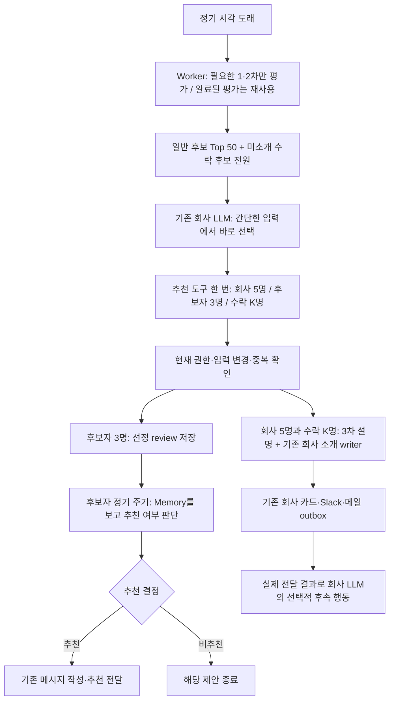

# 정기 추천: 회사 LLM이 Top 50 + 수락 후보 전원에서 직접 선택

문서 기준: 2026-10-26. **웹·Worker는 로컬 구현 기준이며 미배포다.** 후보자 연락 주기 DB 계약(`20261026044735`)과 온보딩·정기 검색 공통 평가 저장 DB 계약(`20261026052249`)은 사용자 승인으로 운영 적용·검증했다. 이 변경 검증에서 실제 추천·발송은 하지 않았다. 앞선 별도 검증 2건은 사용자 요청에 따라 평가·선정 명단·메시지 원문만 기존 운영 원장에 저장한 이력이 있다([검증 결과](../evaluation/company-agentic-role-search/REPORT-LIVE-SCHEDULED-PREVIEW-V1.md)).

온보딩 Opportunity도 정기 검색과 동일한 전체 Profile·Search Brief·Behavior Context·회사 Memory·Role 입력, 1·2차 Decisions 평가와 fingerprint를 사용한다. 양쪽 결과를 `company_role_candidate_evaluations`에 저장하며 동일한 입력·모델·프롬프트 버전의 완료된 평가는 양방향으로 재사용한다. 온보딩의 실제 실행은 `discovery_run_id`, 회사 검색은 `run_id`로 구분하고 선정 기록에 정확한 평가 ID를 남긴다. 기존 다른 입력 계약의 이력은 새 계약으로 소급 변환하지 않는다. [공통 평가 검증](../evaluation/unified-talent-role-fit/README.md).

정기 실행에서는 Worker가 평가를 준비한 뒤 **회사와 대화하는 기존 company-side LLM**에게 일반 후보 Top 50과 미소개 수락 후보 전원을 함께 제공한다. 회사 LLM은 이 간단한 입력에서 바로 추천을 선택한다. 후보 전체의 상세 원문을 다시 읽거나 별도 Worker LLM이 재선정하는 단계는 없다.

이 문서는 앞선 ‘전체 원문을 묶음별로 별도 선정 LLM에 넣는’ 설계를 대체한다. 변경 전 조사 기록은 [기존 Worker 대조표](company-scheduled-worker-current-behavior-audit-ko.md), 앞선 실제 실행의 계약과 한계는 [읽기 전용 v1](../evaluation/company-agentic-role-search/SCHEDULED-READONLY-V1.md)에 보존한다.

### 2026-10-25 로컬 추가: 새 Role의 첫 실행

Role 등록이 완료되어 `active`가 되면 정기 요일·시각과 자동 회사 추천 설정에 관계없이 첫 매칭을 한 번 즉시 접수한다. 초안 생성만으로 실행하지 않으며, 웹 온보딩의 Brief 보정·등록 완료 뒤에 실행한다. 실제 시작 시점은 Worker가 작업을 가져오는 시점이며 다른 작업이 실행 중이면 대기할 수 있다. 일반 정기 일정은 그대로다.

기존 `role_activated` 영수증과 Role별 유일성을 재사용한다. 등록 재시도·Brief 수정·일시 중지 후 재개로 첫 실행이 추가되지 않는다. 이 영수증으로 항상 같은 정기 준비→회사 LLM 선택→Worker 전달 경로를 사용한다. `COMPANY_SCHEDULED_AGENTIC_MATCHING`은 더 이상 읽지 않으며 없거나 `false`여도 경로가 바뀌지 않는다. HTTP 응답 유실은 같은 영수증으로 재시도하며 기존 평가 경로로 우회하지 않는다. 새 테이블이나 별도의 선정 LLM은 없다.

첫 실행의 일정 예외는 서버가 검증한 원본 영수증을 검색·후속 선택·후보 전달까지 이어서 적용한다. 요금제, 활성 상태, test-only 격리, 동의·공개 범위, 중복·용량·전달 가능 상태는 그대로 검사한다. 실행 접수는 추천 대상 존재나 실제 전달 성공을 뜻하지 않는다.

`20261025061447_immediate_role_activation_matching.sql`과 웹·Worker 변경은 아직 운영 미적용이다. 과거 활성 Role의 일괄 재실행은 없다. 격리 SQL 검증은 `node scripts/testRoleActivationMatching.mjs`, Worker 검증은 `tests/test_role_activation_dispatch.py`와 기존 eligibility/scheduled runner 검사로 한다.

같은 날 로컬 `/org/role`에는 검색이 진행 중일 때 공통 상단 상태 줄을 추가했다. 첫 검색·정기 검색의 대기/실행과 결과 확인·추천 준비·전달을 기존 run 및 회사 후속 작업 상태로 표시한다. 완료 뒤 후속 작업이 접수되기 전도 확인 대기로 포함하고, 최종 작업이 끝나면 표시를 지운다. 화면이 열려 있으면 대기 중에는 15초, 실행을 확인한 뒤에는 4초 간격으로 새로 조회한다. 조회 실패는 갱신 실패로 표시하며 접근 권한이 사라지면 기존 상태를 가린다. 별도 검색을 시작하거나 후보 상세·추론 내용을 노출하지 않으며, 수동 검색 버튼의 기존 실행 여부는 별도로 유지한다. 상태 조회에 추가 migration은 없다.

## 1. 실제 실행 순서

| 순서 | 누가 하는가 | 입력과 실행 | 결과 |
| --- | --- | --- | --- |
| 1 | 기존 스케줄러 | 유료 Role의 월·수·금 09시 KST 또는 Role별 회사 추천 설정을 확인 | 같은 Role·시각의 정기 작업을 한 번 접수 |
| 2 | 회사 작업 처리기 | 첫 작업에서 후보 준비 작업을 접수. 초기 기본값은 미평가 최대 5,000명, 회사 추천 최대 10명, 후보자 제안 최대 20명 | 후보 정보 없이 회사 LLM부터 호출하지 않음 |
| 3 | Worker | 역할에 맞는 검색 범위를 찾고 현재 입력과 같은 1·2차 평가를 재사용. 필요한 단계만 Decisions로 평가 | 성공한 단계별 평가 기록. 평가 오류는 부적합으로 취급하지 않음 |
| 4 | Worker | 새 평가와 이미 저장된 호환 2차 평가를 함께 비교. 실제 실행 가능한 일반 후보를 mutualFit 내림차순으로 정렬해 50명까지 가져옴. 미소개 수락 후보는 별도 전원 추가 | `selectionInput`을 기존 검색 결과 JSON에 저장. 아직 추천·연락·연결 상태는 변경하지 않음 |
| 5 | 기존 회사 LLM | 현재 Role의 Hiring Brief·criteria·업무/근무 조건, 기존 회사 대화·메모리, 아래 후보별 간단한 사실을 받음 | 기본적으로 추가 조회 없이 `recommend_talents` 한 번 호출 |
| 6 | 서버 | 짧은 ID를 해당 입력의 실제 talent ID로 변환. 선택 ID·허용 행동·방향별 상한 확인 | 선택한 사람과 행동만 기존 Worker 큐에 접수. 성공한 제출 뒤에는 마무리 문장을 위한 추가 completion을 호출하지 않음 |
| 7 | Worker | 선택 당시 입력과 현재 입력, Brief·권한·수락·중복·잔여 용량을 다시 확인 | 선택을 그대로 실행. 1·2차 재평가, 다른 후보로 교체, 인원 보충 없음 |
| 8 | 기존 작성·전달 경로 | 회사에 보여줄 선택 후보만 3차 criteria·추천 이유·주의점을 작성. 회사는 기존 소개 writer·카드 outbox로 전달하고, 후보자 방향은 선정 review를 저장 | 회사 추천 목록 추가 / 후보자 연락 판단 대기 / 연결 대기 소개 |
| 9 | 기존 회사 LLM | 실제 저장·전달 영수증과 대화 맥락으로 필요한 후속 행동·발언 판단 | 이미 소개한 본문은 반복하지 않으며 조용히 종료 가능 |

평가 준비와 최종 발행은 기존 검색 큐의 별도 작업이다. 긴 평가 동안 웹 요청을 붙잡지 않고 완료 사건으로 같은 회사 작업을 이어간다. 새 판단 테이블은 만들지 않는다.

후보자 방향은 이후 후보자의 정기 점검 주기에 여러 제안을 함께 읽는다. `gpt-6.1-sol high`가 회사명+역할명으로 검색한 사용자 Memory, Profile·전체 Brief·Behavior Context, 추천·지원 이력과 원래 선정 이유로 추천 여부를 결정한다. 이미 지원·탈락한 이야기나 명시적 거절의 실제 범위와 이후 변경을 판단하며, fit 기준을 높여 재심사하지 않는다. 추천한 제안만 기존 최종 writer·전달로 이어진다. 명확한 비추천은 제안을 종료하며 다른 이메일의 성공을 기다리지 않는다. 전체 판단 이유와 정확한 원래 제안 ID를 기존 실행 원장에 저장하고 재시도에서 재사용한다. 회사측 `both` 기록과 후보자가 실제로 남긴 응답은 바꾸지 않는다.

## 2. Top 50의 정확한 기준

- 현재 공유·역할·회사·추천 자격에 맞고, 현재 입력과 호환되는 **2차 평가가 있는 일반 후보**가 대상이다.
- `mutualFit` 내림차순만 사용한다. 동점이면 실제 talent ID로 안정적으로 정렬한다.
- `companyFit`, `candidateFit`, criteria 점수를 다시 가중 합산하지 않는다. mutualFit에 이미 반영된 같은 근거를 중복 가산하지 않는다.
- 출신 회사·학교·가입일에는 순위 가산점을 주지 않는다. 이 정보는 회사 LLM이 실제 맥락을 이해하는 데 사용한다.
- 50위라는 이유로 추천이 확정되지 않는다. 수치 합격선이나 자동 talent-first 전환도 없다.
- 이미 추천한 사람은 현재 관계에 따라 허용 행동이 줄어든다. 기존 회사 목록을 교체하거나 미선택자를 삭제하지 않는다.
- 신규 검색 범위 밖이어도 현재 Brief의 기존 2차 평가가 있는 사람을 함께 읽고 정확한 입력 호환성을 확인한다.

**수락 후보는 위 순위와 별개다.** 준비 시점에 현재 유효한 미소개 수락 관계 전원을 추가한다. 일반 후보 50명과 수락 후보 8명이 있으면 58명이다. 수락 후보가 50명을 넘더라도 전원 포함한다. 점수가 낮거나 1차 평가만 있어도 입력에서 자르지 않는다. 공유 중단·역할 만료 등 실제 자격 경계는 유지한다.

## 3. 회사 LLM에게 주는 후보별 값

| 입력 | 실제 원본 / 제공 형태 |
| --- | --- |
| 짧은 참조 | 일반 후보 `T1…T50`, 수락 후보 `A1…`. 현재 selectionInput에서만 유효. 서버가 실제 talent ID와 매핑 |
| 이름·헤드라인·위치 | `talent_users.name`, `headline`, 기존 위치 resolver가 `location/current_location`에서 계산한 현재 위치 |
| 가입일 | `talent_users.created_at`의 KST 날짜. 공통 날짜 formatter를 거쳐 `YYYY-MM-DD`로 제공 |
| 최근 경력 최대 5개 | `talent_experiences`의 시작일 내림차순. 회사명·직함·시작/종료일과 `description` 앞 240자의 원문 발췌. 잘린 경우 표시 |
| 최근 학력 최대 3개 | `talent_educations`의 시작일 내림차순. 학교·학위·전공·시작/종료일. 긴 학력 설명은 제외 |
| 세 점수 | `company_role_candidate_evaluations.assessment`의 `companyFit`, `candidateFit`, `mutualFit` 원래 값 |
| 기준별 평가 | 같은 assessment의 `criteria[].name/score/label`. 기준 정의는 현재 Role context에서 한 번 제공 |
| 1차만 있는 수락 후보 | 평가 단계와 저장된 업무/회사 조건/후보자 조건의 continue·exclude. 없는 2차 점수를 만들지 않음 |
| 수락 | 현재 유효한 `talent_opportunity_recommendation`의 수락 사실·수락 시각. 실제 recommendation ID는 서버 검증용 |
| 추천·응답 | 같은 회사 Role의 추천 원장: 역할명·추천/응답 시각·feedback·processed_stage. 전체 건수와 최신 5건을 표시. 개인 사유 원문은 넣지 않음 |
| 실행 가능한 행동 | 현재 `pair_routes` 결과를 company_first / talent_first / connect로 제공. 불가능한 행동은 선택할 수 없음 |

전체 Profile, 후보 Search Brief, Behavior Context, 비공개 대화·Memory, 연락처를 이 선정 입력에 반복 주입하지 않는다. 1·2차 평가가 이미 전체 Profile + 전체 Search Brief + 같은 버전의 Behavior Context를 소비했다. `candidateFit`은 그 평가의 결과이며 후보가 실제로 관심을 표현했다는 뜻이 아니다.

점수 의미를 입력에 한 번 설명한다. 0·25·50·75·100의 ordinal 수준에 대한 확률가중 점수이며 채용/수락 확률이 아니다. 기준 라벨은 conflict(확인된 충돌), limited(확인된 부족), uncertain(근거 부족/모호함), good(직접 근거), excellent(특히 강한 직접 근거)다. 점수 50을 자동 불합격으로 해석하거나 숫자를 반올림해 원래 축 라벨을 만들어내지 않는다.

시스템 날짜는 웹 공통 `promptDateTime.ts`를 사용한다. 시간대는 Asia/Seoul이고 시각은 분까지만 제공한다. 저장용 timestamp·fingerprint·revision은 바꾸지 않는다.

## 4. 추가 조회와 선정 프롬프트

**정상 경로는 받은 목록에서 곧바로 선택하는 것이다.** 상세 조회를 했다는 증거를 요구하지 않고, 선정된 전원의 원문을 자동으로 읽지 않는다. 의미 있는 결정을 바꿀 특정 사실이 정말 빠진 경우에만 기존 일반 reader를 예외적으로 쓸 수 있다. 단순 확인 차원에서 전원을 순회하는 지침은 없다.

프롬프트는 다음 판단을 회사 LLM에 맡긴다.

- 회사 선추천: 경력과 기준별 근거에 회사가 검토할 구체적인 이유가 있는 사람을 추가한다. 후보자에게는 연락하지 않는다.
- talent-first: 해당 사람의 실제 수행 업무·기준별 근거와 기존 candidateFit 평가가 이 Role의 업무·범위·조건을 지금 제안할 이유를 제공하는지 판단한다. 비슷한 직함·유명 회사·새 가입·남은 인원수만으로 보내지 않는다.
- 중요한 회사 판단이 먼저 필요하면 회사 선추천, 현재 제안할 근거가 없으면 미선택을 택할 수 있다. M명은 상한이며 0명도 정상이다. 과거 거절·응답을 높은 점수로 지우거나 관심·가능 시점·연봉을 추측하지 않는다.
- 수락 후보: 현재 근거상 회사가 연결 여부를 검토할 가치가 있는 사람을 연결 대기로 소개한다. 수락했다고 모두 자동 소개하지도, 신규 추천 상한 때문에 소개를 막지도 않는다.
- 미선택: 아무 상태도 바꾸지 않는다. 영구 제외·회사 거절·후보 철회가 아니다.

이 선정의 fit 판단을 키워드 분류·임의 점수 합격선·별도 LLM으로 다시 심사하지 않는다. 후보자 연락 단계에서는 위의 Memory와 실제 관계에 따른 추천 여부 판단을 별도로 수행한다.

## 5. 추천 도구

```json
{
  "actions": [
    {"label": "company_first", "talent_ids": ["T1", "T3", "T7", "T12", "T18"]},
    {"label": "talent_first", "talent_ids": ["T2", "T9", "T11"]},
    {"label": "connect", "talent_ids": ["A1", "A2", "A4"]}
  ],
  "reason": "선정 전체에 대한 짧은 설명. 생략 가능."
}
```

위는 **가상 예시**다. 일반 후보 5명의 회사 카드 추가, 다른 3명에게 후보자 제안, 수락 후보 3명의 연결 대기 소개를 요청한다. 같은 일반 후보를 두 방향에서 선택하면 서버는 기존 `both` 명령으로 합친다. `actions: []`면 아무도 추천하지 않는다.

회사 LLM은 미선택자 전체에 대한 yes/no·이유를 출력하지 않는다. 공통 reason은 실행 전체 설명이며 다른 후보자의 정보를 섞어 개별 후보에게 전달하는 원문으로 쓰지 않는다. 후보별 설명은 기존 writer가 해당 후보 원문으로 작성한다.

도구는 현재 정기 위임에서만 노출된다. 일반 회사 대화의 별도 발행 도구·권한을 바꾸지 않는다. 일반 검색 도구로 추가 평가를 요청할 수는 있지만, 추천 수를 채우려고 자동 반복 검색하지 않는다.

## 6. 재평가·중복·상태 변경 경계

- 같은 입력의 완료된 1·2차 평가를 재호출하지 않는다. 정확한 input fingerprint에는 Profile·Brief·Behavior 버전·회사 근거·평가 모델/프롬프트가 포함된다.
- `scope=evaluated`는 호환 평가만 사용한다. 없는 평가를 조용히 새로 만들지 않는다.
- 최종 발행 작업에는 1·2차 평가 함수 호출 자체가 없다. 원본 평가가 없어졌거나 입력이 바뀌면 발행을 실패로 남기며 다른 사람으로 대체하지 않는다.
- source run·현재 Role·같은 정기 root·Brief를 대조한다. 같은 부모 작업의 재시도는 이미 접수한 자식 영수증을 재사용한다.
- 방향별 요청 수와 현재 회사 ready 잔여 용량, 후보자 제안의 정기 root 최대 20명·Role별 pending 용량은 기존 실행 경계에서 확인한다. **수락 소개에는 이 신규 추천 상한이나 2명 상한을 적용하지 않는다.**
- 최종 transaction의 권한·원문·중복·수락 상태 검사를 유지한다. 선택 때 가능했다는 것만으로 나중 발송까지 허용하지 않는다.
- 회사 선추천은 기존 목록에 추가한다. 후보자에게 보여지는 제안은 기존 Opportunity 경로가 담당한다. `connect`는 회사 연결 대기이며 회사 수락이나 연결 완료가 아니다.
- 정기 회사 소개는 기존 `write_slack_message` / `SLACK_WRITER_SYSTEM` / `ACCEPTED_SLACK_WRITER_SYSTEM`과 durable outbox를 유지한다. 메일은 기존 설정·수신 권한·outbox 경로를 따른다. 실제 영수증을 확인하기 전 발송 완료로 집계하지 않는다.

## 7. 흐름 예시



인원은 가상이다. 선정 뒤 전체 후보를 다시 읽는 비교 호출은 없다. 3차 작성·Slack 작성·후보자 연락의 기존 LLM 호출은 별개로 남는다.

## 8. 구현 파일·검증·반영 범위

- 회사 입력/프롬프트: `src/lib/org/agent/scheduledMatching.ts`, `scheduledSelection.ts`
- 회사 작업·짧은 참조·최종 명령 접수: `scheduledMatching.server.ts`
- Worker 순위/간단한 사실/명령 검증: `opp/matching/scheduled.py`
- 평가 준비와 최종 발행 분리: `opp/matching/scheduled_runner.py`
- 원본 조회·호환 평가: `opp/matching/scheduled_repository.py`
- 도구를 한 번 제출하면 종료하는 공통 loop: `src/lib/org/agent/chat.ts`
- 검증: [compact-selection-v2](../evaluation/company-agentic-role-search/SCHEDULED-SELECTION-V2.md)

신규 root는 웹·Worker 배포 후 항상 새 정기 매칭 경로를 사용한다. 별도의 기능 플래그 전환은 없으며 웹의 접수·후속 작업 처리 코드를 Worker보다 먼저 배포한다. 정기 매칭 DB 계약은 계속 필요하다. 2026-10-26 후보자 주기 변경의 로컬 정본은 `20261026034255_candidate_contact_cadence.sql`이며, 사용자 승인으로 운영 migration `20261026044735`(`candidate_contact_cadence`)를 적용했다. 기존 함수 2개의 본문 정본 일치와 서버 전용 실행 권한을 확인했으며 새 테이블·데이터 backfill은 없다. 웹·Worker는 미배포이며 운영 기능 설정은 변경하지 않았다. 적용 당시 `worker_behavior_v1` 선정 review는 0건이므로 전체 새 경로가 운영 활성화됐다고 간주하지 않는다. 후보자 연락의 [합성 평가·실행 결과](../evaluation/unified-talent-role-fit/README.md)는 별도로 기록한다.

구조 검사와 실제 LLM 선정 재현은 저장·전달 transaction, 운영 동시성, 실제 Slack/메일 수신 또는 채용 성과를 증명하지 않는다. 전체 프로필을 다시 읽지 않는 만큼, 짧은 경력 발췌에 없는 세부 사실은 확정 근거로 설명할 수 없다. 이런 한계와 실제 입력 토큰·호출 수·선정 결과를 평가 보고서에 구분해서 남긴다.
