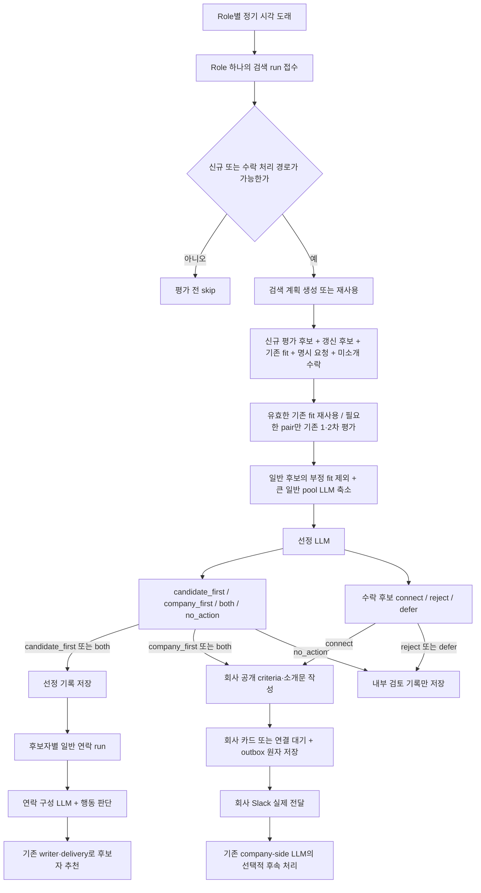

# 기존 정기 추천 Worker — 통합 구현 전 동작과 요구사항 대조

검토 기준: 2026-10-23, 로컬 `harper_worker/`·`harper_beta/` 작업 트리. Worker HEAD는 `d7c220e`, beta HEAD는 `296269eb`이며 두 저장소의 미커밋 변경을 포함한다. HEAD만으로 이 상태를 재현할 수 없다. 운영 배포 revision·운영 DB 함수·실제 발송 결과를 확인한 보고서는 아니다.

이 문서는 통합 구현을 시작하기 전 조사 기록이다. 이후 사용자의 구현 요청으로 로컬 코드가 변경됐으므로 아래의 ‘현재’는 최초 조사 시점을 뜻한다. 이번 로컬 구현과 검증 상태는 [정기 company-side LLM 통합 구현 문서](company-scheduled-agentic-role-search-implementation-ko.md) 상단을 따른다. DB·운영 설정 변경이나 배포는 하지 않았다.

## 1. 결론

**수락 후보를 연결 대기로 옮기는 경로와 talent-first 대상을 LLM이 고르는 경로는 이미 있다.** 후보자를 고르는 기준도 단순 점수 정렬이 아니라 실제 수행 경험, 회사 채용 기준, 후보자의 전체 Search Brief, 남은 불확실성을 해석하도록 되어 있다.

다만 현재 정기 Worker는 기존 company-side 대화 LLM이 일반 도구를 자유롭게 호출하는 구조가 아니다. 검색 계획·평가·축소·경로 선정·소개문·연락 구성을 나누어 호출하는 고정 pipeline이다. Decisions 1·2차를 사용하는 새 대화형 검색과도 분리되어 있다. 따라서 “이미 Decisions로 평가했으니 정기도 그것을 재사용한다”, “Role 기준 신규 미평가 수를 정확히 알고 있다”, “선정되면 같은 run에서 후보자에게 바로 발송한다”는 설명은 현재 정기 코드에 적용할 수 없다.

표의 **구현**은 코드 경로를 확인했다는 뜻이다. LLM 판단의 의미 품질이나 운영에서의 성공을 전부 검증했다는 뜻은 아니다. **부분**은 경로가 있으나 제약·예외가 있거나 원하는 일반성에 못 미친다는 뜻이다. **불일치**는 실행 경로 또는 소비 계약에서 실제 차이를 확인한 경우다.

## 2. 요구사항별 대조표

| 번호 | 우리가 확인해야 할 동작 | 판정 | 현재 코드가 실제로 하는 일과 제한 | 근거 |
| --- | --- | --- | --- | --- |
| 1 | 수락 후보를 찾아 연결 대기로 전환 | 구현·조건부 | 일반 Harper 추천 중 `feedback=like`, `saved_stage=connected`이고 현재 유효한 미소개 수락을 가져온다. LLM이 `connect`를 고르면 `내부:연결대기` 태그와 `processed_stage=pending_connection`을 저장하고 회사 소개 outbox를 만든다. 수락했다는 이유로 전원 자동 전환하지 않는다. | [수락 조회](../../../harper_worker/opp/company_first_search/repository.py), [수락 판단](../../../harper_worker/opp/company_first_search/reranker.py), [DB 자격](../../supabase/migrations/20261021054303_remove_accepted_review_role_type_exclusion.sql) |
| 2 | 수락자의 connect/reject/defer를 LLM이 판단 | 구현 | `connect`: 지금 소개할 적합성 근거가 있음. `reject`: 현재 필수 조건의 명백한 충돌 등 부적합 근거가 있음. `defer`: 정보·시점이 미해결. 수락을 회사 적합성의 증명으로 보지 않는다. reject/defer는 내부 검토 기록이며 후보자 철회나 회사 거절로 상태를 위조하지 않는다. | [ACCEPTED_REVIEW_SYSTEM·parse_rerank](../../../harper_worker/opp/company_first_search/reranker.py), [commit_decisions](../../../harper_worker/opp/company_first_search/repository.py) |
| 3 | 적합한 수락자를 임의 개수 때문에 보류하지 않음 | 구현·미배포 | 수락 prompt의 **connect 최대 2명** 지시를 제거했다. 현재 근거로 소개할 만한 수락자는 인원수 때문에 defer하지 않는다. parser·저장 경로에도 connect 인원 상한은 없으며, 48명 단위 검토·메시지 분할은 처리 단위이고 총 소개 인원 제한이 아니다. 선정 fingerprint에는 변경된 수락 prompt가 포함된다. | [수락 prompt·rerank batch](../../../harper_worker/opp/company_first_search/reranker.py) |
| 4 | 신규 추천이 막혀도 수락자 검토는 가능 | 부분 | **이미 실행된 run 안에서는** 신규 candidate-first 요일·pending 상한·company-first ready 상한과 별개로 수락자를 검토한다. 하지만 스케줄러가 수락 재고 자체로 run을 깨우지는 않는다. Free Role에서 자동 회사 검색이 꺼져 있고 다른 계기도 없으면 이 정기 경로의 실행이 보장되지 않는다. 회사 Slack 전달 경로도 필요하다. | [scheduler](../../../harper_worker/opp/company_first_search/scheduler.py), [pair_routes](../../../harper_worker/opp/company_first_search/eligibility.py), [runner 시작 조건](../../../harper_worker/opp/company_first_search/runner.py) |
| 5 | 이미 회사 카드가 있는 사람·회사 Intro 수락의 기존 전환 보존 | 별도 경로 | 기존 `ready` 회사 카드가 있는 Harper 추천 수락은 DB의 직접 handoff가 연결 대기로 옮긴다. 회사가 먼저 요청한 Intro 수락은 기존 회사 Intro 연결 경로다. 일반 미소개 수락 검토 SQL은 이들을 다시 가져오지 않는다. 이 세 경로를 전부 정기 Worker의 connect/reject/defer로 바꾸면 안 된다. | [기존 ready 수락 handoff](../../supabase/migrations/20260928045449_company_first_score_reuse_and_recommendation_history.sql), [Intro 수락 계약](../../src/lib/org/agent/serviceKnowledgePrompt.ts), [accepted 자격](../../supabase/migrations/20261021054303_remove_accepted_review_role_type_exclusion.sql) |
| 6 | talent-first로 누구에게 어느 Role을 추천할지 LLM이 판단 | 구현·제약 있음 | 최종 reranker가 후보 ID·대표 Role ID·`candidate_first`와 이유를 고른다. 후보자에게 주는 가치와 회사 채용 기준 양쪽의 강한 근거, 회사가 먼저 풀어야 할 중요한 불확실성이 없는지를 본다. 다만 이전 단계의 코드 필터와 인원 상한 안에서만 고른다. 코드상 이름은 `candidate_first`다. | [RERANK_SYSTEM](../../../harper_worker/opp/company_first_search/prompts.py), [reranker](../../../harper_worker/opp/company_first_search/reranker.py) |
| 7 | company-first·both·no_action도 LLM이 판단 | 구현 | 회사가 level·scope·조건·비전형 경력을 먼저 검토할 가치가 있으면 company-first, 양쪽 독립 가치와 실행 권한이 있으면 both, 둘 다 근거가 약하면 no_action이다. 약한 후보의 배출구로 company-first를 쓰지 말도록 되어 있다. 0명도 정상이다. 회사의 명시적 검색은 별도 company-first 계약을 사용한다. | [RERANK_SYSTEM·COMPANY_REQUESTED_RERANK_SYSTEM](../../../harper_worker/opp/company_first_search/prompts.py) |
| 8 | LLM이 모든 평가 후보를 보고 최종적으로 자유롭게 판단 | 부분 | 일반 후보는 2차 완료이며 role/candidate/company fit 중 `bad`·`unfit`이 하나도 없어야 reranker 입력이 된다. 수락 후보는 이 제한을 우회한다. 일반 pool이 48명을 넘으면 별도 LLM이 48명씩 최대 24명을 남기는 축소를 반복한다. 따라서 최종 reranker가 모든 후보를 직접 보는 구조는 아니다. | [passes_structural_floor](../../../harper_worker/opp/company_first_search/reranker.py), [compact_pool](../../../harper_worker/opp/matching/selection.py) |
| 9 | 추천 인원도 실제 상황을 보고 LLM이 판단 | 부분 | 최근 실제 전달·수락·답변 대기·선정 후 미전달·연결 진행을 읽고 수량을 판단한다. 그러나 candidate-first는 Role/run당 최대 20명, company-first는 기본 3명, 별도 우선 검토는 최대 3명이다. company-first·ready 상한은 Ops 설정으로 바뀔 수 있으므로 기본값을 운영값으로 단정하면 안 된다. 첫 run은 적합자가 있으면 10명까지, 일부 Role은 3명까지 넓게 고르라는 prompt 권고도 있다. | [반응 통계](../../../harper_worker/opp/company_first_search/recommendation_statistics.py), [수량 prompt·parser](../../../harper_worker/opp/company_first_search/reranker.py), [기본 설정](../../../harper_worker/opp/company_first_search/runtime_settings.py) |
| 10 | talent-first 선정이 실제 후보자 추천으로 이어짐 | 구현·지연 가능 | 선정은 `talent_opportunity_matching_review`에 남는다. 후보자별 보통 3일 주기 연락 run이 유효한 선정을 읽고, 연락 구성 LLM이 다른 회사 제안·최근 연락과 함께 전달할 Role을 고른다. 그 뒤 orchestration이 내부 추천 행동을 선택하고 기존 writer·delivery로 전달한다. 선정 수와 실제 발송 수는 다르며 같은 정기 run 안의 즉시 발송은 아니다. | [선정 저장](../../../harper_worker/opp/company_first_search/repository.py), [선정 reader](../../../harper_worker/opp/utils/internal_fit.py), [연락 구성](../../../harper_worker/opp/matching/contact_selection.py), [최종 행동](../../../harper_worker/opp/new_harper_agent_v2.py) |
| 11 | 후보자 전달 시 다시 fit을 평가하지 않음 | 구현·역할 구분 필요 | 연락 구성 prompt는 이미 확정한 추천을 존중하고 fit 기준을 높여 재심사하지 않도록 한다. 최신 사실 충돌·중복 연락·다른 제안과의 구성은 판단할 수 있다. 미선택은 pending으로 남길 수 있고 `handledRoleIds`는 별도 연락이 필요 없는 정확한 제안만 처리한다. 이후 orchestration이 연락하지 않을 수도 있다. | [contact_selection](../../../harper_worker/opp/matching/contact_selection.py), [연락 완료 영수증](../../../harper_worker/opp/matching/contact_history.py), [current_state](../../../harper_worker/opp/agentic/current_state.py) |
| 12 | 후보자 발송 계약과 작업 지침이 일치 | 불일치 | Worker AGENTS는 기존 **forced internal Role delivery** 유지를 요구한다. 현재 commit은 `discovery_run_ids={}`로 두고 강제 발송 run을 만들지 않으며 보통 72시간 연락 경로를 사용한다. 이것을 단순히 “기존 전달 그대로”라고 부를 수 없다. 코드와 지침 중 의도된 계약을 일치시키는 일이 남아 있다. | [Worker 지침](../../../harper_worker/AGENTS.md), [commit_decisions](../../../harper_worker/opp/company_first_search/repository.py) |
| 13 | 월수금 아침 정기 실행 및 회사 추천 설정 | 구현 | Paid Role은 월·수·금 09:00 KST baseline이 있다. 회사 자동 검색 OFF여도 이 후보자 방향 baseline은 유지된다. Free/Paid의 회사 방향은 자동 검색·Role별 요일/시각·유효 채널 조건을 따른다. 전역 `scheduled_enabled=false`이면 scheduler는 실행을 접수하지 않는다. 같은 날 놓친 시각은 최신 due slot으로 따라잡는다. | [scheduler](../../../harper_worker/opp/company_first_search/scheduler.py), [role_routes](../../../harper_worker/opp/company_first_search/eligibility.py) |
| 14 | 회사의 여러 Role을 함께 보고 대표 Role 하나 선택 | 부분 | prompt/parser에는 대표 Role 하나·보조 Role 최대 2개 계약이 있다. 하지만 현재 정기 enqueue는 **Role마다 run 하나**이고 snapshot도 그 Role로 제한된다. 정기 한 run이 회사 전체 Role을 비교하는 것은 아니다. 서로 다른 Role run의 동시 실행도 허용된다. run 내부의 중복 금지는 회사 전체 모든 동시 run의 1명·1Role 보장이 아니다. | [enqueue_slot·fetch_eligible_role_rows·claim_next_run](../../../harper_worker/opp/company_first_search/repository.py), [parse_rerank](../../../harper_worker/opp/company_first_search/reranker.py) |
| 15 | Profile·전체 Brief·Behavior를 보고 판단 | 구현·입력 축약 있음 | 공통 fit은 Profile·전체 활성 Search Brief·version이 있는 Talent Behavior와 Role/Hiring Brief·criteria·회사 Behavior를 읽는다. 원본 Memory를 매 단계 반복 주입하지 않는다. Profile은 경력 20개·학력 12개, Behavior는 6,000자 등 기존 축약이 있다. 모든 원문을 무제한으로 읽는다는 뜻은 아니다. | [load_profiles·load_pair_inputs](../../../harper_worker/opp/matching/inputs.py), [Behavior 준비·발행 재확인](../../../harper_worker/opp/matching/service.py), [선정 packet](../../../harper_worker/opp/company_first_search/repository.py) |
| 16 | 정기 1·2차도 Decisions API 사용 | 미구현 | 정기 run은 `score_company_pairs → assess_pairs → evaluate_pairs`의 기존 2단계 fit을 사용한다. `company_agentic_role_search_v1`인 대화형 요청만 다른 executor로 분기한다. 정기 stage 1은 hard conflict뿐 아니라 확인된 큰 scope/direction 차이·복합 부적합도 제외할 수 있어 새 대화형 Decisions 설계와 의미도 같지 않다. | [runner 분기](../../../harper_worker/opp/company_first_search/runner.py), [company adapter](../../../harper_worker/opp/matching/company.py), [기존 1·2차](../../../harper_worker/opp/matching/fit.py) |
| 17 | 이미 평가한 사람은 불필요하게 다시 평가하지 않음 | 부분 | 기존 fit은 입력 fingerprint·평가 계약·모델이 같고 30일 TTL이 유효하면 재사용한다. Brief 외에 Profile·Behavior·Role·prompt/model 변경, TTL 만료도 재평가 이유다. **수동 Decisions 이력을 정기 fit으로 재사용하지 않으므로**, “Decisions 평가가 있으면 정기에서도 재평가하지 않는다”는 현재 보장이 없다. | [cache_is_valid·assess_pairs](../../../harper_worker/opp/matching/service.py), [FIT_TTL_DAYS·PairInput.fingerprint](../../../harper_worker/opp/matching/fit.py) |
| 18 | 남아 있는 기존 평가에서 추가 후보 선정 | 구현·기존 fit 한정 | 현재 유효한 fit pool과 신규 평가·갱신·명시 요청·수락 pool을 합친다. 기존 추천·pending 선정은 해당 경로의 재추천에서 제외한다. 입력·가용 경로·반응 등 선정 fingerprint가 같으면 최종 선정도 재호출하지 않는다. 기존 fit에서 추가 선정은 가능하지만 정기에는 회사 LLM이 `scope=evaluated`를 골라 “이번에 5명 더”를 호출하는 공통 흐름이 없다. | [merge_stored_matching_pool](../../../harper_worker/opp/company_first_search/repository.py), [선정 재사용](../../../harper_worker/opp/company_first_search/runner.py), [signature](../../../harper_worker/opp/matching/selection.py) |
| 19 | 새 가입·아직 미평가 인원을 LLM이 정확히 인지 | 부분·통계 불일치 | planner는 전체 eligible·최근 가입·온보딩·입력 변경 수를 받는다. **해당 Role/현재 평가 계약 기준의 신규 미평가 수와는 다르다.** `_fit_statistics_since`는 옛 `fit/middle/ambiguous` 등급으로 조회하여 현재 V2의 `perfect/good/worth_considering/bad/unfit` 결과를 집계하지 못한다. 앞서 설계한 정확한 평가 재고 인지가 현재 정기에서 완성됐다고 말할 수 없다. | [inventory·fit statistics](../../../harper_worker/opp/company_first_search/repository.py), [현재 등급](../../../harper_worker/opp/matching/fit.py), [planner_input](../../../harper_worker/opp/company_first_search/query_planner.py) |
| 20 | 새 후보를 충분히 탐색하고 평가 범위를 늘림 | 부분 | LLM의 SQL과 기본 hybrid ordering을 사용하고 폭넓은 탐색 몫 5%를 둔다. 신규 평가 예산은 100/150/200쌍, 별도 갱신 예산은 50쌍이다. 기존 유효 fit과 명시 요청·수락은 별도로 합친다. 새 대화형 검색처럼 5,000명 규모의 공통 평가·페이지 흐름이 정기에 연결된 것은 아니다. | [planner](../../../harper_worker/opp/company_first_search/query_planner.py), [retrieval](../../../harper_worker/opp/company_first_search/retrieval.py), [runner 예산](../../../harper_worker/opp/company_first_search/runner.py) |
| 21 | 추천 발행 제한과 평가 가능 여부 분리 | 불일치 | runner는 실행 가능한 route가 전혀 없으면 평가 전에 `no_available_route`로 끝난다. scorer도 `eligible_scoring_pairs`가 허용하는 pair만 평가한다. 따라서 pending/ready 등 발행 제약이 평가까지 막을 수 있다. evaluator 자체는 방향 독립이지만 정기 호출자가 발행 가능성에 묶여 있다. | [runner 초기 skip](../../../harper_worker/opp/company_first_search/runner.py), [eligible_scoring_pairs](../../../harper_worker/opp/company_first_search/eligibility.py) |
| 22 | 후보자의 명시적 검토 요청 우선 처리 | 구현·상한 있음 | 오래된 유효 요청부터 Role당 최대 50명을 별도 pool에 포함하고 일반 선정과 별개로 최대 3명을 고른다. 회사 공유가 허용되면 company-first를 우선 검토한다. 요청은 수락·공유 동의가 아니며, 회사 경로가 막혔다고 candidate-first 기준을 낮추지 않는다. 일반 후보와 같은 부정 fit 사전 제외도 적용된다. | [fetch_priority_review_pairs](../../../harper_worker/opp/company_first_search/repository.py), [priority_routes·rerank_input](../../../harper_worker/opp/company_first_search/reranker.py) |
| 23 | criteria를 언제 어디서 작성하는지 명확함 | 구현·정기/수동 차이 | **Role의 criteria 정의**는 회사 대화 LLM의 Role 작성·수정 도구가 저장하고 Worker는 읽는다. **후보별 criteria 등급·설명**은 정기에서 company-first/both/connect 선정 후 presentation LLM이 새로 작성한다. talent-first만 선정한 사람에게는 작성하지 않는다. 정기 writer는 `finalFit`도 독립 작성한다. | [회사 작성 정책](../../src/lib/org/agent/capabilities/policies.ts), [update_role_criteria](../../src/lib/org/agent/toolExecution.ts), [presentation 호출](../../../harper_worker/opp/company_first_search/runner.py), [presentation 계약](../../../harper_worker/opp/matching/presentation.py) |
| 24 | 3차가 기존 2차 criteria 점수를 그대로 설명 | 정기에는 미구현 | 새 대화형 경로는 `assessments`를 전달해 기록된 Decisions 점수를 보존한다. 정기 runner는 이를 전달하지 않아 writer가 criteria fitness와 finalFit을 새로 판단한다. 새 `finalFit=unfit`이 나와도 이 함수가 선정 route를 자동 재합의하지는 않는다. **불일치가 가능한 구조**이며 실제 운영에서 발생했다고 확인한 것은 아니다. | [write_presentation의 assessment 분기](../../../harper_worker/opp/matching/presentation.py), [정기 호출부](../../../harper_worker/opp/company_first_search/runner.py) |
| 25 | 회사에 추천/수락 소개를 실제 전달 | 구현 | company-first/both는 `ready` 카드, connect는 연결 대기와 소개 기록을 저장한다. 기존 Worker Slack writer가 완성 문장을 만들고 durable outbox로 보낸다. 선택 저장과 outbox 저장은 같은 transaction이다. 실제 전달 뒤 `messageAlreadyDelivered=true`인 공통 회사 이벤트를 넣어 company-side LLM이 필요한 후속 행동만 고른다. 선정이나 pending 상태를 실제 발송 완료로 세지 않는다. | [runner writer·commit](../../../harper_worker/opp/company_first_search/runner.py), [slack_writer](../../../harper_worker/opp/company_first_search/slack_writer.py), [deliver endpoint](../../src/app/api/internal/company-first/deliver/route.ts), [accepted delivery receipt](../../src/lib/companyFirstSearch/acceptedDelivery.ts) |
| 26 | 보류 사유를 보고 회사에 필요한 질문 | 제한적 구현 | allowlist workspace에서 같은 Role의 connect 소개가 함께 있을 때만 별도 defer-question LLM을 호출한다. 최소 2명 보류·7일 재질문 제한과 고정 안내 조립이 있다. 전부 defer여서 소개가 없으면 이 경로로 질문하지 않는다. company-side 원본 LLM이 모든 보류 사실을 읽고 자유롭게 질문하는 목표와는 다르다. | [runner role_questions 조건](../../../harper_worker/opp/company_first_search/runner.py), [defer_questions](../../../harper_worker/opp/company_first_search/defer_questions.py) |
| 27 | 동의·공개 범위·중복·상태 변경 방어 | 구현 | 계정 삭제·회사 차단·testOnly·Role 활성·권한·추천 이력·현재 수락을 확인한다. company-first는 공개 허용 범위가 더 좁고, 후보자 방향 및 수락은 각각 다른 자격을 쓴다. 작성 전후 live guard와 commit lock으로 변경을 재확인한다. `stopped`를 내부 추천 전체 차단으로 해석하지 않는다. 설정 변경만으로 기존 소개를 삭제하지 않는 경로도 확인했다. | [filter/live_guard/commit](../../../harper_worker/opp/company_first_search/repository.py), [pair 자격](../../../harper_worker/opp/company_first_search/eligibility.py), [DB 자격](../../supabase/migrations/20261021054303_remove_accepted_review_role_type_exclusion.sql) |
| 28 | 실행 중 장애·발송 실패 복구 | 구현·범위 구분 | heartbeat·만료 lease 회수는 미확정 run을 복구한다. 이미 확정한 선택은 다시 만들지 않고 outbox를 재시도한다. 앱 오류로 `failed`가 된 모든 평가 run을 같은 slot에서 자동 재실행하는 계약까지 있는 것은 아니다. source cutoff는 claim 때 현재 시각으로 갱신되므로 재시도 전체가 고정된 최초 snapshot도 아니다. | [claim/recovery/commit](../../../harper_worker/opp/company_first_search/repository.py), [worker](../../../harper_worker/opp/company_first_search/worker.py), [deliver 재시도](../../src/app/api/internal/company-first/deliver/route.ts) |
| 29 | 기존 company-side LLM이 정기 작업 전체를 판단 | 미구현 | 현재 회사 LLM은 소개 전달 뒤 선택적 후속 이벤트를 처리한다. 정기 평가·선정의 시작부터 전체 작업을 지휘하지 않는다. 원본 회사 대화 LLM으로 정기 orchestration을 통합하는 작업은 별도 목표 문서에 남아 있다. | [현재 runner](../../../harper_worker/opp/company_first_search/runner.py), [회사 후속 enqueue](../../src/app/api/internal/company-first/deliver/route.ts), [목표 문서](company-scheduled-agentic-role-search-implementation-ko.md) |
| 30 | 연락 구성에서 처리 완료한 제안을 미전달 backlog에서 제외 | 집계 불일치 | 연락 구성의 `handledRoleIds`는 기존 review를 삭제·변경하지 않고 완료 영수증으로 소비한다. 전달 reader는 이 영수증을 확인하지만, 추천 수량 판단에 제공하는 `selectedNotRecommended` 집계에는 `unhandled_contact_sql` 조건이 없다. 처리 완료된 제안도 recommendation_id가 없으면 아직 추천 미생성 인원으로 남을 수 있다. 실제 운영에서의 과대 집계 인원은 확인하지 않았다. | [연락 영수증 계약](../../../harper_worker/opp/matching/contact_history.py), [선정 receipt 저장](../../../harper_worker/opp/matching/contact_selection.py), [pending 집계](../../../harper_worker/opp/company_first_search/recommendation_statistics.py) |

## 3. 현재 코드의 한 번 실행 흐름

아래는 실제 코드의 연결 관계다. 특정 후보나 운영 run의 실행 결과가 아니다.



`both`는 양쪽 경로를 각각 진행한다. 회사 소개가 먼저 발송됐다는 사실은 후보자에게도 전달됐다는 뜻이 아니다. 기존 회사 ready 카드가 있는 추천의 수락과 회사 Request Intro 수락은 위의 미소개 수락 분기와 별개의 기존 전환을 따른다.

## 4. 지금 우선 해소해야 할 차이

1. **현재 통계 계약 오류:** `_fit_statistics_since`의 옛 등급 조회를 현재 V2와 맞추고, 전체 가입/변경 수와 Role별 현재 계약의 미평가·신규 미평가·평가 재고를 구분해야 한다. 연락 구성에서 완료한 제안을 미전달 인원에 계속 세는 문제도 전달 reader와 같은 영수증 기준으로 맞춰야 한다. 통계 조회 실패나 누락을 0명으로 바꾸면 안 된다.
2. **정기·대화형 평가 이력 분리:** 공통 Decisions 평가와 재사용을 목표로 삼았다면 정기 executor·입력 계약·평가 저장·선정 reader·후보자 전달 reader를 함께 연결해야 한다. 2차 결과를 회사 카드에만 저장하고 후보자 reader가 계속 옛 fit만 읽으면 talent-first 전달이 이어지지 않는다.
3. **발행 가능성과 평가 권한의 결합:** 지금은 발행 route가 없으면 평가도 못 한다. 평가 재고를 먼저 쌓고 나중에 연락할 수 있어야 한다면 caller의 skip 및 scoring pair 자격을 분리해야 한다.
4. **수량 제한의 서로 다른 의미:** 신규 평가 예산, 최종 비교 pool 축소, candidate-first 20명, 회사 추천 기본 3명을 한 종류의 limit으로 다루면 안 된다. 수락 connect의 2명 prompt는 후속 요청으로 제거했으며, 수락 후보를 신규 추천 수량 한도 때문에 보류하지 않는다.
5. **후보자 연락 시점의 문서 충돌:** forced 전달과 보통 3일 연락 구성 중 실제 제품 계약을 정리해야 한다. 이번 검토는 어느 쪽을 새로 승인하거나 전환한 작업이 아니다.
6. **회사 전체 판단 범위:** 지금 정기 run은 Role 하나다. 회사 전체에서 후보자의 대표 Role·동시 노출·추천량을 조율하려면 일반 read와 최종 실행 경계가 그 범위를 실제로 다뤄야 한다. prompt에 회사 전체라고 적는 것만으로 충족되지 않는다.
7. **3차 평가의 중복 판단:** 새 대화형처럼 기존 점수 설명이 목표라면 정기 writer에도 해당 평가를 명시적으로 전달해야 한다. 현재는 독립적인 criteria/finalFit 판단이고, 선정과 달라도 자동 합의 절차는 없다.
8. **보류 후 질문의 일반성:** 현재 allowlist·2명·connect 동반 조건은 별도 질문 경로를 만든다. 회사 LLM에 공유 가능한 보류 사실과 기존 질문 이력을 일반 조회로 제공하는 목표와 대조해야 한다.

위 항목은 검토 결과와 후속 설계 과제다. 이번 작업에서 제품 동작은 수정하지 않았다.

## 5. 확인한 범위와 테스트

스케줄러 → claim → Role snapshot → 검색 계획 → retrieval/기존 pool → 공통 fit → shortlist/rerank → presentation/Slack writer → live guard/commit → 후보자 선정 reader/연락 구성/행동 선택/전달 → 수락 자격/기존 DB handoff → 회사 outbox/전달 receipt/회사 후속 이벤트를 대조했다. 현재 호출되지 않는 옛 scorer·제한 상수·오래된 문서 설명은 실행 중인 동작의 근거로 쓰지 않았다.

기존 테스트 중 수락 결정·상태 저장·후보자/회사 방향별 수량·반응 집계·fit cache 재사용·큰 pool 축소·스케줄·발행 자격·Worker 연결 복구를 실행했다. 실제 모델 API 호출이나 운영 DB·Slack·email 발송은 하지 않았다.

- 결과: **69 passed, 1 failed, 8 subtests passed**.
- 실패: `tests/test_company_first_worker_recovery.py::RunnerTransactionTest::test_scoring_never_waits_with_the_cache_read_transaction_open`.
- 원인: 현재 runner에 없는 옛 `score_talents`를 patch하려고 하여 테스트 준비 단계에서 `AttributeError`가 발생했다. 현재 호출은 `score_company_pairs`다. 이 실패만으로 운영 transaction 장애를 증명할 수 없으며, 해당 경계의 테스트가 현재 경로를 검사하지 못한다는 것은 확인됐다.
- 이 검토에서는 테스트를 덮어쓰거나 제품 코드를 수정하지 않았다. 실제 LLM의 추천 품질, 배포된 함수/설정과의 일치, 실사용자 전달 완료는 별도 검증 범위다.

2026-10-23 후속 제한 제거 검증: `tests/test_accepted_role_review.py`의 **34개 테스트가 통과**했다. 별도 로컬 mock 확인에서 회사 선추천 잔여 capacity가 0이어도 수락 connect 3명·49명이 각각 1개·2개 batch를 거쳐 누락 없이 유지됐고, 수락 prompt 변경이 selection fingerprint를 바꾸는 것을 확인했다. 실제 모델 호출·운영 DB 변경·발송·배포는 하지 않았다.

재현 명령(Worker 저장소):

```sh
venv/bin/python -m pytest -q \
  tests/test_accepted_role_review.py \
  tests/test_matching_volume.py \
  tests/test_company_first_worker_recovery.py \
  tests/test_unified_matching.py::test_cache_reuses_across_directions_but_not_source_model_or_ttl_changes \
  tests/test_unified_matching.py::test_large_pool_reducer_visits_all_candidates_without_numeric_grade_cutoff \
  tests/test_role_matching_eligibility.py::test_scheduler_uses_switch_and_slot_type \
  tests/test_role_matching_eligibility.py::test_slack_and_ready_backlog_gate_only_company_route \
  tests/test_role_matching_eligibility.py::test_actual_scorer_only_admits_currently_eligible_pairs
```
