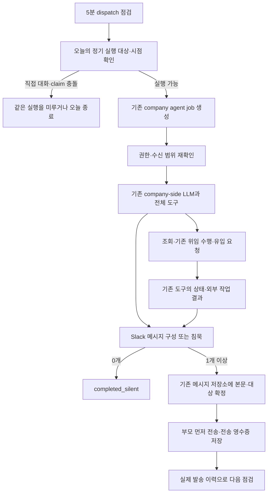

# Company-side Harper 선제적 채용 업무 구현 계획

- 문서 기준: 2026-10-15
- 상태: 정기 실행 enqueue, 원본 company-side Sol/high와 전체 도구, 공고 유입 요청, Slack 메시지 묶음·역할별 스레드와 전달 복구를 로컬 구현했다. 운영 DB migration·설정 활성화·실제 발송·배포는 수행하지 않았다. 본문은 최초 설계의 이력을 포함하며 현재 구현·검증 범위는 [후속 완료 기록](../evaluation/company-side-conversational-qa/reports/2026-10-15-proactive-completion.md)이 우선한다.
- 목표: 기존 company-side LLM이 회사의 현재 채용 상황과 실제 대화를 주기적으로 확인하고, 도움이 되는 일을 수행하거나 구체적인 제안을 하며, 필요가 없으면 아무 메시지도 보내지 않는다.
- 이번 구현 계획의 범위: 정기 실행, 필요한 기본 context, 전체 기존 도구 노출, 공고 유입 요청, Slack 메시지·스레드 구성, 반복 방지, 실행·전달 검증.
- Talent market mapping: 조회 계약과 근거 조건만 설계한다. 해당 도구나 통계 생성은 이번 작업에서 구현하지 않는다.
- 로컬 QA: [오류 수정·출력 검증 보고서](../evaluation/company-side-conversational-qa/reports/2026-10-15-proactive-review.md). 관련 코드 검사 60/60. 위임 실행·침묵은 개선됐으나 시장 근거 부족 상황의 제안 품질은 전체 gate 미통과다. 자동 발송 준비 완료로 판단하지 않는다.
- 추가 운영 관찰: [GPT-6.1 Sol / high, 실제 5곳 읽기 점검](../evaluation/company-side-conversational-qa/reports/2026-10-15-proactive-production-sol.md). 기본 reader의 잘못된 탐색 상태를 수정했고 관련 검사 46/46. 실행 계정 이메일을 회사 담당자로 제안한 문제도 prompt 보완 후 선택 재검증했다. DB 변경·실제 발송·배포는 없으며 최종 source 전체 출시 gate는 별개다.

## 실행 시간 외부 설정 (2026-10-15 로컬 구현)

`COMPANY_PROACTIVE_REVIEW_SCHEDULE` 환경변수로 실행 요일·시작 시각·실행 가능 시간을 조정한다.
미설정 시 기본값인 월~금 13:00 KST부터 120분을 유지한다. 예를 들어 평일 09:30부터
두 시간 동안 실행 가능하게 하려면 다음 JSON을 설정한다.

```json
{"daysOfWeek":[1,2,3,4,5],"startTimeKst":"09:30","windowMinutes":120}
```

- `daysOfWeek`: 일요일 0부터 토요일 6까지. 빈 배열이면 정기 점검을 하지 않는다.
- `startTimeKst`: 한국 시간의 24시간제 `HH:mm`.
- `windowMinutes`: 시작 후 새 점검을 접수하고 실행할 수 있는 시간. 1~1440분이며 실행 간격이 아니다.
- 생략한 필드는 기본값을 쓴다. 잘못된 값은 오류로 알리며 임의 시각으로 대체하지 않는다.

활성화된 Slack 채널이 연결된 모든 Workspace를 자동 조회한다. 별도 대상 등록은 필요하지 않으며
기존 `COMPANY_PROACTIVE_REVIEW_AUDIENCES` 환경변수는 더 이상 사용하지 않는다. Workspace에 활성 채널이
여러 개면 채널별로 하루 한 번 점검한다. 채널은 페이지를 끝까지 조회하고, 접수 직전에 활성 상태를 다시 확인한다.
실행 계정은 해당 Workspace의 Owner 중 가입 시각·membership ID 순으로 첫 계정을 선택한다. Owner가 없으면
건너뛰며, 기존 채널 공유 권한 검사와 실행·발송 단계의 권한 확인은 유지한다.
시간 설정은 자동 조회한 대상 전체에 공통 적용하며, 회사별 관리자 화면 설정은 아니다.
환경변수가 실제 실행 프로세스에 반영된 뒤 다음 5분 dispatcher부터 읽는다. 따라서 지정 시각은
정확한 발송 시각이 아니며, 최근 회사 대화에 따른 연기와 queue 처리·모델 판단에 따라 달라진다.
5분보다 짧은 실행 창은 점검 주기와 맞지 않으면 실행되지 않을 수 있다. 마감까지 기회가 없으면
그 회차는 건너뛰며, 새 회사 발화 취소와 기존 중복 방지는 유지한다.

자정을 넘는 창은 시작한 KST 날짜를 중복 방지 기준으로 사용한다. 설정 변경은 이미 접수한
작업의 마감이나 완료 기록을 다시 쓰지 않으며, 같은 시작 날짜의 작업을 재발송하지 않는다.
코드 수정 없이 조정할 수 있지만 실행 중인 서비스에 환경변수를 반영하는 과정은 필요하다.
무배포 즉시 변경을 위한 DB/Ops 설정은 이번 범위에 없다. 운영 환경변수 변경·배포는 하지 않았다.
기본 시간·다른 요일/분 단위·자정 경계·비활성화·잘못된 값의 관련 검사 5개를 통과했다.

## 1. 권장안과 제품 경험

별도의 주간 보고서 작성 LLM이나 상황 분류기를 만들지 않는다. 회사와 대화하는 기존 company-side LLM을 정기적으로 한 번 깨워, 같은 대화·일반 도구·권한으로 채용 업무를 이어가게 한다. 추가하는 것은 실행 계기, 짧은 현재 상황, 실제로 부족한 외부 능력이다.

LLM은 다음 네 가지를 모두 선택할 수 있다.

1. 이미 회사가 맡긴 일을 기존 도구로 이어간다.
2. 근거를 확인하고 회사가 결정하기 쉬운 제안을 한다.
3. 중요한 진행 상황이나 다음 확인 사항을 알려준다.
4. 읽어보았지만 지금 도움이 되지 않으면 조용히 종료한다.

정기 실행의 성공을 메시지 발송으로 정의하지 않는다. 유용한 업무를 처리하고 말할 필요가 없을 수도 있고, 읽기만 하고 끝날 수도 있다. 매번 질문하거나 역할별 보고서를 만드는 것도 목표가 아니다.

초기 권장값은 다음과 같다. 모두 새 설계의 초기값이며 기존 운영 설정으로 주장하지 않는다.

| 항목 | 초기 제안 |
| --- | --- |
| 점검 기회 | 평일 13:00 KST |
| 실행 단위 | Workspace × 승인된 Slack 수신 범위 × KST 날짜 |
| 정기 실행 횟수 | 해당 단위에 하루 한 번. 같은 작업의 기술적 재시도는 동일 실행으로 취급 |
| 의미 반복 | 최근 며칠 같은 제안을 했고 새 근거·위임·결정이 없으면 침묵. 최근 실제 발송 이력으로 LLM이 판단 |
| 최근 대화가 진행 중일 때 | 마지막 실제 회사 발화 후 30분까지 미룸 |
| 같은 범위의 검색·소개 전달이 진행 중일 때 | 상태를 context에 넣고 다른 승인 업무는 계속 점검. 결과를 기다려야 하는 제안만 보류 |
| 후보 소개가 방금 전달됐을 때 | 전달 시각·본문을 읽고 불필요한 반복 안내 생략. 위임된 업무 실행은 유지 |
| 모델과 기본 업무 도구 | 기존 company-side 설정을 재사용. 이 실행에서는 `full` capability mode |
| Slack 출력 | 0개, 한 메시지, 역할별 새 스레드, 한 부모 아래 여러 답글 모두 가능 |
| 공고 유입 요청 | 기존 홍보 허용 역할에 한해 수요를 기록하고 기존 GTM 운영에 전달 |
| Market mapping | 설계만. 근거 조회가 구현·검증되기 전에는 분포·증가 수치를 만들지 않음 |

초기안의 전체 72시간 발송 금지와 검색 중 점검 전체 연기는 제거한다. 그런 제한은 다른 유용한 일과 이미 맡긴 업무까지 막기 때문이다. 점검은 평일마다 가능하고 출력은 0개일 수 있다. 반복 여부는 최근 실제 대화·발송과 새 사실을 읽어 원본 LLM이 판단하며, 동일 일자의 정기 작업은 여전히 하나다.

사용자의 직접 질문에 대한 답변, 아직 전달하지 않은 필수 제품 사건 안내, 회사가 이미 요청한 업무의 결과 전달은 이 정기 메시지 간격 때문에 막지 않는다. 이들과 정기 점검은 서로의 실제 발송 이력을 읽어 불필요한 덧붙임을 줄인다.

## 2. 확인한 현재 구조와 부족한 부분

이 절은 2026-10-15 로컬 코드와 운영 계약 문서를 기준으로 한다. 확인한 Git HEAD는 beta `d61b9029`, Worker `5c6ba48`이며 두 checkout 모두 다른 작업의 미커밋 변경이 있었다. 로컬 코드의 존재를 현재 배포 완료의 증거로 사용하지 않는다. 실제 구현 시작 시 그때의 checkout과 운영 버전을 다시 확인한다.

| 영역 | 확인한 현재 구조 | 이번 설계에서 필요한 추가 |
| --- | --- | --- |
| Company-side 실행 | `runOrgAgentToolLoop`가 일반 조회·연락·역할·일정 도구를 사용 | 정기 실행도 같은 loop에 진입 |
| 비동기 작업 | `company_agent_web_action_jobs`, claim/retry, Vercel Queue, 5분 dispatch recovery | 선택적인 정기 점검 계기와 동일 작업 키 |
| 제품 사건 후속 판단 | `company_update`가 실제 사건을 전달하고, 소개가 이미 전달됐으면 유용한 후속 행동만 선택 | 실제 사건이 없는 정기 점검을 별도 origin으로 표현 |
| 침묵 | 선택적 event turn에서 빈 최종 출력과 `completed_silent` 지원 | 새 정기 계기의 첫 completion부터 동일 계약 적용 |
| Capability | `full`과 `progressive`가 같은 도구·정책을 공유. 이번 로컬 검증에 per-turn override 추가 | 정기 caller가 `full` 지정. 전역 설정 변경 없이 사용 |
| 기본 context | 접근 가능한 역할, pipeline, 연락, 최근 5개 검색 집계, 실제 회사 대화 | 실행 시점·실제 선제 발송 이력·진행 중 검색과 전달의 짧은 index |
| Slack | 기존 스레드 답글, Workspace 발송, 전달 영수증, 역할 관련 접근 검사 | 모델이 여러 메시지와 부모 관계를 선택하는 일반 발송 계약 |
| 다중 출력 | 현재 event turn의 progress/terminal 지원 | 임의 역할 스레드·여러 답글은 별도 확장 필요 |
| 후보 연락 | `contact_talent`, 연락 목록·상세, 예약 팔로업 조회·변경 | 새 팔로업 엔진 없이 기존 위임과 사실을 읽어 활용 |
| 일정 | Google Calendar 연동·면접 가능 시간·미팅 생성 경로 | 실제 지원되는 단계와 회사·후보 결정에 맞게 제안 |
| 검색 이력 | `get_more_data(kinds=["matching_runs"])`는 집계와 pagination | 시장 분포나 조건별 증감의 근거로 쓰기에는 부족 |
| 외부 공고 | `is_promote`, `is_anonymous`, 기존 LinkedIn GTM 운영 계약 | 유입 필요도를 기록하는 도구와 실제 GTM 소비 경로 |
| 서비스 설명 | 기존 FAQ와 `service_answer_examples`, 외부 홍보 항목 존재 | 해당 항목과 정책을 갱신. 별도 QA DB를 만들지 않음 |

현재 추천 소개에는 Worker가 작성한 카드와 기존 outbox를 유지하는 로컬 계약이 있다. 그 소개 전달 이후에 공통 회사 event가 후속 업무를 선택한다. 이번 정기 점검은 그 소개 writer나 추천 경로를 교체하지 않는다. 새 선제 메시지의 작성자는 기존 company-side LLM 하나다.

### 2.1 실제 코드로 확인한 중요한 제한

- `company_update`에서 아직 안내하지 않은 필수 사건은 메시지가 필요하다. 선택적인 정기 점검을 이 계기로 위장하면 침묵 계약이 어긋난다.
- 현재 loop는 Slack thread ID 유무를 실행 surface 판단에 사용한다. 새 Slack 부모 메시지를 만드는 정기 실행은 기존 thread가 없어도 Slack surface를 명시해야 한다.
- `request_matching_search`는 현재 회사의 명시적인 검색 요청을 전제로 한다. 도구 전체 노출이 이 조건을 제거하지 않는다.
- `get_talents`와 `read_talent`는 회사에 볼 수 있게 된 후보를 읽는 도구다. 전체 `talent_users`를 회사 LLM에 열어주는 도구가 아니다.
- 현재 `update_data` 목록에는 홍보 허용·익명 여부를 바꾸는 항목이 없다. 회사가 Slack에서 이를 요청해도 처리하려면 기존 일반 수정 계약을 확장해야 한다.
- 예약 팔로업의 날짜는 다음 후보자 검토부터 보낼 수 있는 시점이다. 그 값만으로 정확히 내일 이메일을 보낸다고 말할 수 없다.

## 3. 기본 구조



새 계기의 이름은 `company_proactive_review`를 제안한다. 이는 작업의 출처를 구분하기 위한 기술적 식별자다. “대기 후보 안내”, “채용 기준 완화”, “연봉 질문” 같은 상황별 action name을 만들지 않는다.

정기 작업도 `enqueueOrgAgentWebActionTurn`과 기존 queue를 사용한다. `composeCompanyUpdate`처럼 문구만 작성하는 adapter를 주 실행기로 쓰지 않는다. 읽기·쓰기·연락 등 정상 도구를 호출할 수 있는 전체 loop가 필요하기 때문이다.

`enqueueCompanyUpdate`는 실제 회사 공유 가능 사건을 전달하는 기존 경로로 유지한다. 정기 점검에서 실행한 도구가 실제 사건을 만들더라도, 그 사건만으로 또 다른 정기 점검을 만들지 않는다. 정기 작업이 자신의 발송을 읽고 새 작업을 계속 만드는 루프를 막는다.

## 4. 언제 실행할지

### 4.1 검색 완료와 정기 실행을 분리한다

현재 역할별 정기 검색의 기본값은 월·수·금 09:00 KST다. 회사가 역할마다 요일·시간을 바꿀 수 있고 같은 Workspace·같은 시각의 역할들이 한 검색에 묶인다. 따라서 고정된 “검색 세 시간 뒤”나 “모든 역할 검색이 끝난 직후”는 안정적인 공통 실행 시점이 아니다.

검색 결과 소개가 실제 전달된 뒤에는 기존 선택적 company event가 그 결과에 관한 다음 도움을 판단할 수 있다. 정기 점검은 오후에 채용 업무 전체를 확인하는 보완 경로로 둔다. 검색을 하지 않은 날에도 미결정 후보, 회사가 맡긴 연락, 오래된 미팅 상태 같은 업무가 남을 수 있다.

기본 시작 시각은 사용자 요청에 따라 13:00 KST로 설정한다. 오후에 기록한 공고 수요는 다음 GTM 운영이 읽게 된다. 당일 즉시 게시를 약속하지 않는다. 익명·비노출 요청으로 기존 공개물을 수정하거나 내리는 작업은 일반 수요 요청과 다르게 즉시 확인이 필요한 운영 경계다.

### 4.2 기존 5분 dispatch route의 작은 확장

새 스케줄 인프라나 장기 실행 프로세스를 만들지 않는다. 기존 인증된 dispatch/recovery route에 가벼운 due check를 추가한다. 이 route는 LLM을 직접 실행하지 않고 대상 조회와 기존 job enqueue만 수행한다.

1. 활성 Slack 채널이 연결된 모든 Workspace를 자동 조회하고 Owner·채널 공유 권한을 확인한다.
2. 외부 시간 설정의 실행 창에 해당하는지 계산한다. 기본값은 KST 평일 13:00~15:00이다.
3. `workspaceId + audienceScopeId + KST date`로 기존 작업 또는 완료 이력을 조회한다.
4. 실제 대화와 현재 claim으로 실행 가능 시각을 구하고, 검색·전달·최근 발송은 해당 실행 context에 넣는다.
5. 실행 가능하면 동일 키의 job을 한 번 생성한다. 대기가 필요하면 같은 job의 기존 `next_attempt_at`을 사용한다.
6. 설정된 실행 창의 마감(기본 19:00)까지 실행 조건이 맞지 않으면 그날은 종료한다. 다음 날 과거 날짜 작업을 몰아서 만들지 않는다.

시간대는 초기에는 KST로 고정한다. 미래에 Workspace 시간대를 지원할 때도 시간 계산은 서버가 하고, LLM에는 절대 시각과 경과 시간을 제공한다. LLM에게 예약 날짜 산술을 맡기지 않는다.

기존 job status로 표현할 수 있는 결과는 재사용한다. 예를 들어 실제 새 회사 발화로 취소된 선택적 작업은 `superseded`, 말할 필요 없는 완료는 `completed_silent`를 사용할 수 있다. 취소·미룸·전송 여부는 관측 로그에 사실로 구분하며 새 대화 의미 상태 머신을 만들지 않는다.

### 4.3 겹침과 경쟁 처리

| 상황 | 처리 |
| --- | --- |
| 같은 수신 범위에 회사 발화가 최근 30분 내 존재 | 다음 조용한 구간까지 미룸 |
| 같은 대화에 다른 company-side job이 진행 중 | 기존 conversation claim을 따름 |
| 같은 수신 범위의 역할 검색이 queued/running | 진행 중임을 제공. 이미 있는 후보·별도 위임은 점검하고 아직 없는 검색 결과는 단정하지 않음 |
| 검색은 끝났지만 소개 outbox가 전송 중 | 실제 전달 완료 여부를 제공. 소개 자체와 중복되는 선택적 안내는 보류 |
| 소개가 실제 전송된 지 60분 미만 | 시간·실제 본문을 보고 후속 업무의 실익을 판단. 새로 소개된 사실만 반복하지 않음 |
| 전체 Worker의 다른 회사 검색이 진행 중 | 이 회사 점검을 막지 않음 |
| 정기 loop 도중 같은 범위에 새 실제 회사 발화 도착 | 다음 tool boundary와 메시지 확정 전에 중단 검사 |
| 이미 외부 side effect가 실행된 뒤 새 발화 도착 | 실행 사실은 보존. 아직 실행하지 않은 작업만 멈춤 |
| DB/검색 상태 조회 실패 | 빈 결과나 검색 완료로 간주하지 않음. 안전하게 미루거나 실패 |

검색과 선제 점검의 exclusive lock을 Worker 전체로 확대하지 않는다. 같은 회사·수신 범위·대화에만 필요한 경계를 둔다. 선택적 정기 점검은 회사의 직접 대화보다 우선하지 않는다.

현재 필수 `company_update`는 새로운 회사 메시지가 있다고 쉽게 생략할 수 없는 사건 안내다. 정기 작업에 같은 supersede 예외를 그대로 적용하지 않는다.

## 5. 반복과 알림량을 줄이는 방법

반복 방지는 세 층으로 처리한다. 의미 판단과 전송 중복을 섞지 않는다.

| 층 | 원본 | 책임 |
| --- | --- | --- |
| 실행 중복 | 기존 job의 unique idempotency key | 같은 날짜·수신 범위의 작업이 두 번 실행되지 않음 |
| 전송 중복 | 확정 본문, 메시지 ID, 대상, 실제 Slack receipt | 동일 메시지의 재시도가 새 본문·새 부모를 만들지 않음 |
| 의미 반복 | 최근 실제 회사 대화와 이미 전달한 선제 메시지 | 이전 제안을 다시 해야 하는지 원본 LLM이 판단 |

최근 선제 발송을 이유로 정기 LLM 실행이나 승인된 업무를 막지 않는다. 같은 내용의 새 안내를 며칠 동안 반복할 필요가 있는지는 원본 LLM이 실제 이력을 읽어 판단한다. 회사에 보내지 않고 연락 상태를 확인하거나 맡긴 일을 마치는 실행도 정상이다. 새 중요한 사실이나 이미 요청한 결과는 이전 발송과 가까워도 도움이 될 수 있다.

부분 전송도 실제로 회사에 보여준 이력에 포함한다. 같은 실행의 남은 답글 전달은 새 정기 발송으로 세지 않는다. 전송되지 않은 초안과 실제 전달 본문을 구분하고, 재시도의 동일 메시지와 새로운 선제 제안을 섞지 않는다.

LLM에는 같은 수신 범위의 최근 14일 선제 발송 본문 또는 짧은 실제 기록, 관련 역할 대화의 최근 발화, 마지막 질문 이후 회사 답변 유무를 제공한다. 추가 context가 필요하면 `read_conversation_history`를 쓴다. 같은 제안을 했고 회사가 답하지 않았다는 이유만으로 다시 요구하거나 자동으로 수락·거절했다고 해석하지 않는다.

새 키워드 목록, topic enum, 문장 유사도 임계치, “Communications 연봉 질문” 전용 skip 상태를 만들지 않는다. 회사가 “이번 주에는 연락하지 말아줘”처럼 추가 지시를 하면 기존 일반 memory/설정과 대화에 저장된 사실을 사용한다. 영구적인 정기 안내 opt-out이 제품 설정으로 필요해질 때는 그 실제 동의를 저장하는 기존 Workspace 설정을 확장한다.

필수 사건을 알려주는 작업의 선택적 덧붙임도 최근 발송 이력을 읽는다. 이미 전달한 후보 소개를 다른 문장으로 다시 요약하는 것이 유용한 후속 업무인지 LLM이 판단한다. 며칠이 지났다는 사실 자체가 발송 이유는 아니다.

## 6. 최소 prompt와 추가 context

### 6.1 추가 prompt 초안

아래 지침은 기존 공통 company-side system prompt와 도구 정책에 붙이는 짧은 실행 지침이다. 여섯 예시를 각각 시나리오 분기로 넣지 않는다.

```text
This is an optional proactive review, not a new instruction from a company user.
Continue Harper's recruiting work using the company's actual conversation and current facts.
Look for a useful next action, consequential suggestion, or unresolved delegated task; do not produce a routine report.
Use the normal tools when more evidence or an authorized action is needed. Tool availability does not grant new authorization.
Read recent delivered messages before contacting the company. If nothing useful is new, finish with no company message.
Act within existing instructions and permissions. Ask only for a decision or missing fact that materially changes the next step.
Describe verified effects and uncertainty accurately; do not invent candidate interest, delivery, scheduling, or market statistics.
Choose the clearest Slack layout through send_company_message, or use the ordinary single reply when that is enough.
```

기능별 상세 절차는 capability policy, tool의 인자와 효과는 tool description, 실제 상태는 tool result, 말투는 기존 `uxWritingPrompt.ts`에 둔다. 같은 업무 규칙을 prompt·FAQ·tool result에 반복 복제하지 않는다. 위 지침은 배포 시 실제 노출된 도구 이름과 맞춰 최종 조정한다.

### 6.2 기본으로 제공할 짧은 context

기존 role index, 최근 실제 대화, 후보 pipeline 및 연락 context를 재사용한다. 정기 계기에 추가하는 기본 awareness는 다음 정도로 제한한다.

| 정보 | 최소 내용 | 상세 조회 |
| --- | --- | --- |
| 이번 실행 | optional proactive origin, 현재 KST 날짜·시각, 수신 범위 | 추가 조회 없음 |
| 최근 선제 발송 | 실제 전달 시각, 메시지·스레드 ref, 짧은 본문 | `read_conversation_history` |
| 역할별 상황 | 이름·상태·단계별 수, 최신 변화 시각, 홍보 허용·익명 여부 | `read_role`, `get_talents` |
| 검색·소개 진행 | 역할 ID, 최신 run 상태, 실제 전달 여부·시각, 조회 기준 시각 | 기존 `matching_runs`, 실제 전달 ledger의 bounded projection |
| 미완료 연락 | 연락 ref, 실제 발송·회신·팔로업 상태, 다음 검토 시점 | `list_contacts`, `read_contact` |
| 기존 위임 | 관련 실제 회사 발화 또는 기존 대화 요약의 참조 | `read_conversation_history` |
| 새 회사 공유 사건 | 실제 사건의 ID·시각·공유 가능 사실을 소량 | 기존 event/contact 조회 |
| 근거의 부족 | 조회 실패, 잘린 목록, 최신성을 확인하지 못한 항목 | 같은 일반 read tool |

처음부터 모든 후보 프로필·Career 대화·전체 fit 기록·모든 역할 JD를 넣지 않는다. 후보가 많으면 `get_talents`의 pagination으로 필요한 후보를 읽고 shortlist를 만든다. 최신 5개 검색 이력과 역할 index가 이미 기본 context에 있는 것은 다시 중복 주입하지 않는다.

과거 위임을 별도 intent extractor로 다시 저장하지 않는다. 원본 대화와 기존 연락·일정·초안 상태를 읽어 계속할 일을 판단한다. 이 작업을 위해 “agent task”, “pending reasoning”, “company intent” 테이블을 추가하지 않는다.

통계는 이름만 있는 숫자 객체를 넘기지 않는다. 평가 기록 수·최신 평가를 가진 사람 수·긍정 적합 판정 수·현재 신규 소개 자격을 확인한 수·실제 소개 전달 수는 서로 다른 사실이다. 각각의 모집단, 기간, 판정 의미와 미제공 항목을 짧게 설명한다. 예를 들어 ‘18명의 평가가 최신’이라는 사실은 ‘적합한 후보 18명’이 아니다. 최근 구간의 소개 0명과 과거 누적 소개 0명도 구분한다. 이 구분이 불명확한 `freshFitPeople` 같은 이름을 실제 awareness 계약으로 사용하지 않는다.

조회 context와 합성 평가도 실제 `include` 계약을 지킨다. 요청하지 않은 상세·pipeline은 기본 주입하지 않고, 요청한 필드가 빈 값인 경우와 조회되지 않은 경우를 정확히 구분한다. 전체 역할의 단계별 수와 현재 `stage` 필터로 조회한 사람 목록의 모집단을 섞지 않는다.

### 6.3 전체 tool 노출

정기 점검도 일반 채팅의 `onToolStatus`·Working log 정리 방식을 재사용한다. 최종 메시지를 확정한 실행은 해당 메시지 묶음의 기존 `thinking_logs`에 실행 전체의 도구 작업 내역을 저장하며, 역할 메시지는 `/org/role`의 기존 Working log UI로 조회한다. 별도 로그 전용 메시지는 만들지 않고, 최종 메시지가 없는 silent 실행은 채팅에 남기지 않는다. 이 연결은 로컬 구현이며 배포 완료를 뜻하지 않는다.

로컬 loop에 실행별 `capabilityMode?: "full" | "progressive"` 인자를 추가했다. 이 계기에 `full`을 넘기고 기본 대화는 현재 설정을 따르는 설계다. scheduler는 아직 구현하지 않았고 실제 정기 실행을 활성화하지 않았다.

`allowSilentCompletion`만으로 실행 출처를 판단하지 않는다. 기존 공통 지침은 이를 verified product event로 설명했으므로, 새 정기 점검에는 명시적인 `backgroundOrigin: "scheduled_review"`를 넣는다. 새로운 사건이 없는데 사건이 발생한 것처럼 안내하거나 회사 발화로 승인되는 문제를 피한다. 이 로컬 연결과 `proactiveReview.ts`의 작은 prompt builder를 합성 평가에 사용한다.

`resolveCompanyCapabilities`의 기존 `full` 경로를 재사용하므로 모든 현재 surface 지원 도구의 schema와 관련 policy가 첫 completion부터 같이 보인다. tool schema만 열고 정책을 누락하지 않는다. 작업 예산이 끝난 최종 completion에서는 현재 정상 loop처럼 도구 호출이 종료될 수 있다.

새 parent Slack 메시지를 만들 수 있도록 `source: "slack"`와 delivery context를 명시한다. 기존 thread가 없다는 이유로 web chat 도구 목록으로 실행하거나 가짜 thread ID를 넣지 않는다. 다른 회사나 지원되지 않는 surface의 도구를 추가하는 의미의 “모든 도구”는 아니다.

## 7. 무엇을 먼저 실행하고 언제 제안할지

정기 계기는 “회사 전체 업무를 대신 결정할 새로운 승인”이 아니다. 다만 이미 승인된 정상 업무를 매번 재확인하는 계기도 아니다. 원본 LLM이 실제 위임과 최신 철회·수정을 읽고 필요한 일을 이어간다.

| 업무 | 자율 처리·제안의 범위 |
| --- | --- |
| 연결 대기 후보 우선순위 | 접근 가능한 후보의 현재 기준·공유 근거를 읽고 몇 명을 먼저 검토할지 정리 가능. 후보 수만으로 상위 후보를 임의 선정하지 않음 |
| 후보자에 대한 질문 답변 | 이미 회사 공유 가능한 professional profile·명시적으로 허용된 정보만 읽어 답변. 개인 Career 원문을 보충 자료로 쓰지 않음 |
| 후보 연락 | 회사가 이미 맡긴 목적·대상·관계 안의 연락은 기존 `contact_talent`로 수행. 같은 승인 요청을 반복하지 않음 |
| 첫 연결·Intro | 후보 선택과 연결에 대한 기존 회사 결정·동의 계약을 따름. 선제 tick만으로 새 Intro를 소비하지 않음 |
| 팔로업 | 발송·회신·기존 팔로업을 먼저 확인. 위임 범위 안의 기존 연락을 이어가거나 필요한 선택을 구체적으로 제안 |
| 인터뷰 | Calendar 연결과 가능 시간을 확인한 뒤, 지원되는 실제 요청·확정 경로를 사용. 회사가 인터뷰를 원한다고 말하지 않았는데 후보에게 초청하지 않음 |
| 기준·연봉 | 빠진 사실이나 대안의 실익을 제안할 수 있음. 회사의 기준·연봉을 제안만으로 수정하지 않음 |
| 추가 검색 | 도구의 기존 명시적 회사 요청 전제를 유지. 과거 미완료 요청을 재시도하는 경우 중복과 최신 지시를 확인 |
| 공고 유입 | 이미 외부 홍보를 허용한 역할은 실제 수요 요청을 저장 가능. 홍보 허용을 켜거나 익명 설정을 바꾸는 것은 회사의 명시적 지시를 따름 |
| 채용 단계 | 실제 회사 결정·면접 사실과 기존 권한을 사용. 응답이 없다는 이유로 단계·거절·종료를 바꾸지 않음 |

### 7.1 연결 대기 후보와 인터뷰

좋은 메시지는 “16명이 기다립니다”를 반복하는 대신, 현재 Brief에 맞는 후보 몇 명의 서로 다른 강점과 남은 확인 사항을 짧게 제시하고 회사가 한 번 답하면 다음 업무를 진행할 수 있게 한다. 대기 인원이 존재한다는 것은 회사 결정이 아직 기록되지 않았다는 사실이다. 회사가 후보를 읽었는지, 후보가 여전히 즉시 면접 가능한지는 별도 근거가 필요하다.

회사에 실제로 보이는 후보 목록이 잘렸으면 전체 후보 중 최우선이라고 단정하지 않는다. 필요한 페이지와 상세를 읽거나 검토 범위를 명시한다. 회사가 같은 shortlist를 이미 보았으면 새 근거·새 결정이 없는 재발송은 생략한다.

“가능한 시간만 보내주시면 후보자에게 선택을 요청할게요”는 실제 Calendar 연결·후보 관계·연락 경로가 지원될 때 제안한다. 이미 저장된 가능 시간이 있고 회사가 해당 면접을 위임했다면 다시 시간 입력을 요구하지 않고 실행한다. Google Meet 링크는 실제 미팅 생성과 Calendar 작업이 완료된 뒤 사실로 안내한다.

### 7.2 이전 Intro·팔로업·외부 미팅

최근 Intro 뒤 후보자 회신이 없다는 사실을 읽었을 때, 원본 연락이 실제 발송됐는지와 기존 팔로업 유무를 함께 본다. 회사가 같은 이메일에서 직접 회신하거나 외부에서 만났다면 Harper가 그 사실을 아직 모를 수 있다. 알 수 없는 상태를 “아무 진전이 없다”로 단정하지 않는다.

외부 만남의 진행 상태가 다음 추천이나 팔로업에 중요하면 한 번 가볍게 확인할 수 있다. 그 답이 실제 어떤 업무를 바꾸는지 분명해야 하며, 매주 모든 연결 후보에게 근황을 묻는 규칙을 만들지 않는다. 회사가 진행 사실을 알려주면 기존 단계·일정·연락 도구로 필요한 사실을 기록한다.

현재 예약 팔로업은 `scheduledAt` 이후 다음 후보자 검토에서 전달을 판단하는 계약이다. “내일 보내볼게요”라고 확정하려면 정확한 날짜의 실제 실행 계약을 별도로 지원해야 한다. 이번 MVP에서는 기존 예약 검토 계약을 사용하고, 도구가 확인한 다음 검토 시점 또는 현재 등록 사실을 정확히 설명한다. 필요하다면 현재 위임에 따라 정상 연락 도구로 지금 팔로업을 보낼 수 있다.

## 8. Talent market mapping 설계 — 이번에는 구현하지 않음

### 8.1 필요한 질문

목표는 전체 회원 수나 직군 비율을 보여주는 통계 화면이 아니다. 특정 역할에 대해 다음 질문에 답할 최소한의 근거다.

- 최근 실제로 검토한 모집단은 어느 정도이고, 얼마나 최신인가?
- 현재 역할과 관련된 경험이 확인된 사람이 어느 범위에 있는가?
- 어떤 기준이 추가 검토를 막거나 불확실하게 만드는가?
- 다른 주요 기준은 유지하면서 한 기준의 해석을 넓혔을 때 재검토할 가치가 있는 사람이 실제로 있는가?
- 그 추가 검토 대상이 아직 소개되지 않은 사람인지, 이미 소개·연락·거절한 사람인지?
- 후보자 의향을 모르는 상태인지, 현재 소개·연락 자격까지 확인한 상태인지?

“PR 에이전시나 스타트업 프로그램 출신까지 넓혀보자”는 직군에 대한 일반적인 생각만으로 보내지 않는다. 그런 실제 professional evidence를 가진 모집단을 읽고, 현재 기준과의 충돌·유지할 핵심 역량을 확인한 경우에만 제안한다.

### 8.2 현재 쌓인 fit의 활용과 제약

기존 데이터에는 `talent_opportunity_fit`의 역할·후보·회사 fit 축, 평가 시점, 입력 fingerprint와 source/model version이 있다. 과거 경로의 `company_first_talent_scores`나 criterion 컬럼도 존재하지만, 테이블·컬럼이 존재한다는 사실과 현재 실행에서 새로 채워지는 사실을 구분해야 한다. 최신 Company-first runner는 `opp/matching/company.py`를 통해 공통 fit 평가를 사용하고, run/selection·실제 소개·전달 이력은 별도로 남긴다. Worker planner에도 fresh/stale fit과 전달 상태를 구분하는 read-time 집계 계약이 있다.

그러나 이를 그대로 전체 talent 시장 지도라고 부를 수는 없다.

1. 검색·retrieval을 거친 사람은 전체 회원의 무작위 표본이 아니다. 현재 검색 방식과 기준에 따른 선택 편향이 있다.
2. 오래된 fit, 역할 기준이 바뀌기 전 fit, 현재 profile/Brief/version과 다른 fit을 섞으면 현재 재고를 과장한다.
3. 현재 공통 fit의 `_persist`는 기존 `company_criteria_evaluations`를 null로 갱신하며 새 criterion 평가를 생성하지 않는다. 과거 `scorer.py`의 `companyFit=fit` 조건부 criterion 출력이나 legacy 컬럼을 최신 실행의 coverage로 간주할 수 없다.
4. 현재 `opp/matching/presentation.py`는 `company_first/both/connect`로 선정된 후보의 소개 단계에서 criterion별 근거를 작성한다. 선택된 사람만의 기준 분포로 탈락 이유의 전체 분포를 설명할 수 없다. 최신 fit과 과거 criterion 행을 함께 읽더라도 source·version·작성 시점을 분리해야 한다.
5. 후보 측 fit과 내부 이유에는 사적인 목표·선호가 들어갈 수 있다. raw `candidate_reason`, 전체 Search Brief/Memory, Career 대화를 회사 LLM에 넘길 수 없다.
6. fit이 긍정적이더라도 회사 소개 동의·신규 공유 자격·의향·추천 중복·일정은 별도다.

이전에 SBVA 관련 탐색에서 수동으로 읽은 PR 관련 소규모 집합 역시 전체 `talent_users`의 무작위 분포나 실제 신규 소개 가능 인원으로 사용하지 않는다. 기존 탐색 결과와 운영 tool의 재현 가능한 집계를 구분한다. 이 문서에는 실제 후보의 이름·ID·원문을 넣지 않는다.

### 8.3 가장 작은 첫 조회 계약

별도 `recommend_criterion_relaxation` 도구나 도구 내부 분석 LLM을 만들기보다 기존 `read_role`에 `include: ["fit_evidence"]` 같은 선택적 상세 조회를 확장하는 방향을 권장한다. 실제 인자 이름은 기존 tool schema와 맞춰 확정한다.

첫 조회는 한 역할의 현재 기준에 대한 기존 증거를 읽는다. 현재 코드에서 바로 읽을 수 있는 중심은 fresh fit 축의 집계, 실제 소개·pipeline·연락 결과, 소개 대상의 criterion 근거와 그 coverage다. 완화 시 추가 인원 계산이 처음부터 제공되는 tool로 설계하지 않는다. 전체 talent row를 내보내거나 즉석에서 임의 SQL을 실행하는 회사 도구로 만들지 않는다.

| 반환 묶음 | 반드시 포함할 사실 |
| --- | --- |
| 조회 기준 | `asOf`, 현재 역할 기준 revision/fingerprint, 사용한 evaluator/source version |
| 모집단 정의 | 전체 eligible 계정인지, 해당 역할에서 실제 평가된 pair인지, 회사에 이미 소개된 후보인지 |
| Coverage | 중복 없는 사람 수, fresh/stale/미평가·누락 수, 대상 기준별 평가가 존재하는 수 |
| 현재 재고 | 평가됨, 회사 공개 자격 확인됨, 이미 소개됨, 현재 pipeline에 있음 등을 구분한 집계 |
| 기준별 근거 | 평가가 실제 존재하는 모집단의 기존 구조 값과 누락. 내부 이유를 회사용 문장으로 무단 복사하지 않음 |
| 추가 검토 집합 | 같은 기준 버전에서 다른 핵심 조건의 근거가 유지되는 추가 pair 수. 계산할 수 없으면 미제공 |
| 사례 | 이미 회사에 보이는 후보의 기존 공유 가능 ref만. 숨겨진 후보를 이름·링크로 예시화하지 않음 |
| 제한 | 표본 편향, 누락, 의향 미확인, 변경 전 기준, 조회 실패·잘림 |

Global profile 통계가 필요하면 같은 일반 read의 aggregate 범위를 별도로 추가한다. 저장된 professional source로 객관적으로 계산할 수 있는 지역·경력 기간 같은 통계부터 고려하고 정의·중복·미상 비율을 함께 제공한다. 역할명에 “PR”이 있다는 keyword 매칭을 “PR 전문가”라는 의미 분류로 바꾸지 않는다. 에이전시 출신·프로그램 운영 능력 등 의미 판단이 필요한 집합은 기존 검토 근거가 없다면 아직 제공할 수 없다고 반환한다.

전체 회원의 aggregate와 회사 공개 가능 후보의 개별 read는 다른 권한 계약이다. Aggregate의 새로운 회사 공유 범위가 필요하면 명시적으로 정의하고 검증해야 한다. 서비스에 DB 접근 권한이 있다는 사실만으로 회사에 새 개인정보 접근 권한이 생기지 않는다. 식별 가능성이 있는 작은 집계·자유 조합은 기존 개인정보 경계를 적용하거나 더 큰 범주로 합친다.

### 8.4 조건 완화의 근거 수준

다음 세 설명을 구분한다.

| 근거 | 가능한 제안 | 할 수 없는 주장 |
| --- | --- | --- |
| 직군·경력 aggregate만 있음 | 탐색 범위를 넓혀볼 가설. 어떤 기준과 어떤 수행 근거를 검증할지 설명 | 이 변화로 신규 소개가 N명 늘어난다는 수치 |
| 현재 기준의 fresh fit·관련 professional 근거가 있음 | 어떤 조건 때문에 현재 보류되는지, 추가 검토 가치가 어디에 있는지 설명 | 기존 판정의 reason을 임의로 재분류한 정확한 탈락 비율 |
| 동일 모집단·현재 버전에서 다른 기준이 유지되는 집합을 검증함 | 한 기준을 넓히면 추가로 재검토할 수 있는 인원과 남은 확인 사항 설명 | 해당 인원이 실제로 회사를 원하거나 모두 연결된다는 보장 |

한 기준에 `bad/uncertain`이고 나머지가 `good/excellent`인 행을 조회할 수 있더라도, 그것은 재검토할 만한 근거이지 자동 합격 판정이 아니다. 해당 criterion이 어떤 필수 수행 능력을 대표하는지, 그 충돌이 정말 그 기준만의 문제인지 LLM이 evidence로 판단한다. 코드가 “bad 하나면 완화 제안”을 실행하지 않는다.

특히 현재 기준별 평가가 제한적으로 존재하므로 위의 마지막 수준은 항상 계산 가능한 기능으로 약속하지 않는다. 충분한 근거가 없는 경우 첫 버전은 Coverage·불확실성만 보여주는 것이 맞다. 더 넓은 후보의 새 의미 평가가 필요하면 기존 canonical fit 평가 owner와 평가 계약에서 별도 설계한다. 숨은 분석 LLM을 read tool 안에 넣지 않는다.

### 8.5 통계의 저장 방식

첫 버전은 기존 fit/run/presentation을 읽는 on-demand 집계를 권장한다. 이유는 역할·프로필·공개 상태가 바뀌고, 새 통계 테이블을 만들 만큼 독립적인 durable 사실이 없기 때문이다.

DB 집계만으로 현재 criterion과의 증감 근거가 없으면 결과를 미제공으로 돌려준다. 지난 내부 reason을 정규식으로 분류해 부족한 숫자를 채우지 않는다. LLM이 실제 근거를 읽고 한정된 범위의 제안을 한다.

성능이 실제 병목으로 확인될 때만 기존 run의 결과·기존 cache에 version과 as-of를 가진 재생성 가능한 projection을 둔다. 새 “market judgment” 영구 테이블이나 후보별 “완화 가능” 상태를 만들지 않는다. 기존 Worker의 canonical fit 재사용·fingerprint 규칙과 다른 신선도 판단을 임의로 복제하지 않는다.

### 8.6 데이터에 근거한 메시지 형태

아래는 **합성 예시**다. 실제 SBVA 수치나 현재 talent 분포를 뜻하지 않는다.

> Communications의 최근 검토 40명 중 현재 기준으로 평가가 유효한 분은 28명이었어요. 그중 6명은 매체 대응·콘텐츠 실행 근거가 있지만 VC 내부 경력 기준은 충족하지 못하거나 확인이 부족했어요. 이 기준을 ‘VC 내부 경력’에서 ‘투자·스타트업 관련 대외 커뮤니케이션 경험’까지 넓혀볼 여지가 있어 보여요. 다른 핵심 기준을 유지하고 이 6명을 다시 검토해볼 수는 있지만, 아직 의향과 새 소개 가능 여부를 확인한 인원은 아니에요. 이 범위까지 살펴봐도 괜찮을까요?

이 문장을 보내려면 40·28·6의 모집단과 근거가 조회 결과로 실제 뒷받침되어야 한다. 특히 6명의 다른 핵심 기준과 새 소개 가능 여부를 혼동하지 않아야 한다. 현재 저장 coverage로 이 결론을 낼 수 없으면 숫자·직군을 빼고, 실제로 부족한 정보와 검증 가능한 다음 일만 제안한다.

연봉이 없는 것이 중요한 불확실성이라면 허용된 역할 정보와 시장 근거를 보고 범위를 물을 수 있다. “연봉을 알려주면 반드시 더 많이 찾는다”거나 특정 후보의 비공개 희망 연봉을 회사에 전달하지 않는다.

## 9. `job_posting_promote` 도구

### 9.1 도구의 실제 효과

도구 이름은 사용자가 제안한 `job_posting_promote`를 유지할 수 있다. 설명 첫 문장에 **이미 외부 홍보를 허용한 역할의 추가 유입 수요를 기록하는 작업**이라고 명시한다. LinkedIn에 즉시 게시하는 API나 게시 예약 도구처럼 설명하지 않는다.

새 외부 능력은 기존 LinkedIn 슬롯 운영이 읽을 수 있는 역할별 수요 요청을 남기는 것이다. 정기 agent가 이를 호출했을 때 저장 결과를 보고 “더 필요한 역할로 전달해두었다”고 말할 수 있어야 한다. 실제 소비 경로가 없다면 도구를 노출하지 않으며, 기록만 한 것을 운영에 반영됐다고 설명하지 않는다.

### 9.2 최소 인자

```ts
type JobPostingPromoteArgs = {
  roleId: string;
  demand: "sufficient" | "normal" | "more_needed" | "urgent";
  reason: string;
};
```

| 값 | 모델에게 설명할 의미 |
| --- | --- |
| `sufficient` | 현재 추가 유입을 우선 요청할 필요가 적음 |
| `normal` | 일반 수준의 유입 필요 |
| `more_needed` | 현재 역할의 추가 유입을 더 고려해달라는 요청 |
| `urgent` | 현재 채용 맥락에서 가능한 슬롯 배분을 우선 검토해달라는 요청 |

이 값은 슬롯 운영이 읽는 작은 machine contract다. DB enum/CHECK로 늘리기 어렵게 고정하지 않고, tool의 지원값과 executor 타입으로 검증한다. 후보 수·대기 일수·직군 키워드로 demand를 자동 결정하지 않는다. 이유는 원본 LLM이 현재 역할 상황과 회사 지시를 보고 짧게 작성한다.

`sufficient`는 공고를 내리거나 채용을 멈추라는 명령이 아니다. 실제 게시 중단·익명화 요청은 기존 홍보 설정과 해당 운영 경로로 처리한다. `urgent` 역시 게시 순위·횟수·노출량을 확정하는 주문이 아니다.

### 9.3 영속 데이터와 consumer

최신 역할별 운영 요청을 담는 선택적 `company_internal_roles.promotion_demand` JSONB 컬럼 하나를 권장한다. 기존 `considerations`의 의미와 reader를 바꾸지 않고 명시적인 운영 지시를 분리한다. 새 테이블은 만들지 않는다.

```json
{
  "level": "more_needed",
  "reason": "현재 역할에 필요한 추가 유입의 짧은 근거",
  "updatedAt": "ISO timestamp",
  "validUntil": "ISO timestamp",
  "sourceJobId": "existing-company-agent-job-id"
}
```

이 데이터가 필요한 이유는 **다음 외부 공고 운영이 아직 실행하지 않은, 역할별 추가 유입 요청**이라는 durable 사실 때문이다. 구체적인 reader는 기존 LinkedIn GTM 실행의 역할 입력이다. 단순히 LLM의 생각을 보관하기 위한 필드가 아니다.

처음에는 7일 유효 기간을 제안한다. 영원히 urgent로 남지 않게 하고, 만료된 요청을 읽어 강한 최신 지시로 쓰지 않는다. 같은 실행의 재시도는 유효 기간을 연장하지 않는다. 다시 요청하는 경우 현재 상황을 새로 확인하고 독립된 업무 결과로 갱신한다.

기존 LinkedIn GTM은 현재 eligible 역할, 실제 Open 공고와 슬롯, 실제 조회·Apply Starters, 게시·교체 기록과 함께 이 요청을 읽는다. demand를 숫자 점수로 바꾸어 자동 게시하거나 자주 올리고 내리는 규칙을 추가하지 않는다. 역할 상황과 다른 역할의 필요를 기존 운영 판단이 함께 본다.

최신 운영 요청만 있으면 실행 가능하므로 별도 demand history 테이블을 만들지 않는다. 호출과 변경 이력은 기존 tool trace와 job에 남긴다. 실제 게시 사실은 기존 LinkedIn/UI 관찰·공고 전달 기록에 남기며 이 필드에 `posted=true`를 추정해 쓰지 않는다.

### 9.4 서버에서 검증할 경계

- 현재 Workspace·역할 접근 권한과 외부 홍보 요청 권한을 검증한다.
- 역할이 해당 Workspace의 실제 internal role인지 확인한다.
- 활성·유효·비테스트 역할인지 확인한다.
- `is_promote=true`인지 실행 직전에 확인한다. 기본 context에도 표시해 불필요한 호출을 줄인다.
- `is_promote=false`라면 상태를 바꾸지 않고 홍보 비허용 사실을 반환한다. 도구가 몰래 ON으로 바꾸지 않는다.
- 현재 익명 여부를 함께 반환한다. 호출에서 회사명 노출 권한을 확장하지 않는다.
- stable job/원본 메시지 ID를 이용해 같은 side effect의 재시도를 처리한다.
- 저장 중 회사가 홍보를 중단하거나 역할을 종료하면 최신 revision/상태를 기준으로 반영을 막는다.
- 다른 자동 role event나 같은 정기 작업을 다시 enqueue하지 않는다.

### 9.5 tool result

모델에게는 고정된 Slack 성공 문구 대신 작은 factual result를 돌려준다.

```json
{
  "status": "recorded",
  "roleId": "exact-role-id",
  "demand": "more_needed",
  "promotionAllowed": true,
  "anonymous": false,
  "updatedAt": "timestamp",
  "validUntil": "timestamp",
  "consumerAvailable": true,
  "immediatePostingPerformed": false
}
```

서버 실패·권한 없음·홍보 OFF는 해당 사실로 반환한다. `consumerAvailable`은 실제 연동된 운영 reader가 존재할 때만 true다. 다음 실행 시간이 확인되면 별도 factual field로 제공할 수 있지만 이는 게시 시각이 아니다.

도구 결과만 보고 “공고를 올렸습니다”, “더 자주 올라갑니다”, “다음 주에는 몇 명을 보여드릴 수 있습니다”라고 말하지 않는다. “추가 유입이 필요한 역할로 기록했고 다음 슬롯 운영에서 함께 검토해요”처럼 실제 효과에 맞게 원본 LLM이 설명한다.

## 10. 홍보 허용·익명 요청과 서비스 설명

### 10.1 회사가 변경을 요청했을 때

기존 `update_data` catalog에 `role_is_promote`, `role_is_anonymous`를 추가하는 것을 권장한다. 사용자가 현재 역할 또는 정확한 역할 범위를 지정해 요청하면 일반 수정·권한 계약으로 저장한다. 새 `opt_out_promotion` 전용 도구나 발화 keyword 분기는 만들지 않는다.

`job_posting_promote`는 이 설정을 변경하지 않는다. 홍보를 허용하지 않은 역할은 원본 LLM이 먼저 설정을 바꾸거나 거절을 우회하지 않는다. 회사가 단지 “후보를 더 보고 싶다”고 말한 것을 회사명 노출 허용으로 해석하지 않는다.

현재 `is_anonymous` 변경만으로 기존 LinkedIn 공고가 자동으로 익명화되는 것은 아니다. 따라서 변경 도구의 실행 결과와 외부 노출 상태를 분리한다.

1. 회사의 명시적인 요청을 정확한 역할에 저장한다.
2. 기존 게시·공고 연결을 읽어 현재 외부 노출 확인이 필요한지 판단한다.
3. 기존 GTM 실행 경로에 실제 수정/내림 업무를 전달한다. 이는 08:00의 일반 수요 배분까지 기다리게 두지 않는 별도 운영 우선순위다.
4. 실제 LinkedIn Open 상태와 익명 표현을 확인한 뒤에만 외부 변경 완료를 안내한다.

일반 수요 조정과 게시 철회는 효과가 다르지만 새로운 자연어 시나리오 엔진을 만들 필요는 없다. 기존 외부 공고 운영이 읽는 현재 설정과 실제 게시물 변경 작업을 사용한다. 실제 철회/익명화 consumer가 없는 단계에서 “말씀하시면 바로 처리할게요”라는 기능 약속을 먼저 출시하지 않는다.

### 10.2 FAQ와 도구 정책의 역할

기존 `role-public-promotion` FAQ, 한국어·영어 서비스 자료, `service_answer_examples`의 해당 항목을 확장한다. 별도 QA DB나 영구 답변 템플릿을 만들지 않는다. DB 자료는 운영자가 편집했을 수 있으므로 실제 반영 작업 때 현재 값을 읽고 해당 부분만 수정한다. 이 문서 작성에서 seed나 production DB write는 실행하지 않는다.

답변 자료에 포함할 사실은 다음과 같다.

- Harper가 확보한 유료 공고 슬롯에는 제한이 있으며 필요한 역할들에 슬롯을 배분한다.
- 실제 구매 수·사용량은 현재 계정과 운영 자료로 확인한다. 과거 문서의 슬롯 수를 고정 사실로 말하지 않는다.
- 추가 유입 요청은 다음 운영에서 상대적인 필요도를 함께 고려하게 한다.
- 당장 게시하는 것, 게시 기간·빈도, 후보 유입 수를 보장하는 것은 아니다.
- 홍보 OFF·익명 요청은 실제 공개 설정과 외부 공고 변경에 반영해야 한다. 설정 변경만으로 기존 공고가 사라졌다고 말하지 않는다.
- 외부 홍보를 중단해도 일반 후보 탐색이 자동으로 종료되는 것은 아니다.
- Views·Apply Starters는 지원 완료·Harper 가입·적합 후보·실제 연결 수와 다르다.

도구 policy는 절차와 권한, description은 효과와 필수 인자, result는 지금 일어난 사실을 소유한다. FAQ는 회사가 작동 방식을 물었을 때 설명에 도움을 주는 자료다. FAQ 내용이 실제 tool·consumer 없는 행동을 가능하게 만들지는 않는다.

새 도구를 구현할 때 기존 공통 권한 지침과의 관계도 명확히 한다. 유입 필요도 기록은 이미 외부 홍보를 허용한 역할에 대해 Harper가 자기 소싱 운영에 남기는 요청이다. 이 좁은 운영 효과는 capability policy와 서버가 명시적으로 허용해야 하며, 이를 회사 기준·노출 동의·추가 유료 구매 변경 권한으로 확대하지 않는다. 정기 origin이나 도구 노출만으로 일반 회사 데이터 수정 권한이 생긴다고 설명하지 않는다.

필요도 `reason`은 내부 운영 근거이며 공개 공고 본문이 아니다. 실제 게시물 작성은 기존 공개 가능한 JD와 공고 입력 packet을 사용하고, 비공개 Hiring Brief·회사 메모·후보자의 개인 조건을 공개 문구로 복사하지 않는다.

## 11. Slack 여러 메시지와 스레드

### 11.1 권장 방식: 범용 발송 도구 하나

새 외부 능력인 메시지·수신 대상·부모 관계 선택은 `send_company_message` 하나로 제공한다. “역할별 보고”, “후보 shortlist 전송”, “시장 제안 스레드” 같은 별도 도구를 만들지 않는다. 정기 실행과 일반 company-side Slack 대화가 같은 기능을 사용할 수 있다.

첫 구현은 한 tool call에서 하나의 메시지 묶음을 확정하고 턴을 종료하는 계약을 권장한다. 필요한 조회·업무 도구를 먼저 사용한 뒤 이 도구를 마지막에 호출한다. 수신 채널은 서버가 승인된 delivery context에서 정하고 LLM은 임의 Slack channel ID를 쓰지 않는다.

```ts
type SendCompanyMessageArgs = {
  messages: Array<{
    ref: string;
    text: string;
    roleId?: string;
    threadRef?: string;
    replyTo?: string;
  }>;
};
```

- `ref`: 묶음 안에서 부모를 가리키기 위한 짧은 고유 참조. 서버가 실제 메시지 ID에 연결한다.
- `text`: 원본 LLM이 작성한 회사용 본문.
- `roleId`: 명시된 역할 문맥. 없으면 현재 허용된 Workspace 문맥이다.
- `threadRef`: 일반 대화 read가 돌려준 기존 Harper 스레드 참조.
- `replyTo`: 같은 묶음의 선행 메시지 `ref`. 새 부모 메시지 아래에 답글을 넣는다.

`threadRef`와 `replyTo`는 동시에 쓰지 않는다. 부모가 없으면 승인된 현재 채널에 새 root를 만든다. 부모 참조는 같은 job·같은 수신 범위에서만 해석하며 순환·누락·권한 밖 역할을 거부한다. 여러 역할을 한 부모 아래 담으려면 그 수신 범위가 해당 역할 모두를 볼 수 있어야 한다.

`ref`나 부모 관계는 전달 실행에 필요한 machine contract다. 의도·톤·메시지 가치·priority·reasoning plan 같은 semantic 필드를 요구하지 않는다. Slack 플랫폼의 실제 크기 제한·실행 예산은 구조적으로 검증하지만, 글자 수로 본문을 잘라 나누거나 문구를 덮어쓰지 않는다.

### 11.2 가능한 구성

| 모델이 고르는 방식 | 입력과 실제 전달 |
| --- | --- |
| 한 메시지 | root 또는 현재 thread의 답글 하나 |
| 역할별 스레드 | 각 역할의 root + 해당 `ref`를 부모로 한 상세 답글 |
| 공통 시작과 역할별 답글 | Workspace root 하나 + 여러 역할 답글. 모든 역할의 수신 권한 필요 |
| 기존 역할 스레드 이어가기 | `read_conversation_history`가 반환한 `threadRef` 사용 |
| 침묵 | 도구를 호출하지 않고 빈 최종 출력으로 종료 |

사용자가 말한 “역할별로 따로 스레드를 만들고 안에 자세히 적겠다”는 배치는 이 도구로 실제 수행한 뒤 설명한다. 스레드가 만들어지지 않은 상태에서 예고만 보내지 않는다. 단순한 한 메시지에는 기존 최종 답변 경로를 계속 사용할 수 있다.

현재 progress + terminal 기능을 임의 역할별 스레드 지원으로 설명하지 않는다. 새 root 생성에 `start_role_creation`도 재사용하지 않는다. 그 도구의 실제 역할 생성 효과가 있기 때문이다.

### 11.3 본문 선택과 최종 출력

원본 LLM이 명시적인 메시지 묶음을 선택하면 그 tool call이 실제 발송 내용을 정하고 loop를 종료한다. 저장 후 result는 `queued`와 서버 message refs를 반환한다. `queued`는 실제 회사 수신 확인을 의미하지 않는다.

이 도구를 호출한 경우 추가 최종 답변을 생성하지 않는다. 완성된 메시지 묶음이 해당 턴의 회사용 출력이므로 다시 자연어 답변을 요청할 이유가 없다. 서버가 문장 유사도로 본문을 삭제하거나 수정하는 방식이 아니라 명시적인 발송 command의 continuation contract다.

같은 completion에서 이 terminal command와 다른 업무 write를 함께 선택하는 것은 허용하지 않는다. 그런 경우 아무 side effect도 부분 실행하지 않고 계약 오류를 반환해, 원본 LLM이 필요한 업무를 먼저 마친 뒤 전체 메시지를 마지막에 확정하게 한다. 이는 실행 순서의 데이터 무결성 경계이며 상황별 대화 판단이 아니다.

이 기능을 쓰지 않은 기존 단일 답변은 그대로 한 메시지 adapter로 전달한다. 침묵은 도구로 확정한 메시지도 없고 최종 텍스트도 없는 상태다. `NO_SEND` 문자열을 검사하거나 별도 `finish_silently` 도구를 만들지 않는다.

정기 실행은 “확인 중이에요” progress를 기본으로 보내지 않는다. 최종적으로 전달할 실질적인 내용만 보낸다. 실제 업무를 실행하고 말할 필요가 없으면 message count 0으로 끝난다.

## 12. 전달의 영속성·재시도·공유 경계

### 12.1 기존 메시지 저장소를 사용한다

모델이 선택한 각 본문과 목적지는 기존 `company_messages`에 저장한다. 기존 job ID, part ref/순서, 부모 local message ID, 실제 conversation·role·delivery scope, 전송 receipt를 metadata에 둔다.

정확한 본문·대상·부모·receipt는 외부 전달을 재시도하기 위한 durable 사실이다. “왜 이 제안을 골랐는가” 같은 transient 판단을 담는 새 테이블은 필요하지 않다.

최소한 필요한 전달 확정 사실은 job의 `delivery_committed_at` 같은 nullable 필드와 기존 메시지 참조로 표현할 수 있다. 실제 구현에서는 현재 job schema와 동시성 검사를 확인한 뒤 최소 변경을 확정한다. 기존 immutable action context를 LLM 생각 저장소나 변경되는 계획으로 사용하지 않는다.

명시적 batch를 받으면 모든 part와 전달 확정 사실을 한 transaction으로 저장한다. 현재 progress/terminal의 unique phase를 임의 part에 그대로 사용하면 두 번째 part가 충돌할 수 있으므로 part identity를 위한 별도 unique contract가 필요하다. 이는 역할·문장 의미가 아닌 재시도 식별자 검증이다.

### 12.2 전송 순서와 재시도

1. claim한 job에서 확정 메시지가 있는지 먼저 읽는다.
2. 이미 확정돼 있으면 LLM을 다시 호출해 새 본문을 만들지 않고 남은 전달만 재시도한다.
3. 새 tool batch는 저장할 때 stable message IDs와 부모 관계를 확정한다.
4. 부모 root를 먼저 보내고 실제 Slack `ts`와 thread ID를 저장한다.
5. 자식은 실제 부모 receipt를 이용해 답글로 보낸다.
6. 각 대상·part의 성공 receipt를 즉시 저장한다. 병렬 대상의 오래된 snapshot이 최신 receipt를 덮어쓰지 않게 한다.
7. 일부만 실패하면 이미 전달한 root와 답글은 유지하고 남은 part만 전달한다.
8. 전부 완료됐을 때 실제 delivered 결과와 완료 시각을 기록한다.

본문 확정 후 provider 오류가 나더라도 이미 확정한 메시지와 이미 실행한 tool side effect는 보존한다. 명시적 메시지 command는 턴의 마지막이므로 아직 남은 모델 판단을 재시도에서 누락시키지 않는다. 전달 retry가 모델을 재실행하여 다른 후보에게 다시 연락하거나 새 root를 만드는 구조를 피한다. 후보 연락과 공고 수요 변경은 각 기존 tool의 안정적인 원본 ID·revision·idempotency로 별도 보호한다.

아직 첫 메시지를 전송하지 않은 선택적 묶음에는 발송 직전 새 회사 발화·권한 검사를 적용한다. 새 발화가 있으면 미전송 묶음을 취소하고 직접 대화를 우선한다. 일부가 이미 전달됐다면 새 발화가 왔다는 이유만으로 나머지 상세를 잘라버리지 않는다. 짧은 전달 묶음을 같은 수신 범위의 전달 claim으로 마치고 후속 회사 답변을 처리한다. 권한·공유 범위 철회는 각 part 직전에 계속 확인한다.

부분 실패가 길어져 회사 대화가 먼저 진행됐다면, 미전송 part를 과거 상태로 자동 전송하지 않는다. 새 직접 대화가 기존 확정 메시지 ref·부분 receipt를 읽어 현재 필요한 후속 설명을 판단하고, 이전 job의 미전송 part는 supersede한다. 기술적 재시도가 회사의 새로운 대화와 경쟁해 오래된 계획을 되살리지 않게 한다. 필수 사건과 선택적 안내의 취소 계약을 구분한다.

Slack API 성공과 receipt DB 저장 사이에서 장애가 나면 정확히 한 번 전달됐다고 단정할 수 없다. 기존 sender의 idempotency와 메시지 식별 metadata를 재사용하고, 실제 Slack 기록을 대조하는 recovery가 가능한지 확인한다. 성공 여부가 불명확한 외부 write를 확인 없이 재발송하지 않는다. 지원되는 reconciliation으로 판정하지 못한 경우 실패를 남겨 운영 확인 대상으로 둔다.

전송 receipt는 회사가 메시지를 읽었다는 증거가 아니다. Tool이 후보 연락을 정상 접수·전달한 기존 UX 계약과도 구분한다. 회사 열람·답변·면접·채용 결정은 해당 원본 사실 없이 주장하지 않는다.

### 12.3 역할 접근과 Slack 대상

Background actor는 기존 서버 job의 권한 검증에 필요한 실행 주체다. 그 actor를 회사가 오늘 새 업무를 요청한 실제 발화자로 prompt에 넣지 않는다. 활성 회사 사용자와 현재 권한을 검증하고, prompt에는 기술적 정기 origin을 명시한다.

이 실행 계정의 이메일을 소개 메일 참조자나 미팅 담당자로 자동 채택하지 않는다. 실제 회사가 명시한 수신자와 기존 역할 담당자를 확인하고, 준비 도구가 실행 actor로부터 돌려준 기본값을 회사의 선택처럼 제안하지 않는다. 확인된 회사 담당자가 없으면 연결을 진행할 때 필요한 담당자를 확인한다. 정기 점검의 읽기 권한과 외부 메일의 수신자 선택은 서로 다른 사실이다.

처음에는 Workspace별 승인된 기본 수신 채널 하나와 거기서 공유 가능한 역할 범위로 시작한다. Owner 계정을 사용한다고 제한된 팀 채널에 모든 역할을 보내지 않는다. 역할별 Team 접근, Slack 실제 수신 권한, channel enabled 상태를 실행 전과 발송 전에 다시 확인한다.

여러 Team이 있으면 `audienceScopeId`는 channel과 실제 공유 가능한 역할 범위에서 서버가 정한다. 수신 범위마다 입력을 분리하며, 서로 다른 역할 접근 범위의 context를 한 loop에 섞지 않는다. 모든 채널로 자동 broadcast하지 않는다.

작업 키의 수신 범위 식별자는 승인된 channel 등록처럼 안정적인 값이어야 한다. 현재 Role ID 목록의 hash를 작업 키로 쓰면 역할 추가·권한 변경 때 같은 날 새 작업을 다시 만들 수 있다. 식별자는 안정적으로 유지하고, 실제 공유 가능한 Role 집합은 실행·발송 시점마다 다시 계산한다.

새 root는 실제 `company_slack_threads`와 연결하고 역할·conversation 관계를 저장한다. 회사가 그 root에 답하면 기존 Slack reply 경로가 해당 역할·이전 제안·정확한 초안·후보 ref를 읽고 업무를 이어갈 수 있어야 한다. 답글을 받은 뒤 새 제안이 없는 것처럼 처음부터 다시 묻지 않는다.

Hidden anchor는 idempotency와 도구 원본 식별을 위한 서버 기록이다. 회사가 보거나 승인한 문장으로 해석하지 않는다. Web/Slack mirror도 기존 기록의 같은 본문을 사용하고 또 다른 LLM으로 다시 쓰지 않는다.

## 13. 추가할 데이터와 추가하지 않을 데이터

| 데이터 | 저장 위치 제안 | 필요한 이유·reader |
| --- | --- | --- |
| 정기 실행·재시도·완료 | 기존 `company_agent_web_action_jobs` | 동일 날짜 실행 및 전달 recovery |
| 수신 범위·정기 origin | 기존 job의 input/action context | 실행·권한·취소 경계의 실제 입력 |
| 정확한 발송 part·부모·receipt | 기존 `company_messages` metadata와 thread 기록 | Slack 전달과 다음 실제 대화 |
| 메시지 묶음 확정 시각 | 기존 job의 최소 nullable 필드 | 재시도가 LLM을 다시 부르지 않게 함 |
| 최신 공고 유입 요청 | internal role의 `promotion_demand` JSONB 하나 | 다음 실제 GTM 운영 |
| 홍보·익명 여부 | 기존 `is_promote`, `is_anonymous` | 회사가 허용한 노출 범위 |
| 실행 대상·시간 | 활성 Slack 채널과 기존 Owner·공유 권한 / 시간 환경변수 | 자동 대상 조회·중지·기본 시간과 일일 실행 한도 |

처음부터 별도 scheduler·message plan·role urgency history·market snapshot·review agenda 테이블을 만들지 않는다. Workspace별 영구적인 시간 설정 UI가 필요해질 때도 기존 운영 설정에 적합한 저장 방법을 선택한다. 사용자별 특수 메시지 상태나 시나리오 enum은 필요하지 않다.

## 14. 파일별 구현 계획

아래 경로는 현재 checkout에서 확인한 구조를 기준으로 한다. 새 파일 이름은 제안이며 구현 때 기존 일반 모듈에 합칠 수 있으면 합친다.

| 위치 | 변경 |
| --- | --- |
| `src/app/api/internal/org-agent/web-action-dispatch/route.ts` | 기존 recovery 유지, 가벼운 정기 due enqueue 호출 |
| `src/lib/org/agent/webActionTurn.ts` | 같은 job enqueue·idempotency 재사용, 명시적인 optional origin |
| `src/lib/org/agent/webActionProcessor.server.ts` | optional 계기의 현재 권한·수신 범위·새 발화 중단 검사, 다중 part recovery |
| `src/lib/org/agent/chat.ts` | per-turn full mode, thread 없는 Slack surface, silent·명시적 메시지 batch·단일 답변 연동 |
| `src/lib/org/agent/capabilities/resolver.ts` | 실행 인자 override 전달. 현재 global default 유지 |
| `src/lib/org/agent/context.ts`와 기존 history/contact reads | 작고 최신인 정기 awareness, 실제 발송 이력·진행 중 검색·전달의 범위 제한 조회 |
| `src/lib/org/agent/prompts.ts` 또는 가까운 input builder | 최소 optional review 지침과 trusted origin |
| `src/lib/org/agent/tools.ts`와 기존 executor/registry/policy | `job_posting_promote`, `send_company_message`, 필요한 기존 update 항목 |
| 기존 `dataCatalog` / `update_data` executor | 홍보 허용·익명 설정을 일반 수정 계약에 추가 |
| `src/lib/org/agent/contactEvent.server.ts` 및 가까운 일반 전달 모듈 | 기존 receipt·공유 경계 사용, 메시지 part·부모 전송 확장 |
| `src/lib/org/slackHarper.ts` | 실제 대상·root/thread registry·receipt·reconciliation 재사용 |
| `src/lib/org/serviceFaq.ts`, `src/i18n/org/ko.ts`, `en.ts` | 기존 외부 홍보 설명을 실제 효과와 일치하게 수정 |
| `scripts/seedCompanyServiceAnswerExamples.ts` | 기존 bilingual key 갱신 경로 유지. 실제 DB 반영은 별도 승인된 작업 |
| `docs/scheduled/linkedin-jobs-marketplace-gtm-ko.md`와 실제 해당 실행 입력 | demand 조회·현재 홍보/익명 재확인·즉시 철회 업무 경계 반영 |
| 최소 migration + `src/types/database.types.ts` | 최신 promotion 요청, 메시지 batch 확정·unique integrity에 필요한 최소 schema |
| `docs/evaluation/company-side-conversational-qa/` | 향후 정기 계기·메시지 batch의 frozen 합성 평가 버전 등록 |

`companyUpdate`는 기존 사실 기반 사건 경로를 유지하고, 필요할 때 최근 실제 선제 발송 이력을 같은 일반 context로 제공한다. Worker 검색·scorer·reranker·소개 writer를 이 작업의 일부로 바꾸지 않는다. Market evidence read 역시 이 표의 현재 구현 항목에 넣지 않는다.

## 15. 구현 순서와 단계별 완료 기준

### 단계 A. 기존 agent를 정기적으로 실행한다

- optional 계기, per-turn `full`, 현재 권한과 Slack 수신 범위, 기본 awareness를 붙인다.
- 기존 job/queue/claim/retry를 사용한다.
- 평일 13:00, 실제 대화 충돌과 검색·전달 awareness, 기존 single reply와 silent 완료를 연결한다.
- 회사 실제 발화가 오면 선택적 작업을 중단하고 직접 대화를 우선한다.

완료 기준은 “한 메시지를 보냈다”가 아니다. 적절한 읽기를 하고, 기존 위임을 이어가거나 실제 도움이 필요한 제안을 하고, 변화가 없으면 output 0으로 완료되는 것을 확인한다. 반복된 같은 입력과 전달 이력에서 새 알림이 나오지 않아야 한다.

### 단계 B. 공고 수요를 실제 운영에 연결한다

- `job_posting_promote`의 최소 저장과 권한·eligibility 검증을 구현한다.
- 기존 GTM이 그 저장값을 실제 역할 입력으로 읽도록 연결한다.
- 기존 일반 수정 도구에서 홍보/익명 요청을 처리하고, 이미 노출된 공고의 확인·수정/내림 경로를 완성한다.
- 실제 효과에 맞게 FAQ와 도구 계약을 수정한다.

consumer가 값을 읽고 다음 운영 판단에 사용한다는 증거가 있어야 이 도구를 회사 LLM에 노출한다. 실제 게시의 빈도·우선순위 상승을 보장하는 기능으로 출시하지 않는다.

### 단계 C. Slack 출력 구조를 확장한다

- 한 일반 메시지 batch 도구, 최소 부모 참조, 기존 메시지 저장소의 확정·receipt를 연결한다.
- 역할별 root 및 한 부모 아래 답글, 기존 스레드 이어가기를 지원한다.
- 중간 실패·재시도·새 발화·권한 변경을 검증한다.
- 다음 회사 답변이 정확한 역할·후보·이전 제안으로 이어지는지 확인한다.

상황에 따른 문장 구성이 아니라 실제 메시지 graph·전달의 integrity만 코드가 처리한다. 길이를 보고 자동으로 역할 스레드를 선택하는 분기를 두지 않는다.

### 단계 D. Market mapping은 후속 검증을 먼저 한다

이번에는 구현하지 않는다. 별도 작업 때 existing fit의 실제 coverage·version·privacy projection을 확인하고, 단 한 역할의 on-demand read로 유용한 제안이 가능한지 먼저 검증한다. 통계가 충분하지 않으면 정확한 부족을 알려주는 계약부터 시작한다.

전체 회원 재평가나 새 데이터 수집을 먼저 시작하지 않는다. 동일 모집단의 조건 변경 효과가 필요할 때 기존 evaluator와 source ownership에 맞춰 추가 설계를 한다.

## 16. 검증 계획

### 16.1 구조·실제 효과 검증

아래는 전체 기능 구현 뒤 필요한 targeted 검증이다. 이번 로컬 점검에서는 일반 loop의 선택적 origin·실행별 full 도구 노출·후속 회사 답변·합성 조회/연락과 관련 코드 검사를 수행했다. 결과와 남은 품질 문제는 [QA 보고서](../evaluation/company-side-conversational-qa/reports/2026-10-15-proactive-review.md)에 기록한다. Scheduler·공고 수요·Slack batch의 실제 실행과 배송 검증은 아직 수행하지 않았다.

| 검증 | 확인할 결과 |
| --- | --- |
| 같은 날짜 동시 due check | 같은 수신 범위에 job 1개 |
| silent 완료 | 실제 Slack 발송 0개, job 정상 완료, 가짜 assistant 메시지 없음 |
| full 도구 노출 | 지원 schema와 policy 모두 처음부터 포함, 정상 executor 권한 동일 |
| 최근 실제 발송 | 동일 제안 반복은 침묵. 다른 유용한 승인 업무와 새 사실은 점검 가능 |
| 검색·전송 진행 | 현재 진행 상태를 정확히 사용하고 별도 위임 업무는 계속. 없는 결과·미전달 소개는 단정하지 않음 |
| 회사의 새 지시 | 아직 하지 않은 side effect와 메시지 확정을 중단, 이미 한 사실 보존 |
| 홍보 OFF·test-only·종료 역할 | 수요 요청 write 없음, 정확한 factual result |
| 도구 재시도 | 같은 수요·연락·메시지 결과 재사용, 유효 기간이나 외부 write의 불필요한 갱신 없음 |
| 실제 GTM reader | 최신 유효 demand를 읽고 현재 역할·공개 설정과 함께 판단 |
| 익명·홍보 철회 | flag와 실제 외부 노출 완료를 분리, 거짓 완료 안내 없음 |
| role/team/channel 권한 | 입력·발송·새 root·다음 답글 모두 현재 범위 준수 |
| 부모만 성공한 전송 | 재시도에서 부모 새로 만들지 않고 남은 자식 전달 |
| Slack 성공 후 DB 장애 | 기존 외부 사실을 대조, 불명확한 재발송을 성공으로 감추지 않음 |
| thread 없는 proactive Slack | Slack surface 도구와 올바른 root 등록 |
| 후속 회사 답변 | 기존 intro·draft·역할 ref를 보존하고 실제 normal tool 실행 |
| 기존 event·단일 답변 | 선택적 follow-up과 필수 안내, 기존 progress/terminal 경로의 회귀 없음 |

처음에는 비운영 DB와 가짜 Slack transport로 검증한다. 불가피한 internal E2E는 기존 test-only 역할과 전용 fixture account 격리를 따른다. 일반 후보에게 보이는 실제 역할을 테스트 용도로 만들지 않는다.

### 16.2 모델의 판단·문장 검증

기존 `docs/evaluation/company-side-conversational-qa/` task 아래 새 frozen dataset version을 만든다. runner는 `scripts/evalCompanyAgentCapabilities.ts`의 정상 company loop 경로를 재사용한다. 실행 전에 evaluation registry와 해당 task README를 다시 읽는다.

평가 단위는 고정된 현재 사실 + 실제 회사 대화 + 이전 전달 이력 + tool result가 있는 정기 episode다. 필요한 경우 이후 회사 답변·재시도까지 같은 case에 포함한다. 최초 제안만 보고 업무가 이어진다고 결론내리지 않는다.

초기 case에는 다음과 같은 독립적인 의미를 포함한다.

- 후보 대기가 많아도 이미 같은 shortlist를 보낸 경우의 침묵.
- 후보 대기가 적지만 회사가 맡긴 중요한 연락이 남은 경우의 실행.
- fresh/biased/incomplete fit을 전체 분포로 과장하지 않는 제안.
- 없던 market 수치와 의향을 만들지 않는 답변.
- 홍보 허용 역할의 실제 수요 변경과 소비되지 않은 요청의 한계.
- 익명 요청 또는 노출 철회 후 실제 외부 결과를 구분하는 후속 대화.
- Calendar·가능 시간이 있을 때의 실행과 없을 때 필요한 한 가지 질문.
- 이미 회신했거나 외부에서 만난 사람에게 중복 팔로업하지 않는 판단.
- 여러 역할이 한 채널에 공유 가능한 경우와 서로 다른 접근 범위인 경우.
- 회사가 최근 요청을 취소한 경우의 중단.
- 실제 새 사실이 없는 일일 정기 실행의 침묵.
- 기존 예시에 없는 관련 업무를 동일 context·일반 도구로 처리하는 case.

문장·말투·적절성은 원본 전체 답변과 도구 효과를 보고 검토한다. 특정 문구·어미·키워드·JSON의 confidence로 품질을 자동 판정하지 않는다. 도구 결과가 없는 “해드릴게요” 예고보다 실제로 필요한 행동을 한 뒤 다음 결정을 쉽게 하는지를 본다.

Frozen input/gold와 version·모델·prompt·데이터 출처를 기록한다. 합성·비식별 데이터만 tracked registry에 둔다. 실제 회사·후보 원문, raw model output, secret은 해당 task의 ignored `private/` 또는 `runs/`에 owner-only로 보관하며 운영 캡처는 읽기 전용으로 한다.

초기 release gate는 선택한 합성 case 모두의 필수 행동·침묵·회사용 의미 통과와, 중대한 미승인 side effect·정보 노출·허위 완료·허위 시장 수치 0건이다. 모델/provider/reasoning/temperature는 실행 당시의 기존 company-side 설정을 기록한다. known limitations에는 합성 도구 효과, 작성자 의미 검토, 작은 표본, 운영 분포와 실제 외부 전달 미검증을 명시한다.

정기 점검 모델이 좋아 보였다는 평가와 실제 Slack·DB·GTM·Calendar 동작 검증은 별도로 보고한다. 한 쪽이 통과했다고 다른 쪽이 완료된 것으로 표시하지 않는다. 이번 변경과 관련 있는 기존 event/contact/presentation 사례만 회귀 검증하며 전체 저장소 테스트를 불필요하게 돌리지 않는다.

### 16.3 관측

기존 job·message·usage trace에 아래 사실을 연결한다.

- 실행 기회, 미룸, 침묵, 메시지 확정, 실제 전달 성공·부분 실패.
- 현재 role·audience scope·job ID와 source origin.
- 읽은 tool 종류와 호출 수, 모델 latency·비용, side effect의 실제 결과.
- 기존 후보 연락·일정·공고 수요 요청에 연결된 원본 ID.
- 이전 발송 뒤 회사가 답했는지, 그 답변 뒤 실제 업무가 진행됐는지.
- 같은 제안 반복·잘못된 수치·실행 없는 완료 주장에 대한 의미 검토 결과.

답변율이나 발송량만 높이는 목표를 두지 않는다. 적절한 침묵, 회사의 검토 부담 감소, 이미 위임한 업무의 진행, 잘못된 외부 약속이 없는지가 핵심이다. “회사 답변이 없음”을 거절·불만·열람 완료로 해석하지 않는다.

## 17. Rollout과 중지

후속 사용자 요청으로 별도 운영 allowlist 없이 활성 Slack 채널이 연결된 모든 Workspace를 자동 대상으로 삼는다. 기존 Owner·채널 공유 권한 검사와 중복 방지는 유지한다. 이 문서는 배포나 실제 선제 발송을 실행한 기록이 아니다.

운영 출시 순서는 reader·permission·receipt 경계를 먼저 준비하고, optional wake를 켜는 순서다. GTM consumer가 준비되기 전에 promotion tool을 켜지 않는다. 다중 message recovery가 준비되기 전에 모델에 임의 스레드 기능을 약속하지 않는다. Market mapping은 별도 검증 후 켠다.

중지 스위치는 새 정기 enqueue와 아직 확정하지 않은 선택적 loop를 멈춘다. 이미 전달된 메시지와 후보 소개·연락 기록은 지우지 않는다. 확정된 전달의 재시도 여부는 회사의 현재 지시와 권한을 확인해 처리한다. 회사가 후보 연락이나 공고 노출을 철회한 경우에는 해당 기존 실행 경로의 철회 경계가 우선한다.

배포, production migration, 운영 FAQ write, 실제 Slack 전송은 사용자가 해당 작업을 별도로 명시했을 때 수행한다. 이번 보완은 설계 오류 수정과 정상 loop·prompt를 사용하는 격리 출력 검증까지다. 향후 실제 배포가 성공하면 운영에 반영된 행동만 확인해 관련 Notion 제품 문서를 갱신한다. 설계를 현재 출시된 기능처럼 Notion에 쓰지 않는다.

## 18. 구현자가 유지할 판단 기준

1. 새 상황도 현재 context와 일반 tool로 처리할 수 있는가? 그렇지 않다면 예시별 분기 대신 부족한 사실이나 외부 능력을 보완한다.
2. 메시지가 없어도 이번 실행이 정상적으로 끝날 수 있는가?
3. 회사가 이미 맡긴 일을 다시 회사에게 넘기고 있지는 않은가?
4. 실제로 새로 확인한 사실과 그로부터의 제안을 구분했는가?
5. 새 저장 데이터에 재시도·외부 운영·다음 실제 대화를 위해 필요한 durable reader가 있는가?
6. 선택한 Slack 수신 범위가 읽은 모든 역할 정보를 볼 수 있는가?
7. 도구의 저장 결과·전송 결과·회사 열람·후보 의향을 혼동하지 않는가?
8. 시장 통계의 모집단·최신성·누락이 한정된 제안의 근거를 실제로 뒷받침하는가?

## 19. 근거와 관련 계약

제품·개발 계약:

- [Company-side agent 변경 정본](../company-side-agent-engineering-contract-ko.md)
- [Company-side UX Writing Guide](../company-side-ux-writing-guide-ko.md)
- [Hiring Brief 작성 정본](./company-role-hiring-brief-authoring-guide-ko.md)
- [기존 event turn·multi-message 계획](../company-side-llm-event-turn-multi-message-implementation-plan-ko.md)
- [Company-first 제품 계약](./company-first-talent-recommendation-product-plan-ko.md)
- [Company-first Worker 구현 계약](./company-first-talent-search-worker-implementation-plan-ko.md)
- [검색 운영 설정](./company-first-runtime-settings-ko.md)
- [LinkedIn GTM 운영 계약](../scheduled/linkedin-jobs-marketplace-gtm-ko.md)
- [LinkedIn 운영 관찰](../scheduled/linkedin-jobs-marketplace-learnings-ko.md)
- [Evaluation registry](../evaluation/README.md)
- [Company-side 대화 평가](../evaluation/company-side-conversational-qa/README.md)

주요 로컬 코드:

- [Company event 입력](../../src/lib/org/agent/companyUpdate.ts), [event enqueue](../../src/lib/org/agent/companyUpdate.server.ts)
- [정상 loop와 event turn](../../src/lib/org/agent/chat.ts)
- [일반 job enqueue](../../src/lib/org/agent/webActionTurn.ts), [processor](../../src/lib/org/agent/webActionProcessor.server.ts), [queue adapter](../../src/lib/org/agent/webActionQueue.ts)
- [Capability resolver](../../src/lib/org/agent/capabilities/resolver.ts), [일반 도구 schema](../../src/lib/org/agent/tools.ts)
- [현재 context](../../src/lib/org/agent/context.ts), [사건 메시지의 실제 Slack 전달](../../src/lib/org/agent/contactEvent.server.ts)
- [Slack thread·Workspace 전달](../../src/lib/org/slackHarper.ts)
- [기존 팔로업](../../src/lib/companyTalentRequests/followups.ts)
- [기존 서비스 FAQ](../../src/lib/org/serviceFaq.ts)
- [현재 Company-first runner](../../../harper_worker/opp/company_first_search/runner.py), [공통 fit adapter](../../../harper_worker/opp/matching/company.py), [현재 fit 저장 경계](../../../harper_worker/opp/matching/service.py)
- [현재 소개·criterion 작성](../../../harper_worker/opp/matching/presentation.py), [fit·run·presentation 조회](../../../harper_worker/opp/company_first_search/repository.py)
- [기존 후보자 검토·팔로업 실행](../../../harper_worker/opp/utils/scheduled_company_followups.py)

설계 문서의 과거 운영 설명과 로컬 실행 코드가 다를 때는 날짜·배포 여부와 실제 state-changing path를 확인한다. 이 문서의 새 제안은 구현·운영 증거가 생기기 전까지 현재 기능으로 안내하지 않는다.
