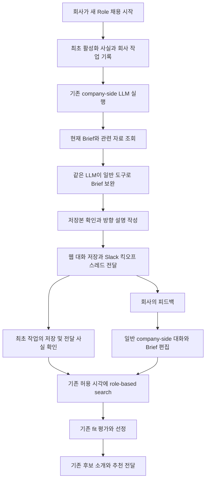

# 최초 채용 시작의 인재상 정의와 서치 킥오프 구현 설계

- 작성일: 2026-10-15
- 상태: 자동 킥오프는 설계 제안. 2026-10-15 후속 요청으로 수동 조사 미리보기만 로컬 구현했으며, 채용 시작·운영 검색에는 연결하지 않는다. 배포하지 않았다.
- 목적: 새 Role의 첫 채용 시작 때 Harper가 회사의 실제 기대 수준과 인재 탐색 방향을 정리하고, Hiring Brief에 반영한 뒤 첫 추천에 앞서 회사에 설명한다.
- 구현 기반: 기존 company-side LLM, 일반 조회·수정 도구, 회사 작업 큐, Role Hiring Brief, 회사 메시지·Slack 스레드, role-based matching Worker.

## 현재 구현 범위

`src/lib/org/agent/roleSearchResearch.server.ts`의 `runRoleSearchResearchPreview`는 기존 company-side loop에 조사 목적과 조회 도구만 제공해 조사 결과·Brief 초안·회사 설명 초안을 반환한다. 이름이나 프로필 URL을 미리 주지 않아도 공개 웹에서 필요한 근거를 찾을 수 있다. 일반 회사 조회는 기존 executor를 재사용하며, 공개 페이지 cache는 세션 메모리에만 둔다.

이 함수의 제품 route·cron·queue·activation hook은 없다. 신규 Role 채용을 시작해도 호출되지 않으며, 자동 검색에 선행 조건이나 지연을 추가하지 않는다. Brief 저장·후보 연락·회사 메시지 발송 도구는 노출과 실행 모두 제한된다. 아래 자동 저장·Slack 전달·검색 gate 설계는 아직 구현하지 않았다.

수동 실행은 `scripts/runRoleSearchResearchPreview.ts --run=<새 ID>`로 제공한다. 기본은 [등록된 평가 입력](../evaluation/company-side-conversational-qa/research-preview-v1.json)이며 `--case=<선택>`으로 범위를 줄인다. `--input=<로컬 JSON>`으로 같은 구조의 별도 조사 packet을 줄 수 있다. 실행 환경과 한계는 [평가 계약](../evaluation/company-side-conversational-qa/README.md#수동-인재상-조사-미리보기-research-preview-v1-2026-10-15)에 정리했다. 이 CLI의 내부 자료 조회는 packet에 한정되며 운영 DB를 조회하지 않는다. 원본 출력은 ignored owner-only `runs/<새 ID>/`에 보존한다.

현재 수동 경로는 기존 30회 호출·80,000자 결과 예산과 240초 제한을 사용한다. CLI에서는 timeout을 실제 fetch에도 전달한다. 공통 URL reader의 cache refresh·offset pagination이나 자동 작업의 중단 복구는 아직 구현하지 않았다.

후속 사용자 요청으로 조사 경로만 `gpt-6.1-sol` / reasoning `medium`으로 고정했다. 일반 회사 대화·다른 업무의 모델 설정은 그대로다. 같은 조사 세션이 도구 호출부터 Brief·회사 설명 초안까지 작성하며 별도 writer는 추가하지 않았다. Brief는 전이 가능한 전문 경험의 수준을 먼저 설명하고 관찰한 회사·팀·학교를 그 수준의 예시로 둔다. 다른 회사·팀·인접 분야에서 같은 수준을 확인할 근거도 적는다. 특정 출신 자체의 추가 우대는 실제 팀 구성이나 반복 판단 근거가 있을 때 별도로 제안한다.

### 지금 생성되는 문서와 향후 전달의 차이

현재 수동 실행은 다음을 한 Markdown 파일에 반환한다. 이것을 파싱해 저장하거나 Slack으로 보내는 코드는 없다.

1. **조사 근거**: 회사 대화·현재 기준·이전 검토 이유, 실제 읽은 공개 자료 링크와 관련 팀원의 전문 경력. 과거 자료·다른 역할·조회 실패와 추론의 범위를 함께 설명한다.
2. **Hiring Brief 초안**: 복사해서 검토할 수 있는 Markdown 블록. 기존 `Hard constraints`와 `Preferred criteria`의 조건 문구와 강도를 유지하면서, 우대 영역 앞부분에 조사에서 도출한 퀄리티 바와 가산 기준을 Harper의 제안으로 작성한다. 어느 회사·팀·학업 배경의 어떤 수준에 어느 정도 가산점을 줄지와 검토 우선순위 효과를 명시한다. 비교에 유용한 검증된 대표 회사·팀·학교명도 보존한다. 이는 평가 효과 없는 검색 경로가 아니라 채택되면 실제 우선순위를 높이는 soft 기준이며, 새로운 필수 탈락 조건은 아니다. 지금 DB에는 저장하지 않는다.
3. **회사 메시지 초안**: 채널용 짧은 부모 메시지와 스레드용 설명 답글. 회사가 말한 가산점은 명확하게 유지하고 Harper가 조사해서 정한 방향은 제안으로 구분한다. 가상 입력이면 메시지에도 가상 초안임을 유지한다.

향후 자동 연결을 구현할 때의 순서는 **회사 맥락·공개 근거 조사 → 같은 company-side LLM의 Brief 작성·일반 도구 저장 → 실제 저장본 확인 → 같은 LLM의 부모·답글 작성 → 기존 메시지 묶음 확정·전달 → 검색 실행 시 최신 Brief 조회**다. 사람이 매번 조사 승인을 누르는 단계를 전제하지 않는다. 다만 현행 일반 Brief 수정은 제안·확인 계약이 있으므로, 아래의 최초 위임 범위와 동시 수정 보호를 먼저 구현해야 한다. 현재 코드에 이 저장 예외나 검색 선행 조건은 없다.

향후 Slack의 부모는 `{역할} · 인재상과 탐색 방향`이라는 주제를 알아볼 수 있게 짧게 작성하고, 답글에서 기대 경험 수준·가산 효과·그 이유·먼저 찾아볼 경로를 설명한다. 제목과 문장 자체는 LLM이 맥락에 맞게 작성한다. 조사 보고서 전체나 비공개 후보 검토 원문을 채널에 그대로 보내지 않는다. 회사의 수정 의견은 같은 스레드에서 기존 대화 LLM이 받아 해당 Brief의 관련 부분에 반영한다. 첫 추천 카드는 기존 후보 소개 경로를 유지한다.

[최초 구현·검증 보고서](../evaluation/company-side-conversational-qa/reports/2026-10-15-role-search-research-preview.md)의 r3는 의미 품질 1/3이었다. [후속 개선·검증 보고서](../evaluation/company-side-conversational-qa/reports/2026-10-15-role-search-research-refinement.md)의 v1 r6는 실행 3/3, Brief 기존 조건 보존·부모/답글 분리 3/3이지만 문서 전체 의미 gate는 0/3이다. 이후 사용자가 지적한 실제 pedigree 가산 기준 누락을 수정한 v2의 실행·한계는 [퀄리티 바 개선 기록](../evaluation/company-side-conversational-qa/reports/2026-10-15-role-search-quality-bar.md)에 별도로 남긴다. 기존 실패를 덮어쓰지 않으며 초안 원문을 수동 검토하는 용도로 유지한다.

## 권장안

새 Role에서 채용을 처음 시작하면 기존 company-side LLM에 **서치 킥오프 작업을 한 번** 맡긴다. 이 LLM이 현재 Brief와 역할 작성 대화, 회사 자료, 확인된 팀원·참고 인물의 경력, 이전 후보 검토 기록을 읽는다. 자료가 부족하면 회사 홈페이지·공개 웹 검색·LinkedIn 프로필 등으로 관련 팀원과 경력 근거를 스스로 찾아 확인한다. 무엇을 강하게 우선할지, 어느 정도의 이전 경험을 기대할지, 어떤 경로에서 사람을 찾을지를 판단하고 기존 Brief를 보완한다. 이어서 같은 LLM이 **「서치 킥오프 · 인재상과 탐색 방향」**이라는 역할별 스레드에 설명한다.

핵심은 명문 학교나 유명 회사 출신을 일괄적으로 부정하는 것도, 팀원의 이력을 그대로 복제하는 것도 아니다. **회사가 실제로 높이 평가하는 배경을 유지하면서, 그 배경이 뜻하는 경험 수준과 가산 효과를 검색·평가에 사용할 수 있는 문장으로 만드는 것**이다.

예를 들어 “좋은 회사 출신” 대신 “어떤 종류의 회사와 팀에서, 어떤 난도의 업무를, 어느 정도 독립적으로 수행한 경력인지”를 쓴다. 회사가 특정 학교·회사·프로그램을 명시적인 기준점으로 제시했다면 이름도 보존한다. 그 신호가 강한 가산점인지, 회사가 정한 인터뷰 기준인지, 다른 직무 근거와 함께 볼 보조 신호인지까지 설명한다.

구조는 다음으로 한정한다.

1. 최초 활성화 사실에 연결된 회사 작업 하나.
2. 기존 company-side LLM의 한 작업 세션과 일반 도구.
3. 기존 Hiring Brief의 필요한 부분 수정.
4. 역할별 킥오프 스레드와 실제 전달 기록.
5. Brief 저장과 설명 전달을 확인한 뒤 기존 검색·추천 경로로 연결.

별도의 인재상 생성 모델, 학교·회사 점수표, 역할별 판단 상태 머신, 새 인재상 원장, 회사용 문구 작성 모델을 추가하지 않는다.

## 현재 검색 시작 동작

### 채용 시작 때 최초 검색을 예약하는 경로는 있다

현재 checkout에는 Role 활성화 때 `company_first_search_runs`에 `trigger_reason='role_activated'` 작업을 넣는 경로가 있다. 다만 **채용 시작 시점에 항상 즉시 검색이 실행되는 것은 아니다.**

2026-10-09 migration의 `enqueue_activated_role_matching_v1`은 다음을 확인한다.

- internal Role이 active이고 만료되지 않았는가.
- Hiring Brief가 비어 있지 않은가.
- test-only Role이 아닌가.
- 현재 실행 가능한 슬롯인가.
- Paid 후보자 방향의 허용 요일이거나, 회사 방향의 설정 요일·시각 조건을 만족하는가.

즉시 실행 조건에 해당하면 현재 시각으로 enqueue하고, 그렇지 않으면 다음 허용 시각에 예약한다. Free이고 회사 정기 검색이 꺼져 있는 등 허용 시각이 없으면 최초 검색이 만들어지지 않을 수 있다. enqueue 이후에도 Worker claim, 현재 권한·역할 상태·방향별 자격 검사가 남는다.

기존 activation unique index는 `(role_id, contract_version)`과 `role_activated` 조건으로 중복을 막는다. 따라서 현재 의미도 엄밀하게는 “한 Role의 같은 실행 계약에서 activation 검색 하나”에 가깝다. 이 키를 새 기능의 영구적인 최초 1회 판정으로 그대로 사용하면 안 된다. 계약 버전 변경이나 명시적 검색 요청의 trigger 승격이 최초 실행 여부와 섞일 수 있다.

### 이번 설계에서 분리할 두 시점

| 시점 | 권장 동작 |
| --- | --- |
| 최초 채용 시작 직후 | 인재상·기대 경험 수준·탐색 방향을 정리하고 회사에 설명 |
| 실제 검색 허용 시각 | 보완된 Brief로 기존 role-based search 실행 |

예를 들어 목요일에 시작한 Role의 후보자 방향 검색이 금요일에 허용된다면, 킥오프는 목요일에 진행한다. 금요일까지 인재상 정의를 미루지 않는다. 회사 설명도 실제 예약 사실에 맞추고, 이미 후보를 찾았다는 표현은 사용하지 않는다.

모든 신규 Role을 요일과 플랜에 관계없이 즉시 검색하도록 바꾸는 것은 별도의 제품 결정이다. 이 설계는 검색 시각·플랜·추천 방향 계약을 유지하며 그 앞에 초기 정리와 설명을 연결한다.

### 확인 범위

이 문서의 현재 구조 설명은 2026-10-15 로컬 checkout 기준이다. 확인한 HEAD는 beta `d61b9029`, Worker `5c6ba48`이며 두 저장소에 다른 작업의 미커밋 변경이 있다. 운영 DB의 현재 함수 본문·trigger·실행 중 revision을 이번 작업에서 직접 조회하지 않았으므로, migration 파일만으로 운영의 매 실행 결과를 확정하지 않는다.

현재 소스에는 기존 설계 문서와 다른 부분도 있다. 특히 검색 planner는 자유 SQL·벡터 조합 설명이 남은 문서와 달리, 로컬 실행 경로에서 직무 검색어를 만드는 FTS 방식이다. 아래 설계는 현재 코드 경로를 기준으로 한다.

## 용어와 회사가 보게 될 경험

### 기능명

사용자에게 보이는 기능명은 **서치 킥오프**, 스레드 제목은 **「{Role 이름} · 인재상과 탐색 방향」**을 권장한다. 영어는 **Search kickoff · {Role}**와 **Candidate profile and search strategy**를 사용할 수 있다.

채용 실무에서는 kickoff, ideal candidate profile, sourcing plan, calibration을 사용한다. Greenhouse의 실무 안내도 검색 전 기대 인재상·선호 경험·참고 프로필·탐색 대상 회사를 정리하고, 필요하면 이후 프로필을 함께 검토해 기준을 맞추는 흐름을 설명한다. 여기서는 사용자가 별도 미팅이나 예시 프로필 평가를 마쳐야 하는 절차를 만들지 않는다. [용어와 흐름 참고](https://www.greenhouse.com/blog/how-to-source-top-talent-questions-to-ask-hiring-managers).

`Talent mapping`은 실제 인재 시장·후보군을 조사한 결과로 오해할 수 있어 첫 설명의 명칭으로 쓰지 않는다. `Calibration`은 피드백으로 기준을 맞추는 후속 활동에 사용할 수 있지만, 제거 중인 자동 예시 프로필 기능을 되살리는 이름으로 쓰지 않는다.

### 회사가 이해해야 할 내용

설명을 읽은 회사는 다음을 이해할 수 있어야 한다. 고정 목차·문장 수를 요구하는 출력 schema는 아니다.

- Harper가 이 역할에서 우선 찾아볼 사람은 어떤 사람인가.
- 단순 업무 가능성과 별개로 어느 정도의 이전 경험을 기대하는가.
- 어떤 배경·성과를 강하게 우선하고 무엇은 보조적으로 보는가.
- 현재 자료와 대화에서 어떤 근거로 그 방향을 정했는가.
- 먼저 탐색할 직무·팀·경력 경로는 무엇인가.
- 확정된 회사 기준과 Harper의 초기 탐색 가설은 어디서 다른가.
- 바꾸고 싶은 방향이 있으면 같은 스레드에서 말할 수 있고, 답변이 없어도 승인된 범위의 검색은 진행된다는 점.

회사가 이미 충분히 설명한 내용을 다시 설문으로 돌리지 않는다. 정말 결과를 크게 바꿀 한 가지 불확실성이 있으면 짧게 물을 수 있지만, 모든 킥오프의 완료 조건을 회사의 추가 답변으로 만들지 않는다.

## 인재상 정의의 내용

### 업무 가능성 외에 기대 경험의 수준을 명시한다

| 판단 대상 | 기록할 내용 | 후보 검토에 미치는 영향 |
| --- | --- | --- |
| 실제 업무 수행 요건 | 회사가 명시한 필수 경험·기능·조건 | 확인된 필수 충돌은 기존 fit 계약대로 처리 |
| 회사의 인터뷰 기대 수준 | 회사가 실제로 별도 기준으로 확립한 회사·팀·학업·성과·책임 범위 | 직무는 가능해도 회사 기준에는 미달할 수 있음을 표현 |
| 강한 가산점 | 확인된 참고 경력에서 도출되는 직무 관련 배경과 성과 | 유사한 후보 사이에서 적극 우선 |
| 보조 가산점 | 함께 있으면 도움이 되지만 단독으로 강한 결론을 만들지 않는 신호 | 다른 근거와 결합해 해석 |
| 초기 탐색 방향 | 아직 회사의 확정 기준은 아니지만 먼저 살펴볼 만한 경력 경로 | 검색·비교의 가설. 미해당을 탈락 사유로 만들지 않음 |

이 표는 설계 설명이다. 실제 데이터에 다섯 enum이나 점수 필드를 추가하지 않는다. 강도와 의미는 Brief의 자연어 문장으로 유지하고 원본 LLM이 해석한다.

“어느 정도 플러스인가”는 임의의 숫자보다 판단 효과로 쓴다. 예를 들어 “직무 수행 근거가 비슷하면 먼저 검토할 강한 가산점”, “관련 실무 경험과 결합했을 때 의미가 큰 보조 신호”, “회사가 별도로 확인한 인터뷰 기대 수준”은 실행에 유용하다. `빅테크 +10`, `학교 tier A +5` 같은 고정 점수는 만들지 않는다.

### 이전 회사 경험을 구체화하는 방법

회사명, 소속 팀, 본인의 직무, 책임 범위와 결과를 분리해 본다.

1. 해당 경력이 나타내는 환경을 읽는다. 예: 복잡한 기업 고객, 높은 신뢰성이 필요한 제품, 빠른 제품 확장, 기술 선별성이 높은 조직.
2. 본인이 실제로 했던 일을 읽는다. 예: 고객 요구 해석부터 구현·배포까지 담당, 핵심 시스템 설계, 신규 시장 개척, 제품의 초기 매출 창출.
3. 회사가 중요하게 본 이유와 연결한다. 직무 전문성인지, 일의 난도인지, 채용 선별성인지, 성장 속도인지 구분한다.
4. 같은 종류의 후보를 찾을 수 있게 경력 범주로 쓴다. 근거가 있으면 대표 회사·팀 이름을 함께 적는다.
5. 그 배경의 효과와 한계를 쓴다. 회사 로고만 있는 경력과 해당 기능의 실질 경험은 구분하되, 회사가 명시한 배경 선호 자체를 삭제하지 않는다.

이것은 회사 경험을 항상 개인 성과로만 환원하라는 뜻이 아니다. 회사가 선별성이 높은 조직에서의 근무 자체를 가산점으로 본다고 명시했다면 그 기준도 그대로 유지한다. 다만 그 가산점이 실제 직무 수행 근거를 전부 대체하는지는 별도로 판단한다.

### 학교와 프로그램도 같은 방식으로 다룬다

회사가 학업 배경을 기준점으로 제시했다면 대표 학교·프로그램을 보존하고, 무엇을 확인하려는지와 어느 정도로 우선할지를 쓴다. 일반적인 명성 순위를 모델이 만들어 회사의 기준처럼 저장하지 않는다. 한 팀원의 학교를 보고 전사의 필수 학력으로 확대하지 않는다.

학교 신호와 이전 회사 신호를 둘 다 쓸 때는 각각 무엇을 추가로 설명하는지 구분한다. “명문 학교 + 유명 회사”라는 사실을 같은 선별 신호로 두 번 세는 가중치표는 두지 않는다. 프로필의 이름·사진·나이·성별 등 직무 관련성이 없는 개인 특성으로 좋은 인재상을 추론하지 않는다.

### 수준 외에 탐색 방향을 정의한다

“더 뛰어난 사람”만으로는 서치 전략이 되지 않는다. 같은 기대 수준에서도 어떤 경로를 먼저 볼지 설명한다.

예를 들어 FDE라면 현재 업무·대화에 근거해 고객 배포 엔지니어링, 직접 구현 비중이 높은 솔루션 엔지니어링, 고객 도입까지 맡은 초기 제품 엔지니어링 같은 경로를 비교할 수 있다. 직함이 같아도 직접 구현이 없는 역할과, 직함이 달라도 실제 고객 배포를 맡은 역할을 구분한다.

다른 직군에도 같은 원칙을 적용한다. 세일즈라면 제품·고객군·딜 복잡도·개척 책임을, 제품 역할이라면 문제 정의·출시·사업 결과 범위를 읽는다. 런타임에 직군별 분기나 경력 경로 enum을 만들지 않고, 해당 Role의 사실과 일반 도구로 LLM이 작성한다.

## 사용할 데이터와 근거의 강도

### 근거 우선순위

기존 [Hiring Brief 작성 가이드](company-role-hiring-brief-authoring-guide-ko.md)를 정본으로 사용한다.

1. 현재 Role에 관한 최신 회사 발화와 명시적 수정.
2. 현재 승인된 Brief·JD·저장된 조건.
3. 회사가 좋게 본 참고 인물과 그 이유.
4. 확인 가능한 전문 경력 자료.
5. 같은 Role의 이유 있는 여러 독립적인 검토·채용 결정.
6. 다른 Role의 기록, 유사 회사, 일반적인 시장 지식.

낮은 순위의 자료가 최신 명시 기준을 덮어쓰지 않는다. 이전 Harper 답변과 평가 모델의 reason은 회사의 새 발화가 아니다. 회사가 후보자를 검토하지 않았거나 답하지 않은 기록에서 선호·거절을 만들지 않는다.

### 실제 제공 가능한 데이터

| 자료 | 현재 코드로 확인한 범위 | 설계에서 필요한 처리 |
| --- | --- | --- |
| 현재 Role | `read_role`의 criteria에 Brief와 평가 요소, 별도 description·memory·pipeline 조회 | 완전한 현재 Brief를 읽고 최신 수정 우선 |
| 회사 자료 | `get_more_data`의 company_details·workspace_memory | 실제 권한 범위에서 필요한 장문 필드만 전체 조회 |
| 팀원 목록 | `members`는 이름·이메일·계정·Workspace 권한 중심 | 이것만으로 경력·학력·직무 수준을 안다고 하지 않음 |
| 실제 팀원·참고 인물 경력 | 회사가 준 URL·문서·작성 대화, 접근 가능한 회사 자료, `web_search`·`open_url`로 발견한 공개 전문 경력 | 링크를 받지 않아도 관련 인물을 탐색. 동일인·재직 시점·출처를 확인하고 기준에 사용할 근거만 읽기 |
| 이전 후보 | `get_talents`와 `read_talent`의 회사에 공유된 범위 | 역할별 이유·시각·행위자 확인. 전체 비공개 인재 풀 접근 금지 |
| 같은 Role 대화 | 현재 대화와 저장된 Slack 스레드 조회 | 최신 관련 대화부터 읽고 필요한 스레드만 추가 조회 |
| 다른 Role 기록 | 접근 가능한 Role의 Brief·메모·대화·공유 후보 | 동일 직무·팀·시점의 관련성을 LLM이 해석. 회사 전역 기준으로 자동 승격 금지 |
| 검색 실행 이력 | 최근 실행 집계와 추가 페이지 | 검토·선정·실제 전달을 구분. 시장 규모와 수급을 추정하는 근거로 쓰지 않음 |

`company_users`에 가입한 팀원의 계정 정보와 그 사람의 전문 경력은 다른 데이터다. Workspace 계정 목록은 실제 회사의 전체 팀원 명단도 아니며, `owner`·`admin`은 직무나 직급이 아니다. 기존 자료에 경력이 없으면 회사명·공식 도메인·역할 맥락을 바탕으로 관련 팀원과 공개 프로필을 스스로 찾는다. 이름만 같은 동명이인을 연결하거나, 이메일을 단서로 Career 계정의 비공개 경력을 읽지 않는다. 공개 조사에서도 확인하지 못했거나 조사가 불가능한 경우에만 그 확인 범위 안에서 대화·Brief·회사 문서로 방향을 정한다. 조사하지 않은 것, 조회 실패, 확인 결과 없음은 서로 다른 사실이다.

### 이전 Role 기록을 사용할 때

이전 Role의 기준은 재사용 후보이지 자동 상속값이 아니다. 과거 시니어 리드 채용과 현재 초기 경력 엔지니어 채용은 회사가 같아도 기대 수준이 다를 수 있다. 팀·직무·채용 시기·회사 성장 단계와 함께 읽고, 새 Role의 최신 명시 기준을 우선한다.

같은 Role의 과거 후보라면 회사의 실제 평가 이유와 당시 프로필을 함께 읽는다. “인터뷰 진행”만으로 모든 학교·회사 이력이 좋았다고 해석하지 않는다. “이번 역할에는 고객 앞에서 설계 결정을 주도한 경험이 부족하다”는 발화는 그 판단축에 한해 사용한다. 후보자의 비공개 거절 사유는 회사 기준 도출에 제공하지 않는다.

### 기본 입력은 짧은 자료 색인

초기 context에는 현재 Role·Brief·등록 대화의 핵심 맥락, 사용 가능한 회사 자료, 관련 참고 링크·기록의 짧은 색인을 제공한다. 자료마다 출처, 시각, 관련 Role, 제공자, 조회 범위·누락 여부를 붙인다. 전체 회사의 모든 후보와 Slack 대화를 일괄 주입하지 않는다.

원본은 일반 read tool로 추가 조회한다. 요약 생성만을 위한 새 LLM이나 중요도 키워드 분류기를 두지 않는다. 역할·팀·날짜·출처 같은 구조적 필터와 최근순 페이지네이션은 코드가 제공하고, 어떤 자료가 의미 있는지는 company-side LLM이 판단한다.

## 자율적인 공개 경력 조사와 도구 제공

### 현재 도구는 있지만 킥오프에 그대로 연결하는 것만으로는 부족하다

2026-10-15 코드 확인 기준이다. 아래의 보완은 아직 구현하지 않은 설계다.

| 확인 지점 | 현재 동작 | 킥오프에 반영할 결정 |
| --- | --- | --- |
| 도구 노출 | 기본 `progressive` 모드에서 `web_research`는 catalog에만 있고 `load_capabilities` 이후 completion에 검색·URL 읽기 schema와 policy가 제공됨 | trusted event caller가 `initialCapabilities`로 필요한 기능을 첫 completion부터 제공 |
| 실제 검색 | `web_search` → `executeSharedWebSearch` → `runWebSearch` → Exa. Google 검색 API가 아님 | 사용자 요구의 핵심인 자율 웹·LinkedIn 발견은 기존 도구로 시작. 실제 Google 결과를 조회했다고 표현하지 않음 |
| URL 읽기 | `open_url` → documents cache → 미적중 시 Exa `getContents`. LinkedIn 전용 로그인 브라우저 없음 | 검색으로 발견한 URL도 자율적으로 열도록 공통 설명을 보완. 읽기 실패 시 접근 가능한 대체 출처 탐색 |
| 작업 진입 | 공통 loop에는 `initialCapabilities` 인자가 있지만 현재 `runOrgAgentWebActionTurn`은 이를 전달하지 않음 | 킥오프의 신뢰된 실행 문맥에서 연결. 단순 enqueue 사실만으로 제공됐다고 보지 않음 |
| 작업 길이 | 최대 30 loop·총 30 tool call, tool 결과 총 80,000자. Queue route `maxDuration=300` | 조사와 Brief 읽기·쓰기·메시지 확정에 필요한 실제 예산을 함께 관리 |
| 본문 신선도 | URL cache를 날짜 조건 없이 우선 사용. `createdAt`은 cache 저장 시각 | 오래된 현재 재직 주장에는 새 확인 경로 필요. cache 생성 시각을 원문 갱신 시각으로 해석하지 않음 |
| 본문 완전성 | 검색은 최대 15,000자 원문을 cache, URL 새 조회는 최대 20,000자 요청. 반환 `truncated`는 확보된 본문을 잘랐는지만 표시 | `truncated=false`를 전체 원문 확보의 증거로 쓰지 않음. 근거가 생략됐다면 추가 읽기 또는 다른 출처 사용 |

`EXA_API_KEY`와 documents cache의 실제 read/write 권한도 필요하다. 업무 의미는 읽기여도 현재 도구는 cache를 저장한다. 검색 provider가 성공해도 cache 저장이 실패하면 현재 호출 전체가 실패할 수 있으므로, 격리 환경의 실행 권한 검증에 이 경계를 포함한다. 운영 DB 접근 가능성은 도구 schema 확인이나 메모리 cache smoke로 검증되지 않는다.

Google 결과를 반드시 사용해야 하는 요구가 생기면 기존 `web_search`의 provider adapter에 실제 Google 결과를 제공하는 연결을 추가한다. Google이나 LinkedIn URL을 그냥 `open_url`에 넣는 것을 Google 검색 기능으로 간주하지 않는다. 현재 구현에서는 Exa만 확인됐으며, Google provider가 준비됐다는 전제를 두지 않는다.

### 첫 completion에서 제공할 기능

기존 기본 조회 도구와 함께 다음 capability의 **실제 schema와 policy를 동시에** 제공한다.

- `web_research`: `web_search`, `open_url`.
- `company_role_edit`: 공통 Brief 작성 계약과 `update_data`. 실제 쓰기는 해당 Role의 최초 위임 범위 안으로 제한.
- `company_messaging`: 승인된 Slack audience가 있는 경우 `send_company_message`. 웹 전용이면 기존 웹 메시지 경로 사용.

`read_role`, `get_more_data`, `get_talents`, `read_talent`, `read_conversation_history`는 기본 조회로 제공한다. 일반 capability catalog와 loader도 유지해 예상하지 못한 관련 자료 조회를 이어갈 수 있게 한다. 현재 기본 연락 도구가 보이는 사실은 조사 대상에게 연락할 권한을 뜻하지 않는다. 킥오프는 공개 조사·해당 Brief 보완·승인된 회사 수신 범위 설명만 위임한다.

모든 company event에 무거운 도구를 일괄 주입하거나 전역 설정을 `full`로 바꾸지 않는다. 이미 확인된 제품 업무의 필요 도구를 trusted caller가 제공하는 기존 확장 지점을 사용한다. 모델의 query나 외부 페이지 내용이 실행 권한을 추가하지는 않는다.

### LLM에 맡길 조사 목적

도구를 갖고 있다는 사실만으로 충분한 조사를 기대하지 않는다. 킥오프의 업무 목적에는 **기대 경험 수준을 정하는 데 필요한 근거를 능동적으로 확보하는 것**을 포함한다. 회사가 링크를 보내줄 때까지 기다리거나, 저장된 팀원 경력이 없다는 이유만으로 일반적인 JD 요약에서 끝내지 않는다. 이미 충분하고 최신인 근거가 있으면 같은 조사를 반복할 필요도 없다.

LLM이 선택할 수 있는 자연스러운 조사 흐름은 다음과 같다. 고정 실행 순서나 사람 수를 코드로 강제하는 절차는 아니다.

1. 회사 공식 이름·도메인·제품·현재 Role과 팀의 업무를 파악한다. 공개 홈페이지와 기존 자료에서 팀·리더·관련 참고 인물을 찾는다.
2. 이름이 있으면 회사·역할 맥락을 함께 검색하고, 이름이 없으면 회사와 관련 직무를 단서로 인물을 발견한다. 한글·영문 표기나 검색 범위 변경은 모델이 실제 결과를 보고 선택한다.
3. 공개 LinkedIn, 공식 팀 소개, 기술 블로그·발표자 소개·본인 홈페이지 등에서 경력을 확인한다. 채용 직무와 관계없는 창업자 한 명이나 Workspace 관리자만으로 팀 전체를 대표시키지 않는다.
4. 같은 사람인지와 현재·과거 재직을 확인한다. 이름·회사·업무·시점의 일치와 상충을 원문으로 판단하고, 불확실한 경우 다른 출처를 읽거나 해당 주장을 보류한다. 동일인 판단을 이름 유사도 점수로 대체하지 않는다.
5. 관련 이전 Role의 실제 평가와 현재 요구를 함께 읽어 기대 수준·가산 효과·탐색 방향을 정리한다. 검색 결과가 잘 잡힌 사람들의 경력만으로 회사의 확정된 채용 기준을 만들지 않는다.
6. 확보된 근거가 실제로 판단을 바꾸는지 보고 조사를 마친다. 최종 Brief를 저장하고 회사 설명을 같은 세션에서 작성한다.

`회사명 + 관련 직무 + LinkedIn`, `확인한 이름 + 회사명` 같은 조합은 검색 의도의 예다. 이를 고정 query template이나 필수 `site:` 연산자로 만들지 않는다. 현재 `web_search`에는 domain filter 인자가 없으므로 query의 사이트 지정 문구가 provider 수준의 강제 필터라고 전제하지 않는다.

### 출처와 공개 범위

검색 snippet은 유용한 원문을 찾는 단서다. 중요한 경력 주장은 해당 URL의 실제 반환 본문과 필요시 다른 출처를 읽고 판단한다. provider가 반환한 본문에는 주변 회사 설명이나 보강 정보가 섞일 수 있으므로 모두를 당사자의 직접 발언으로 인용하지 않는다. 조회 시각, 실제 URL, cache 여부, 확인한 내용과 읽지 못한 부분은 기존 tool result·trace에서 추적한다.

공개 프로필을 읽을 수 없으면 공식 소개나 본인의 다른 공개 경력 자료로 계속 조사한다. 읽기 실패를 경력 없음으로 바꾸지 않고, 로그인·접근 제한을 우회하거나 같은 실패 URL을 새 정보 없이 반복 호출하지 않는다. 동명이인이나 재직 시점의 충돌이 해소되지 않으면 그 사람의 이력을 확정 근거로 사용하지 않는다.

외부 검색어에는 공개 회사명·공개 직무·필요한 이름만 사용한다. 비공개 후보 평가, 보상, 개인 연락처, 회사 내부 대화 전체를 검색 provider에 보내지 않는다. 공개 조사로 찾은 인물은 자동으로 Harper 후보자가 되거나 연락 대상이 되지 않는다. 기준에 필요한 전문 경력만 사용하고 회사 공유 경계도 유지한다.

`open_url`의 현재 설명은 사용자가 URL을 주거나 특정 페이지 읽기를 요청한 경우에 치우쳐 있다. 구현 시 공통 `agentTools/web.ts`에서 **진행 중인 승인된 작업에 필요한, 검색·자료에서 발견한 URL을 여는 경우**까지 설명한다. 회사 전용 도구를 복제하지 않고, 해당 공통 도구의 다른 사용처도 그대로 작동하는지 변경 경로만 확인한다.

### 조사 예산과 작업 완료

현재 예산에 도달하면 공통 loop가 도구 없는 최종 답변으로 넘어간다. 따라서 “조사 30회 후 Brief 저장·Slack 전송”은 불가능하다. 최대치만 높이면 충분하다고 보지 않고, 다음 보완을 같은 공통 실행 계약에 포함한다.

- 남은 호출 수·결과 크기·실행 시간을 모델이 알 수 있게 전달한다. 원문 읽기뿐 아니라 최신 Brief 확인, 수정·충돌 처리, 메시지 확정에 사용할 여유를 남기도록 한다.
- 검색 결과는 짧은 색인으로 읽고 필요한 페이지의 반환 길이를 선택한다. 원문의 앞부분만으로 확인되지 않는 경력은 더 긴 읽기 또는 다른 원문으로 확인한다. 필요하면 공통 URL reader에 문서 참조·offset·limit을 통한 부분 읽기를 추가한다. 이미 수집 자체가 잘린 내용은 pagination만으로 복구되지 않는다.
- 현재 재직 여부처럼 신선도가 중요한 주장은 공통 URL reader의 명시적 cache refresh 옵션 또는 새 검색으로 확인한다. TTL·refresh는 자료 조회 정책이며 전문 경력 판단 규칙이 아니다. 새 API가 반환해 준 최신성도 실제 반환 범위 이상으로 보장하지 않는다.
- provider 요청에 실제 timeout·취소를 전달하고 남은 실행 시간 안에서 종료한다. 현재 event turn은 loop에 `signal`을 넘기지 않고 shared web wrapper도 `signal` 인자가 없으므로, queue 제한만으로 이 전파가 구현됐다고 보지 않는다.
- 자료가 충분하면 LLM이 조사를 종료한다. 예산 때문에 끝나면 확보한 근거 범위를 설명한다. 저장·전달이 끝나지 않았으면 기존 job의 미완료·재시도로 복구하고 최초 검색 gate를 해제하지 않는다.

추가 실행은 같은 최초 작업의 복구다. 새 분석 모델이나 역할별 중간 판단 상태 테이블을 만들지 않는다. 재시도는 이미 저장된 Brief·메시지와 기존 trace·공개 문서 cache를 확인하고, 같은 조사를 무조건 처음부터 반복하지 않도록 연결한다. 실제 소요 시간과 tool 사용량을 보고 이 작업의 예산을 조정한다.

## Brief와 탐색 가설의 저장

### 하나의 정본 유지

후보 평가 기준의 정본은 계속 `company_internal_roles.request`다. 필요한 호환 사본은 기존 공통 mutation 경로로 관리한다. `talent_profile`, `hiring_strategy`, `calibration_plan` 같은 별도 테이블을 만들지 않는다.

Brief에는 미래 후보를 판단할 수 있는 현재형 기준을 남긴다. 특정 팀원·후보의 이름, URL, 과거 사건의 연대기, 내부 분석 과정을 넣지 않는다. 기준의 출처는 기존 tool trace·변경 기록·회사 대화에 연결해 보존한다. 출처 추적에 필요한 참조가 기존 기록에 없다면 해당 변경 기록의 metadata에 원본 ID·시각만 추가한다.

### 확정 기준과 자율 탐색을 함께 담는 방법

회사가 직접 말한 기대 수준은 정확한 강도로 저장한다. 확인된 참고 경력에서 뽑은 비독점적 가산점도 기존 작성 가이드에 따라 반영할 수 있다. 반면 다른 Role·시장 관행에서 나온 새로운 선호를 회사의 확정 기준처럼 저장하지 않는다.

Harper가 조사한 관련 전문 배경에서 도출한 퀄리티 바와 가산 기준은 `## Preferred criteria` 앞부분에 **「Harper가 제안하는 퀄리티 바·가산 기준」** 같은 자유 형식 소제목으로 구분한다. 어떤 회사·팀·학업 수준을 어떤 강도의 플러스로 볼지와 실제 검토 우선순위 효과를 작성한다. 회사의 확정된 필수 기준과는 다르지만, 초안이 채택되면 비교에 영향을 주는 bonus다. 근거가 약한 탐색 아이디어는 이 기준과 별도로 둔다. 기존 필수·선호의 의미를 바꾸거나 bonus 미해당만으로 새 탈락 기준을 만들지 않는다.

2026-10-15 사용자 정정 요청으로 **위임받은 조사·calibration에서 soft caliber와 가산 효과를 직접 작성하는 계약**을 정본 작성 가이드와 공통 authoring prompt에 로컬 반영했다. 일반 자격 문구의 원문 보존과 저장 권한은 유지한다. 다른 Role·시장 가설을 확정 기준처럼 조용히 저장하는 권한이나 최초 자동 저장 경로는 구현하지 않았다. 향후 저장 연결도 다음 경계를 따른다.

- 회사의 실제 기준, Harper의 구체적인 가산 제안, 근거가 약한 탐색 아이디어를 자연어로 구분한다.
- 가설은 설명과 함께 저장하고 회사가 같은 스레드에서 바로 수정할 수 있다.
- 가설만으로 hard requirement나 독립적인 company rejection bar를 만들지 않는다.
- 근거 없는 정밀한 tier·연차·성과 숫자를 가설이라는 이름으로 발명하지 않는다.
- 질문이 필요한 근거 부족과, 읽은 자료로 합리적으로 설정할 수 있는 탐색 우선순위를 구분한다.

서버가 이 소제목을 파싱해 다른 평가 모드로 전환하지 않는다. Brief 전체를 읽는 LLM의 일반 근거 계약으로 처리한다. 회사가 나중에 방향을 명확히 확정하거나 수정하면 기존 일반 편집으로 문장을 갱신한다. 가설·승인·승격을 관리하는 별도 상태 머신은 만들지 않는다.

### 형식과 평가 요소

Brief의 최상위 구조는 기존 `## Hard constraints`와 `## Preferred criteria`를 유지한다. 필요한 하위 소제목만 쓰고, 핵심 회사 기대 수준을 문서 앞부분에 둔다.

Evaluation Criteria는 비교를 돕는 요소이고 Brief의 대체물이나 전부 충족해야 하는 필터가 아니다. 최초 Role 작성에서 이미 만든 요소를 킥오프가 자동으로 전부 재작성하지 않는다. 기본 자율 수정 범위는 Brief다. 실제 회사 요청으로 평가 요소 수정이 필요하면 기존 도구·권한을 사용한다.

공개 JD·보상·근무지·공개 설정·추천 설정·후보자 Memory는 이 작업으로 변경하지 않는다. 비공개 인재상 정리를 공개 자격 요건 추가로 전파하지 않는다.

## 설명과 Brief 작성 예시

아래는 기대 품질을 보여주는 합성 예시다. 특정 회사의 실제 기준이나 출력 템플릿이 아니다. 실제 역할과 대화에 따라 구성과 길이가 달라진다.

### 회사가 기대 배경을 명시한 경우

전제: 회사가 “Palantir나 Datadog 같은 곳에서 고객의 복잡한 도입을 직접 맡았던 경험을 강하게 보고 싶다”고 말했고, 현재 Role에는 고객 요구를 실제 제품으로 구현하는 업무가 있다.

Slack 부모 메시지 예시:

> FDE · 인재상과 탐색 방향
>
> 첫 추천 전에 어떤 경험을 가진 분들을 우선 찾아볼지 정리했어요. 말씀하신 이전 회사 경험의 수준도 채용 기준에 반영했어요.

스레드 답글 예시:

> 이번에는 기업 고객의 복잡한 요구를 이해하고, 직접 구현해서 실제 도입까지 이끌어 본 엔지니어를 우선 찾으려고 해요.
>
> 말씀하신 Palantir·Datadog 계열의 고객 배포·솔루션 엔지니어링 경험은 강한 가산점으로 볼게요. 여기서는 회사 이름에 더해 그 안에서 고객 설계와 구현을 어디까지 맡았는지를 함께 확인하겠어요. 기존에 정해주신 역할 수행 기준을 만족하는 분들 중 이 배경이 있는 분들을 먼저 검토할 방향이에요.
>
> 첫 탐색은 고객 배포를 맡은 엔지니어와 직접 코드를 작성하는 솔루션 엔지니어를 중심으로 잡았어요. 고객 도입까지 맡아 본 제품 엔지니어도 함께 살펴보되, 이 경로를 같은 수준으로 볼지는 확인되는 실제 경험을 보고 판단할게요.

Brief에 반영할 문장 예시:

> 기업 고객의 복잡한 기술 도입을 직접 맡은 경력을 강한 가산점으로 본다. 회사가 제시한 대표 배경은 Palantir·Datadog의 관련 고객 배포·솔루션 엔지니어링 경력이다. 후보자가 맡은 고객 문제, 설계·구현 범위와 실제 도입 경험을 함께 확인하며, 관련 직무 수행 근거가 비슷하면 이 배경을 우선 검토한다. 대표 회사명은 폐쇄적인 허용 목록이 아니며, 소속만으로 역할 적합성이 충족되는 것은 아니다.

이 예시의 회사명은 입력에서 명시됐기 때문에 보존했다. 회사명이 주어지지 않은 실행에서 모델이 이 이름을 관성적으로 채우면 잘못된 결과다.

### 확인된 팀원 경력만 있는 경우

전제: 회사가 관련 팀원들을 참고 자료로 제공했고, 여러 자료에서 고객 대응과 직접 구현을 함께 맡은 경험이 관찰되지만 별도의 필수 출신 회사는 말하지 않았다.

> 공유해주신 팀원들의 경력에서는 고객 문제를 직접 다루면서 구현까지 책임진 경험이 반복해서 보여요. 첫 탐색도 이 두 경험이 함께 있는 분들을 우선으로 잡았어요. 경력 연수만 맞춘 분보다 고객 앞에서 기술적 선택을 설명하고 실제 동작하는 결과까지 만든 경력을 더 강하게 보려고 해요.
>
> 이전 회사는 이런 일을 해본 환경을 확인하는 기준점으로 활용하겠어요. 관련 팀에서 맡았던 일이 분명한 경력을 우선 보고, 같은 회사에 있었다는 사실만으로 같은 수준의 경험이라고 보지는 않을게요.

여기서 추가한 수준은 확인한 전문 경험의 가산점이다. 회사가 따로 말하지 않은 “이 수준 이하는 인터뷰하지 않는다”는 필수 경계로 올리지 않는다. 정보가 적어도 구체적인 초기 방향을 제시할 수 있으며, 매번 “근거가 없습니다”라는 설명으로 끝낼 필요가 없다.

### 자료가 거의 없는 경우

현재 JD와 회사가 말한 업무에서 이미 확인되는 범위로 시작한다. 미래 업무를 수행할 능력을 검토하되, 그 업무의 모든 항목을 과거 경력 필수 조건으로 바꾸지 않는다. 팀원 경력을 읽지 않았다면 읽었다고 말하지 않는다.

설명은 “현재 알려주신 업무를 기준으로 이런 경로부터 살펴보겠다”가 중심이다. 기준을 크게 바꿀 참고 인물이나 선호 배경이 있다면 같은 스레드에서 받을 수 있다. 답변이 없다는 이유로 새 hard constraint를 만들거나 최초 검색을 무기한 멈추지 않는다.

## 전체 실행 흐름

### 추가 LLM 호출 하나의 정확한 의미

추가하는 것은 **최초 킥오프 agent run 하나**다. 일반 도구를 모델이 직접 호출하려면 `모델 → 도구 → 모델`의 여러 completion이 필요할 수 있다. 따라서 외부 모델 API를 정확히 한 번만 호출한다는 의미로 비용과 구조를 설명하지 않는다.

원하는 결과를 모두 한 모델이 책임진다. 첫 completion에서 충분한 자료를 제공하고, 필요한 자료만 추가로 읽고, Brief 수정 결과를 확인한 뒤 최종 회사 메시지를 작성한다. 별도의 extractor, 인재상 classifier, Brief writer, Slack writer를 순차 추가하지 않는다. 기존 `calibrate_role_talent_bar`의 별도 전문 분석 모델을 자동 호출하는 방식도 기본안으로 삼지 않는다. 사용자가 실제 참고 인물을 새로 준 기존 기능의 역할은 유지한다.

회사용 설명은 `composeCompanyUpdate`의 문구 전용 adapter가 아니라 일반 도구를 사용할 수 있는 `runOrgAgentToolLoop`에서 작성한다. 모델·언어·문체는 기존 company-side 설정을 재사용한다. 킥오프만을 위한 모델 교체는 품질·지연 검증 뒤 별도 결정한다.

## 최초 한 번의 판정과 작업 생성

### Role별로 정의한다

“처음”은 Workspace의 첫 채용이 아니라 **동일 Role ID의 최초 채용 시작**이다. 같은 회사의 두 번째 Role도 자기 인재상과 탐색 방향을 한 번 정리한다.

| 상황 | 처리 |
| --- | --- |
| 새 Role 최초 활성화 | 킥오프 생성 |
| draft 편집 | 작성 대화만 진행. 킥오프 생성 안 함 |
| 활성화 요청 재시도·중복 클릭 | 같은 작업 반환 |
| 같은 Role의 중단 후 재개 | 기존 킥오프와 최신 Brief 사용 |
| Role 복제로 새 ID 생성 | 새 킥오프. 복제된 Brief의 적합성을 다시 확인 |
| 기존 Role에 새 참고 인물·피드백 추가 | 일반 편집·현재 검색 계약. 최초 킥오프 재생성 안 함 |
| 도입 이전부터 active인 Role | 자동 소급 생성·발송 안 함 |
| 플랜상 당장 검색할 수 없음 | 초기 방향은 정리. 검색·추천 권한을 새로 부여하지 않음 |

멱등 키는 예를 들어 `role-search-kickoff:{roleId}`로 두고 prompt·모델·검색 contract version을 키에 넣지 않는다. 문체나 모델을 바꿨다고 같은 회사에 최초 안내가 다시 나가면 안 된다. 실제 재작성 요청은 기존 스레드의 새 회사 발화에 대한 일반 작업이다.

### 활성화와 내구성 있는 연결

UI·Slack 응답의 마지막 줄에서 단순 비동기 호출만 하지 않는다. 활성화 저장 직후 프로세스가 종료돼도 작업을 복구할 수 있어야 한다.

권장 구현은 최초 활성화 transaction에서 기존 회사 event job과 최초 검색의 의존 관계를 함께 기록하는 것이다. SQL에서는 기존 `enqueue_company_update_v1` 계약을 재사용·확장하고, transaction 이후 TypeScript의 `enqueueCompanyUpdate` 공통 dispatch/recovery 경계가 실행을 맡는다. DB에서 LLM이나 Slack을 호출하지 않는다.

기존 `company_roles` status trigger와 `company_internal_roles.request` trigger가 모두 활성화 검색을 만들 수 있으므로, 웹의 한 함수에만 끼워 넣지 않는다. 최초 이벤트 확보와 검색 연결을 공통 activation 경계에서 수행하고, trigger 호출 순서와 중복 호출에 관계없이 같은 이벤트를 사용한다.

새 이벤트 적용 대상은 기능 도입 이후의 명확한 최초 활성화로 한정한다. 기존 active Role에 이벤트가 없다는 이유만으로 첫 채용이라고 추정하지 않는다. 직접 운영 도구·허용된 API의 활성화도 같은 경계를 통과해야 한다. 실행 주체·권한 근거가 없는 직접 쓰기는 임의의 팀원 계정으로 대체하지 않고, 이벤트 준비 오류로 드러낸다.

## 기존 도구와 실행 권한

### 일반 도구 확장을 우선한다

| 작업 | 기존 수단 | 필요한 보완 |
| --- | --- | --- |
| Brief·기준 읽기 | `read_role` | 전체 저장본·현재성 확인 |
| 회사 자료·팀원 색인 | `get_more_data` | 확인된 전문 자료 참조를 반환할 수 있는 일반 상세 조회 확장 |
| 과거 역할·후보 확인 | Role 목록, `read_role`, `get_talents`, `read_talent` | 접근 가능한 범위의 관련 기록만 사용 |
| 대화 조회 | 기본 context, `read_conversation_history` | 작성 완료 대화와 기존 웹 메시지의 연결·필요한 pagination 보완 |
| 공개 인물 발견·경력 조사 | `web_search`, `open_url` | 첫 completion부터 제공, 발견한 URL 자율 조회, 출처·동명이인·신선도·불완전 조회 확인 |
| Brief 반영 | `update_data`와 공통 mutation | 최초 위임 범위를 서버가 검증하는 실행 문맥 |
| 회사 설명 전달 | `send_company_message`의 일반 메시지 묶음 | 제품 사건 turn에서도 새 root·reply·수신 범위 사용 가능하도록 통합 |
| 검색 연결 | 기존 scheduler·activation queue | 킥오프 의존성, 최신 Brief snapshot |

`define_talent_profile`, `decide_company_bar`, `start_calibration`, `approve_search_strategy` 같은 상황별 도구를 추가하지 않는다. 도구 목록의 노출 여부와 실행 권한은 분리한다. 기존 명시적 회사 검색 도구를 자동 호출해 추천 방향을 `company_requested`로 바꾸지 않는다.

### 현재 Brief 확인 계약과의 차이

현재 `update_data`의 `role_request`와 메모 변경은 제안 후 명시적 확인을 요구한다. 따라서 “기존 도구로 자동 저장”이라는 설명만으로 구현이 끝나지 않는다. `company_update`의 사실과 목적도 그 자체로 수정 승인이 아니다.

권장 제품 계약은 **Role 생성의 기존 최종 확인에 최초 인재상 정리 위임을 포함하는 것**이다. 사용자는 채용을 시작하면 Harper가 공유한 자료를 바탕으로 비공개 기준과 탐색 방향을 보완하고 알린다는 사실을 이해할 수 있어야 한다. 별도 calibration 승인 버튼이나 두 번째 채용 시작 확인을 추가하지 않는다.

서버는 그 최초 활성화와 실행 계정의 실제 권한을 근거로 제한된 위임을 기존 event job에 연결한다. 공통 mutation executor는 이 실행 문맥에서만 다음 범위를 직접 적용할 수 있다.

- 정확히 해당 Workspace·Role의 `role_request`.
- 읽은 현재값을 기준으로 한 부분 편집 또는 필요한 재정리.
- 기존 명시적 필수·제외·선호를 보존하는 근거 정리와 표시된 초기 탐색 가설.
- 해당 최초 작업 안에서의 저장·read-back·설명.

모델이 `skipConfirmation=true` 같은 인자를 보낼 수 있게 하지 않는다. 실제 저장 권한은 서버가 job ID, 활성화 근거, actor의 최신 권한, 대상 Role, 허용 필드와 expected revision/value로 검증한다. 기존 일반 대화의 확인 절차를 전역으로 없애지 않는다.

단, “기존 의미 보존”을 코드가 키워드로 판정하지 않는다. 코드가 검증하는 것은 범위·권한·현재성이다. 근거 없는 조건 추가를 막는 품질 책임은 authoring 계약과 실제 출력 검토에 있다.

위임 근거가 없는 기존 Role·과거 activation은 자동 수정 예외에 포함하지 않는다. 이 경우 일반 제안·확인 계약을 사용한다. 이번 설계 요청 자체를 운영 회사들의 Brief를 지금 수정할 권한으로 해석하지 않는다.

### 충돌과 재시도

모델이 읽은 뒤 회사가 Brief를 수정했다면 이전 전체 문서를 덮어쓰지 않는다. 공통 expected-value 검사가 실패한 것을 같은 LLM에 돌려주고 최신 저장본을 읽어 필요한 부분만 다시 판단한다. 반복 충돌은 기존 job을 재시도하고 사용자 편집을 우선한다.

한 작업에서 Brief 저장은 성공했지만 메시지 전달이 실패했다면, 저장된 tool 결과·변경 참조를 읽고 작성본 또는 미전달 부분만 이어간다. 실패 복구 때 전체 기준을 처음부터 더 강하게 다시 쓰는 루프를 만들지 않는다.

## 메시지와 스레드 전달

### Slack 기본 구성

한 Role의 첫 킥오프는 채널 본문에 짧은 부모 메시지를 만들고, 그 스레드에 인재상·기대 수준·탐색 방향을 설명한다. 회사의 피드백도 같은 스레드에서 이어간다. 본문은 같은 company-side LLM이 작성하고, 부모 제목·설명 문구를 코드가 정답 문장으로 조립하지 않는다.

기존 일반 메시지 tool의 `messages[].ref`, `replyTo`, `threadRef`, `roleId`를 사용한다. 채널 ID·수신 범위는 모델이 선택하거나 확장하지 않고 서버가 현재 Role 설정과 권한으로 확정한다. 부모를 보냈다는 사실만으로 본문 전달까지 완료됐다고 처리하지 않는다.

첫 추천 카드들은 기존 전달 경로에서 채널 본문의 독립 카드로 유지한다. 모든 후보 카드를 킥오프 스레드 안에 숨기지 않는다. 필요하면 첫 결과 안내에서 방향 스레드에 링크하고, 이후 기준 수정에 관한 대화는 그 스레드로 이어간다.

### 현재 메시지 코드에서 필요한 통합

로컬 코드에는 `send_company_message`, `companyMessaging.ts`, `companyMessageDelivery.server.ts`와 batch 저장 RPC가 있다. 2026-10-15 재점검에서 다른 작업으로 추가된 공통 event 통합도 확인했다. **이 일반 능력이 존재한다는 사실과 이 문서의 킥오프가 연결됐다는 것은 다르다.** 운영 배포 여부는 이번 검토 대상이 아니다.

- 현재 `runOrgAgentWebActionTurn`은 `company_update`에 실제 기존 `slackThreadId`가 있으면 해당 채널에서 승인된 audience를 구성한다. 저장된 batch의 복구·새 batch 반환과, batch 확정 뒤 빈 최종 답변으로 종료하는 경로도 있다.
- `webActionProcessor.server.ts`는 batch를 기존 전달기로 보내며 deadline·새 회사 발화에 따른 시작 취소는 선택적 정기 점검에만 적용한다. 필수 회사 event 전체에 deadline을 요구하지 않는다.
- `enqueueCompanyUpdate`의 별도 inline Slack 옵션은 실제 멘션 부모를 먼저 만든 뒤 기존 event를 실행한다. 이는 팀원 진입 안내용으로 만들어진 경로다. 인재상 설명에 쓸 짧은 부모와 답글을 모두 원본 LLM이 작성하는 킥오프 경로로 자동 연결돼 있지는 않다.
- 기존 thread가 없는 Role 최초 사건에서도 서버가 실제 Role 알림 설정·권한으로 audience를 확정하고, 부모·답글을 같은 batch로 저장하도록 일반 event 진입점을 연결해야 한다. raw 채널을 모델에게 선택시키지 않는다.
- 현재 batch RPC는 해당 conversation의 user 원문과 job 소유권을 확인한다. UI 활성화 등 사용자 채팅 원문이 없는 사건에서는 이 검증을 만족한다고 추정하지 않는다. 실제 활성화 근거·인증된 event anchor의 관계를 검증하는 공통 source 계약이 필요하다. 가짜 회사 발화를 만들지 않는다.

기존 batch 저장·receipt 복구·전달기를 재사용하고, 아직 없는 최초 사건 연결과 Brief 위임·검색 의존성만 추가하는 방향이다. 이 수동 조사 구현에서는 해당 연결을 수정하지 않는다.

### 웹과 Slack

웹의 Role 대화에는 동일한 확정 설명과 생성 시각을 저장한다. Slack을 사용하는 Role은 해당 역할을 받을 수 있는 채널에 새 스레드를 전달하고, 웹에서 그 스레드로 이동할 수 있게 한다. Slack 기록을 웹 대화로 동기화할 때 같은 본문을 중복 표시하지 않는다.

Slack이 없는 경우에도 웹 Role 대화에 초기 설명을 남긴다. 그 사실만으로 현재 Slack이 필요한 회사 선추천 자격을 열지는 않는다. Slack 연결 없이 허용되는 후보자 방향 등은 기존 자격 계약을 그대로 따른다.

여러 채널에서는 역할별 허용 범위에 맞는 채널에만 전달한다. 첫 검색 release를 무관한 채널의 장애가 전부 막지 않도록, 기존 알림 설정 중 대표 전달 채널 하나를 서버가 명확히 정하고 그 receipt를 최초 release 근거로 사용한다. 나머지 채널은 동일 본문을 기존 전달 방식으로 재시도하되, 각 채널의 첫 후보 소개는 그 채널의 킥오프 본문 receipt 이후로 순서를 지킨다. 대표 채널이 바뀌면 현재 권한을 다시 확인한다.

자료를 읽을 수 있는 사람과 메시지를 받는 사람의 권한이 다를 수 있다. 비공개 General 대화나 다른 팀의 후보 이유를 넓은 채널에 인용하지 않는다. 최종 설명의 입력·읽기 범위는 실제 수신자에게 공유 가능한 사실로 제한한다. 더 좁은 내부 근거가 필요한 경우 비공개 Brief 편집 trace와 공유 가능한 설명을 구분하고 원문을 메시지로 복사하지 않는다.

## 검색과 첫 추천의 순서 보장

### 저장된 기준과 설명이 먼저다

첫 검색 직전 다음 사실을 확인한다.

1. 최초 작업이 사용할 Brief의 저장본이 정해졌거나, 읽은 기존 Brief를 그대로 유지하기로 완료됐다.
2. 그 저장본에 맞는 설명이 회사 Role 대화에 내구성 있게 저장됐다.
3. Slack 대상 Role이면 대표 채널의 부모와 설명 본문 전달이 확인됐다.

이 완료는 “LLM이 인재상 정의를 잘했다”는 코드 판정이 아니다. 저장·전달·의존성이라는 실제 실행 사실이다. 제목 존재·문단 수·회사 이름 포함 여부로 완료를 검사하지 않는다.

기존 `company_first_search_runs`의 첫 실행은 해당 회사 job을 참조한다. Worker는 의존성이 준비되지 않으면 그 Role만 나중에 실행 가능하도록 돌려놓고 다른 작업을 처리한다. Worker가 sleep하면서 회사 LLM 완료를 기다리거나, 한 회사의 모든 다른 Role을 함께 막지 않는다.

### 검색 snapshot은 킥오프 이후에 만든다

enqueue 시점의 Brief를 복사해 그대로 쓰지 않는다. Worker가 실제 실행할 때 최신 canonical Brief와 source fingerprint를 읽는다. 킥오프 대기 중인 run을 먼저 claim해 source cutoff·snapshot을 고정하지 않는다.

같은 Role이 정기 run·명시적 검색·activation run에 동시에 들어갈 수 있다. `role_activated` trigger에서만 대기하면 우회가 생기므로, 도입 대상 Role의 검색 진입 공통 경계에서 킥오프 의존성을 확인한다. 준비된 다른 Role은 실행하고, 준비 안 된 Role은 기존 큐에서 정확한 대상 범위로 다시 잡는다. 역할을 조용히 누락한 채 전체 검색 완료라고 기록하지 않는다.

activation run과 같은 시각의 정기 run이 겹치는 경우 기존 검색의 동일 작업·현재 실행 검사로 병합하거나 하나를 이미 수행된 것으로 처리한다. 킥오프의 멱등 키와 검색 run의 멱등 키는 별개다. 킥오프가 한 번이라고 실제 검색도 영원히 한 번만 하는 구조로 만들지 않는다.

### 최초 소개가 다른 경로에서 나오는 경우

Role 검색 외의 후보자 온보딩·직접 검토·수락 소개 경로도 첫 회사 소개를 만들 수 있다. 새 기능이 적용된 Role의 **새 자동 추천·최초 회사 소개**가 킥오프보다 앞서 나가지 않도록 기존 공통 선정·회사 전달 경계에도 동일한 사실 확인을 둔다. 별도 기준 평가 엔진은 만들지 않는다.

이미 존재하던 추천·회사 공유·Intro·사용자가 승인한 연락은 보존한다. 킥오프 대기를 이유로 기존 후보를 숨기거나 기존 연락을 취소하지 않는다. 롤아웃 시 이런 이력이 있는 Role은 신규 최초 대상에서 제외하는 것이 기본이다. 실행 중 생기는 정상 후보자 답변과 기존 약속의 후속 처리는 킥오프가 막지 않는다.

### 장애 시 정책

자료가 적은 것은 장애가 아니다. 현재 사실로 방향을 설명하고 기존 Brief를 유지해도 킥오프를 완료할 수 있다. 반면 모델·저장·전달 실패는 성공으로 만들지 않는다.

기본안은 최초 자동 검색·소개를 같은 Role에 한해 보류하고 기존 큐의 제한된 재시도로 복구하는 것이다. 재시도를 소진하면 운영에 정확한 미완료 단계를 표시한다. silent fallback 문구로 방향을 설명했다고 기록하거나 빈 Brief로 검색을 진행하지 않는다. 다른 Role·회사의 작업은 계속한다.

즉시 검색을 항상 우선해 설명 실패 때도 통과시키는 안은 “첫 소개 전에 방향을 설명한다”는 요구를 약하게 만든다. 이 문서의 기본안은 그 우회를 두지 않는다. 향후 지연 측정 후 별도 제품 결정으로만 변경한다.

## Brief가 실제 검색과 평가에 반영되는 지점

### 현재 경로별 차이

| 소비 경로 | 확인한 현재 처리 | 설계상 조치 |
| --- | --- | --- |
| 검색 snapshot | `repository.py`가 Brief를 최대 12,000자로 정규화 | 현재 저장 한도와 다른 절단을 명시하고 주요 기준 누락 방지 |
| 검색 planner | `ftsKeywords`와 검색 방향 작성. 직무명·인접 직무 중심 | 초기 탐색 방향을 넓은 발견에 사용. 학교·회사 whitelist로 변환하지 않음 |
| 공통 fit | `opp/matching/inputs.py`가 `internal_role.request`를 직접 읽어 PairInput 구성 | 새 Brief가 양방향 평가에 동일하게 들어가는지 확인 |
| fit fingerprint | Role 입력·모델·prompt를 포함 | 수정 뒤 이전 fit을 새 기준의 평가로 오인하지 않음 |
| rerank | Role snapshot·Brief와 평가 결과 사용 | 회사가 확정한 기대 수준과 가산점·가설의 강도 보존 |
| 회사 소개 writer | Role request 앞 2,000자 사용 | 기준 판단의 정본으로 쓰지 않고 공유 가능한 소개 목적의 입력 유지 |
| 일부 기존 Role 카드·internal fit projection | `COMPANY_ROLE_REQUEST_MAX_CHARS=4000` | 실제 진입 경로의 절단을 확인. 모든 경로가 2,000자라는 문서 설명을 그대로 믿지 않음 |

현재 Hiring Brief 작성 가이드에는 Worker projection이 2,000자라고 적혀 있지만, 확인한 코드의 한도는 경로별로 다르다. 공통 fit 입력은 request를 직접 읽고, planner snapshot은 12,000자, 기존 카드 상수는 4,000자, 소개 writer는 2,000자다. 구현 시 이 차이를 정본 문서에 바로잡아야 한다.

### 최소 변경 방향

새 인재상 정의를 별도 필드에 저장한 뒤 일부 scorer만 읽게 하지 않는다. 공통 Brief가 유일한 기준이며, 실제 판정에 쓰는 planner·fit·rerank에는 같은 유효 내용을 전달한다. 문서가 길어서 필수·회사 기준이 조용히 잘리는 경우에는 공통 입력 budget을 조정하고, 변경한 경로의 긴 Brief 한 사례로 검증한다.

구체적으로 이번 경로의 planner·fit·rerank는 저장 가능한 20,000자 범위의 canonical Brief를 공통 projection으로 읽는 안을 권장한다. 여러 Role 때문에 총 입력 한도를 넘으면 Role 묶음을 나누거나 해당 실행의 context budget을 조정한다. 뒤쪽 기준을 조용히 잘라 놓고 전체 Brief를 사용했다고 기록하지 않는다. 소개 writer의 짧은 입력은 소개 작성 목적에 한해 유지할 수 있지만, 그 요약으로 fit을 재판정하지 않는다. 변경 전후 비용은 실제 사용량으로 측정한다.

이 작업을 계기로 검색 알고리즘 전체를 바꾸지는 않는다. 현재 FTS는 발견 단계이고 최종 경험 수준 판단은 LLM 평가 단계다. 첫 검색의 범위 밖에 있는 후보를 모두 발견할 수 있다고 약속하지 않는다. “이 기준에 맞는 사람을 전부 검색했다”거나 검토 표본만으로 “시장에 없다”고 설명하지 않는다.

### 가설이 탈락 기준으로 변하지 않게 한다

검색 방향은 어떤 후보를 먼저 살펴볼지 돕지만, 그 방향의 단어가 없다는 이유로 탈락시키지 않는다. 구체적인 이전 경험 수준을 유지하는 것과 검색의 첫 관문을 출신 회사 목록으로 닫는 것은 다른 문제다.

fit과 rerank의 공통 근거 계약에는 확정 기준·비독점적 가산점·초기 탐색 가설의 해석을 명확히 한다. 직무 수행 요건을 충족하지만 회사가 실제로 정한 별도 bar를 못 넘는 경우와, Harper의 첫 탐색 경로에 속하지 않는 경우는 다르게 판단한다. 이를 postprocessor나 회사명 정규식으로 재분류하지 않는다.

## 저장할 최소 실행 사실

| 사실 | 저장 위치 후보 | 실제 reader |
| --- | --- | --- |
| 최초 활성화에 대응하는 작업과 위임 범위 | 기존 회사 job의 event key·action context | dispatch recovery, 공통 mutation executor |
| 어떤 Brief를 읽고 어떤 저장본을 확정했는가 | 기존 수정 기록·tool result, job metadata의 참조·fingerprint | 재시도, 충돌 확인, 검색 입력 확인 |
| 실제 설명 본문과 부모·답글 관계 | 기존 `company_messages` batch metadata | 웹·Slack renderer, 후속 대화 |
| 채널별 실제 전달 receipt | 기존 메시지 metadata와 Slack thread | 중복 전달 방지, 첫 소개 순서 |
| 최초 검색이 기다리는 작업 | 기존 search run metadata 또는 최소 참조 필드 | queue claim, Worker 진입 |

새 테이블은 필요하지 않다. 다만 현재 search run에 참조를 담을 적절한 metadata가 없다면 `prerequisite_job_id`처럼 실제 실행 의존성을 표현하는 nullable 참조 하나를 검토한다. 이 값의 목적은 재시작 후 미완료 선행 작업을 찾는 것이고, reader는 queue와 Worker다. 이를 LLM 중간 판단 저장소로 확장하지 않는다.

추가 무결성 경계가 필요하면 막는 오류를 명시한다.

- 동일 Role 최초 이벤트 중복: 기존 event key의 unique/idempotent upsert 재사용.
- 다른 회사의 job을 선행 작업으로 연결: 동일 Workspace·Role 검증.
- 오래된 Brief 덮어쓰기: expected value/revision 검사와 원자적 저장.
- 다른 채널·Role의 receipt를 완료 근거로 사용: exact message·channel·thread 소속 확인.
- 재시도에서 같은 메시지 재전송: 기존 batch/part와 provider receipt 재사용·응답 유실 대조.

전문 경력 범주, 학교 tier, 가산점 강도, 소제목, LLM 문단 수를 DB CHECK나 enum으로 제한하지 않는다. Supabase의 server-only RPC·권한 검사를 유지하고 browser에 service key나 raw 실행 trace를 노출하지 않는다.

## 실패와 동시 실행 처리

| 상황 | 기대 동작 |
| --- | --- |
| 자료 조회가 0건 | 없는 것으로 표시하고 확보된 자료로 계속 |
| 자료 조회 실패 | 0건으로 바꾸지 않음. 핵심이면 재시도, 보조이면 확인 범위를 설명 |
| 팀원과 동명이인 자료 | 동일인 확인 전 사용하지 않음 |
| 모델이 Brief 수정 없이 종료 | 현재 Brief가 충분하면 유효. 설명과 사용한 저장본 참조는 남김 |
| Brief 저장 중 회사 수정 | 충돌 반환 후 최신값 재조회. 사용자 내용을 덮어쓰지 않음 |
| Brief 저장 성공 후 모델 오류 | 적용된 변경 기록부터 복구. 같은 기준을 반복 append하지 않음 |
| 설명 저장 뒤 Slack 실패 | 같은 본문과 같은 part를 재시도. LLM 재작성 불필요 |
| 부모 성공·답글 실패 | 부모 재발송 안 함. 실제 thread에 미전달 답글만 이어감 |
| Slack 성공 응답 유실 | 기존 대조 경로로 실제 전달 확인. 무조건 재전송하지 않음 |
| 역할 중단·종료·권한 회수 | 실행·쓰기·전달 직전 재확인. 새 검색이나 안내를 강행하지 않음 |
| 회사가 킥오프 도중 정정 | 다음 도구 경계에서 최신 발화 읽기, 저장 전 현재성 확인 |
| 회사가 전달 뒤 방향 수정 | 같은 스레드 일반 편집. 이미 전달된 설명은 이력으로 남기고 수정 사실을 설명 |
| 검색 중 Brief 수정 | 현재 fingerprint 검사. 구 기준 결과를 새 기준 결과로 확정하지 않음 |
| Worker 재시작 | 동일 선행 작업·검색 작업을 이어감. 재시작을 검색 실패 이유로 만들지 않음 |

메시지 전송은 외부 시스템과 DB의 단일 transaction이 아니므로 완벽한 exactly-once를 주장하지 않는다. 안정된 전송 식별자, 저장된 receipt, 응답 유실 대조, 미확인 상태의 재시도 계약으로 중복을 막는다.

## Prompt 책임과 출력 계약

### 지침의 소유 위치

| 책임 | 권장 원본 |
| --- | --- |
| 기준의 근거·강도·가설 해석 | `hiringBriefAuthoringPrompt.ts`와 Hiring Brief 작성 가이드 |
| 이 작업의 목적과 완료 의미 | 기존 회사 event 입력 builder의 짧은 목적·확인된 사실 |
| 어떤 도구가 무엇을 바꾸는가 | 공통 tool schema와 capability policy |
| 말투·언어·Slack 표현 | 기존 `uxWritingPrompt.ts` |
| 대상·권한·동시 수정·최초 1회·실제 전달 | 공통 executor·RPC·queue·delivery |

이 작업의 짧은 목적은 다음 의미를 전달한다.

> 이 Role의 첫 채용이 시작됐다. 현재 기준과 회사 맥락을 바탕으로 먼저 찾아볼 인재의 경험 수준과 탐색 방향을 정리하라. 기존 일반 도구로 관련 대화·이전 검토 기록을 읽고, 근거가 부족하면 공개 웹에서 관련 팀원과 전문 경력 자료를 스스로 찾아 확인하라. 받은 링크에만 머물지 말고 필요한 근거를 확보하되, 작업 예산 안에서 Brief 반영과 회사 설명까지 마쳐라. 허용된 범위에서 Brief를 보완한 뒤 실제 저장된 방향을 설명하라. 회사의 확정 기준과 초기 탐색 가설을 구분하고, 아직 확인하지 않은 시장·후보·전달 사실을 만들지 말라.

이는 구현할 때 더 간결하게 조정할 업무 지침이다. 예시 답변 전문이나 특정 학교·회사명을 runtime prompt에 복사하지 않는다. 출처가 없다는 면책 문장을 매번 쓰라는 지침도 두지 않는다.

### 모델의 구조화 출력

기존 도구 호출 인자만 사용한다. Brief 변경에는 대상·변경 내용, 메시지에는 본문·부모 참조가 필요하다. 별도의 `caliberScore`, `prestigeTier`, `reasoningSteps`, `communicationPlan`, `confidence`, `approvedHypothesis` 같은 JSON은 만들지 않는다.

정성 판단은 Brief와 회사 설명의 짧은 문장으로 남긴다. 내부 chain-of-thought를 저장하거나 회사에 보여주지 않는다. 도구 결과는 실제 저장본, 실제 실패·충돌, 전달 식별자 등 확인된 사실만 제공한다.

## 구현 순서와 파일별 작업

### 첫 단계 공통 계약과 입력

1. 현재 checkout의 관련 미커밋 변경과 적용된 runtime 경계를 다시 확인한다.
2. Hiring Brief 정본에 표시된 초기 탐색 가설과 최초 위임 범위를 추가한다.
3. 공통 authoring prompt에 같은 의미를 반영한다. 일반 Role 작성의 근거 보존 원칙은 유지한다.
4. 기본 context에 현재 Role·공식 회사 식별 정보·자료 색인을 추가하고, 필요한 전문 자료·작성 대화의 일반 read를 보완한다.
5. trusted event caller에 초기 capability를 연결하고, 발견 URL의 자율 조회·cache 신선도·부분 읽기·실행 예산을 공통 도구 경계에서 보완한다.
6. URL을 주지 않은 입력에서도 같은 company-side loop가 필요한 공개 근거를 찾아 기대 수준을 실제 Brief 문장으로 만들 수 있는지 확인한다.

### 두 번째 단계 저장과 활성화 연결

1. 최초 activation에 기존 company job과 stable event key를 원자적으로 연결한다.
2. `update_data` 공통 executor에 서버가 확인한 좁은 위임 문맥과 expected-value 검사를 연결한다.
3. 변경 기록·job 참조를 같은 transaction으로 남겨 저장 후 장애를 복구한다.
4. 최초 검색·정기·명시적 검색의 공통 진입에 선행 작업 확인을 연결한다.

### 세 번째 단계 메시지 전달

1. 일반 company event turn에 승인된 surface·audience·batch 결과를 전달한다.
2. 실제 활성화 원문 또는 인증된 제품 사건을 batch의 source로 처리한다.
3. 선택적 정기 점검의 취소 조건과 필수 제품 사건 전달 조건을 분리한다.
4. 부모·답글·웹 기록·receipt를 기존 저장·전송 경로로 연결한다.
5. 기존 첫 후보 소개가 각 채널의 초기 설명보다 앞서 나가지 않는지 확인한다.

### 네 번째 단계 검색 소비와 제한된 공개

1. planner·fit·rerank의 Brief 전달·fingerprint·문서 길이 차이를 확인한다.
2. 새로운 최초 activation에만 적용하고 기존 Role은 자동 소급하지 않는다.
3. 격리 환경의 전체 한 흐름을 통과한 뒤 명시적으로 정한 pilot 범위에서 검증한다.
4. 배포는 별도 명시적 요청 후 수행한다. beta 전달·위임 계약과 Worker 의존성 계약의 호환을 확인하고 신규 이벤트를 활성화한다.

### 주요 변경 지점

| 영역 | 파일 또는 경로 | 필요한 변경 |
| --- | --- | --- |
| 최종 활성화 | `src/lib/org/agent/toolExecution.ts`, `src/lib/org/server.ts`, activation RPC·trigger | 모든 활성화 진입에서 동일 최초 사건 확보 |
| 공통 회사 event | `src/lib/org/agent/companyUpdate.server.ts` | 내구성 있는 enqueue·dispatch와 초기 작업 참조 |
| 공통 loop | `src/lib/org/agent/chat.ts` | kickoff 입력·initialCapabilities·위임·audience·실행 예산·batch 복구 |
| 작업 processor | `src/lib/org/agent/webActionProcessor.server.ts` | 제품 사건용 batch 처리와 실제 전달 완료 |
| 조회 | `src/lib/org/agent/context.ts`, `data.ts`, `tools.ts` | 자료 색인·전문 경력 원본·필요한 대화 조회 |
| 공개 조사 | `src/lib/agentTools/web.ts`, `src/lib/tools/webSearch.ts`, `src/lib/talentOnboarding/openUrlTool.ts`, `src/lib/tools/documentCache.ts` | 발견 URL 조회 설명·신선도·부분 읽기·요청 취소·provider와 cache 오류 구분 |
| Brief 편집 | `companyDataMutation.ts`, `toolExecution.ts`, 공통 mutation RPC | 좁은 위임·현재성·적용 결과 참조 |
| 메시지 | `companyMessaging.ts`, `companyMessageDelivery.server.ts`, batch RPC | 제품 사건 source·부모/답글·채널 receipt |
| 작성 계약 | `hiringBriefAuthoringPrompt.ts`, `capabilities/policies.ts` | 근거 있는 수준·가산 효과·가설 의미 |
| 검색 진입 | Worker `company_first_search/`의 queue·repository·runner·scheduler | 선행 작업 확인, 새 snapshot, 중복 실행 방지 |
| 실제 평가 | Worker `matching/inputs.py`, `fit.py`, 검색 planner·rerank | Brief 내용·강도·현재성 일치 |
| 최초 회사 전달 | 기존 회사 소개 outbox와 공통 전달 경계 | 해당 채널의 킥오프 후 소개 |

파일명은 확인한 현재 구조이며, 존재하지 않는 신규 모듈을 이미 구현된 것처럼 전제하지 않는다. DB 변경은 구현 시 실제 schema를 확인한 뒤 최소 migration으로 준비한다.

## 검증 계획

이번 점검에서는 킥오프 LLM 평가나 운영 후보 검색을 실행하지 않았다. 기존 공개 웹 도구의 실제 외부 호출과 관련 구조 테스트만 확인했다. 구현 때 변경 경로에 집중한 짧은 검증을 수행한다.

### 공개 조사 기능의 확인 결과와 남은 검증

2026-10-15 기존 공통 도구를 그대로 호출해 공개 검색어 `Exa AI founders LinkedIn professional profile`의 결과 5건을 받았다. 반환 결과 중 [공개 LinkedIn 프로필](https://linkedin.com/in/william-bryk)을 `executeSharedOpenUrl`로 읽었고, 검색 결과의 cache를 통한 읽기와 cache가 없는 Exa `getContents` 읽기가 모두 성공했다. 새 조회에서 확보된 본문은 15,851자였고, 요청한 반환 길이 5,000자에 맞춰 `truncated=true`가 전달됐다. 한 공개 프로필에서 조회 경로를 확인한 것이며 모든 LinkedIn 페이지의 접근성·최신성이나 개별 경력의 진위를 검증한 결과는 아니다.

이 smoke는 실제 Exa API와 공통 search/open 함수, 메모리 안의 documents adapter를 사용했다. 운영 DB·Brief·Slack은 변경하지 않았다. 검색어와 URL 선택은 점검 코드가 수행했으므로 **LLM의 자율 도구 선택 검증은 아니다.** 외부 검색이 된다는 사실과 모델이 필요한 조사를 스스로 수행한다는 사실을 분리한다.

기존 `capabilities/capabilities.test.ts`와 `talentOnboarding/openUrlTool.test.ts`의 14개 테스트가 통과했다. 이들은 도구 노출·지연 로딩·surface 제한·cache·조회 실패 처리를 확인하며, 실제 모델의 조사 품질이나 킥오프 완료를 보장하지 않는다.

구현 완료 판정에는 이름·프로필 URL을 미리 주지 않은 회사와 Role 입력에서, 원본 company-side LLM이 일반 도구로 관련 인물을 발견하고 원문을 읽어 Brief에 반영하는 한 흐름이 필요하다. 도구 호출 순서를 정답으로 고정하지 않고, 확보한 근거와 저장된 판단의 연결을 검토한다. 합성 응답으로 동명이인·접근 실패·오래된 cache·긴 본문 경계를 재현하고, 제한된 공개 자료 live smoke로 provider 연결을 별도 확인한다. 격리 DB에서 실제 executor의 cache read/write·Brief 저장·새 스레드 확정까지 검증한 뒤 전체 경로 성공을 주장한다.

### 정성 검증의 필수 사례

| 사례 | 확인할 결과 |
| --- | --- |
| 회사가 높은 이전 회사·학교 배경을 명시 | 이름·강도가 사라지지 않고, 실제 판단 효과가 Brief와 설명에 반영됨 |
| 참고 팀원 한 명만 제공 | 관찰 가능한 비독점적 가산점. 새 회사 전체 필수 bar를 만들지 않음 |
| 여러 관련 사례와 명시적 평가 이유 | 공통 기대 수준을 구체화하되 각 이유의 범위를 넘지 않음 |
| 다른 Role 기록과 현재 요청 충돌 | 현재 Role의 최신 요청을 우선하고 자동 상속하지 않음 |
| 이전 기록이 없고 공개 조사로도 관련 경력을 확인하지 못함 | 자료를 읽었다고 꾸미지 않고 현재 업무와 확인한 자료로 초기 탐색 방향을 설명 |
| 팀원 경력이 없지만 회사명·공식 도메인은 있음 | 추가 링크 요청부터 하지 않고 공개 자료로 관련 인물과 전문 경력을 발견·확인 |
| Workspace 계정과 실제 채용 팀이 다름 | 계정의 admin/owner를 회사 직무로 오해하지 않고 관련 팀 근거를 조사 |
| 동명이인·과거 재직·공개 프로필 읽기 실패 | 원문 교차 확인·대체 출처로 이어가고 미확인 경력을 기준에 넣지 않음 |
| 긴 프로필·예산 부족 | 읽지 못한 내용을 과장하지 않고 저장·전달의 실제 완료에 따라 검색 gate 유지 |
| 유명 회사 이력과 직무 근거가 엇갈림 | 회사 배경의 가산 효과와 실제 수행 근거를 구분 |
| 초기 탐색 경로 밖의 강한 후보 | 가설 미해당만으로 자동 탈락하지 않음 |
| FDE 외 다른 직군 | 같은 일반 도구와 계약으로 직군에 맞는 기준을 작성 |
| 회사가 설명에 정정·거절 | 같은 스레드에서 정확한 부분을 수정하고 불필요한 재승인 루프 없음 |

고정 문장 포함 여부나 특정 키워드 점수로 통과를 판정하지 않는다. 실제 입력·저장된 Brief·회사에 보이는 전체 메시지를 함께 읽는다. 모델이 “구체적으로 정리했다”고 말했는지보다 저장된 기준이 실제 후보 판단을 바꾸는 데 충분한지를 본다.

### 구조 검증의 최소 묶음

- 중복 활성화·request trigger·작업 재시도에서 킥오프 하나와 부모 스레드 하나만 생성.
- Brief 변경 충돌이 사용자 최신 내용을 보존하고, 저장 후 재시도에서 중복 append가 없음.
- 최초 작업이 끝나기 전 관련 신규 검색이 시작하지 않으며 다른 Role은 계속 처리.
- 부모 성공·답글 실패·응답 유실에서 실제 receipt와 정확한 thread를 재사용.
- 다른 회사·팀·채널·Role의 source·쓰기·receipt가 거부됨.
- 실제 Worker 입력이 저장된 Brief와 일치하고, 변경 뒤 cache fingerprint가 달라짐.
- 초기 설명 후 기존 후보 카드·추천 흐름이 이어지고 소개 writer는 그대로 유지됨.

LLM 재사용 평가를 구현할 때는 [evaluation registry](../evaluation/README.md)와 관련 task README를 먼저 읽는다. 기존 `company-side-conversational-qa`의 공통 loop runner를 확장하고 새 frozen 입력·gold version으로 등록하는 것을 우선한다. 실제 Worker 소비 확인은 해당 Worker canonical runner를 사용한다. 이 문서의 사례 목록 자체를 이미 등록·동결·실행된 gold로 취급하지 않는다.

등록에는 목적, 평가 단위, frozen 입력·gold, prompt/input 계약, canonical runner, 의미 검토 기준과 release gate, 모델·실행 설정, provenance, privacy와 한계를 포함한다. 운영 원문·모델 raw 출력은 ignored `private/` 또는 `runs/`에 owner-only로 저장한다.

전체 suite·전수 후보 재평가를 기본 절차로 요구하지 않는다. 회사·역할 쓰기와 외부 발송은 비운영 환경을 우선하고, fixture는 삽입 전 `testOnly=true`, stable `testFixture`로 격리한다. 실제 queue를 검증하는 fixture는 production 검색 guard를 우회하지 않도록 격리 DB에서 사용한다.

## 관찰 지표와 운영 반영

초기 관찰은 실행과 내용 품질을 나눠 본다.

- 최초 활성화에서 Brief 확정·설명 전달까지의 시간.
- 작업당 completion 수·추가 read 수·사용량·비용.
- 모델·저장·전달 실패와 재시도, 대기한 최초 검색 수.
- 실제 중복 스레드·설명 이전 후보 소개 건수.
- 회사의 설명 정정 이유와 Brief에 기대 수준이 보존됐는지.
- 첫 추천의 검토 가치와 근거 연결. 단순 추천 인원 증가를 품질 개선으로 보지 않음.

처음부터 근거 없는 지연 SLA나 성공률을 약속하지 않는다. 목표는 최초 설명이 충분히 빠르면서 구체적이고, 다음 허용 검색을 불필요하게 놓치지 않는 것이다. 긴 대기를 발견하면 자료 중복 조회·불필요한 completion·전달 복구를 먼저 개선한다.

도입 시 이미 active인 Role을 일괄 재작성하거나 과거 calibration을 재발송하지 않는다. 제거 중인 예시 프로필·12시간 뒤 검색 hook은 부활시키지 않는다. 새 rollout 범위의 최초 사건만 생성한다.

향후 실제 배포가 성공하면 저장소의 배포 문서 동기화 계약에 따라 Notion의 Slack Harper, 추천 로직, Role lifecycle 문서 중 실제 변경된 부분만 갱신한다. 이번 설계 문서를 운영 기능 설명으로 Notion에 반영하지 않는다.

## 이번 설계의 기본 결정

| 질문 | 권장 결정 |
| --- | --- |
| 언제 인재상을 정리하는가 | Role 최초 활성화 직후 |
| 검색도 무조건 즉시인가 | 기존 허용 요일·시각·방향 계약 유지 |
| 어떤 LLM인가 | 기존 company-side LLM의 추가 작업 세션 하나 |
| 물리적 모델 호출도 한 번인가 | 도구 사용 때문에 여러 completion 가능 |
| 팀원 링크를 반드시 받아야 하는가 | 아니오. 회사 식별 정보에서 공개 웹·LinkedIn 자료를 자율 발견하고 확인 |
| 첫 completion부터 조사 도구를 주는가 | 예. web_research·company_role_edit와 필요한 company_messaging을 trusted caller가 제공하도록 구현 |
| 현재 검색 provider는 무엇인가 | Exa. 실제 Google 검색 연결은 현재 도구에 없음 |
| 무엇을 저장하는가 | 기존 Brief의 구체적 기준·가산 효과·표시된 초기 탐색 방향 |
| 높은 이전 경험 수준을 쓸 수 있는가 | 예. 확인된 회사 기준과 전문 경력 근거를 구체적으로 보존 |
| 추론만으로 필수 bar를 만들 수 있는가 | 아니오. 자율 탐색 가설은 명시적 기준을 덮지 않음 |
| 회사의 추가 승인이 반드시 필요한가 | 최초 위임 범위 안의 보완·설명에는 두 번째 승인 단계 없음 |
| 어디에 설명하는가 | Role 웹 대화와 역할별 새 Slack 킥오프 스레드 |
| 첫 소개와 순서는 어떻게 지키는가 | Brief·설명·필요한 receipt의 실제 저장 사실을 선행 조건으로 사용 |
| 새 인재상 테이블이 필요한가 | 필요 없음. 기존 job·Brief·메시지·thread 재사용 |
| 이후 기준 수정은 어떻게 하는가 | 같은 스레드의 일반 company-side 대화와 공통 편집 도구 |

## 근거 파일

설계와 현재 구현을 대조할 핵심 파일이다. 과거 계획 문서의 완료 주장보다 실행 코드를 우선한다.

- [Hiring Brief 작성 정본](company-role-hiring-brief-authoring-guide-ko.md)
- [회사 agent engineering 계약](../company-side-agent-engineering-contract-ko.md)
- [회사 UX writing 정본](../company-side-ux-writing-guide-ko.md)
- [회사 추천 제품 계약](company-first-talent-recommendation-product-plan-ko.md)
- [회사 검색 Worker 계약](company-first-talent-search-worker-implementation-plan-ko.md)
- [선제적 채용 업무 설계](company-side-proactive-recruiting-implementation-plan-ko.md)
- [activation 검색 최초 구조](../../supabase/migrations/20261007121000_role_matching_schedule.sql)
- [activation 예약 함수 보완](../../supabase/migrations/20261009084546_reconcile_role_matching_runtime_prerequisites.sql)
- [자동 예시 프로필 제거](../../supabase/migrations/20261014173559_retire_company_role_profile_calibration.sql)
- [회사 사건 enqueue](../../src/lib/org/agent/companyUpdate.server.ts)
- [공통 company-side loop](../../src/lib/org/agent/chat.ts)
- [일반 회사 도구](../../src/lib/org/agent/tools.ts)
- [회사 자료 조회](../../src/lib/org/agent/data.ts)
- [공통 웹 도구 계약과 실행](../../src/lib/agentTools/web.ts)
- [실제 웹 검색 provider 연결](../../src/lib/tools/webSearch.ts)
- [URL 본문 조회](../../src/lib/talentOnboarding/openUrlTool.ts)
- [공개 문서 cache](../../src/lib/tools/documentCache.ts)
- [기능별 도구 제공](../../src/lib/org/agent/capabilities/resolver.ts)
- [도구 결과 예산](../../src/lib/org/agent/toolResultBudget.ts)
- [회사 사건 queue 실행 제한](../../src/app/api/queues/process-company-agent-web-action/route.ts)
- [일반 데이터 변경](../../src/lib/org/agent/companyDataMutation.ts)
- [회사 메시지 묶음](../../src/lib/org/agent/companyMessaging.ts)
- [회사 메시지 전달](../../src/lib/org/agent/companyMessageDelivery.server.ts)
- [Worker 실행](../../../harper_worker/opp/company_first_search/runner.py)
- [Worker 방향별 자격](../../../harper_worker/opp/company_first_search/eligibility.py)
- [Worker 현재 planner prompt](../../../harper_worker/opp/company_first_search/prompts.py)
- [Worker 공통 fit 입력](../../../harper_worker/opp/matching/inputs.py)

위 링크 중 Worker 파일은 이 저장소와 나란히 있는 기존 `harper_worker/` checkout을 기준으로 한다.
