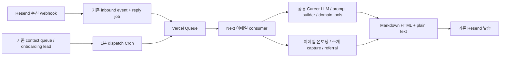

# 이메일 Vercel runtime

> 2026-10-16 운영 상태: beta `d30ff764`와 관련 DB 구조는 배포·적용했다. 운영에 `EMAIL_RUNTIME_TARGET=vercel_queue`는 설정하지 않았고 기존 이메일·contact Worker를 유지한다. 회사 Slack 연결 안내 이메일과 회사 이메일 답장 runtime도 비활성 상태다. 코드·DB 존재를 해당 기능의 활성화로 해석하지 않는다. 아래 미배포·미적용 표기는 작성 당시 이력이다.

2026-10-13 구현 기준. 아직 운영 DB 적용, Vercel 배포, 환경변수 활성화, 기존 서비스 종료를 수행하지 않았다.

## 구조와 웹 보존



웹 `/api/talent/chat`, 공통 모델 설정, LLM provider loop, tool 정의/실행기, prompt 원본은 변경하지 않는다. 기존 서버용 `runCareerChatTurn`에 선택적 adapter만 추가했다. 이메일은 이 helper가 만드는 프로필, Brief/Memory, 문서, 추천, 회사 연락 context와 공통 LLM/tool을 재사용한다. 이메일 adapter는 채널 표현/출력 지침만 교체하고 메일 제목, 첨부 메타데이터, 과거 thread, 발송 메일의 기회 식별자를 추가한다. 입력 prompt 객체를 수정하지 않는다.

모델과 reasoning은 `resolveCareerTextChatModel(null)`로 **웹 기본값**을 그대로 읽는다. 기존 Python `EMAIL_REPLY_MODEL` 등 별도 모델 설정은 새 runtime에서 사용하지 않는다. 웹의 관리자별 모델 override UI는 그대로다. 이메일에 별도 모델 목록/override를 복제하지 않는다.

일반 대화는 원본 LLM이 공통 read/write tool을 직접 사용한다. 이메일 온보딩의 기존 추출·checklist·완료 규칙은 별도 흐름으로 유지한다. 일반 대화에 turn별 추출기나 intent 분류기를 추가하지 않는다. 첨부 문서 저장과 온보딩 진행 기록만 이메일의 별도 executor이며, 기존 Next 업무 API/공통 저장 함수를 호출한다. 이메일에서 실행할 수 없는 웹 화면·폼·실시간 기능은 링크로 이어간다.

## 옮긴 흐름

| 기존 흐름 | 새 처리 |
| --- | --- |
| 일반 이메일 답장 | 공통 Career turn + 이메일 adapter, 동일 domain tool |
| 구독 중단/재개·언어·프로필·Brief/Memory·문서·추천 feedback | 공통 tool schema와 executor |
| 회사 연락·질문·거절·첨부 전달 | 공통 `read_company_connections` / `contact_company`, 같은 호출에서 전달 |
| 첨부 업로드 | 실제 수신 파일의 index를 기존 profile ingest API의 fileName/kind 계약으로 변환; resume/document 기본 공개·대표 설정도 기존 계약 |
| 일반 내부 추천 수락 | 첫 긍정 답장에 pending confirmation, 같은 source message로 수락 불가, 같은 대화의 후속 긍정 답장에 기존 acceptance API |
| 회사 Request Intro 수락 | 기존 직접 acceptance 계약 |
| signup follow-up 답장 | 기존 전용 prompt, 명시적 프로필 사실 저장, 첨부·링크·본문 이력서 처리, 기존 profile-submit seed |
| email-first onboarding | locale/이름/지역/기회 유형/프로필 재료 수집, pause, 추가 재료, 누락 항목 재질문 |
| onboarding profile review | 기존 ingest API, 실제 추출 결과 확인, 기존 완료/실패 메일과 continue URL, 원래 step 전환 |
| 내부 연결 안내·Role 이동 안내 | 기존 승인/단계/24시간·KST 시간대/transfer snapshot 검사와 기존 문구 |
| 회사→후보자 요청·후보자→회사 relay | 승인된 문구 유지, 첫 수신 요청 CTA, 기존 target 검사/전달 API |
| 일정 초대 | 기존 schedule/active round/만료/발송 대상 검사, queued→sent 또는 delivery_failed |
| CRM broadcast | 기존 승인 HTML, paused 재예약, 현재 후보자·연락 설정 검사 |
| 조직 warm introduction 회신 | 원래 참여자만 capture, 감사 기록·message count 원자적 저장, LLM/자동답장/후보자 chat 없음 |
| referral intro | 후보자 한 명만 대상으로 기존 동의 안내·추천인 확인 메일, 각 발송 checkpoint; 프로필 생성/회사 공유 없음 |

추천 발송을 담당하는 Opportunity Worker와 다른 수집/매칭 Worker는 이 서비스의 종료 대상이 아니다.

## 발송과 재시도

- Queue에는 `{version, kind, jobId}`만 넣는다. 원문과 개인정보는 기존 DB에 둔다. 새 업무 테이블을 만들지 않는다.
- 세 기존 작업 테이블에 `worker_target`, dispatch 시각/오류만 추가한다. 기본값은 `legacy`다. 기존 Worker claim RPC는 legacy 작업만 가져온다.
- webhook은 먼저 기존 inbound event/job을 저장한다. 발행 실패는 durable job과 오류를 남기며 Cron이 복구한다. Cron은 예약 시간이 된 연락과 review도 발행한다.
- claim은 DB에서 원자적으로 수행한다. 이미 끝난 작업은 무시하며, 현재 소유자의 lease와 대화 소유권을 확인한다. 같은 이메일 대화의 reply/review를 동시에 수행하지 않는다. 아직 identity가 정해지지 않은 reply도 메시지를 저장할 때 충돌을 검사한다.
- 기본 동시 실행은 4건이고 `EMAIL_RUNTIME_CONCURRENCY`로 1–100 범위에서 조절한다. 대기/용량 초과는 시도 횟수를 소모하지 않는다.
- callback 최대 실행 시간은 480초, lease/Queue visibility는 600초다. 3번 실패하면 해당 작업을 failed로 남긴다. 이미 provider ID가 저장된 작업은 횟수 제한으로 버리지 않고 기록 복구를 계속한다.
- 답장/문구와 발송 인자를 발송 전에 고정한다. 기존 Resend idempotency key를 유지한다. provider ID를 먼저 checkpoint한 뒤 대화·감사 기록·상태를 마무리한다. provider 성공 이후에는 현재 연락 조건이 바뀌어도 새 발송 없이 이미 일어난 전달 사실을 기록한다.
- tool 결과의 성공한 변경 명령은 같은 source job의 metadata에 재사용한다. 공통 tool의 source-message 기반 idempotency도 유지한다. 이것은 의미 판단 cache가 아닌 완료된 side effect의 실행 영수증이다.
- Resend idempotency 보장 기간 밖에서 provider 성공 여부를 확인할 수 없는 작업을 수동 재실행하면 중복 가능성이 남는다. 임의로 새 idempotency key를 만들거나 provider checkpoint를 지우지 않는다.
- 삭제된 계정, 바뀐 수신자, 만료·종료된 역할, test-only 격리, 취소된 일정, 연락 중단 같은 권한 경계는 발송 직전에 다시 확인한다.

## Markdown 후처리

`unified`의 remark/rehype + GFM으로 단락, 제목, 강조, 목록, 표, 인용, 코드, 링크를 HTML로 렌더링하고 inline style을 적용한다. HTML AST에서 plain text도 만든다. posting identifier와 상대 URL은 실제 Career 링크로 변환한다. raw HTML과 위험한 URL은 허용하지 않으며, 원격 이미지는 alt text만 표시한다. 앱 전용 choice/reengagement/기회 진행 control payload는 제거한다. 모델 답변의 의미나 말투를 정규식으로 고치지 않는다. Next API에서 지원되는 AST renderer를 사용하며 React 서버 렌더러에 의존하지 않는다. CRM의 기존 승인 HTML은 Markdown으로 다시 해석하지 않는다.

## 설정과 운영 전환

운영 전환에는 현재 요청의 명시적 배포 승인이 필요하다. 이 문서의 단계는 아직 수행하지 않았다.

1. `20261013035308_email_vercel_runtime.sql`을 검토하여 별도 승인된 DB 적용을 수행한다. 새 RPC는 service_role만 사용할 수 있다. 기본 legacy ownership 덕분에 DB 적용만으로 새 runtime이 활성화되지는 않는다.
2. 기존 정상 웹 환경에 필요한 값을 확인한다: Supabase admin/anon 설정, 현재 웹 모델 provider credential, Resend receiving+send 권한, `EMAIL_REPLY_DOMAIN`, `EMAIL_REPLY_TOKEN_SECRET`, sender 설정, `INTERNAL_WORKER_API_SECRET`, `CRON_SECRET`, email onboarding token secret 및 공개 사이트 URL. 값은 기존 업무 기능의 설정을 재사용한다.
3. `EMAIL_RUNTIME_TARGET`을 비워 둔 상태에서 코드 배포를 검증한다. `vercel.json`의 Queue trigger `harper-email-runtime-v1`와 매분 dispatch Cron이 포함된다. topic/consumer를 별도 상시 서버로 운영하지 않는다. 480초 Functions와 매분 Cron을 지원하는 Vercel 환경이 필요하다.
4. Production에서 `EMAIL_RUNTIME_TARGET=vercel_queue`로 활성화한다. 동시 실행 기본은 4; 필요하면 `EMAIL_RUNTIME_CONCURRENCY`를 늘린다. 신규 webhook과 due job이 새 경로로 간다. 기존 processing legacy 작업이나 legacy review lock은 자동으로 뺏지 않는다.
5. 전용 비운영 fixture로 일반 답장, 첨부, 첫/후속 수락, onboarding/review, 회사 relay, 일정 취소, capture, referral을 확인한다. `EMAIL_REPLY_DRY_RUN=true`는 발송과 회사 연락만 차단하며 일반적인 DB 저장까지 막는 sandbox가 아니다. dry run도 반드시 비운영 DB를 사용한다.
6. 기존 서비스의 reply/contact processing 및 review lock이 모두 마무리됐고 새 경로의 due job/예약 연락이 처리되는지 확인한다. 장기 in-flight 작업을 timeout이나 SIGKILL로 끊지 않는다.
7. 별도 승인된 운영 작업에서 `harper-email-reply-worker.service`를 stop/disable한다. 새 runtime은 이 프로세스 없이 세 작업군 모두를 처리한다. Python 소스는 초기 rollback 기간 동안 유지할 수 있다.
8. 성공 배포 뒤 실제 변경 범위를 기준으로 팀원용 Notion 문서 sync를 수행한다. 미배포 구현을 live 동작으로 기록하지 않는다.

확인할 durable 값은 job 상태/시도/lease/`queue_dispatch_error`, `resend_email_id` 또는 review/referral provider checkpoint, `career_email_messages`, 기존 회사 request/meeting round 상태다. 단순 outbox 상태만으로 정상 회사 전달 UX를 실패로 판정하지 않는다.

롤백은 새 발행을 멈추고 active Vercel 작업을 drain한 뒤 수행한다. 이미 provider checkpoint가 있는 작업은 새 경로에서 finalize한다. 발송되지 않았고 active lease가 없는 queued 작업만 명시적으로 legacy ownership으로 돌린 후 기존 서비스를 다시 실행한다. 실패한 이전 작업을 일괄 queued로 되돌리거나 진행 중인 작업을 빼앗지 않는다.

## 로컬 설정과 검증

기존 `HARPER_LOCAL_E2E=1` 로컬 stack을 사용하면 개발 모드의 publisher가 Next `after()`에서 **동일 consumer**를 호출한다. 별도 Python email poller나 Vercel Queue credential 없이 확인할 수 있다. 기존 local stack은 loopback DB/메일 relay와 전용 fixture 계정을 강제한다. 운영에서는 항상 Vercel Queue를 사용한다. 예약 작업/실패 복구는 인증된 dispatch endpoint를 호출하여 확인한다.

```
EMAIL_RUNTIME_TARGET=vercel_queue
EMAIL_RUNTIME_CONCURRENCY=4
```

로컬 DB에는 migration을 먼저 적용한다. `.env` 값을 운영에서 복사하여 local E2E를 우회하지 않는다. 개발 stack이 없는 환경에서는 비운영 Vercel preview + Queue로 검증한다.

```
pnpm test:email-runtime
pnpm exec tsc --noEmit --incremental false
```

테스트는 외부 LLM 호출/실제 메일/운영 DB 변경 없이 Markdown, 기존 웹 prompt 불변성, source 동의, 격리, 재실행, lease, provider checkpoint, 일정 취소, 기존 audit identity, review state, capture 원자성을 검증한다. PGlite 테스트는 migration 자체를 실행한다. 실제 provider 응답 품질 및 운영 Queue·Resend 연결 검증은 별도 환경에서 수행해야 한다.

## 확장 위치

- 공통 Career 능력은 기존 registry/executor에 한 번 구현하고 이메일 allowlist에 공개한다. 웹 원본을 이메일 요구에 맞춰 수정하지 않는다.
- 채널 지침/메일 source context: `src/lib/email/runtime/prompt.ts`, `context.ts`.
- 새 연락 유형: `contact.ts`의 handler에 기존 durable job을 연결한다. 승인된 내용과 lifecycle 경계를 재사용한다.
- 수신·발송 provider: `transport.ts`. body renderer: `format.ts`.
- dispatch/consumer는 독립되어 webhook이 전체 LLM 처리 코드를 미리 로드하지 않는다.

## Company 유저 이메일 답장 (2026-10-15 로컬 구현, 미배포)

새 회사 메일은 `src/lib/email/company.ts`의 `sendCompanyEmail`로 보낸다. 호출자는 회사 팀원의
`userId`, `workspaceId`, 승인된 `subject`·`body`, 해당 발송 사건의 고유한 `idempotencyKey`를 넘긴다.
동일 사건을 재시도하면 같은 Reply-To와 본문을 유지한다. 같은 key로 수신자·본문·회사·대화 범위를
바꾸면 거절한다. 기존 초대·연결 알림 등 모든 회사 메일을 자동으로 전환하지 않는다.

- `company+<token>@<reply domain>`을 기존 alias 저장소에서 회사 팀원·Workspace·회사 일반 대화에
  연결한다. talent의 `reply+`와 구분하며, 같은 주소가 양쪽 계정에 있어도 이메일 주소로 audience를
  추측하지 않는다. 회사 alias 없는 기존 메일을 회사 계정 검색으로 자동 전환하지 않는다.
- 발신자는 최초 수신 주소 및 현재 확인된 계정 이메일과 일치해야 한다. 현재 소속, 후보자 관리 권한,
  팀 접근 범위도 실행 중 및 발송 직전에 확인한다. 전달받은 alias만 가진 다른 발신자, 만료된 alias,
  복수 회사 alias, 회사·talent alias가 섞인 답장은 실행하지 않는다. 팀 범위가 바뀐 과거 대화도 재사용하지 않는다.
- 일반 수신 webhook·작업·Queue·Resend 경로를 재사용한다. DB trigger가 회사 작업을 새 runtime 소유로
  고정해 legacy talent poller가 처리하지 않게 한다. 새 runtime이 꺼져 있으면 회사 발송 helper는
  실행되지 않으며, 이미 수신된 회사 작업은 legacy로 넘기지 않는다.
- 원본 발송 메일, 현재 본문, 제한된 인용 이력을 참고해 기존 `runOrgAgentChat`을 호출한다.
  기존 회사 일반 대화와 도구·현재 권한·언어 설정을 공유한다. 메시지도 `company_messages`에 남으며
  웹 일반 대화에서 볼 수 있다. 별도 회사용 writer나 intent classifier는 없다.
- 이메일 표시는 shared prompt의 email surface가 맡는다. 중간 진행 메시지를 발송·저장하지 않고
  최종 한 통을 보낸다. 실패 시 고정 성공 답장으로 대체하지 않는다. 회사 화면용 역할·후보자 링크는
  기존 navigation 변환기를 거쳐 실제 인증된 웹 링크로 바꾼다. 인용된 내용은 새로운 실행 승인이 아니다.
- 제목의 `Re:`, `In-Reply-To`, `References`, 후속 Reply-To를 유지한다. 자동응답은 기존 공통 필터로
  차단하고 발송 메일에는 `Auto-Submitted: auto-replied`를 붙인다. 외부 Reply-To나 CC로 회사 정보를
  전송하지 않고 확인된 팀원 한 명에게만 회신한다.
- 같은 수신 작업의 회사 원문·최종 답변은 한 번씩 저장한다. 같은 회사 대화의 이메일 작업은 직렬화하며,
  발송 전 payload를 고정한다. provider 성공 checkpoint 이후에는 새 발송 없이 완료 기록만 복구한다.
  실제 provider 성공 기록 없이 Resend idempotency 기간 밖에서 재시도하는 기존 한계는 남는다.

현재 범위: 메일 본문은 인용 제거 후 최대 32,000자다. 첨부는 이름·유형만 제공하고 내용을 읽었다고
주장하지 않는다. 첨부 내용 추출은 미지원이다. 비동기 회사 작업의 후속 결과는 기존 웹·Slack 전달 계약을
유지하며, 이번 변경만으로 모든 후속 결과가 이메일로 전달되는 것은 아니다. 여러 CC의 공동 회사 대화도
지원하지 않는다.

활성화 전 `20261015120000_company_email_replies.sql` 적용과 웹 배포,
`EMAIL_RUNTIME_TARGET=vercel_queue`가 필요하다. 이번 구현 작업은 운영 DB·배포·환경변수·실제 발송을
변경하지 않았다. 별도 승인된 배포에서 migration과 실제 Resend/Queue 연결을 확인해야 한다.
검증: [회사 이메일 로컬 검증](evaluation/company-side-conversational-qa/reports/2026-10-15-company-email.md).


### 회사 이메일 DB 선반영 상태 (2026-10-15)

후속 사용자 요청으로 운영 DB에 `company_email_replies`를 적용했다. 운영 version은
`20261015103733`이며 로컬 `20261015120000_company_email_replies.sql`과 동일 변경이다.
함수 권한·trigger·index·기존 legacy 작업 보존을 확인했으므로 migration을 다시 적용하지 않는다.
로컬 실제 Supabase + company-side LLM + 메일 capture 통합 실행도 완료했다.
웹 배포·운영 runtime 활성화·실제 외부 이메일 발송은 미실행이다.
실행 결과와 로컬 추천 이력 reader의 미검증 범위는 위 검증 기록의 후속 요청 절에 남겼다.
