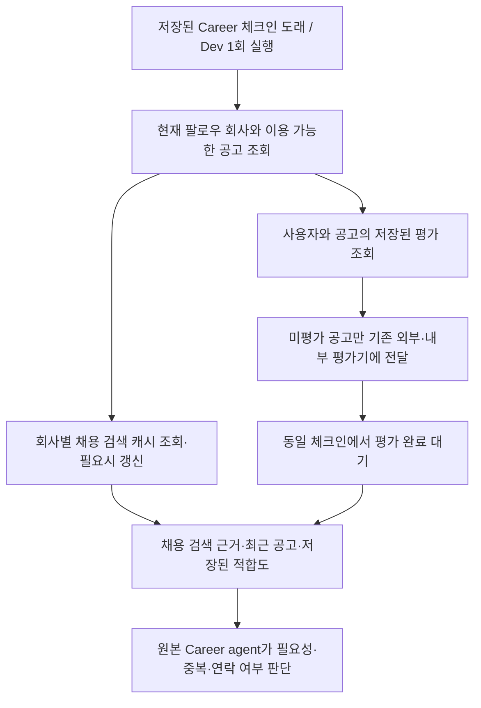

# 팔로우 회사 준비 구현·검증 — 2026-11-02

로컬 구현이다. 운영 migration·배포·실제 사용자 연락은 실행하지 않았다.

## 동작

- 최초에는 해당 회사의 현재 이용 가능한 미평가 공고를 준비한다. 이후에는 저장된 평가가 없는 공고만 자동 평가한다. 낮은 점수도 재사용하며, 프로필·Brief 변경이나 평가의 나이만으로 자동 재평가하지 않는다. 이미 추천한 공고도 자동 평가 대상에서 제외한다. 원본 agent의 명시적인 일반 평가 요청은 기존대로 사용할 수 있다.
- 회사 범위를 SQL에서 먼저 제한하고 exact role IDs를 기존 평가기에 전달한다. 전체 DB 임베딩 검색이나 새로운 검색계획 LLM을 실행하지 않는다. 500개 SQL 페이지 경계를 넘는 공고도 누락하지 않는다.
- 채용 소식은 기존 웹 검색을 회사별로 공유한다. 연결된 workspace들은 같은 회사 identity의 캐시를 사용한다. **새·확대 채용, 공채 등 실제 채용 발표에 집중**한다. 별도 뉴스 요약/분류 LLM은 추가하지 않았다. 검색 결과는 확인된 발표로 단정하지 않고 출처·날짜·발췌를 원본 agent에 제공한다. 필요한 원문 확인은 일반 open_url을 사용한다.
- 캐시는 최초 필요한 사용자 실행에서 수집하고, 다음 실행에서 24시간이 지난 경우 갱신한다. 매일 별도 수집 작업을 돌리는 구조는 아니다. 결과가 없었던 정상 검색도 캐시한다. 실패하면 기존 근거를 유지하고 1시간 동안 다른 팔로워의 반복 유료 검색을 막는다. 회사 검색의 freshness와 사용자의 연락 주기는 별개다.
- 평가는 기존 durable run/evaluation 저장소와 큐를 사용한다. 새 persistence는 회사 공통 검색 근거 캐시뿐이고, 준비 상태·자식 실행 ID는 기존 background invocation의 coverage에 저장한다. 동일 사용자의 겹치는 준비는 직렬화한다.
- source 변화가 새로운 연락 run을 만들지 않는다. 중단된 정기 스케줄은 그대로 중단되어 있다. 다른 종류의 알림·회사 요청 run에는 회사 팔로우 준비를 자동 추가하지 않는다.
- 원본 agent의 시작 context에는 회사마다 최근 5개와 저장된 mutual-fit 기준 상위 5개의 중복 없는 index를 제공한다. 이는 표시 분량이며 평가 대상 제한이 아니다. `follow_company action=read`는 모든 현재 공고·저장된 평가·채용 검색 근거를 페이지별로 읽는다. 사용자에게 공개할 정보와 연락 여부는 원본 agent가 결정한다.
- Dev 실행 로그에는 `prepare_followed_companies`의 대기/준비 결과와 자식 평가 run ID가 남는다. 실제 agent tool 로그는 기존 기록 경로를 사용한다.

## 검증

### SQL·실행 경로

- 첫 신규 검증: PGlite에서 실제 migration/SQL을 실행한 8개 테스트 통과.
- 기존 검색·스케줄·발송 경로를 포함한 재검증: 64개 통과.
- 추가한 실행기 회귀 검증: 31개 통과. 프로필 revision이 바뀌어도 과거 non-fit 공고를 재평가하지 않으며, 팔로우 해제로 대상이 비면 전체 DB 검색으로 넘어가지 않는지 확인했다.
- 최종 관련 묶음: **웹 테스트 74개 통과**. 마지막 context 축소·prompt 수정 뒤 해당 경로 16개 재검증 통과.
- Worker: `test_career_requested.py` **10개 + 5 subtests 통과**. 역할 자격 경계 테스트를 포함한 실행은 **185개 + 5 subtests 통과**.
- 변경한 TS 파일 ESLint 통과. 전체 `tsc --noEmit`은 마지막 확인에서 이번 작업 밖 `src/components/career/history/TalentRoleActivityTimeline.tsx:185`의 nullable `endAt`에 대한 `new Date()` 호출 오류 1건으로 실패했다. 이 파일은 다른 진행 중 변경이므로 수정하지 않았다. 이번 변경 경로에는 타입 오류가 보고되지 않았다.

검증 항목: 정확한 회사/workspace 범위와 소유권, 차단·만료·test-only·연락 중단, 동시 팔로워의 검색 1회 공유, 정상 빈 결과 캐시, 검색 실패 시 기존 근거 유지, positive/non-fit 평가 재사용, 기존 큐 완료 대기, 겹치는 준비의 유료 평가 중복 방지, 한쪽 작업 등록 실패 시 진행 중인 다른 평가 보호, 603개 공고 누락 없는 조회/평가 대상 구성, 페이지 읽기, 원본 agent 호출 전 중단 재검사, 현재 예약 실행 ID 유지.

### 실제 모델

Production Career runtime·prompt·handbook·tool schema와 실제 PostgreSQL context projection을 사용했다. 외부 자료·발송·추천 저장은 synthetic receipt이며 모델 provider 이외 네트워크는 차단했다. 전체 provider 입력과 생성한 이메일·도구 인자를 직접 검토했다. 실제 이메일은 0건이다.

| 상황 | 첫 2회 공통 결과 |
| --- | --- |
| 잘 맞는 새 공고 + 실제 채용 발표 + 브랜드 뉴스 | 공식 채용 출처를 확인하고 관련 공고/채용 정보만 발송 도구에 전달. 브랜드 뉴스·private 점수 제외 |
| 제품·투자 뉴스만 있음 | 발송 없음 |
| 어제 같은 공고·채용 소식을 실제로 알림 | 중복 발송 없음 |
| 회사명 오타만 고친 프로필 + 과거 non-fit | 기존 평가 재사용, 재평가·발송 없음 |

- `2026-11-02T08-16-10-015Z`: frozen 4개 상황 완료.
- `2026-11-02T08-19-17-386Z`: 같은 4개 재실행 완료.
- `2026-11-02T08-23-38-374Z`: 채용 안내 1개 재검증 완료.
- `2026-11-02T08-30-14-380Z`: 최종 background guide 변경 뒤 채용 안내·사소한 프로필 수정 2개 완료.
- **합계 11개 실행에서 새 web_search 0회, 새 평가 요청 0회**. `search_opportunities action=read`는 저장된 평가를 읽는 호출이며 새 검색/평가가 아니다. 채용 안내 4번에서 각각 발송 시도 1회, 나머지 7번에서 발송 시도 0회였다. 발송 후 `action=read`는 중복 발송으로 집계하지 않았다. action 생략은 실제 도구와 동일하게 deliver로 해석했다.
- 모델 호출 수는 조용한 확인 3회, 채용 안내 5–8회였다. 이는 한 논리적 Career 실행 안에서 도구 결과를 이어받는 provider 호출 수다. 별도 뉴스 판단·선별 LLM은 없다.

## 수정한 문제와 한계

- 초기 코드의 빈 회사 범위가 일반 검색 분기로 넘어가지 않도록 executor 경계를 고쳤다.
- 회사 identity와 workspace 이름이 섞여 첫 팔로워에 따라 공유 검색 범위가 달라지지 않도록 공통 회사 identity로 검색한다.
- 검색 실패를 빈 결과로 기록하거나 다음 팔로워마다 재시도하지 않는다.
- 이미 실행 중인 자식 평가를 다른 enqueue 실패 때문에 준비 완료로 처리하지 않는다.
- 정기 실행 도중 중단/동의가 바뀌면 원본 agent 호출 전 재검사한다. 준비 시간도 기존 background 요청의 전체 deadline에 포함한다.
- 신규 DB 테이블/RPC는 service_role 전용이며 일반 사용자 역할에 노출하지 않는다. 실제 migration·RPC 권한 경계는 PGlite에서 검증했다.
- 실제 웹 검색 결과의 품질/coverage, 운영 데이터 규모의 성능, hosted 큐와 이메일 서비스는 이 로컬 검증으로 확인하지 않았다. 공고 수집은 기존 company_roles 수집기를 그대로 사용하므로 아직 DB에 수집되지 않은 공고까지 보장하지 않는다.
- SQL migration `20261102080129_career_follow_preparation.sql`과 웹/Worker 변경은 운영에 적용하지 않았다.
