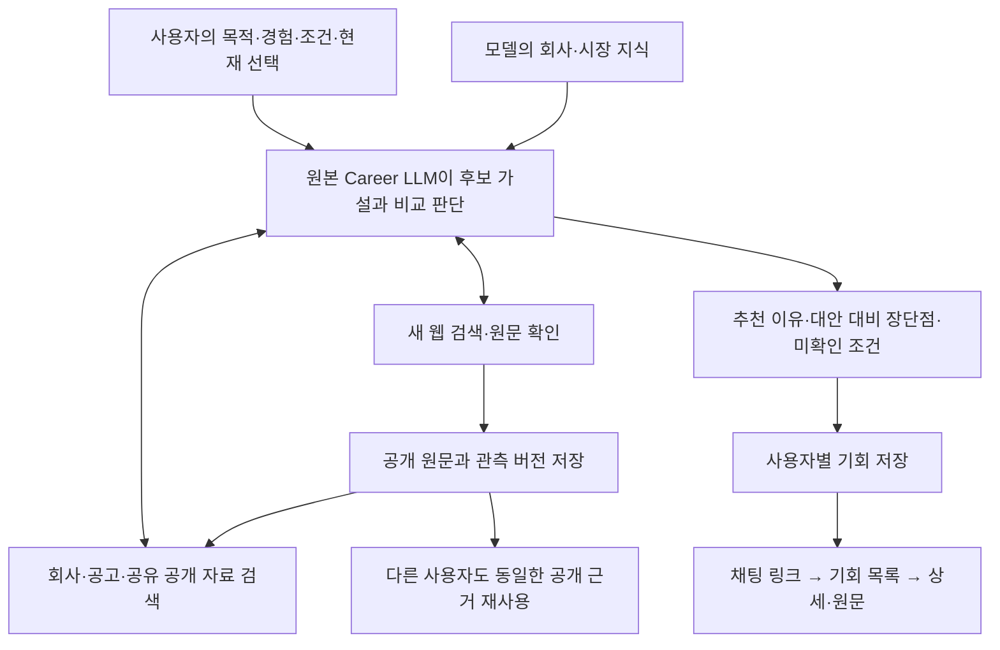

# 회사 발견·개인 적합성 실사용 점검

2026-11-15. 로컬 구현 및 실제 모델 실행 결과. 운영 배포 기록이 아니다.

## 결론

사용자의 우려에는 근거가 있었다. 기존 Harper도 DB 밖에서 웹으로 회사를 찾고 실제 직무를 읽었지만, **기존 경력과 비슷한 회사를 찾는 것에서 출발해 그 후보를 잘 설명하는 경향**이 있었다. 특히 같은 결제 백엔드 경력이라도 기술적 깊이를 원하는 사람과 고객·제품 경험을 통해 창업을 준비하는 사람은 다른 후보군이 필요하다. 후자의 baseline은 18회 웹 검색 대부분이 결제·핀테크 주변에 머물렀다. 자료를 많이 읽는 것만으로 후보 가설이 좋아지지는 않았다.

원본 discovery guide에서 탐색 목적과 종료 기준을 수정하고, 실제로 확인한 도구 계약 결함을 고쳤다. 다시 실행한 창업 지향 사례에서는 재무 제품·의료 제품·업무 SaaS를 비교했고, 기술 성장 사례에서는 글로벌 결제 인프라와 인증 플랫폼까지 검토했다. 재직 조건이 좋은 별도 사례는 이직을 억지로 권하지 않았다. **수정은 유지한다. 다만 모든 경우에 가장 적합한 회사를 찾았다고 입증한 것은 아니다.** 지역·직무 전환 사례의 실현 가능성, 부족한 사용자 정보, 조사 시간은 아직 명확한 한계다.

추천 회사 이름을 정답으로 두거나, 검색 횟수·회사 수·점수·별도 심사 모델로 답을 통제하지 않았다. 사용자가 예로 든 동료 경력/학력 join, 연결 공고 요약은 추가하지 않았다.

## 확인 방법과 범위

- 회사 정답 목록 없는 가상 사용자 6명을 먼저 고정했다. 최초 4명은 수정 전후 비교, 마지막 2명은 수정 전에 동결한 전이 사례다. `cases-v1.json`과 reviewer-only `gold-v1.json`의 SHA-256은 `manifest-v1.json`에 있다. 평가 기준은 제품 모델에 전달하지 않았다.
- **첫 대화 10회 + 브라우저에서 보낸 후속 대화 1회**, 총 11회. 답이 마음에 들 때까지 재생성하지 않았다. 전후 각 사례는 새 로컬 계정이다.
- 실제 인증된 `/api/talent/chat`, 기본 `gpt-6.1-terra` / `high`, 제품의 prompt·context·capability·tool 경로, 실제 Exa 검색과 페이지 읽기, 로컬 Supabase 저장을 사용했다. 검색 결과를 평가자가 공급하지 않았다. 정확한 provider request/response, tool 결과, DB 상태, 전체 최종 답변을 확인했다.
- 로컬 앱은 기존 checkout의 별도 port 3025다. 운영 DB·실사용자 데이터 대신 marker가 확인된 로컬 DB와 합성 프로필을 사용했다. 테스트 요청에는 연락·지원 금지를 명시했고 실제 발송·지원은 하지 않았다.
- 로컬 회사 디렉터리는 5개 회사, 시작 시 22개 Role로 희소하다. 공개 자료의 semantic index 처리도 운영 규모와 같지 않다. 따라서 **DB 기반 추천의 운영 성능 검증이 아니라, 현재 정보와 실제 웹으로 좋은 회사를 발견하는지 보는 평가**다.
- live web, 모델 변동, 공유 캐시의 누적과 로컬 DB 복구가 개입했다. 전후 관찰은 유의미하지만 prompt 하나의 인과 효과를 분리한 통계적 A/B는 아니다. 응답·면접·오퍼 결과는 측정하지 않았다.

## 관측한 전후 결과

시간은 API 요청부터 응답 stream 종료까지의 실제 시간이며 UI의 반올림 표시와 조금 다르다.

| 사용자 목적 | 수정 전 | 수정 후 / 별도 확인 | 판단과 미확인 |
| --- | --- | --- | --- |
| 결제 백엔드 8년, 관리직보다 깊은 기술·좋은 동료·Staff 범위 | 쿠팡페이·당근페이·토스 계열·우아한형제들의 결제/정산 중심. 165초 | Airwallex GTPN → 쿠팡페이 → 토스페이먼츠 → 당근 인증 플랫폼 등의 실제 일을 비교. 210초 | 후보 공간과 현재 직장 대비 설명은 개선. 동료 수준·보상·실제 권한을 확인했다고 말하지 않음. 최상위 회사가 절대적으로 최선이라는 증거는 아님. |
| 같은 경력, 작은 팀에서 고객·제품·기술을 함께 책임지고 향후 창업 | 캐노피 → 포트원 FDE → 데일리페이. 검색 대부분 기존 핀테크 경력 주변. 139초 | 볼타 → PhyxUp Health → 스텝하우. 수요, 고객 접점, 권한, 기술 전환 비용을 비교. 데일리페이의 확인된 FDE 보상 범위와 기준 불일치를 지적하되 다른 시니어 역할까지 일반화하지 않음. 121초 | 목적에서 출발하는 대안 형성이 개선. 1억원 기본급, 채용 상태, 실제 고객 접촉·권한은 미확인으로 남음. PhyxUp의 경력 범위와 스텝하우의 AI/RAG 경험 차이도 설명. |
| 임상 연구 6년, 부산 거주·월 2회 이하 출장, 환자에게 영향을 주는 제품으로 전환 | 아크·디오·부산 CRO 등을 조건부 검토. 108초 | 디오·비주얼터미놀로지·부산 CRO 등을 비교하고 간호사 자격/서울 출근 제약을 구분. 127초 | 혼합 결과. 다른 후보를 찾았지만 부산 거주와 보상을 충족하는 실제 역할을 확정하지 못함. baseline보다 분명히 우수하다고 판정하지 않음. |
| 금융 UX 5년, 실직·가족 생계, 3개월 내 안정적 재취업 | 토스뱅크·당근페이, 판교 가능 시 카카오페이. 183초 | 토스증권 Trading·토스인슈어런스·당근페이를 사업·팀의 조건과 함께 비교하고 Role 카드 3개 저장. 313초 | 유명세 대신 사업 실적과 팀 범위를 더 확인. 보상·채용 속도·팀 안정성은 보장 못함. 구체성은 좋아졌지만 시간이 상당히 늘었고 더 넓은 안정적 업종에서의 최선은 미입증. |
| 이미 연봉 1.6억·원격·가족 시간 만족, AI 이직에 대한 불안 | 수정 전 실행 없음 | 업스테이지·Cohere를 비교하면서 **현재 회사를 떠나는 편이 확실히 낫다고 말할 곳은 없다**고 판단. 내부 역할 확대를 우선 검토. 미국 한정 원격, 출장 부담, 채용 상태 충돌을 구별. 163초 | 유행이나 회사 이름만으로 이동을 권하지 않는 전이 사례 확인. 현재 역할 확대가 실제 승인될지는 미확인. |
| 서울 거주 외 경력·목적 거의 없음 | 수정 전 실행 없음 | 개인 최적 회사를 판단할 정보가 없다고 말하고 조건부 예시 후 경력/목적 질문. 41초 | 가짜 개인화는 피함. 다만 질문 전에 웹 검색 6회로 조사한 것은 비효율적. 이번 수정으로 해결됐다고 보지 않음. |

개발 비교 4개의 평균 시간은 약 149초 → 193초였다. 효율 개선을 전체 응답 속도 향상으로 보고하지 않는다. tool 성공 역시 추천 품질의 대리 점수가 아니다.

## 근본적으로 바꾼 부분

### 1. 후보를 만드는 목적과 비교 기준

`src/lib/career/handbooks/methods/index.ts`의 기존 `OPPORTUNITY_DISCOVERY` 본문을 수정하고 registry 버전을 `2026-11-15-v2`로 올렸다.

이전의 “기회를 찾고 유용한 다음 행동이 보이면 조사를 멈춘다”는 기준은 그럴듯한 회사 몇 곳에서 멈추기 쉬웠다. 지금은 원하는 일·사람·조건·미래 선택지에서 후보 가설을 만들고, 기존 경력은 옮겨갈 수 있는 능력과 진입 가능성을 판단하는 근거로 사용한다. 실질적으로 다른 경로와 현재 직장에서의 선택을 비교하며, 순위를 뒤집을 수 있는 불확실성에 조사 노력을 쓴다. 공개 자료로 해결할 수 없는 조건은 조건부 판단으로 남긴다.

모델이 알고 있는 회사, 공유 공개 조사, 회사 디렉터리, 새 웹 검색 중 필요한 경로를 선택한다. `search_resources(source="companies")` 선행 의무를 만들지 않았다. main prompt에 사례별 문구를 추가하지 않았고, 기존의 관련 작업용 동적 guide를 수정했다. 특정 회사명이나 이번 사례의 경력·연봉 조건은 제품 지침에 넣지 않았다.

### 2. 도구가 요구하는 입력과 순서를 모델에 정확히 전달

- `resources/tools.ts`: `filters`가 빈 object 설명뿐이라 `external_roles` 호출 시 실제 executor가 요구하는 국가 범위를 알기 어려웠다. 기존 `externalSearchPlanSchema`를 그대로 공개해 `plan.roleTitles`와 국가 코드별 `countries`, 다른 자료의 `where` 계약을 드러냈다. 새 휴리스틱이나 조용한 재시도는 없다.
- `matching/searchPlan.ts`: 공용 parser의 오류 설명이 `search_opportunities`만 지칭하던 것을 실제 plan 요구사항으로 바꿨다.
- `opportunities/tool.ts`: `displayOrder`가 작은 수부터 표시된다는 계약이 없었다. baseline 창업 사례는 채팅 1순위에 값 3을 주어 목록이 거꾸로 저장됐다. 오름차순, 생략 시 동작, 사용자 수동 순서 우선이라는 실제 실행 계약을 설명했다. 후속 실행은 1·2·3 순서로 저장했고 목록도 동일했다.

### 3. 이미 읽은 공개 원문을 추천 근거로 바로 사용

공유 공개 저장 자체는 기존 구현에 있었다. 결함은 **웹 읽기의 공개 저장 영수증을 실제 Career 모델 입력까지 전달하지 않는 것**이었다. 모델이 원문을 읽었어도 기회의 `resourceRef`를 붙이기 위해 별도 검색/조회를 해야 할 수 있었다.

- `documentCache.ts`: 공개 capture가 실제로 반환한 document ID와 observation revision을 `saveDocumentCaches`의 반환값에 보존한다.
- `webSearch.ts`: 각 결과에 해당 capture의 정확한 `resourceRef`를 붙인다.
- `agentTools/web.ts`, `talentOnboarding/tools.ts`: Career 웹 검색·단일/복수 URL 읽기의 모델 입력에 공개 원문 reference를 전달한다. 출처 시각, 잘림, 다음 offset, 부분 실패 등 기존 실행 사실은 유지한다. 공유 함수의 기본 옵션은 꺼져 있어 회사 agent 출력에 새 reference를 강제하지 않는다.
- `resources/webResult.ts`: 이미 받은 exact receipt를 재사용한다. 별도 조회 시점에 다른 요청이 URL을 갱신한 버전을 잘못 붙이는 경로와 불필요한 조회를 줄인다. receipt가 없을 때의 기존 경로는 유지한다.

새 웹 호출·DB 테이블·모델·개인별 추천 점수 캐시를 추가하지 않았다. 검색 메타데이터만 받은 자료를 본문까지 읽은 것처럼 바꾸지 않는다. 같은 공개 원문은 다른 사용자에게 재사용할 수 있지만, **그 원문이 누구에게 왜 좋은지에 대한 판단은 그 사용자의 맥락에서 다시 한다.**

## 추천부터 화면까지 실제 확인

화살표는 가능한 정보 흐름이며 정해진 도구 호출 순서가 아니다. 회사 추천 전체에 고정 scoring 단계를 새로 두지 않았다.

창업 사례에 브라우저 composer로 “아까 우선 추천한 세 곳을 기회 탭에 추천 순서대로 남겨줘…”를 보냈다. 약 66초 뒤 볼타·픽스업·스텝하우 일반 기회 3개가 저장됐다. 각 상세에는 추천 근거, 다른 후보 대비 이유, 미확인 연봉·권한·채용 상태, 버전이 고정된 공개 출처가 있었다. 이 저장을 지원 의사나 연락 완료로 기록하지 않았다.

확인한 UI/소유권 동작:

- 채팅의 회사 링크에서 해당 상세로 이동하고, 목록은 볼타 → 픽스업 → 스텝하우 순서로 표시됐다.
- 데스크톱과 390px 모바일의 상세를 직접 확인했다. 모바일 document 폭도 390px로 가로 넘침이 없었다. 공개 근거 링크에서 저장된 원문 본문이 열렸다.
- baseline 기회의 저장/해제와 숨김/복원이 동작했다.
- 다른 합성 계정으로 볼타의 **같은 공개 원문 revision**을 읽을 수 있었다. 첫 사용자의 개인화된 기회 상세에는 “현재 읽을 수 없음”이 표시됐다. 공개 자료와 개인 추천의 접근 경계가 유지됐다.

후속 저장은 성공했지만 회사/공개 자료 재검색과 기존 URL 읽기를 여전히 수행했다. reference 전달은 반복 조회의 기술적 원인을 제거하며 정확한 버전을 제공하지만, **중복 조사를 모두 없앴다거나 사용자 간 자동 발견·추천 효율이 충분히 입증됐다는 뜻은 아니다.**

## 독립 원문 확인

제품의 실제 tool 결과와 별도로 몇 가지 중요한 주장과 놓칠 수 있는 대안을 확인했다.

- [Airwallex 공식 GTPN 공고](https://careers.airwallex.com/job/5d5ae093-c9ea-4fce-b504-a8bca9330e13/staff-software-engineer-gtpn-platform/)는 서울 근무 및 글로벌 지급 인프라의 실제 범위를 뒷받침한다. 좋은 동료나 후보자의 합격·보상을 증명하지는 않는다.
- [볼타 공식 제품](https://bolta.io/)은 세금계산서·입금/정산 API와 제품 사용 근거를 제공한다. 무료 이용이 있으므로 공개 사용 수치를 유료 고객이나 매출로 치환하면 안 된다. 저장 상세에도 해당 한계를 남겼다.
- [PhyxUp의 클리닉 사례](https://blog.phyxuphealth.com/cornish-therapy-works-rtm-case-study/)는 실제 제품 사용의 근거다. 회사가 작성한 사례이며 매출 안정성이나 이 후보자에게 맞는 채용 조건의 증거는 아니다.
- 별도 조사에서는 [Joint의 공식 Product Engineer 채용](https://www.joint.now/careers/ai-native-product-engineer-2026/)처럼 고객 문제에서 제품을 만드는 다른 후보도 발견했다. 이를 현재 순위보다 낫다고 확정하지 않았으며 제품 prompt에 정답 회사로 넣지 않았다. 제한된 탐색으로 전 시장 최적을 입증할 수 없다는 반례다.

## DB·검증·운영 상태

baseline의 두 Role 검색 오류와 회사 외부 공고 저장 오류를 원인까지 구분했다. 로컬 DB에는 기존 `external_role_index_vector`, `external_role_has_type`, `external_role_salary_satisfaction` 함수가 빠져 있었고, user-submitted Role guard가 이전 버전이었다. 다음 **기존 migration의 함수/guard 정의만 로컬에 복구**했다. 대형 index 생성은 실행하지 않았다.

- `20261022132418_job_search_employment_remote_hnsw.sql`
- `20261022120257_job_search_country_non_intern_hnsw.sql`
- `20261014230152_external_salary_partial_bounds.sql`
- `20261105090000_career_found_items_own_list.sql`

운영 Harper 프로젝트의 함수와 guard를 직접 읽어 비교했다. 운영에는 이미 해당 정의가 있었다. 따라서 이 오류를 운영 결함으로 보고하거나 불필요하게 운영 DB를 변경하지 않았다. 이 수정에 필요한 **새 DB migration은 없다.** 이 확인은 모든 미배포 로컬 기능의 운영 migration 상태를 전수 점검했다는 뜻이 아니다.

검증 결과:

- `careerFoundItems` 11개, external search 34개, resource DB 22개, shared web/open URL 18개: 합계 **85개 통과**. 공개 reference의 전달, 본문 없는 결과, 공개/개인 경계, 페이지 부분 실패와 기존 기본 출력 계약을 포함한다.
- external search의 최초 테스트 실행은 환경변수가 없는 상태여서 `supabaseUrl is required`로 실패했다. marker가 확인된 local env로 다시 실행해 34개가 통과했다. 이 초기 실패를 품질 실패나 성공으로 숨기지 않는다.
- `tsc --noEmit --pretty false`가 최종 코드에서 통과했고 runner의 `node --check`, 변경한 tracked 파일의 `git diff --check`도 통과했다.
- 브라우저 자동화에서 잘못 추정한 role/접근성 이름으로 locator timeout이 있었다. 실제 DOM/href를 읽어 다시 검증했으며 목록·모바일·근거 페이지의 성공 관측을 별도로 남겼다. timeout 자체를 제품 성공으로 세지 않았다.
- 수정 이후 4개 비교, 2개 전이 및 후속 대화가 완료됐고 초기의 tool 계약/로컬 DB 오류는 재발하지 않았다. 이것은 해당 실행 범위의 관측이다.

코드는 기존 checkout에 있으며 **운영 웹·Worker 배포, push, 운영 DB 변경, 이메일 발송, 회사 연락, 지원 제출은 하지 않았다.** 사용자의 DB 반영 권한은 활용 필요 여부를 판단한 것이며 배포 승인으로 확대하지 않았다.

## 남아 있는 한계와 유지 결정

1. 공개 자료가 없는 보상·권한·동료·실제 채용 여지는 조사만으로 확정할 수 없다. 이번 결과를 “최적 회사 확정”보다 **근거 있는 우선 검토와 다음 확인 사항**으로 보는 것이 정확하다.
2. 부산 임상 전환처럼 제약이 강한 경우 현실적으로 조건을 충족하는 구체적 역할까지 찾지 못했다. 후보가 바뀌었다는 이유만으로 개선 판정을 내리지 않는다.
3. 사용자 정보가 희소할 때 조사와 질문의 순서가 아직 비효율적이다. 저장 후속에서도 이미 한 조사를 반복했다. 단순 검색 횟수 제한이나 사례별 분기 대신 실제 입력과 불확실성의 가치에 관한 후속 평가가 필요하다.
4. 안정성 사례의 응답 시간은 약 3분에서 5분으로 늘었다. 더 깊은 비교의 가치와 대기 비용을 함께 평가해야 한다. 속도 향상을 주장하지 않는다.
5. 공개 자료 접근·버전 재사용은 실제 확인했지만, 다수 사용자 운영에서 추천 품질과 비용이 얼마나 개선되는지는 아직 측정하지 않았다. 사후 응답·면접·오퍼 성과도 미측정이다.

이번 변경은 사례별 정답을 강제하지 않으면서 후보 가설의 폭과 목적 적합성을 개선했고, 확인된 도구 결함을 해결했다. 그러므로 유지한다. 남은 문제를 가리기 위해 새 점수 체계·회사별 예외·별도 판단 agent를 추가하지 않는다.

## 증거 위치

개인 세션·모델 입력·원문은 ignored `runs/` 아래에만 보관한다. 저장소에 세션이나 원문 전체를 추가하지 않는다.

| 실행 | 상대 경로 (`docs/evaluation/career-opportunity-discovery/` 기준) |
| --- | --- |
| 수정 전 4회 | `runs/2026-11-15T12-25-19-488Z-baseline/` |
| 수정 후 4회 및 후속 저장 | `runs/2026-11-15T12-33-22-297Z-refined/` |
| 전이 2회 | `runs/2026-11-15T12-43-39-963Z-transfer/` |
| 실제 provider request/response 및 app log | `runs/2026-11-15T12-25-12-875Z-app/` |
| 로컬 DB 복구 전후 정의 | `runs/local-db-repair.json` |

각 run의 `run.json`, `sources.json`, `durable.json`, stream이 결과와 입력 revision을 연결한다. `sourceRevision`만으로 dirty checkout을 재현할 수 없으므로 실제 소스 snapshot을 사용한다. 웹 reference 수정은 refined 최초 4회 이후이며 transfer와 브라우저 후속에 반영됐다. 상세·목록·모바일·다른 계정의 원문 스크린샷과 `ui-verification.json`은 refined 폴더에 있다. 단위 테스트 로그는 `runs/*tests.log`, 타입 검사는 `runs/typecheck-final.log`다.
