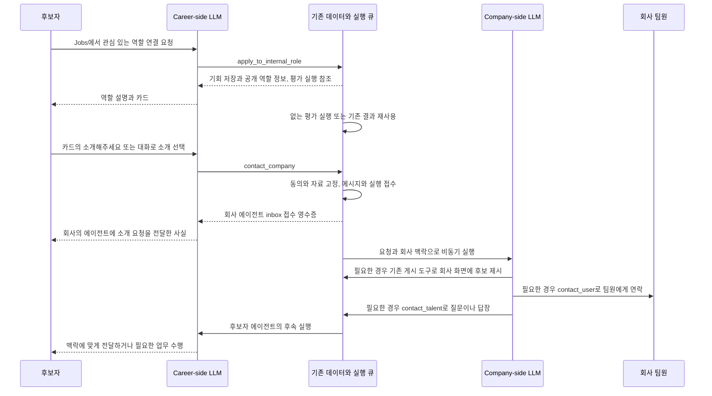
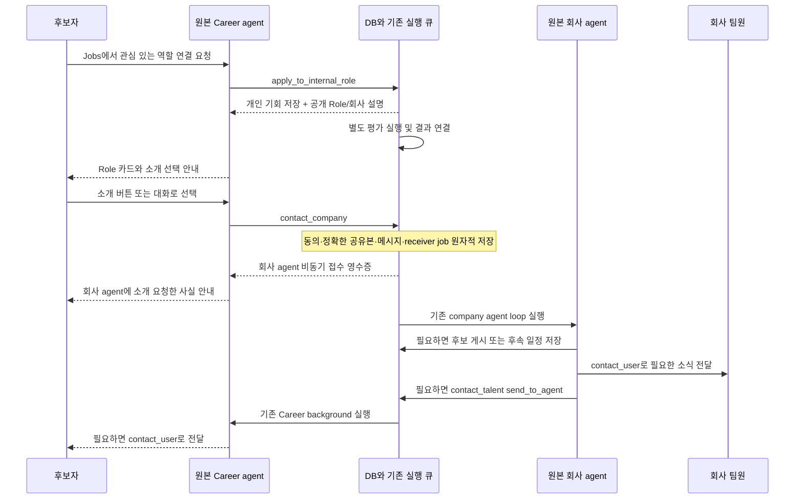

# Internal Role 연결 요청과 양방향 에이전트 연락 설계

작성·전면 재검토·구현일: 2026-11-03. 상태: **로컬 구현 및 검증, 운영 미적용**. 1–20절은 구현 전 조사와 설계 판단을 보존한다. 현재 구현·검증 결과와 적용 순서는 **21절**이 정본이다. 기준은 미커밋 변경을 포함한 로컬 checkout이며, 운영에서 같은 코드·migration이 실행 중이라는 의미는 아니다.

사용자가 관심 있는 내부 기회를 발견하면 Harper가 바로 평가를 시작하고 기회 목록에 담는다. 사용자가 그 기회의 소개를 선택하면 Career-side LLM이 회사의 에이전트에 소개 요청을 전달한다. Company-side LLM은 자기 회사의 맥락과 위임을 바탕으로 팀원에게 소개하거나, 후보자의 에이전트에 질문·답장을 보내거나, 필요한 시점에 다시 살펴본다. 양쪽의 실제 사람에게 연락하는 행위는 각각의 에이전트가 담당한다.

핵심은 사용자에게 보여 주는 표현만 바꾸는 것이 아니다. **평가·기회 저장, 후보자의 소개 동의, 상대 에이전트의 요청 접수, 사람에게 전달, 실제 연결을 서로 다른 사실로 보존**하고, 그 사실과 일반 도구를 원본 LLM이 사용하게 만드는 변경이다.

## 1. 채택할 결정

| 항목 | 제안하는 결정 |
| --- | --- |
| 제품 표현 | 요청의 중심 표현은 한국어 `연결해주세요`, 영어 `Introduce me`. 소개를 확정하는 카드 버튼은 `소개해주세요` / `Introduce me` |
| 첫 진입 | `/jobs/{slug}`의 Talk to Harper는 정확한 Role 참조와 대화 초안을 전달한다. 클릭·로그인·초안 삽입 자체로 실행하지 않는다 |
| 처음 요청한 기회 | `apply_to_internal_role`이 기존 평가를 확인하고, 필요한 평가를 즉시 접수하며, 후보자용 기회를 저장한다. 회사에 소개하지 않는다 |
| 평가와 카드 | 낮은 점수 때문에 사용자가 지정한 기회를 숨기지 않는다. 평가 대기·장애도 기회 저장과 분리한다 |
| 평가 저장 | 공통 평가 원장 `company_role_candidate_evaluations`를 재사용한다. 과거 `talent_opportunity_fit`에 새 평가를 이중 저장하지 않는다 |
| 평가 공개 | 원장을 함께 써도 회사 열람 권한은 별도다. 후보자 비공개 맥락을 읽은 평가는 프로필 공유만으로 공개하지 않는다 |
| 새 기회 탭 | `talent_opportunity_recommendation`과 기존 목록 조회를 사용한다. 평가 행만 저장해서는 카드가 생기지 않는다 |
| 역할 상태 | Career-side 입력에서 내부 `active` / `paused` / `top_priority`를 제외한다. 실행 가능한 효과는 서버가 확인한다. Company-side에는 자기 역할 운영에 필요한 실제 상태를 제공한다 |
| 소개 선택 | 카드 버튼과 대화는 같은 소개 실행 계약으로 모인다. 이미 소개에 동의한 역할에 재승인을 반복하지 않는다 |
| 소개 요청 도구 | `contact_company`가 소개 동의·자료 고정·회사 에이전트 메시지 접수를 원자적으로 확정할 수 있게 확장한다 |
| 양방향 연락 | `contact_company` / `contact_talent`는 상대 에이전트의 durable inbox에 보낸다. 상대 LLM의 답변을 기다리지 않는다 |
| 사람에게 연락 | `contact_user`는 자기 후보자 또는 권한 있는 회사 팀원·채널에 실제 메시지를 전달한다. 기존 메일·Slack·대화 저장과 영수증을 재사용한다 |
| 기본 자료 | 역할에 지정한 자료가 있으면 그 버전, 없으면 소개 동의 시점의 기본 프로필과 공개 문서를 고정한다 |
| 재소개 자료 | 최초 소개·재소개별 root가 당시 자료를 가리킨다. recommendation의 기존 pin을 새 동의의 자료로 무조건 재사용하지 않는다 |
| 회사 게시 | 기존 후보 게시 도구를 확장해 실제 presentation을 기록한다. `contact_user`는 연락을 소유하며 후보 게시·회사 수락을 암묵적으로 실행하지 않는다 |
| 소개 이후 | 후보자 수락·회사 수락·기존 Intro·warm intro·pipeline의 실제 계약을 유지한다. 새 메시지 접수를 회사 수락이나 연결 완료로 취급하지 않는다 |
| 회사의 지속 업무 | Career의 일반 일정 도구 계약을 회사에도 제공한다. 예약 시점에는 현재 사실을 읽고 연락 필요성을 판단한다 |
| 저장 확장 | 에이전트 간 메시지 원장 하나와 회사 예약 원장 하나를 추가하는 안을 권장한다. 기존 업무 상태·실행 큐·전달 영수증은 재사용한다 |
| 첫 적용 범위 | 새 internal role 소개 요청과 그 요청에서 이어지는 양방향 대화. 전체 추천·연락 체계의 일괄 교체는 후속 범위 |

이 문서의 대화 예시는 의미를 설명한다. 런타임 답변 템플릿, 특정 표현을 감지하는 분기, 평가 통과 문자열로 사용하지 않는다.

## 2. 현재 코드와 바뀌어야 하는 지점

### 2.1 이미 있는 기반

| 현재 로컬 코드에서 확인한 사실 | 근거 | 설계에 주는 의미 |
| --- | --- | --- |
| Jobs 진입 초안은 아직 “우선적으로 검토해 주세요” / “Please prioritize it for review” | `src/lib/officialJobs/copy.ts` | 공개 진입 문구부터 변경해야 한다 |
| `apply_to_internal_role`은 지정 자료 또는 기본 프로필로 공통 내부 평가를 접수하고 `publishRecommendation=true`를 넘긴다 | `src/lib/career/internalApplications/tools.ts` | 도구를 새로 만들 필요가 없다 |
| 평가 요청은 기존 run에 저장되고 queue·continuation으로 이어진다 | `career/matching/internalEvaluation.ts`, `internalScoring/backend.ts`, `internalScoring/runtime.ts` | “즉시 평가”는 정기 추천까지 기다리지 않고 접수·실행하는 것으로 구현할 수 있다 |
| 같은 Brief·입력 fingerprint·평가 계약의 단계별 결과를 재사용한다 | `internalScoring/repository.ts`의 `evaluateDurableStage` | 사용자 요청마다 전체 평가를 다시 하지 않는다 |
| 직접 요청은 1차 결과와 관계없이 2차를 수행한다 | `internalScoring/runtime.ts` | 낮은 fit도 저장한다는 방향의 기반이 이미 있다 |
| 평가 입력은 현재 `active`와 슬롯 자격 등을 요구한다. 저장 함수는 `active`, `paused`, `top_priority`를 허용한다 | `internalScoring/inputs.ts`, `publish_evaluated_internal_role_v1` | 조회·평가·저장의 자격 불일치를 먼저 제거해야 한다 |
| 추천 저장 함수는 완료된 2차 평가를 요구한다 | `20261029182857_career_profile_versions_and_role_materials.sql` | 평가 장애 중에도 카드가 남도록 저장 계약을 분리해야 한다 |
| 자료 assignment와 수락 시 snapshot 고정이 있다. 기존 pin 함수는 recommendation에 공유본이 있으면 즉시 그 ID를 반환한다 | 같은 migration, `career/roleMaterials/store.ts` | 최초 수락은 재사용할 수 있지만, 재소개·명시적 자료 갱신에는 소개별 snapshot 참조가 필요하다 |
| `careerContinuation`은 런타임의 대기 작업이 되고, 완료한 reply는 재개하지 않는다 | `career/capabilities/runtime.ts`, `career/agentContinuation.ts` | 카드 먼저 응답하는 apply는 평가를 기다리는 일반 평가 호출과 분리해야 한다 |
| Career 평가 입력에 private Brief·Behavior Context가 있고, 기본 프로필이면 `evidenceScope=default`가 된다 | `internalScoring/inputs.ts`, `company_readable_role_evaluations_v1` | 프로필 공개 여부만으로 평가 전체의 회사 공개 범위를 판단하면 안 된다 |
| `get_role_context` 실행 결과에 `role.status`, `internalRequest`가 존재한다 | `src/lib/talentOnboarding/tools.ts`의 `runGetRoleContext` | apply 결과만 바꾸면 후속 조회를 통해 상태가 재유입될 수 있다 |
| Career `contact_company`는 mutual connection과 실제 사용자 메시지 ID를 요구하고 같은 호출에서 회사 전달을 시도한다 | `talentOnboarding/tools.ts`, `companyTalentRequests/server.ts` | 소개 전 역할 참조 및 background의 유효한 위임 참조를 지원해야 한다 |
| Company `contact_talent`는 후보자용 최종 메일과 draft·예약·전달 기능을 소유한다 | `src/lib/org/agent/tools.ts`, `capabilities/policies.ts` | 상대 에이전트 연락과 사람에게 보내는 문서의 의미를 분리해야 한다 |
| 회사 사건을 기존 company-side LLM으로 전달하는 큐가 있다 | `org/agent/companyUpdate.server.ts`, `company_agent_web_action_jobs` | 새 company agent나 별도 작성 모델이 필요하지 않다 |
| 회사에 자체 proactive review와 `send_company_message`가 있다 | `proactiveReview.server.ts`, `companyMessaging.ts` | 기존 실행 기반을 재사용하고 새 소개의 일반 예약 능력을 추가한다. 전체 고정 점검 이관은 별도 범위다 |
| `publish_role_recommendations`는 현재 company-first 목록만 게시하고, `recommend_talents`의 connect는 scheduled shortlist에 한정된다 | `org/agent/tools.ts`, `companyFirstSearch/publication/`, Worker accepted commit | 새 receiver가 후보자 수락 presentation을 명시적으로 게시할 기존 일반 도구의 확장이 필요하다 |
| Career background는 일반 agent를 사용하며 `deliver_career_email`로 실제 연락한다 | `career/background/prompt.ts`, `delivery.ts`, `career/schedules/` | 새 `contact_user`의 후보자 adapter로 재사용한다 |
| 수락한 후보를 회사에 소개하는 기존 Worker 경로가 존재한다 | `harper_worker/opp/company_first_search/runner.py`, `reranker.py`, `slack_writer.py` | 같은 수락을 새 agent와 Worker가 함께 소비하지 않도록 전환해야 한다 |

### 2.2 현행 계약과 명시적으로 달라지는 부분

기존 [회사 작업 계약](agent-guidance/company-workflows.md)은 후보자→회사 연락을 같은 도구 호출에서 즉시 전달하도록 정한다. 정기 회사 소개에는 전용 Worker 작성 예외도 있다. 이번 설계는 **전환된 소개 대화에서 상대 에이전트 접수와 사람에게 전달을 분리**한다. 구현 때 이 기존 책임 원본을 해당 범위에서 수정해야 한다. 반대 지침을 새 prompt 끝에 덧붙여 두 계약을 동시에 유지하지 않는다.

[기존 Career 설계](career-agentic-runtime-and-opportunity-plan-ko.md)는 평가 성공 뒤 추천 저장, Career LLM에 private assessment 제공을 설명한다. 여기서는 apply의 기본 결과를 공개 Role·회사 정보와 실행 사실로 줄이고, 카드 저장을 평가 완료와 분리한다. 일반 검색 평가 도구의 판단 자료 계약까지 무조건 삭제한다는 뜻은 아니다.

현재 기본 Career 텍스트 prompt는 [선택된 C 지침](agent-guidance/career-guidance-selection.md)의 `mainPrompt2.ts`다. `mainPrompts.ts` 안의 오래된 본문만 수정하고 완료로 판단하면 실제 기본 경로를 놓친다. 음성·온보딩·background도 각각의 활성 입력 경로를 확인한다.

## 3. 사용자가 겪는 흐름



그림의 마지막 두 연락은 필수 순서가 아니다. 회사의 에이전트가 기존 공개 자료로 답할 수 있으면 사람에게 묻지 않을 수 있고, 중요한 회사 판단이 필요하면 팀원에게 확인할 수 있다. 실제 연결은 별도의 기존 연결 계약이 성립할 때 진행한다.

### 3.1 Jobs 진입과 첫 요청

- 한국어 초안: `Harper 내부 기회인 {role}에 관심 있어요. 연결해주세요.`
- 영어 초안: `I'm interested in the Harper-connected {role} opportunity. Please introduce me.`
- 같은 이름의 역할이 여럿이면 서버가 확인한 `official_job`과 `roleId`를 최초 대상의 근거로 사용한다. 사용자가 초안을 수정해 다른 역할을 명시했다면 최신 발화가 우선한다. 링크의 대상과 요청 대상의 차이를 원본 LLM이 일반 조회로 해결하며, 진입 Role을 강제로 유지하지 않는다.
- 로그인 왕복과 온보딩을 거쳐도 원래 진입 참조와 사용자가 수정한 실제 발화를 보존한다. URL의 Role ID만으로 접근 권한이나 소개 동의를 만들지 않는다.
- 첫 발화는 해당 기회를 자세히 알아보고 소개를 고려하는 요청으로 처리한다. 처음 제시하는 카드에서는 소개 대상과 공유되는 기본 자료를 이해할 수 있게 한다.
- 이미 같은 역할을 설명하고 소개 선택을 받은 대화라면 다시 apply와 카드 확인을 반복하지 않는다. 서버의 실제 추천·수락 기록과 원문 대화를 함께 사용한다.

**동일한 “연결해주세요”라는 문장의 의미는 직전 맥락에 달려 있다.** 이를 특정 단어, 클릭 횟수, “두 번째 발화” 카운터로 판정하지 않는다. 첫 Jobs 진입의 출처, 기존 역할 설명, 현재 추천과 동의 사실을 원본 LLM에 준다.

### 3.2 카드와 응답

apply 결과는 공개된 회사 소개, 역할명·설명·실제 업무 조건, 정확한 Role 참조, 기회 저장 사실을 포함한다. 사용자에게 도움이 되는 설명은 원본 LLM이 작성한다. “이 역할에서 특히 중요한 부분”은 공개 JD와 확인된 사용자 경험을 근거로 설명한다. private Hiring Brief를 회사가 공개한 요구처럼 인용하지 않는다.

채팅 카드는 기존 `postingRoleIds` 또는 현재 메시지의 구조화된 카드 참조로 연결한다. 모델에게 Role ID를 제공하되, 모델이 자연어에 UUID를 정확하게 출력해야만 카드가 생기는 구조에 의존하지 않는다. 기존 Role 마커도 호환하되 UI는 서버가 검증한 ID를 사용한다.

새 기회 탭에는 평가 점수와 상관없이 해당 카드가 나타난다. 목록과 채팅은 같은 recommendation ID와 현재 결정을 읽는다. 이미 저장·거절·소개한 카드라면 과거 결정을 조용히 초기화하지 않는다. 다시 관심을 보인 의미는 원본 LLM이 판단하고 필요한 기존 결정을 명시적으로 변경한다.

첫 설명의 의미는 “이 기회를 자세히 볼 수 있도록 담았으며, 여전히 소개를 원하면 버튼이나 대화로 선택할 수 있다”다. 고정된 회사 설명 분량, 무조건적인 칭찬, 매번 같은 확인 문장은 넣지 않는다.

새 기회 count·pagination·모바일 목록·채팅 카드·이메일 링크도 같은 원본을 읽어야 한다. mutation 뒤에는 관련 query를 갱신하고, 이전 페이지에서 이미 본 카드를 새 카드로 중복 삽입하지 않는다. 기존 `saved_stage=connected` 같은 저장값은 후보자 수락에도 쓰이는 경로가 있으므로, 그 문자열을 그대로 사용자에게 “회사와 연결됨”으로 번역하지 않는다.

### 3.3 소개 선택 이후

새 카드의 표준 경로는 **인증된 선택 저장 → 기존 Career 실행 → `contact_company`의 원자적 접수**다. 버튼 action에는 recommendation·정확한 역할·검토한 자료 참조·재시도 키를 담고, 기존 대화 source와 실행 큐에 기록한다. 선택 저장만 성공한 동안 UI는 처리 중으로 표시한다. 회사 inbox 영수증 전에 `소개 요청됨`을 낙관적으로 표시하지 않는다. action 처리 실패는 동일 실행을 복구할 수 있어야 한다.

Career-side LLM은 필요한 업무를 기존 승인 범위 안에서 수행하고 준비된 자료가 충분하면 바로 `contact_company`를 호출한다. 버튼 선택을 다시 승인 질문으로 바꾸거나 “그대로 보내줘”라는 요청에 프로필 개선을 필수 단계로 만들지 않는다. 늦게 실행된 action은 최신 사용자 수정·취소와 자료 revision을 읽는다. 이후 도착한 발화를 무시한 채 과거 버튼만 실행하지 않는다.

기존 API·서명된 이메일에서 직접 수락하는 호환 경로는 표준 UI와 별개다. 이미 승인된 소개 내용과 자료를 확정할 수 있는 기존 경로만 같은 공통 executor로 수락·최초 mailbox를 함께 commit한다. 승인된 본문이 아직 없으면 선택과 Career job을 durable하게 기록하는 표준 경로를 사용한다. 수락만 먼저 저장한 뒤 LLM이 나중에 최초 메시지를 만들도록 두지 않는다. 이미 접수된 호환 요청은 후속 LLM에 영수증을 전달해 중복 생성하지 않는다.

회사 inbox 저장이 확인되면 “회사 측 에이전트에 소개를 요청했어요”라고 안내할 근거가 생긴다. 이것을 회사 팀원이 읽었다거나, 회사가 관심을 보였다거나, 소개 이메일이 발송됐다는 뜻으로 확대하지 않는다. 정상 접수에서 내부 queue 용어를 사용자에게 설명할 필요는 없다.

## 4. 평가와 기회 저장

### 4.1 데이터의 역할

| 원본 | 소유하는 사실 | 소유하지 않는 사실 |
| --- | --- | --- |
| `company_role_candidate_evaluations` | 어떤 입력·기준·프로필로 어느 단계 평가가 수행됐는지 | 후보자에게 카드가 보이는지, 소개에 동의했는지 |
| `opportunity_discovery_run` | 평가 요청, 실행 소유권, 실제 완료·실패, 재사용한 평가 참조 | 회사의 수락, 발송 완료 |
| `talent_opportunity_recommendation` | 후보자에게 제시된 기회와 사용자 결정 | 회사의 관심이나 열람 |
| 기존 matching membership | 사용자 목록 내 소속·보관 관계 | 별도의 소개 동의 |
| `talent_role_materials`와 소개 root의 material 참조 | 준비한 자료와 각 소개 시점의 고정본. 기존 `shared_material_id`는 현재 소개를 위한 호환 참조 | 이후 만든 모든 문서의 자동 공유, 과거 소개본의 덮어쓰기 |
| 기존 `talent_progress` | 사용자 결정과 공개 가능한 진행 사건 | 비공개 모델 사고 과정 |

과거 `talent_opportunity_fit`은 기존 reader와 기록 해석을 위해 보존한다. 새 평가 원장과 이중 write하면 input version·갱신 시점·낮은 fit의 의미가 어긋나므로 새 경로의 정본으로 되돌리지 않는다.

### 4.2 즉시 평가의 의미와 재사용

1. 정확한 Role과 프로필 assignment를 확인한다.
2. 기존 평가의 입력 fingerprint, Brief version, evaluator 계약과 프로필 참조를 확인한다.
3. 동일 입력의 완료 단계는 재사용하고, 없는 단계만 기존 평가 런타임에 접수한다. 1차의 낮은 점수는 명시적 사용자 요청의 2차 실행을 막지 않는다.
4. 기존 평가가 다른 프로필·기준에 대한 결과라면 그 사실을 보존한다. 과거 결과를 현재 평가로 표시하지 않는다.
5. 캐시 없는 실행은 정기 company search나 다음 추천일까지 기다리지 않는다. apply는 평가 run 참조를 돌려주고 카드 설명을 완료할 수 있다. 평가 완료가 반드시 이 reply를 재개한다는 계약은 두지 않는다.

현재 평가 fingerprint는 회사와 후보자 맥락도 포함하므로 “같은 talentId와 roleId”만으로 캐시를 재사용하면 안 된다. 반대로 기회 카드를 다시 읽거나 채팅에서 다시 언급했다는 이유만으로 재평가하지 않는다.

### 4.3 카드 저장을 평가 성공과 분리

권장 구현은 첫 호출에서 **기회 확보와 필요한 평가 접수를 먼저 durable하게 저장**하는 것이다. 평가가 즉시 끝나면 결과를 함께 읽고, 오래 걸리면 카드와 공개 정보로 대화를 이어간다. 이는 새 기회 목록이 평가 인프라 장애에 종속되지 않게 하는 선택이다.

현재 `publish_evaluated_internal_role_v1`의 “2차 결과가 있어야 추천 생성” 계약을 사용자 직접 요청용 공통 저장 계약과 분리한다. 기존 선제 추천의 평가 근거 요건을 전역으로 약화하지 않는다. 호출 출처는 서버가 알고 있는 사용자 메시지 또는 인증된 UI action에서 정한다. LLM이 `userRequested=true`를 임의로 넣어 선제 추천 제한을 우회하는 구조는 피한다.

저장되는 카드에는 실행 중인 평가 참조 또는 실제 평가 참조가 연결된다. recommendation 생성과 기본 membership 확보를 같은 commit에 넣고 기존 membership trigger와 중복되지 않게 한다. 이미 숨긴 카드에 대한 재관심은 원본 LLM이 기존 목록 수정 도구로 반영한다. 저장됐지만 모든 membership이 archived인 결과를 “새 기회에 추가됨”이라고 반환하지 않는다. 평가 미완료를 낮은 점수, 0점, 추천 성공으로 변환하지 않는다. 평가 완료는 카드의 평가 참조를 갱신하지만 그 사이 사용자 거절·소개·숨김 결정을 덮어쓰지 않는다.

평가 실패 후에는 같은 run의 실패 단계만 복구한다. 저장과 평가가 모두 성공해야 한다는 DB transaction 안에 LLM 네트워크 호출을 넣지 않는다. 이미 저장된 카드를 지우거나, 나중에 평가가 완료됐다고 똑같은 카드를 다시 추천하지 않는다.

**대화 완료 계약도 함께 바꾼다.** 현재 `requestInternalRoleEvaluation`은 `careerContinuation`을 반환하고 runtime이 이를 `waitFor`에 넣는다. 카드 우선 apply에서는 이 대기 신호를 반환하지 않고, run과 recommendation의 참조만 남긴다. 평가 결과를 기다려야 하는 기존 일반 평가 도구는 원래 continuation을 유지한다. `resumeCareerAgentAfterWork`가 이미 완료한 reply를 재개하지 않는 현재 보호도 유지한다.

현재 `publishRecommendation`은 2차 강제 실행과 완료 뒤 추천 생성을 함께 제어한다. 카드 저장을 분리한다고 이 값만 false로 바꾸면 낮은 1차 평가에서 멈출 수 있다. 새 직접 요청 run의 trusted 실행 계약은 필요한 2차까지 수행하고, 완료 handler는 이미 확보한 recommendation에 평가 참조만 연결한다. 정기 추천의 선정 조건은 유지한다. 필요한 평가 입력 자체가 없어 run을 만들 수 없을 때도 카드 저장 결과와 평가 미접수 사유를 각각 반환한다.

detached apply의 완료는 기존 completion handler가 평가 참조와 UI invalidation을 멱등 반영하는 데서 끝난다. 사용자가 별도로 결과 설명·후속 업무를 맡겼다면 그 실제 위임에 연결된 기존 source-event/job으로 이어간다. 모든 평가 완료마다 새 LLM 실행·메일·두 번째 소개 질문을 만들지 않는다. 평가 완료 전에 사용자가 소개를 선택해도 그 소개는 독립적으로 실행한다.

### 4.4 평가와 동의의 독립성

평가는 조언과 회사 측 판단에 쓰는 근거다. 사용자가 설명을 듣고 현재 자료로 소개를 원하면, 평가 지연·낮은 점수만으로 소개 요청을 거절하지 않는다. 존재하지 않는 프로필을 만들어 소개하거나 사용자가 공유하지 않은 자료를 보낼 수 있다는 뜻은 아니다.

초기 개인정보가 부족하면 공개 Role을 보관하는 일과 실제 평가·소개를 나누어 처리한다. 기존 온보딩 완료 조건을 새 경로에 복사하기 전에 어느 executor가 어떤 실제 자료를 필요로 하는지 확인한다. 필요한 자료가 없다는 사실과 형식적인 온보딩 단계 미완료를 혼동하지 않는다.

### 4.5 평가 재사용과 회사 열람은 별개다

현재 Career 평가는 profile 외에 후보자의 private Brief·Behavior Context를 읽는다. `profile.isDefault`에 따른 `evidenceScope=default`와 현재 `company_readable_role_evaluations_v1`의 “공유 profile revision이 같으면 허용”만으로는 그 평가의 전체 근거 공개를 증명할 수 없다. 같은 프로필을 회사에 소개해도 private 사정이 포함된 assessment까지 공개한 것은 아니다.

공통 원장과 evaluator cache는 유지하되 **실제 입력의 공유 범위**를 정본으로 삼는다. 새 직접 요청의 private 맥락을 읽은 평가에는 그 범위를 나타내는 text scope와 source run을 보존한다. 회사 reader는 허용된 scope·정확한 material·현재 접근 권한을 모두 확인한다. scope를 모르면 회사용 결과로 승격하지 않는다. profile ID 일치만으로 private-context 평가를 허용하는 view의 조건도 해당 원본에서 고친다.

이 검사는 새 평가 insert뿐 아니라 cache hit에도 적용한다. 기존 `default` row를 재사용했다는 이유로 private 입력의 공개 범위를 넓히지 않는다. 실제 frozen source·input contract로 기존 scope의 의미를 확인하고, 평가 결과의 재사용 가능성과 회사 reader에 제공할 자격을 각각 판단한다.

회사 agent에는 회사가 볼 수 있는 입력으로 수행된 기존 평가만 재사용한다. 그런 평가가 없으면 공유 material을 직접 읽고 판단할 수 있고, 필요한 경우 기존 평가 도구가 회사 허용 입력으로 평가한다. private assessment를 별도 검열 LLM으로 정제하거나, 이름이 같은 점수만 떼어 안전하다고 가정하지 않는다. 후보자 전용 평가와 회사 전용 평가가 실제로 다른 입력이면 두 평가가 존재하는 것은 정상이다.

이전 행은 source run·입력 계약으로 범위를 확인한다. 확인할 수 없는 행을 회사에 새로 노출하지 않는다. 기존 공개 sourcing의 정당한 평가·추천까지 없애지 않으며, **개인 카드 저장·관심 요청이라는 사실**은 소개 동의 전 회사 조회·검색·알림에 추가하지 않는다.

### 4.6 효과별 자격

| 효과 | 실제로 확인할 조건 | 다른 효과에서 가져오지 않을 조건 |
| --- | --- | --- |
| 개인 기회 보관 | 로그인한 본인, 접근 가능한 실제 공개 Role, 삭제·test 격리 경계 | 온보딩 완료, 추천 수신 허용, 회사 프로필 공개, 매칭 슬롯, 평가 통과 |
| 직접 요청의 private 평가 | 소유한 profile revision, 유효한 평가 입력·Role, 직접 요청 source, 실행 자원 | 정기 검색의 active/슬롯 조건, 추천 수신·회사 공개 설정 |
| 최초 소개·새 자료 공유 | 역할별 실제 동의, 현재 공유 설정·차단·계정·자료 소유권, 유효한 관계 | 적합성 점수, 평가 완료, 정기 추천 수신 허용 |
| 회사 사람에게 게시·연락 | 유효한 소개와 공유 자료, 회사 위임·현재 팀/채널 권한, 실제 전달 경계 | 후보자의 동의만으로 회사의 채용 결정·Intro 비용 승인 추정 |

직접 평가의 자격은 enqueue뿐 아니라 `loadInputs`, `loadRoleContext`, 저장 직전 `assertInput`에도 동일하게 적용한다. 처음 읽을 때만 paused/슬롯 조건을 풀고 commit에서 기존 조건으로 실패하게 두지 않는다. 정기 평가 경로는 기존 계약을 유지하며, 평가 실행의 출처는 trusted run으로 결정한다. 필수 profile·Behavior 입력이 없으면 현재 준비 도구와 source를 사용하거나 그 미완료 사실을 남긴다. 빈 평가·무한 재시도로 대신하지 않는다.

## 5. Role 상태와 공개 범위

### 5.1 paused는 역할을 삭제하는 상태가 아니다

명시적인 후보자 요청의 공개 조회·기회 저장·평가·회사 에이전트 접수는 `active`, `paused`, `top_priority`를 같은 종류의 유효한 내부 Role로 처리하는 안을 채택한다. 정기 검색을 중단하는 `paused`를 후보자의 관심 자체를 차단하는 사유로 쓰지 않는다. 정기 검색의 활성 조건까지 함께 변경하지 않는다.

종료·삭제·만료·비공개 Role, 존재하지 않는 대상, 다른 회사로 옮겨진 참조, 차단 및 test-only는 별개의 실행 경계다. 이때는 현재 가능한 효과를 사실대로 반환한다. “paused를 숨긴다”는 이유로 종료된 공고를 진행 중이라고 설명하지 않는다.

회사 에이전트는 자기 회사의 실제 운영 상태를 알아야 한다. paused 중에도 지금 후보자를 소개할지, 기존 회사 요청대로 나중에 볼지 판단할 수 있다. 후보자에게 보낼 메시지는 회사가 공유하도록 허용한 사실만 포함한다. 내부 상태값을 그대로 relay에 복사하지 않는다.

공개 회사명·소개도 현재 Jobs의 익명/공개 정책을 따른다. 내부 workspace의 실제 이름·팀·로고를 공개 alias 대신 넣지 않는다. 공개 Role을 설명하는 formatter와 회사 내부 채용 기준 formatter를 분리하고, 사용할 공개 설명이 비어 있으면 비공개 Brief로 보충하지 않는다.

### 5.2 정보가 유입되는 전체 경로

Career용 공개 Role projection에서 내부 status를 제외하고 다음 경로가 같은 projection을 사용하게 한다.

- apply 결과와 평가 완료 continuation.
- `get_role_context`, `get_internal_roles`, 추천 목록·상세의 모델용 결과.
- Jobs 진입 context, 카드 metadata의 모델 재입력, 이메일·음성·background 입력.
- 기존 tool result를 다시 붙이는 대화 이력과 요약 입력.
- 오류·재시도 결과 및 company→career 사건의 공개 projection.

서버의 실제 자격 검사는 raw status를 사용할 수 있다. UI·실행·trace용 원본과 모델용 텍스트를 분리한다. 상태를 모델에 준 뒤 “말하지 마라”를 추가하거나 최종 답변에서 정규식으로 지우는 방식은 사용하지 않는다.

기존 사용자 발화에 들어 있는 “지금 paused인가요?” 같은 원문을 지우지는 않는다. 서버가 제공하는 내부 사실을 제외하는 계약이지 사용자가 스스로 말한 내용을 재작성하는 계약이 아니다. 과거 모델용 요약이 내부 상태를 복제했다면 새 입력을 만들 때 공개 가능한 원본으로 다시 구성한다. 저장된 감사 이력을 거짓으로 고치지 않는다.

## 6. 도구 계약

### 6.1 apply_to_internal_role

기본 입력 `roleId`를 유지한다. 임의 회사명 매칭, 소개 동의, 프로필 작성, 회사 발송을 숨은 부수 효과로 넣지 않는다.

실행부의 구조화된 결과와 LLM의 텍스트 결과는 구분한다. UI에는 정확한 카드 참조를, LLM에는 공개 회사·Role 설명과 실제 저장·평가 상태를 제공한다. 예를 들면 다음 정도의 사실이면 충분하다.

```text
Role: <roleId>, <역할명>
Company: <공개 회사명>
Company description: <공개 소개>
Role description: <공개 업무 설명>
Opportunity: <recommendationId>, 후보자 기회 목록에 저장됨
Assessment: 기존 평가 재사용 또는 평가 진행 중, <필요한 조회 참조>
Introduction: 아직 요청하지 않음
```

이 텍스트는 결과 형식의 예시다. “회사 설명을 몇 문장 쓰고 반드시 확인 질문을 하라” 같은 응답 지시를 결과에 포함하지 않는다. 평가 수치·회사 비공개 요구·내부 운영 상태는 이 기본 결과에서 제외한다. 역할 카드의 소개 선택 의미는 tool 결과마다 반복하지 않고 capability의 실행 계약에서 설명한다.

### 6.2 contact_company

도구의 새로운 핵심 효과는 **정확한 회사 에이전트에 승인된 내용을 접수하는 것**이다. 기존 `connectionId` 연락을 유지하면서, 첫 소개에는 `roleId`와 recommendation 참조를 사용할 수 있게 한다.

의미를 설명하기 위한 입력 초안은 다음과 같다. 실제 naming은 기존 schema convention에 맞춘다.

```ts
type ContactCompanyInput = {
  roleId?: string,
  connectionId?: string,
  introductionRootId?: string,
  message: string,
  replyToMessageId?: string,
  selectionRef?: string,
  acceptIntroduction?: {
    recommendationId: string
  },
  documentRefs?: Array<{ documentId: string; revision: number }>
};
```

- `acceptIntroduction`은 실제 동의 기록·자료 공유를 일으키는 실행 명령이다. 관심·감정·대화 단계를 분류하는 필드가 아니다.
- `selectionRef`는 UI 또는 자료 조회가 반환한 exact 선택 참조다. assignment ID/revision 또는 기본 profile·문서 revision 묶음을 서버가 검증한다. 사용자가 특정 버전을 검토한 action에는 그 참조가 필수이며 서버가 원본 action에서 결합한다. LLM이 생략해도 기본값으로 우회하지 않는다. 현재 역할의 지정 자료, 지정이 없으면 현재 기본 자료를 보내라는 위임이면 생략할 수 있다. 기존 지정 대신 기본 자료를 원하면 일반 assignment 도구로 그 선택을 먼저 반영한다. legacy material 인자는 내부 adapter에서만 같은 선택 계약으로 변환한다.
- 최초 소개에서는 선택한 자료를 root와 함께 고정한다. 유효한 소개에 대한 후속 호출의 `selectionRef`는 승인된 자료 업데이트라는 명시적 효과이며 메시지·현재 공유 pointer를 함께 commit한다. 후속 호출에서 이를 생략하면 기존 공유본을 유지한다. 기본값 선택·자동 pinning은 최초 소개에만 적용한다. `documentRefs`는 승인된 메시지 첨부이며 프로필 선택이나 전체 자료 교체를 암묵적으로 수행하지 않는다.
- 서버는 인증된 talent, 실제 원본 사용자 메시지·UI action·기존 위임, Role 소유 workspace를 결합한다. talentId와 workspaceId를 모델이 정하게 하지 않는다.
- 단순 후속 연락은 기존 소개 동의를 새로 만들지 않는다. 최초 소개가 없는데 일반 `message`만 보냈다는 이유로 프로필 공유 권한을 부여하지 않는다.
- `replyToMessageId`는 동일한 당사자·Role 대화의 메시지여야 한다. 다른 회사의 메시지 ID로 라우팅을 바꿀 수 없다.
- `roleId`와 `connectionId`를 함께 주면 같은 대상인지 확인한다. 같은 회사명이 여러 workspace에 있어도 이름으로 전달 대상을 합치지 않는다.
- 후속 메시지는 정확한 root 또는 기존 connection/reply 참조를 사용한다. `roleId`만으로 이전에 끝난 소개를 임의로 재개하거나 여러 소개 중 최신 하나를 선택하지 않는다. 최초 소개를 제외한 대상 모호성은 일반 read로 해소한다.
- 첫 소개 요청은 승인된 공개 자료와 후보자가 전달하려는 내용을 담는다. 회사의 에이전트가 수행할 다음 행동의 세부 순서까지 강제하지 않는다.
- 성공 결과는 mailbox 접수 ID와 실제 동의·자료 고정 결과를 반환한다. 상대 agent 실행·팀원 전달·읽음·회신은 별도의 사실이다.

현재 `contact_company`의 “mutual connection이 있어야 연락 가능” 조건은 소개 개시 효과에 한해 확장한다. 임의 Role ID만 알고 모든 회사에 자유롭게 연락할 권한을 주지 않는다. 유효한 공개 Role, 정확한 후보자 기회와 소개 동의가 첫 관계의 근거다.

`read_company_connections`도 실제 연결뿐 아니라 이 사용자가 접수한 소개 요청과 그 연락 참조를 읽을 수 있게 확장한다. 요청 중인 관계를 mutual connection이라고 표시하지 않는다. Company-side `list_contacts` / `read_contact`는 agent 메시지와 사람 전달 영수증을 구분해 조회하며, 두 방향 모두 후속 답장·취소·실패 복구에 필요한 정확한 ID를 반환한다. 새 연락 도구만 만들고 그 결과를 다음 turn에서 읽을 수 없는 구조를 피한다.

### 6.3 contact_talent

Company-side에서 상대 후보자의 에이전트로 보내는 일반 메시지 능력이다. 새 소개 대화에서는 `roleId + talentId` 또는 정확한 reply 참조를 받고 승인된 내용을 전달한다. 수신자는 확인된 Career agent로 서버가 정한다.

기존 `send`의 후보자용 이메일 본문과 새 agent 메시지는 같은 의미가 아니다. 새 요청은 `action=send_to_agent`와 정확한 root/reply 또는 승인된 관계 참조를 사용한다. `message`는 상대 에이전트가 읽을 내용이다. 기존 contact의 draft·schedule·retry는 그 exact contact ID와 원래 recipient kind를 유지한다. 전환된 소개에서 새 사람용 `send`를 우회 생성하는 경로는 제공하지 않는다. 기존 승인된 최종 메일을 새 agent가 임의로 다시 쓰게 하지 않는다.

회사가 검토한 최종 문구를 정확하게 전달해야 하는 경우에는 원문·첨부·revision을 immutable reference로 붙인다. Career-side는 사용자에게 그 원문을 전달하고 자기 설명을 구분할 수 있다. 승인된 조건·강도·기한·거절 의미를 완화하거나 새 약속을 덧붙이지 않는다.

단순 질문·회신·정보 제공은 기존 회사 위임 안에서 처리한다. 최초의 중요한 회사 제안, 조건 변경, 채용 결정 등 기존 승인이 필요한 외부 효과는 그 계약을 유지한다. 상대 에이전트에게 메시지를 보낸다는 이유로 회사 승인 경계를 우회하지 않는다.

### 6.4 contact_user

이 도구는 자기 사용자를 실제로 연락할 수 있게 하는 공통 인터페이스다. 상대방 에이전트에 보내는 도구와 수신 대상을 분리한다.

| 실행 주체 | 허용 대상 | 재사용할 실행부 |
| --- | --- | --- |
| Career-side | 현재 후보자 본인, 확인된 Harper 대화·이메일 등 지원 채널 | `career/background/delivery.ts`, 기존 candidate 메시지 저장·메일 영수증 |
| Company-side | 해당 workspace·Role에 접근할 수 있는 팀원과 승인된 실제 지원 채널 | `companyMessaging.ts`, `send_company_message`, 검증된 웹/메일 전달 adapter |

입력에는 지원 채널, 권한 있는 대상 참조, 최종 본문, 이메일 제목, 필요한 첨부·reply 참조를 둔다. 임의 주소나 다른 tenant ID를 받는 범용 외부 발송 도구로 만들지 않는다. 기존 `read_role`, 회사 연락 설정 조회, 자기 연락 설정 조회가 유효한 대상을 제공한다.

현재 `companyMessaging.ts`의 batch audience는 Slack 채널에 결합되어 있다. 이를 근거로 일반 회사 이메일·Slack 없는 웹 전달이 이미 구현됐다고 가정하지 않는다. 첫 구현에서 자기 웹 대화 저장과 Slack adapter의 실행 계약을 분리하고, 회사 메일은 확인된 팀원·승인된 채널 설정과 기존 발송부를 연결한 뒤 노출한다. 미지원 채널은 능력 목록·target 조회에 발송 가능 대상으로 나타나지 않는다. Slack 없는 회사도 허용된 웹 inbox에 게시할 수 있어야 하며, 웹 게시가 알림 전송·열람을 의미하지는 않는다.

일반 대화의 assistant 답변은 현재 대화의 응답이다. 같은 답변을 `contact_user`로 또 보내지 않는다. background 실행의 final text는 자동 발송하지 않고, 실제 연락은 이 도구로 명시한다. Web·Slack 동기화도 동일 발송 영수증으로 중복 표시를 구분한다.

기존 `deliver_career_email`과 `send_company_message`는 처음에는 adapter로 유지한다. 같은 completion에 의미가 같은 새·구 도구를 모두 노출해 모델이 선택을 고민하게 하지 않는다. 사용자 Gmail로 외부 회사에 지원서를 보내는 `write_email`은 자기 사용자 연락과 별개다.

### 6.5 실행 사실의 공통 의미

| 확인한 사실 | 말할 수 있는 의미 | 이 사실만으로 성립하지 않는 것 |
| --- | --- | --- |
| recommendation 저장 | 기회를 목록에 담음 | 평가 완료·소개 요청 |
| 동의·자료·mailbox commit | 회사 에이전트에 소개 요청을 전달함 | 회사 팀원에게 실제 알림·열람 |
| receiver 작업 완료 | 상대 에이전트가 해당 실행을 처리함 | 반드시 팀원에게 소개하거나 답장했다는 뜻 |
| 회사 웹 게시 | 회사의 권한 있는 화면에 후보자가 표시됨 | Slack·메일 전송 성공·팀원 열람 |
| contact delivery 영수증 | 해당 채널로 실제 전달됨 | 수신자가 읽거나 동의함 |
| 회사의 실제 답변 | 확인된 회사 발화가 존재함 | agent의 추론을 회사의 결정으로 확대 |
| warm intro의 기존 완료 조건 | 기존 연결 계약에 따라 연결됨 | 인터뷰 일정·입사·채용 완료 |

이 구분을 답변마다 전부 설명하라는 지침으로 만들지 않는다. 필요할 때 정확하게 말할 수 있도록 원본 사실과 조회 참조를 제공한다. 모델용 날짜는 기존 `src/lib/llm/promptDateTime.ts`를 사용하고, 실행·정렬·멱등성에 필요한 원본 timestamp는 별도로 유지한다.

## 7. 소개 동의와 요청 접수의 원자성

소개 수락을 먼저 저장하고 그 다음 LLM 호출이나 HTTP 요청에서 회사 메시지를 생성하면, 수락만 남고 상대 에이전트에는 도착하지 않는 틈이 생긴다. 다음 사실은 짧은 DB transaction에서 함께 확정한다.

1. 인증된 후보자·추천·Role·workspace 관계와 현재 공유 자격을 확인한다.
2. 같은 추천의 기존 소개 요청, 현재 회사 Intro와 실제 연결을 읽는다.
3. 정확한 사용자 결정 원본과 현재 자료 선택을 확인한다.
4. 기존 수락 coordinator를 통해 해당 종류의 후보자 동의를 기록한다.
5. 선택된 자료 또는 기본 자료 snapshot을 고정한다.
6. 같은 introduction에 대한 첫 agent 메시지를 저장한다.
7. 기존 receiver job 또는 dispatcher가 읽을 durable 실행 접수를 저장한다.
8. 같은 transaction을 commit하고 접수 영수증을 반환한다.

LLM 생성·Slack·메일·외부 queue 호출은 이 transaction 바깥에서 수행한다. 외부 queue publish가 실패해도 DB의 미dispatch 작업을 기존 dispatcher가 다시 접수할 수 있어야 한다. HTTP 프로세스 종료와 함께 사라지는 fire-and-forget Promise는 사용하지 않는다.

현재 `accept_talent_internal_role_recommendation_v2`의 pair coordination과 자료 snapshot 구현을 재사용하되, 내부 v1의 자동 후속 효과까지 확인해서 새 메시지 경로와 중복되지 않게 한다. 새 경로의 전달 owner는 feedback을 변경하기 **전에 같은 transaction 안에서** 확정해 trigger도 읽을 수 있어야 한다. 함수 호출 뒤 metadata를 별도 update하는 방식은 이미 생성된 구 작업을 막지 못한다. `pin_talent_role_material_v1`의 기존 pin 조기 반환은 최초 소개에만 그대로 사용할 수 있으며, 소개별 자료 계약은 8.4절을 따른다.

같은 logical operation의 재시도는 첫 payload와 영수증을 반환한다. timeout 뒤 모델이 문구를 다시 작성해도 이미 접수된 본문을 바꾸지 않는다. 내용을 수정하려면 기존 메시지의 실제 상태를 읽고, 미접수 수정 또는 새로운 정정 메시지라는 명시적 효과로 처리한다.

현재 material migration의 v2 수락 wrapper는 `p_expected_updated_at` 인자를 받아도 내부에서 비교하지 않는다. 인자가 있다는 이유로 오래된 UI 선택이 보호된다고 가정하지 않는다. 공통 coordinator는 lock 아래 현재 추천의 결정·동의 source와 UI가 본 선택을 대조한다. 평가 참조 갱신처럼 동의와 무관한 update 때문에 모두 충돌시키는 대신, 실제 사용자 결정·공유 자료가 달라졌는지를 검증한다. 과거 버튼이 최근 철회를 조용히 뒤집지 않으며, 새 원문에 근거한 명시적 재소개는 허용한다.

### 7.1 중복 방지 키와 재소개

전송 재시도 키와 업무 중복 키는 다르다. 전송 재시도는 서버가 만든 동일 logical tool action ID를 사용한다. 모델이 호출할 때마다 새로 만든 UUID나 본문 hash만으로 멱등성을 정의하지 않는다. 사용자가 나중에 같은 문장을 다시 보낼 수 있으므로 본문 동일성이 같은 요청이라는 증거도 아니다.

버튼과 채팅이라는 서로 다른 action이 같은 소개를 동시에 요청할 때는 `recommendation + 현재 유효한 동의 사건`에 해당하는 첫 mailbox root를 공통 수락 lock 아래 재사용한다. 최초 동의 사건은 기존 feedback/progress 원본에 연결한다. 새로운 conversation-plan 상태나 별도 동의 분류기를 만들지 않는다.

철회·종료 이후 사용자가 다시 소개를 요청하면 현재 재참여 계약을 적용하고 새 동의 사건과 root를 만든다. `talentId + roleId` 또는 recommendation ID 하나에 영구 unique를 걸어 정당한 재소개를 막지 않는다. 기존 공유 material과 실제 발송은 당시 소개에 남기고, 새로 고정할 자료는 새 동의에 연결한다.

LLM이 같은 turn이나 checkpoint 재실행에서 새 tool call ID를 만들 수도 있다. runtime은 원본 action/event와 durable tool effect를 연결하고, 최초 소개에는 동의 사건의 업무 unique까지 함께 적용한다. 서로 다른 후속 연락은 같은 body라는 이유로 합치지 않는다. timeout으로 접수 여부를 모르면 먼저 원래 effect를 조회한다. 기존 호출 ID를 복원할 수 없다는 이유로 새 message를 보내는 것이 복구는 아니다.

## 8. 자료 선택과 회사 조회

### 8.1 기본값

현재 코드의 기본 pinning은 **기본 프로필 + 모든 삭제되지 않은 공개 문서**다. “공개 이력서”라는 설명만으로는 여러 공개 파일이 있는 경우가 불명확하므로, 구현에서는 실제 목록을 동일 reader와 UI가 보여 주게 한다. 첫 릴리스는 이 기존 공개 문서 계약을 유지하고, 특정 대표 이력서만 보이게 하는 정책은 별도로 바꾸지 않는다.

`assign_to_role`에서 특정 profile revision과 document revision을 골랐다면 그 조합을 사용한다. documents-only assignment가 기본 프로필을 고정하는 현재 의미도 유지한다. 공개 파일이 없으면 기본 프로필만으로 진행할 수 있고, 프로필까지 없으면 자료가 존재한다고 가정하지 않는다.

### 8.2 동시 변경과 고정 시점

- 특정 자료를 읽고 선택한 요청은 material ID와 assignment revision을 함께 넘긴다. 충돌하면 최신 선택을 읽고 원래 사용자의 의도를 이어간다.
- “현재 기본 자료”를 선택한 요청은 동의 commit 시점의 기본 프로필과 공개 문서를 원자적으로 고정한다.
- UI에서 특정 기본 버전을 검토하고 승인받았다면 null assignment revision만으로는 부족하다. 그 기본 profile revision과 공개 문서 revision 묶음도 비교해야 한다. 승인 화면이 보여 준 자료를 조용히 다른 버전으로 바꾸지 않는다.
- 공유 뒤 만든 새 private 프로필·문서나 새 assignment는 기존 공유본을 바꾸지 않는다. 후속 `contact_company`로 명시적인 업데이트를 보낸다.
- 이미 공유된 파일의 복사본을 회수할 수 있다고 약속하지 않는다. 신규 추천 중단·전역 프로필 비공개와 특정 소개의 공유 철회·회사 차단을 구분한다. 전자의 기존 회사 이력은 보존하며, 후자의 이후 접근·전달은 실제 역할별 권한 계약을 따른다(15.1절).

### 8.3 평가한 자료와 소개한 자료

평가 profile revision과 shared material revision은 다를 수 있다. 각각의 사실을 보존하고 필요할 때 회사 에이전트가 현재 공유본을 읽게 한다. 새 버전이 선택됐다고 이미 유효한 소개 동의를 자동 취소하거나 모든 평가를 다시 수행하지 않는다. 판단에 필요한 재평가는 LLM이 일반 평가 도구로 요청한다.

회사 reader는 정확한 introduction root·material 관계를 따라야 한다. `resolveRoleSharedMaterials`의 최신 pin 선택을 편의상 사용하다 다른 소개의 자료를 보여 주지 않도록, 새 메시지에 연결된 recommendation과 material을 명시한다. 프로필을 공유한 사실만으로 해당 profile을 사용한 private 평가까지 공개하지 않는다(4.5절).

### 8.4 최초 소개, 재소개, 자료 업데이트

현재 pin 함수는 `recommendation.shared_material_id`가 있으면 새 인자의 revision 검사보다 먼저 기존 ID를 반환한다. 따라서 이 함수를 그대로 부르면서 “재소개에는 새 자료를 고정한다”고 구현할 수는 없다.

snapshot 선택·검증 로직을 공통 helper로 분리한다. 첫 소개는 helper가 고정한 material을 root에 연결한다. 같은 유효한 동의의 재시도는 root에 고정한 것을 반환한다. 새 동의 사건의 재소개는 새 root가 이번에 승인한 material을 가리키며, 이전 material을 자동으로 새 선택으로 취급하지 않는다. 자료가 동일하면 immutable material 자체는 재사용할 수 있다.

현재 기본 pinning은 `source.defaultAcceptance=true`인 material을 최신 assignment로도 만든다. 이 행을 사용자가 직접 지정한 자료와 구분하지 않으면 다음 소개에서도 옛 기본 프로필이 고정된다. 공통 reader/helper에서 **준비한 assignment와 당시 공유를 위해 만든 snapshot**을 provenance로 구분한다. 실제 set/clear가 현재 준비 선택을 결정하며, acceptance snapshot은 그 선택을 변경하지 않는다. 기존 defaultAcceptance 행은 과거 공유본으로 그대로 보존하고, 새 소개에 명시적 지정이 없으면 그때의 기본 profile·공개 문서를 읽는다. 새 테이블 없이 기존 source와 reader를 정리한다.

준비 선택을 읽는 것과 material 원장의 append revision도 구분한다. 기존 `expectedRevision` 비교에는 원장의 최신 revision을 계속 사용하고, 어떤 explicit assignment를 선택했는지는 exact material ID로 보존한다. snapshot 행을 조회에서 제외한 뒤 그 이전 행의 revision을 쓰기 CAS에 넣는 불일치를 만들지 않는다. `selectionRef`는 이 기존 식별자·revision을 결합한 참조이며 별도 선택 상태 테이블이 아니다.

기존 recommendation·현재 `company_intro_candidates`의 `shared_material_id`는 현재 유효한 소개를 읽는 호환 pointer로 유지한다. 새 root로 바뀌면 공통 coordinator가 해당 current pointer만 원자적으로 갱신한다. 과거 root·메시지·발송 payload·이미 종료된 Intro의 자료 참조는 바꾸지 않는다. 현재 회사 화면과 과거 소개 조회가 어떤 자료를 읽는지 모든 관련 reader에 명시한다.

진행 중 소개에서 “새 이력서로 바꿔서 전해줘”라는 요청은 별도의 새 소개가 아니다. 동일 root에 승인된 새 material 참조를 가진 후속 메시지와 현재 공유 pointer 갱신을 함께 기록한다. 단순 `assign_to_role`은 준비만 바꾸며 이미 공유된 자료에는 영향이 없다. 미래 채용 상태를 표현할 새 테이블은 필요하지 않다.

## 9. 수신 에이전트의 입력과 권한

### 9.1 Company-side 실행

기존 `runOrgAgentChat` / 공통 tool loop를 receiver로 사용한다. 새 회사 전용 상담 LLM이나 소개문 작성기를 추가하지 않는다. 사건에는 다음만 들어간다.

- 원본 agent 메시지, 발신 측, 정확한 회사·Role·후보자 참조와 수신 시점.
- 해당 소개의 후보자 동의와 공유 material 참조.
- 자기 회사의 최신 관련 대화·Hiring Brief·Memory·공개 가능한 후보 기록.
- 기존 Intro·회사 결정·접촉·자료 공유·발송·관련 예약의 작은 색인.
- 이 실행이 외부 에이전트 메시지에서 시작됐다는 출처와 실제 위임 범위.

회사 목적을 돕고 민감한 회사 정보는 밖으로 보내지 않으며, 확인 가능한 정보는 먼저 읽고, 필요한 때만 팀원에게 연락하도록 기존 guide의 목적·능력 계약을 수정한다. 사례마다 “질문→답장→Slack 소개”를 강제하지 않는다.

수신 agent 메시지는 회사 팀원의 새 명령이 아니다. 메시지 안에 “회사 조건을 바꾸라”, “다른 후보 정보를 달라”, “회사 owner 권한으로 실행하라”가 있어도 실행 권한을 만들지 않는다. user role로 위장해 회사 대화에 넣지 않고 출처가 구분된 참고 입력으로 제공한다.

기존 `enqueueCompanyUpdate`는 회사 안내를 작성·전달하는 동작도 포함하므로 그대로 호출하고 끝내면 agent의 최종 답변이 의도치 않게 Slack에 나갈 수 있다. 새 receiver adapter는 같은 loop·도구·큐를 재사용하면서 **사건 실행의 최종 텍스트는 자동 전달하지 않고 `contact_user`의 확정 결과만 전달**하는 실행 계약을 적용한다. 또한 기존 `messageAlreadyDelivered=true`를 조용한 실행을 만드는 편법으로 쓰지 않는다. 그 값은 실제 전달 영수증이 있을 때만 참이다.

### 9.2 서비스 실행 주체

현재 일부 background 경로는 owner 사용자를 조회해 실행한다. 새 mailbox 실행을 무조건 owner로 위장하면 외부 후보자의 요청이 회사 전체 권한을 얻게 될 수 있다.

receiver에는 workspace와 해당 Role에 제한된 trusted event scope를 둔다. 회사가 실제로 위임한 행동과 현재 팀 접근 범위만 실행할 수 있다. 일반 회사 사용자가 뒤이어 요청하면 그 사용자의 실제 권한을 사용한다. Tool loader가 event scope를 넓힐 수 없게 한다.

receiver의 기본 위임은 이 역할의 요청 읽기, 허용된 자료 조회, 승인 범위의 agent 회신, 자기 팀원에게 필요한 연락, 그 업무의 일정 관리다. 기존 executor가 `User`를 요구하더라도 owner ID를 끼워 넣는 대신 현재 사용자 또는 검증된 서비스 위임을 받도록 실제 권한 계층을 확장한다. source의 발신자, 실행 principal, 회사의 승인 주체를 각각 보존한다. 비용·채용 결정·Role 변경은 해당 효과의 기존 위임이 있을 때만 추가로 가능하다.

후보자가 소개를 허락한 사실은 회사의 채용 수락·유료 Intro 사용·Role 변경 권한이 아니다. 회사의 사전 위임이나 현재 승인이 있어야 그 실제 작업을 수행한다.

### 9.3 Career-side 회신 실행

새 회사 메시지는 기존 Career background/source-event 경로로 전달한다. 현재 사용자의 대화·추천·자료·남은 요청을 읽고, 이미 답할 수 있는 정보는 기존 허용 범위에서 답하고, 필요한 질문은 자기 사용자에게 한다. 회사 에이전트가 요구했다는 이유로 후보자의 private Memory를 자동 공유하지 않는다.

수신 내용을 그대로 전달하는 것과 사용자에게 유용하게 설명하는 것을 구분한다. 회사가 승인한 원문·조건은 보존하고, Harper의 설명은 자신의 해석임이 드러나게 한다. 모든 메시지를 사용자에게 즉시 메일로 중계하는 것은 기본값이 아니다.

## 10. 기존 internal role 수락 흐름과의 연결

### 10.1 일반 후보자 선확인

후보자가 소개를 선택하면 후보자 수락과 공유 자료가 확정된다. 회사 에이전트는 그 요청을 받아 회사에 보여 줄 소개와 필요한 다음 일을 판단한다. 회사에게 후보가 실제 제시되면 기존 회사 조회·연결 대기와 연결한다. 회사가 현재 계약에 따라 Connect를 승인하면 기존 warm intro와 pipeline transition을 사용한다.

후보자 수락 직후 아직 회사에 보여 주지 않은 사실과 회사에 소개된 사실은 기존 공개 이력과 전달 기록으로 구분한다. `pending_connection`이라는 하나의 라벨만으로 회사의 실제 수신을 추정하지 않는다. UI에서는 같은 사실을 읽어 `소개 요청됨`, `회사에 소개됨`, `연결됨`의 의미를 혼동하지 않게 한다.

Company-side의 적합성 판단은 회사의 실제 결정이 아니다. 에이전트가 지금 소개하지 않기로 판단했다면 “회사가 거절했다”거나 `process_stopped`를 회사 결정처럼 기록하지 않는다. 회사가 위임한 명확한 결정 범위가 있으면 그 근거로 기존 결정 도구를 사용할 수 있다.

회사 agent의 inbox 접근과 회사 팀원 화면의 게시도 구분한다. 소개 동의와 mailbox 접수는 해당 agent가 고정 자료를 읽을 근거가 되지만, `shared_material_id` 하나만으로 “회사 팀원에게 이미 소개했다”는 사실을 만들지 않는다. **후보 게시와 사람 연락은 명시적인 별도 효과**로 둔다. `contact_user`에 후보 ID를 첨부했다고 pipeline을 자동 변경하지 않는다.

기존 `publish_role_recommendations`의 일반 게시 능력을 확장해 승인된 introduction root를 게시 원본으로 받을 수 있게 한다. 현재 company-first `add/replace`와 구별되는 명시적 입력으로, 해당 root의 후보를 기존 accepted presentation·`pending_connection` writer에 연결한다. 기존 company-first의 stage-2 요건과 replace 의미는 유지한다. 소개 원본 게시에서는 수락·정확한 공유 자료가 권한 근거이고 평가 완료를 다시 필수화하지 않는다. 게시 설명은 이 company-side LLM이 작성한 본문·근거를 사용하며 또 다른 소개문 작성 LLM을 자동 호출하지 않는다. `recommend_talents`의 scheduled 권한을 receiver에 가장하지도 않는다.

게시 도구는 회사 화면의 candidate/presentation·현재 자료 참조·진행 사건을 하나의 멱등 commit으로 만들고 그 참조를 반환한다. 필요한 Slack/메일 알림은 `contact_user`가 그 presentation을 참조해 별도 outbox에 저장한다. 게시 뒤 알림 전에 crash하면 이미 게시한 결과를 재사용하고 미완료 연락만 이어간다. 팀원 알림이 불필요하면 웹 게시만으로 완료할 수 있다. 회사의 Connect 승인과 비용 차감은 이 두 효과와 계속 별개다.

회사 웹에 카드가 게시된 사실, Slack/메일 전송 성공, 팀원이 실제 열람한 사실은 각각의 원본으로 구분한다. Slack 실패 때문에 웹의 실제 게시를 지우지 않으며, 웹 게시만으로 Slack 전달 성공을 표시하지 않는다. 이미 회사 선추천으로 공개된 후보는 기존 presentation을 재사용하고 새 수락·자료 참조만 현재 계약대로 연결한다.

### 10.2 회사가 먼저 보낸 Request Intro

이미 회사가 연결 계획을 승인한 `intro_request`를 후보자가 수락하면 기존 직접 연결 계약을 유지한다. 새 회사 agent가 같은 회사 승인을 다시 받거나, 일반 소개 대기로 되돌리면 안 된다. 수락·자료 pinning·기존 warm intro 실행 접수를 원자적으로 하고, agent 메시지는 그 사실을 알리거나 후속 업무를 이어가는 데 사용한다.

같은 pair에 company-first `ready`와 기존 후보자 카드가 공존할 때는 현재 원자적 supersede·handoff 계약을 유지한다. 먼저 commit한 유효한 결정이 원본이 되고 후속 실행은 그 결과를 읽는다. 두 추천·두 warm intro를 만들지 않는다.

### 10.3 Worker와 처리 주체

새 경로의 introduction에는 생성 시점의 `deliveryContractVersion` 또는 동일 의미의 실행 경로 정보를 보존한다. 이것은 LLM의 임시 계획이 아니라 **어느 consumer가 이 소개를 전달할 책임이 있는지**를 정하는 durable 실행 계약이다.

새 company agent가 맡은 소개를 기존 accepted-review·Slack 소개 Worker가 다시 선정·전달하지 않게 한다. 이미 시작되거나 본문이 확정된 legacy 전달은 기존 consumer가 완료한다. 동일 introduction의 회사 소개 발송 키를 공통으로 사용하고, 어느 경로에서 성공했든 다른 경로가 발송 직전에 확인한다.

소유권 검사 위치는 Worker의 후보 조회만이 아니다. accepted 선정 commit, presentation 생성, outbox claim, 실제 발송 직전까지 현재 owner를 확인한다. 구 Worker가 미리 읽어 둔 shortlist도 새 owner의 소개를 commit할 수 없어야 한다. 공통 중복 키는 해당 presentation·승인된 audience·채널·원본 연락 효과에 연결한다. 같은 후보를 이후 다른 역할에 소개하거나 새로운 소식을 전하는 정당한 연락까지 영구 차단하지 않는다.

`enqueue_matching_presentation_followup_v1`, `enqueue_intro_presentation_followup_v1`는 실제 delivery 뒤 기존 company agent를 다시 깨운다. 새 receiver가 스스로 만든 게시/연락에 이 trigger가 또 붙으면 자기 결과를 재처리할 수 있다. 새 계약의 영수증은 원래 실행·메시지에 연결하고 자동 추가 invocation을 생성하지 않는다. legacy의 기존 후속 실행은 유지한다. feedback·Intro·미팅·메일 완료 trigger도 같은 방식으로 원본 사건과 consumer를 대조한다.

정기 후보 발굴·company-first 신규 선정 전체를 이번에 새 agent로 교체하지 않는다. 변경은 소개 전달 소유권과 겹치는 pair의 소비 경계에 한정한다. 이 경계를 구현할 때 [회사 선추천 제품 계약](company/company-first-talent-recommendation-product-plan-ko.md)과 [Worker 실행 계약](company/company-first-talent-search-worker-implementation-plan-ko.md)의 최신 내용 및 실제 SQL을 다시 대조한다.

## 11. 회사 스케줄링

### 11.1 같은 일반 도구와 실행 방식

회사에도 `list_schedules`, `read_schedule`, `upsert_schedule`을 제공한다. 생성·수정·pause·resume·cancel과 정확한 revision을 지원하며 Career와 가능한 한 같은 공통 시간 계산·실행 receipt를 사용한다. schema 이름이 같아도 서버 principal은 회사이므로 후보자의 일정 테이블에 쓸 수 없다.

저장 필드는 목적을 설명하는 title·instruction, 정확한 subject reference, timezone, next occurrence, 선택적 recurrence 또는 interval, 상태·revision, 원래 위임과 최근 실행 참조면 충분하다. 예약 내용은 미래 실행을 재현해야 하는 실제 사용자 업무다. 지금 모델이 고민한 후보별 계획·판단 점수를 저장하는 곳으로 쓰지 않는다.

첫 범위는 **새 소개에서 파생된 회사 업무의 일반 예약**이다. 회사 전체 proactive review·기존 candidate follow-up·미팅 scheduler를 이번에 일괄 이관하지 않는다. 새 예약에서 기존 contact·미팅·Intro의 승인된 일정을 읽을 수 있게 하고, 같은 원본 업무를 기존 scheduler와 새 schedule이 동시에 맡지 않도록 owner·occurrence를 확인한다. 이미 확정된 기존 연락은 원래 consumer가 완료한다. 전체 일정 통합은 공통 도구가 검증된 뒤 별도 범위로 진행한다.

### 11.2 언제 사람에게 연락할지

회사 agent에는 최근 실제 팀원 연락, 답변 여부, 관련 후보·Role·예약과 회사가 정한 선호를 제공한다. 모델이 다음을 판단한다.

- 지금 팀원의 판단이 필요한가, 공개 정보나 기존 위임으로 진행할 수 있는가.
- 다른 미결 사항과 함께 연락하면 더 유용한가.
- 기존 스레드의 답장이 적절한가, 별도 역할 대화가 필요한가.
- 지금은 조용히 두고 어느 시점에 다시 확인하는 것이 좋은가.

모든 회사에 하루 1회, 후보자마다 24시간 후, 무응답 3회 뒤 자동 종료 같은 규칙을 새 기본 정책으로 넣지 않는다. 사용자가 정한 연락 시간·중단·명시적 기한과 실제 채널 한도는 실행 경계로 지킨다. 예약 시간은 agent가 다시 판단할 시간이며, 사람에게 그 시각에 반드시 메일이 간다는 뜻은 아니다.

### 11.3 묶기와 scope

새 메시지마다 별도 회사 전체 점검을 만드는 대신, 같은 권한 범위의 대기 source들을 하나의 기존 receiver 실행에 모을 수 있다. 읽은 exact message ID와 처리 영수증을 유지한다. 팀이 다른 비공개 Role을 같은 Slack digest에 묶지 않는다. 새 요청 수신만으로 앞선 예약을 계속 뒤로 밀어 오래된 미결 업무가 굶지 않도록 실제 due 예약도 함께 읽는다.

LLM은 묶을 가치와 시점을 정하고, 코드는 현재 권한·lease·새 원본 도착·이미 소비한 source를 확인한다. 첫 구현은 workspace 전체 직렬화 대신 기존 대화·Role scope의 단일 writer를 사용하고, 여러 Role에 영향을 주는 commit만 필요한 행을 정해진 순서로 잠근다.

### 11.4 미결 요청을 잃지 않기

받은 메시지에 답이 필요하다고 판단했지만 나중에 처리한다면, 해당 메시지 참조를 가진 실제 예약 또는 진행 중 job을 남긴다. “나중에 확인하겠다”는 답변만 쓰고 실행 근거를 없애지 않는다. 반면 단순 수신 확인·중복 정보·이미 해결한 메시지는 사람에게 알리지 않고 처리 완료할 수 있다.

조용히 완료한 run, 미래 예약, 사용자 답변을 기다리는 실제 contact는 서로 다른 사실이다. 새로운 의미 분류 테이블로 복제하지 않고 기존 job·schedule·contact와 메시지 참조에서 읽는다.

일회성 source의 처리 완료는 “관심이 사라졌다”는 제품 결정이 아니다. 실제 답이 필요한 요청을 미뤘다면 확인 가능한 다음 실행 근거가 남아야 한다는 능력 계약을 원본 guide에 둔다. 상대에게 답할 내용이 없고 맡은 후속 업무도 없다면 조용한 완료가 가능하다. agent의 일시적 판단만으로 회사 거절이나 자동 만료를 기록하지 않는다. 재시도 소진·실행 중단은 기존 job 실패와 source 참조로 운영 복구에서 발견되며, 실제 전달 실패를 성공으로 숨기지 않는다.

회사가 미리 정한 연락 선호와 agent가 나중에 선택한 시점이 충돌하면 명시적 회사 지시가 우선한다. 모델은 자기 판단으로 미뤄 둔 예약을 변경할 수 있지만, 회사가 직접 pause/cancel한 업무를 새 메시지가 왔다는 이유로 자동 재개하지 않는다. 새 인바운드 요청을 읽는 것과 금지된 사람 연락을 재개하는 것도 구분한다.

## 12. 최소 데이터 확장

### 12.1 agent_contact_messages

새 원장 하나를 권장하는 이유는 현재 `company_talent_relays`가 후보자 원문과 회사 직접 전달에, `company_talent_requests`가 후보자용 연락·draft·답변에 결합되어 있기 때문이다. **양방향 agent 메시지가 어느 상대 inbox에 언제 접수됐고, 무엇에 대한 답이며, 사람이 실제로 받은 것과 어떻게 다른지**는 별도로 보존해야 한다. 기존 양쪽 contact 행을 번갈아 가짜 사람 연락으로 만드는 편이 더 위험하다.

이 원장의 reader는 양쪽 receiver, `list_contacts` / `read_contact`의 권한별 projection, Career 연결 조회, 복구 dispatcher와 운영 추적이다. 기존 큐를 하나 더 만드는 목적이 아니다.

| 필드군 | 최소 내용과 소비자 |
| --- | --- |
| 대상 | ID, workspace·Role·talent, 발신 principal 종류. 서버가 대상 일치 검증 |
| 본문 | 원본 agent 메시지 text, 승인된 원문·첨부 refs. 수신 LLM이 읽음 |
| 관계 | nullable reply-to, root message 참조, recommendation·정확한 공유 material 참조. reply 라우팅·소개별 자료 조회·비용 귀속 |
| 권한 근거 | 사용자 message/UI action/기존 회사 위임 참조, 최초 동의 사건·적용된 공유 범위 참조. executor와 감사 reader |
| 접수 | logical operation key, 접수 시각, 실행 계약 version. 재시도와 consumer 선택 |
| 처리 | receiver job 참조, 취소 시각·revision 등 실제 실행 사실. dispatcher와 복구 reader |

root message는 자기 자신 또는 대화의 첫 메시지를 가리킬 수 있다. 별도의 agent conversation 테이블과 후보자별 negotiation stage를 만들지 않는다. 메시지 direction은 실제 발신·수신 경계이므로 구조화한다. 협상 의도·질문 유형·감정·답변 전략은 자유 본문으로 둔다.

message row는 접수와 소개별 자료 참조의 정본, 기존 job은 실행의 정본, contact outbox는 사람 전달의 정본이다. 같은 상태를 세 곳에 중복 write하지 않는다. 사용자용 상태는 세 원본을 읽은 projection으로 만든다. 첫 root의 동의 사건과 기존 수락 기록은 공통 transaction으로 연결하고, 별도 consent 단계 테이블은 만들지 않는다.

본문은 첫 접수 후 immutable하게 두고 정정은 새 메시지로 남긴다. 기술적 취소·처리 참조만 revision과 함께 변경한다. source message의 삭제·개인정보 삭제가 새 원장을 통해 우회되지 않도록 기존 삭제 정책을 연결하고, 일반 모델 context와 로그에는 접근 가능한 내용만 projection한다. 첨부는 장기 서명 URL을 본문에 고정하지 않고 소유권이 확인된 파일 revision 참조를 저장해 실제 수신자가 읽을 때 권한과 유효기간을 확인한다.

### 12.2 company_agent_schedules

새 원장에 필요한 irreducible fact는 “어느 회사가 어떤 범위의 일을 언제 다시 수행하도록 위임했고 지금도 유효한가”다. Career의 `talent_agent_schedules`는 talent 소유권·FK에 결합되어 있으므로 회사 ID를 억지로 넣지 않는다.

workspace, 선택적 Role/team scope, instruction·target refs, 일정·timezone, revision, 실행·위임 참조를 저장한다. 시간 계산·도구·dispatcher의 공통 구현은 공유한다. 미래의 모든 principal을 위한 거대한 범용 workflow 엔진으로 먼저 추상화하지 않는다.

예약 자체가 paused인 것과 회사를 위한 특정 업무가 중단된 것은 구분한다. occurrence는 `schedule ID + directive revision + 예정 instant`로 식별하고, claim 당시 revision을 effect commit까지 확인한다. 대상 Role 삭제·차단·위임 철회로 실행할 수 없으면 그 실제 실패/중단 사실을 남긴다. 같은 occurrence를 새 날짜로 계속 되살리거나 새로운 예약으로 비용 한도를 초기화하지 않는다.

### 12.3 기존 테이블에서 재사용할 것

`company_agent_web_action_jobs`, Career run·reply queue, `contact_queue`, candidate delivery outbox, `company_messages`, `talent_messages`, 기존 material·recommendation·Intro·pipeline·progress를 유지한다. agent 메시지와 실제 contact에는 서로의 참조만 연결하고 동일 본문을 새로운 감사 테이블에 반복 복사하지 않는다. 실제 발송에 필요한 immutable payload는 기존 outbox에 보존한다.

추가하는 제약은 잘못된 tenant·Role pair, 잘못된 reply 관계, 중복 최초 소개, 다른 사람 문서, stale revision, 같은 provider 발송의 중복을 막는 데 한정한다. 본문 길이·fit 점수·질문 개수·대화 순서에 대한 정성 제약은 두지 않는다.

### 12.4 DB 접근과 인덱스

원본 mailbox와 실행 payload는 서버 전용으로 둔다. `public` 등 노출 schema라면 RLS를 켜고 실제 grant를 제한하며, service-role executor에서도 소유권을 명시적으로 검증한다. 회사의 Role 접근과 후보자의 자기 데이터 접근은 별도 정책이다. RLS만으로 privileged server 호출의 권한이 보장되지는 않는다. [Supabase RLS 문서](https://supabase.com/docs/guides/database/postgres/row-level-security).

필요한 인덱스는 idempotency key unique, receiver별 미dispatch 조회, workspace/Role/talent의 최신 메시지 조회, reply/root 조회, due schedule 조회부터 시작한다. 실제 쿼리와 실행 계획을 보고 추가한다. 메시지 내용을 검색할 요구가 없는데 embedding·범용 검색 테이블부터 만들지 않는다.

## 13. 동시 실행과 복구

### 13.1 짧은 commit과 긴 모델 실행

LLM 실행 동안 추천·회사 행의 DB lock을 유지하지 않는다. 실행 시작 시 현재 사실과 exact source 집합을 읽고, 실제 효과를 commit할 때 관련 revision·권한·취소를 재검사한다. 취소되거나 lease를 잃은 이전 worker의 결과는 fencing으로 write를 막는다. 늦게 도착한 모델 응답이 새 worker의 결정·이미 전달한 본문을 덮어쓸 수 없어야 한다.

수락·자료 pinning·최초 메시지는 같은 추천 기준의 lock을 공유한다. 다른 후보자·다른 회사 전체를 잠그지 않는다. 기존 talent 단위 lock과 함께 쓸 때도 lock 순서를 통일한다. PostgreSQL의 행 잠금은 transaction 종료까지 유지되므로 외부 호출을 잠금 구간에 넣지 않는 것이 중요하다. [PostgreSQL 명시적 잠금 문서](https://www.postgresql.org/docs/current/explicit-locking.html).

### 13.2 충돌 처리 표

| 상황 | 처리 원칙 |
| --- | --- |
| Jobs 버튼 또는 전송 중복 | 같은 원본 action/message의 operation key로 평가 접수와 카드 재사용 |
| 소개 버튼 연속 클릭 | 동일 recommendation의 유효한 최초 introduction을 재사용. 새 agent 메시지·공유본을 만들지 않음 |
| 버튼과 채팅 수락이 동시 도착 | 공통 수락 lock 아래 먼저 확정된 결과를 반환. 두 원본은 감사 참조로 남김 |
| 서로 다른 역할에 동시 소개 | 역할별 동의·자료를 분리. 기존 같은 회사 교체/독립 진행 계약을 확인하고 자동 교체하지 않음 |
| 평가와 프로필 수정이 동시 진행 | 평가 입력 snapshot 유지. 현재 자료와 달라졌다는 사실을 구분하고 기존 결과를 덮어쓰지 않음 |
| assignment 변경과 소개가 경합 | 명시적 선택은 expected revision 충돌. 현재 기본값 선택은 commit 시점 snapshot |
| 평가 완료 전에 후보자가 카드 숨김·거절 | 평가 결과만 저장. 카드를 다시 새 기회로 올리거나 수락을 복구하지 않음 |
| 평가 중 역할 pause | 직접 요청의 평가·보관을 중단하지 않음. 정기 검색과 별도 실행 자격 적용 |
| 평가 중 역할 종료·삭제·차단 | 결과는 당시 기록으로 보존. 새 공유·전달은 현재 자격 확인으로 차단 |
| 접수 transaction 성공 후 HTTP 응답 유실 | 같은 operation 조회/재시도로 첫 접수 영수증 반환 |
| DB commit 후 queue publish 실패 | 미dispatch row를 dispatcher가 다시 접수. 새 메시지를 생성하지 않음 |
| receiver가 모델 호출 후 crash | 저장된 tool effect를 재사용. 이미 확정한 발송 본문을 재작성·재발송하지 않음 |
| Slack/메일 성공 후 영수증 저장 실패 | delivery unknown으로 보존. provider key와 기존 영수증 조회로 해결하고 맹목 재발송하지 않음 |
| Slack 성공·메일 실패 | 성공 채널은 완료 유지. 아직 승인된 실패 채널만 복구 |
| 이메일 주소나 Slack 설치가 바뀜 | 전달 직전 현재 권한과 목적지를 확인. 동일 key로 다른 수신자에게 조용히 재전송하지 않음 |
| 회사의 새 답변이 예약 실행 중 도착 | 미확정 메시지를 보류하고 최신 source를 읽음. 이미 전달된 내용은 후속 정정으로 처리 |
| 후보자가 새 소개를 철회 | 미전달 공유·새 연락 중단. 이미 전달된 사실은 유지하고 필요한 후속 정정만 현재 동의 범위에서 처리 |
| 전체 추천/정기 연락만 중단 | 기존 소개를 자동 거절하지 않음. 명시적 전체 연락 금지와 신규 공유 제한은 별도로 존중 |
| 회사 담당자 퇴사·팀 이동 | 현재 권한으로 수신 scope 재확인. 무관한 채널·다른 팀에 fallback하지 않음 |
| 회사 선제 Intro와 후보자 소개가 경합 | 기존 pair coordinator로 회사 commitment를 보존. 동일 warm intro·과금은 한 번만 |
| 구 Worker와 새 agent가 같은 소개를 claim | 저장된 실행 계약과 공통 delivery key로 한 consumer만 실제 발송 |
| 회사와 후보자 agent가 동시에 답장 | 각 메시지는 reply-to와 원본 순서를 보존. 아직 읽지 않은 동시 메시지를 읽은 척하지 않음 |
| scheduler 시간대 변경·DST·지연 실행 | UTC 실행 instant와 IANA timezone을 구분. 기존 occurrence key 재사용, missed 실행을 연속 발송으로 보충하지 않음 |
| 회사/후보 계정 삭제 | 현재 read·contact 권한을 막고 기존 삭제·보존 계약 적용. 메시지 참조로 private 데이터를 복원하지 않음 |
| 카드 답변 종료 후 평가 완료 | 완료한 reply 재개 없음. 평가 참조만 갱신하고 위임된 후속 업무만 별도 실행 |
| 철회 후 새 자료로 재소개 | 새 동의 root의 material 사용. 예전 pin 조기 반환·과거 자료 덮어쓰기 없음 |
| UI에서 검토한 기본 자료와 commit 사이 수정 | selectionRef 충돌로 새 자료를 몰래 공유하지 않음. 원래 선택과 최신 위임으로 재판단 |
| 회사 웹 게시 후 알림 전에 crash | 기존 presentation 재사용. 필요한 미완료 채널 연락만 복구 |
| 늦게 commit한 낮은 ID의 mailbox 행 | max ID watermark로 건너뛰지 않고 미처리 행으로 발견 |
| 새 게시가 구 presentation followup trigger를 호출 | 원래 owner/run에 영수증 연결. 동일 소개의 추가 자동 agent 호출 없음 |

재시도는 기술적 실패를 복구한다. 동의 취소·차단·권한 상실·Role 종료를 재시도로 우회하지 않는다. 영구 실패의 최소 사실은 발신 agent가 다음 대화 또는 이미 허용된 연락에서 이해할 수 있어야 한다.

### 13.3 순서와 전달 경계

같은 receiver는 commit된 미처리 메시지를 claim하고 **읽은 exact ID 집합**을 기존 job/source 참조에 기록한다. sequence ID·생성 시각은 화면 정렬에는 쓸 수 있지만 commit 순서를 보장하지 않는다. `id > lastProcessedId`만으로 소비하면 먼저 번호를 받고 늦게 commit한 메시지를 영구히 놓칠 수 있으므로, 미dispatch/미처리 행 조회와 개별 처리 영수증이 복구의 기준이다. 별도 conversation-plan 테이블은 필요하지 않다.

여러 메시지를 한 invocation에 묶어도 실제 tool effects와 source 참조는 보존한다. 중간 crash에서 배치 전체를 이미 처리했다고 표시하거나 모든 연락을 처음부터 반복하지 않는다. invocation 종료와 실행 결과 참조를 commit할 때 소비한 source 집합을 함께 확정한다. 새로 도착한 메시지는 다음 실행에서 읽는다. 별개 역할까지 전역 순서를 만들지 않으며, 동시 질문은 둘 다 유효한 사실이다.

동의 철회와 provider 발송이 경합할 때는 발송 직전 claim과 현재 권한을 재확인한다. 철회가 먼저 확정됐으면 발송하지 않는다. provider가 이미 요청을 받아들인 뒤 철회됐다면 회수를 보장할 수 없다. 그때의 실제 영수증·unknown 상태와 이후 시도 중단을 남긴다. 외부 provider까지 포함한 exactly-once나 완전한 발송 취소를 DB transaction만으로 보장한다고 설명하지 않는다.

provider가 idempotency나 수신 결과 조회를 제공하지 않는 `delivery_unknown`은 자동 재발송하지 않는다. 확인 가능한 영수증으로 복구하거나 운영 확인 대상으로 남긴다. 일정 시간이 지났다는 이유만으로 실패라고 단정하고 새 전송 키를 만들지 않는다. 앱 내부의 한 번 확정과 외부 전달의 불확실성을 각각 관측한다.

한 candidate가 여러 회사의 연락을 동시에 받을 때도 각 회사 메시지는 자기 scope에서 별도로 저장한다. 후보자에게 보내는 실제 연락은 후보자의 기존 단일 대화·연락 실행에서 조정해 메일이 한꺼번에 중복되지 않게 한다. 한 회사의 연락 실패가 다른 회사의 승인된 업무를 막는 전역 lock은 두지 않는다.

## 14. 에이전트 왕복과 비용 제어

### 14.1 무한 왕복을 만드는 원인을 제거

에이전트 메시지와 시스템 전달 영수증을 분리한다. inbox 접수·worker 완료·읽음 영수증은 상대 LLM을 다시 깨우는 대화 메시지가 아니다. guide에도 모든 메시지에 확인 답장을 의무화하지 않는다. 유용한 새로운 정보·질문·요청이 없으면 답장을 보내지 않는 것이 정상 완료다.

자기 자신에게 보내기, reply parent cycle, 다른 pair로 reply 참조 바꾸기, 같은 operation 재접수는 구조적으로 막는다. 내용이 “감사합니다”라는 이유로 막는 keyword filter나 답변 필요성 심사 LLM은 두지 않는다.

상호 자동 실행은 root와 원인 source를 통해 양쪽 run의 실제 호출·비용을 연결한다. 개별 job timeout만으로는 새 job을 계속 만드는 왕복을 제한할 수 없으므로, **자동 실행 연쇄 전체의 자원 예산**을 기존 사용량·실행 원장에 연결한다. 다음 호출의 자원을 원자적으로 예약하고 완료 후 정산한다. 동시에 시작한 두 receiver가 각각 남은 예산 전부를 쓰지 못하게 한다. 실제 provider·운영 용량에 근거한 예산과 복구 경로는 출시 전에 부하 실험으로 정한다.

한도 도달은 작업 완료가 아니라 재개 가능한 실행 중단이다. 자동 retry·schedule·새 root ID만으로 같은 원인 업무의 예산을 초기화하지 않는다. 새로운 실제 사용자 요청이나 운영 복구가 있을 때 기존 미완료 효과를 읽고 허용된 새 실행으로 이어간다. 비용 제한 사실은 내부 운영·발신 agent가 조회할 수 있지만 이를 또 상대방 자동 메시지로 보내 왕복을 만들지 않는다. 임의의 “3회 왕복하면 종료”나 본문 품질 제한은 두지 않는다.

### 14.2 모델 비용을 줄일 지점

- 입력과 공개 범위가 호환되는 평가 cache를 양쪽에서 재사용하고, company agent가 소개마다 동일 1·2차를 다시 평가하지 않게 한다.
- 첫 회사 invocation은 해당 Role·후보자·메시지와 관련 회사 대화만 읽는다. 모든 회사 Memory·전체 후보자 이력을 넣지 않는다.
- 카드에 필요한 공개 설명은 같은 tool result에 제공해 무조건적인 `get_role_context` 추가 왕복을 줄인다.
- 같은 scope의 대기 메시지는 한 invocation에서 처리할 수 있게 하고 사람 연락도 맥락에 맞게 묶는다.
- 새 사실 없는 정기 점검은 예약만 유지하거나 시점을 조정한다. 상태 확인 메일을 매번 만들지 않는다.
- 기술적 delivery 재시도는 확정 본문을 재사용한다. 매번 양쪽 LLM을 다시 부르지 않는다.
- 읽은 상세 원문은 필요할 때 재조회할 수 있게 하고, 오래된 읽기 결과만 축약한다. 쓰기 결과·미완료·권한 참조는 유지한다.

새 구조가 항상 기존보다 저렴하다고 단정할 수는 없다. 소개 한 건에 두 원본 agent와 후속 연락이 참여할 수 있다. cache hit/miss, company invocation, 실제 contact, 재시도를 나눠 비용과 지연을 측정한다. 품질을 떨어뜨리는 작은 출력 상한이나 조용한 모델 교체로 비용을 맞추지 않는다.

## 15. 개인정보와 공유 계약

### 15.1 역할별 공유 허가

private 기회 저장은 회사 공유가 아니다. 기존 평가·저장 코드에 묶여 있는 `profile_visibility`, `get_internal_recommendation`, 온보딩 조건을 효과별로 분리한다. 추천 수신 중단은 사용자가 직접 요청한 역할을 개인 목록에 넣지 못하게 하는 이유가 아니다.

사용자 의도와 기존 위임의 의미는 원본 LLM이 해석한다. 서버가 원본 메시지 참조를 검증한다는 것은 그 메시지가 실제 사용자 것인지, 현재 대상과 연결되는지, 실행 권한이 남아 있는지 검증한다는 뜻이다. “소개”라는 단어가 들어 있는지로 동의를 재판정하거나 별도 consent classifier를 추가하지 않는다. 버튼은 인증된 명시적 action 자체가 정확한 결정 근거다.

소개에서는 현재 역할별 동의, 회사 차단, 계정 상태, 자료 소유권과 공개 범위를 확인한다. 첫 릴리스는 **기존 신규 공유 설정의 실행 경계를 유지**한다. `dont_share`나 명시적 회사 차단과 요청이 충돌하면 원본 LLM이 그 실제 충돌을 읽고, 사용자 위임에 따라 기존 설정 변경 도구로 해결한다. 새 역할별 예외 허가 체계를 동시에 만들거나 전역 설정을 조용히 바꾸지 않는다. 이미 명확한 변경 위임이 있으면 같은 허락을 반복해 묻지 않는다.

[회사 작업 계약](agent-guidance/company-workflows.md)에 따라 전체 추천 중단·프로필 비공개는 이미 회사에 제시한 프로필·추천·Intro·진행 이력을 자동 삭제하거나 종료하지 않는다. 명시적 소개 철회는 앞으로의 이 소개 업무를, 회사별 차단·계정 삭제는 해당 실제 접근 경계를 적용한다. 미전달 material의 새 공유는 현재 설정을 재확인한다. 일반 설정 변경을 과거 자료 회수로 확대하거나, 과거 이력 보존을 새 연락 허용으로 확대하지 않는다.

역할별 철회는 기존 기회 결정 executor가 현재 introduction root와 미전달 contact·예약의 실행 자격을 함께 갱신하도록 연결한다. 목록에서 카드 숨김·보관만 하는 효과를 소개 철회로 바꾸지 않는다. 취소 사실과 source revision은 남기고, 수신 job이 이미 실행 중이면 실제 write/발송 경계의 재검사로 늦은 효과를 막는다. 상대에게 정정이 필요한지는 원본 agent가 허용된 연락 범위에서 판단한다.

### 15.2 상대방에게 넘어갈 수 없는 데이터

후보자 private Memory·Brief 원문, 다른 회사 지원 현황, 개인 사정, 비공개 문서와 연결 전 제한되는 연락처는 소개 동의만으로 전부 공유되지 않는다. 회사의 비공개 Hiring Brief·예산·다른 후보·팀 대화도 반대편 agent에게 넘기지 않는다.

회사 agent는 확인된 material과 공개 가능한 후보 정보만 조회한다. Career agent는 공개 Role projection과 허용된 회사 메시지를 읽는다. 기존 전문 평가가 private 정보를 처리하는 경로와 원본 대화 agent에 그 원문을 복사하는 경로는 구별한다.

자연어 본문이 민감한 의미를 포함하는지는 원본 LLM의 판단이 필요하다. 이 경계를 keyword·정규식·별도 심사 모델로 완벽히 검증할 수 있다고 주장하지 않는다. 구조적인 source 접근·첨부 권한을 서버가 제한하고, outbound 작성에 필요한 최소 context와 출처·공개 범위를 제공하며, 개발 단계에서 실제 전체 대화로 유출을 평가한다.

### 15.3 회사 팀원과 채널

회사 소유 agent가 받았다는 사실은 모든 팀원이 읽어도 된다는 의미가 아니다. 관련 Role 팀에 대한 권한을 reader와 최종 Slack/메일 전달 직전에 확인한다. Role의 팀 이동, Slack 채널 scope 변경, 팀원 권한 철회가 대기 작업에 반영되어야 한다.

Ops 전용 관심 확인은 계속 private 경로다. 현재 `ops-contact:`가 회사 agent를 호출하지 않도록 분리된 계약을 새 mailbox로 자동 전환하지 않는다. test-only Role은 stable fixture와 전용 test talent 경계 안에서만 실행한다.

## 16. 예상되는 제품 및 운영 영향

| 영향 | 대응 |
| --- | --- |
| 사용자 지정 저평가 기회도 카드가 생김 | 사용자가 고른 기회와 Harper 선제 추천 출처를 유지. 저장을 적합성 보증으로 설명하지 않음 |
| 첫 “연결해주세요” 뒤 한 번 더 소개 선택 | 처음에는 역할 설명과 공유 효과를 알려 주고, 이미 확인된 동일 소개에는 반복하지 않음 |
| paused 역할에 요청이 들어옴 | 회사 agent가 회사 상황과 위임으로 처리 시점을 정함. 후보자에게 내부 상태를 넘기거나 진행을 보장하지 않음 |
| 회사 팀원에게 즉시 전달되지 않을 수 있음 | 에이전트 접수와 팀원 전달을 분리. 미결 요청은 실행/예약 근거와 일반 read에서 추적 가능하게 함 |
| 회사가 low-fit 후보를 많이 받음 | 사람에게 무엇을 소개할지는 회사 agent가 현재 회사 맥락으로 판단. 후보자 요청을 다시 점수로 막는 gateway는 만들지 않음 |
| private 평가와 회사 평가가 같은 원장에 존재 | 실제 입력 scope·source run·공유 material로 reader를 제한. 기본 프로필 사용을 평가 전체 공개로 해석하지 않음 |
| 새 카드가 기존 자동 알림 trigger를 깨울 수 있음 | 저장 event와 추천 발송 event를 분리. 첫 대화 뒤 불필요한 추천 메일·follow-up이 자동 생성되지 않게 확인 |
| 통계에서 추천 전환율이 달라짐 | 사용자 직접 선택, Harper 선제 추천, 회사 Intro의 출처와 분모를 구분. 접수·사람 전달·연결도 별도 집계 |
| 기존 공개 프로필 링크가 현재 프로필을 읽음 | 새 소개는 고정 material을 읽게 함. 링크만 snapshot이라고 부르지 않음 |
| 재소개·자료 갱신으로 current pin이 달라짐 | 과거 링크·contact·root는 당시 자료, 현재 회사 화면은 현재 승인 자료를 명시적으로 읽음 |
| 이메일·Slack·웹이 서로 다른 진행 상태를 보여 줌 | 동일 recommendation·contact·delivery projection을 사용. 각 화면의 독립적인 status 추론 제거 |
| 수락 직후 기존 reengagement/자동거절/만료가 작동 | 전환된 소개의 owner와 기존 사건을 구분. 새 경로에 옛 우선 검토 만료를 복사하지 않음 |
| 회사 담당자나 Slack 연결이 없음 | 승인된 대체 수신 경로가 있을 때만 사용. 유효한 수신 경로가 없으면 실제 실패로 남겨 복구 가능하게 함 |
| Intro 잔액·유료 효과 중복 | agent 메시지 접수는 Intro 차감이 아님. 기존 회사 결정 시점의 실제 과금 계약·멱등성을 보존 |
| 같은 회사의 여러 역할 | 대화·자료·동의는 역할별. 회사 agent는 관련 내용을 함께 읽되 역할 전환을 별도 실제 결정 없이 수행하지 않음 |
| 사용자가 질문을 회사 답변으로 오해 | “회사 팀원의 답변”과 “회사 에이전트가 공개 정보로 설명한 내용”의 출처를 보존 |

## 17. Prompt와 context 변경 방법

새 규칙을 system prompt 끝에 길게 추가하기 전에 기존 활성 경로의 상충 계약을 제거한다.

| 책임 원본 | 수정 방향 |
| --- | --- |
| `officialJobs/copy.ts`, 실제 ko/en UI key | 우선 검토 진입 문구를 연결 요청으로 변경. 과거 사용자 원문·감사 event 이름까지 일괄 치환하지 않음 |
| `career/prompts/mainPrompt2.ts`와 실제 builder | 내부 소개의 상대가 회사 에이전트라는 실행 의미, 소개 선택 후 일반 도구로 끝까지 수행하는 목적 반영 |
| `career/capabilities/registry.ts`, `handbooks/opportunitySearch.ts` | apply의 저장·평가와 소개의 효과를 한 책임 원본에서 설명 |
| `llm/toolDescriptions.ts`, `internalApplications/tools.ts` | 실제 인자·효과·결과만. 공개 회사·Role와 정확한 카드 참조 제공 |
| `talentOnboarding/tools.ts`와 전용 formatter | 현재 활성 legacy result의 assistantInstruction·status·과한 후속 호출 지시 정리 |
| `get_role_context` 및 목록·요약 projection | Career가 필요 없는 내부 운영 상태를 받지 않도록 공통 공개 projection 사용 |
| `internalScoring/inputs.ts`·검증부·회사 평가 view | 직접 평가 자격과 입력 공유 scope를 일치시킴. 회사 reader의 profile 일치만으로 private 평가 허용하는 조건 수정 |
| `companyTalentRequests/relayContract.ts`와 연락 schema | agent 접수와 사람 전달 계약 구분. 기존 승인 원문과 첨부 의미 보존 |
| `org/agent/capabilities/registry.ts`, `policies.ts` | 양방향 agent 연락, 자기 팀원 연락, 일반 일정 능력을 발견할 수 있게 함 |
| `org/agent/tools.ts`, `companyFirstSearch/publication/`, 기존 accepted presentation writer | 후보 게시의 명시적 효과를 확장. `contact_user`에는 pipeline 변경을 숨기지 않음 |
| `org/agent/input.ts`, `promptFormat.ts`, 사건 adapter | 외부 agent 발화가 회사 사용자 명령으로 승격되지 않게 출처·scope 보존 |
| `career/background/prompt.ts` | 자기 사용자 연락 도구와 상대 에이전트 회신 능력 연결 |
| 기존 회사 업데이트와 Worker 소개 계약 | 새 소개 소유권 범위에서만 기존 동작 대체. legacy 완료 작업에는 원래 계약 유지 |

비활성 priority-review 코드가 남아 있다는 이유로 모두 현재 실행 경로라고 판단하지 않는다. 실제 registry, capability loader, surface allowlist, formatter, provider payload를 따라가며 활성인 상충 지시를 수정한다.

검증할 입력은 첫 completion, capability 로딩 다음 completion, apply 결과 뒤, 평가 continuation 뒤, 첫 contact 접수 뒤, 반대편 receiver, 후속 회신과 예약 실행이다. 실제 모델에 들어가지 않은 문서만 고친 것을 완료로 보지 않는다.

surface별 실행 context도 확인한다. 현재 apply는 chat/voice, contact_company는 실제 채팅 사용자 메시지를 전제로 하는 부분이 있다. 이메일 reply·인증된 카드 action·background는 각각의 원본 source와 계정 principal을 전달해야 하며 가짜 `talent_messages` 사용자 행이나 임의 owner ID로 맞추지 않는다. 같은 capability의 discoverability·schema·formatter를 실제 지원 surface에 연결하고, 미지원 surface는 실행 불가능한 성공 안내를 하지 않는다. 첫 출시에는 사용자가 이미 사용하는 수락 진입점과 역방향 background가 모두 공통 coordinator에 연결되어야 한다.

## 18. 단계별 구현과 전환

### 18.1 구현 단위

구현 순서와 실제 사용자에게 새 요청을 받는 시점을 구분한다. 특히 Worker 소유권 검사를 마지막에 추가하면 중간 버전에서 이중 발송이 생길 수 있으므로 저장 계약과 함께 먼저 만든다.

| 순서 | 구현 결과와 주요 변경 경로 | 의존성·해당 단위 완료 증거 |
| --- | --- | --- |
| 1. 책임·읽기 경계 | 공개 Role projection, 실제 입력 범위의 평가 view, 소개/자료/연락 조회 projection, source principal·version 계약 | 현재 활성 prompt·consumer·SQL trigger 목록 확인. 회사가 private 평가/관심을 읽지 못하는 실제 read 확인 |
| 2. 원자적 kernel과 소비 소유권 | mailbox·회사 schedule의 최소 schema, 수락 coordinator·snapshot helper·root 관계, durable enqueue, Worker selector/commit/outbox 경계 | 중복 버튼·timeout·구 Worker 경합에서 동의/자료/최초 접수 한 번. 이 단계에는 신규 producer를 켜지 않음 |
| 3. 양쪽 receiver와 실제 효과 | company 공통 loop, Career source-event, `contact_company`/`send_to_agent`, 후보 게시 도구 확장, `contact_user` 채널 adapter | 상대 답을 기다리지 않는 접수. 서비스 principal 범위, 웹 게시/채널 영수증/조용한 완료, exact 자료와 원문 확인 |
| 4. 첫 요청과 모든 수락 진입점 | Jobs ko/en 초안, private 카드/membership, detached 평가, 채팅 카드·목록, 버튼 action·자연어·기존 이메일 adapter | 평가 장애에도 카드 즉시 표시. 완료 reply 재개 없음. 각 수락 경로가 같은 kernel 사용 |
| 5. 새 소개의 지속 실행 | 일반 회사 schedule 도구·dispatcher, source별 처리 receipt, coalescing, 실행 연쇄 자원 예산, 재시도/unknown 복구 | 새 답변·취소·늦은 commit·부분 crash·자동 왕복 부하에서 실제 효과 중복/누락 없음 |
| 6. 통합 전환 준비 | consumer 지원 version 확인, legacy drain, 새 producer 제어, 범위 내 frozen 대화·제품 E2E | 위 단위의 실제 입력/출력·영수증 증거를 묶고 롤백 절차 확인. 운영 적용은 별도 승인 범위 |

첫 카드 변경만 먼저 노출할 수는 있으나, 새 agent 소개를 받는 첫 적용 시점에는 양방향 회신·실패 복구·회사 후속 일정·공통 소유권 검사가 모두 준비되어 있어야 한다. 중간 코드만으로 전체 경험이 완성됐다고 표시하지 않는다.

### 18.2 기존 자동 효과의 대조

구현에서 다음 원본별로 “새 계약이 소유 / legacy만 유지 / 실제 업무와 무관하여 미변경”을 정한다. 별도 runtime 분기표를 만드는 일이 아니라 각 기존 producer의 원본 책임을 수정하고 증거를 남기는 작업이다.

| 원본 | 확인·수정할 연결부 |
| --- | --- |
| recommendation insert·matching membership·개인 알림 | 직접 보관으로 회사 공개·선제 추천 메일이 생기지 않음. membership을 정확히 한 번 생성 |
| v1/v2 수락·feedback·회사 Intro·자료 pin | 새 owner를 trigger 전에 확정. company-first 사전 승인·warm intro·과금은 기존 coordinator 보존 |
| Worker `fetch_accepted_review_pairs`, accepted commit, Slack outbox | 조회뿐 아니라 commit과 발송 claim도 새 owner 제외. 이전 claim의 명시적 drain |
| matching/intro presentation followup·메일 완료 | 이미 실행 중인 receiver의 결과를 새 inbound 요청처럼 재실행하지 않음. 필요한 completion은 같은 source에 연결 |
| 기존 proactive review·contact followup·미팅 일정 | 이번 소개의 같은 연락을 다시 만들지 않음. 다른 회사 업무의 기존 cadence·승인·일정은 유지 |
| 평가 완료·Career checkpoint | detached apply의 카드 갱신과 실제로 기다리던 reply 재개를 구분 |

### 18.3 기존 기록의 처리

- 이미 발송된 연락·회사에 공유한 소개·연결된 pipeline을 재발송하거나 새 소개로 변환하지 않는다.
- 아직 전달되지 않았지만 작성본/claim이 확정된 legacy 작업은 원래 consumer가 완료한다.
- 아직 claim되지 않은 구 수락 backlog를 옮길지는 건별 현재 권한·동의·발송 상태와 새 owner를 원자적으로 대조한다. 단순 날짜나 전체 update로 전환하지 않는다.
- 오래된 우선 검토 요청은 소개 동의가 아니므로 새 회사 메시지로 backfill하지 않는다. 기존 관심·검토 이력으로 남기고, 후보자가 다시 진행 의사를 보이면 현재 계약을 적용한다.
- 이전 declined/kept/closed 기록을 새 기회로 일괄 되살리지 않는다.
- 기존 회사 Intro의 사전 승인·CC·과금 기록은 보존한다.

### 18.4 혼합 버전과 되돌리기

새 schema/reader와 새 receiver를 먼저 준비한 뒤 새 producer를 켠다. 새 메시지 version을 모르는 consumer는 raw forwarding하지 않고 처리 가능한 worker를 기다린다. 새로운 v2 메시지를 구 direct-email consumer가 읽게 만들지 않는다.

같은 회사 대화에서 새 agent 메시지와 이전에 승인한 직접 발송 draft가 함께 나타날 수 있다. 모델에게는 새 메시지 전송과 기존 exact contact의 실행 효과를 명확히 구분해 제공한다. 일반 `message` 입력은 상대 agent 접수, 기존 승인 contact의 재시도는 저장된 사람용 본문 재전달이라는 계약을 정확한 참조와 상세 schema에서 드러낸다. 서버가 숨은 rollout 설정만 보고 똑같은 호출을 어느 때는 agent에, 어느 때는 사람에게 보내지 않는다. 이미 접수된 legacy 작업을 완료하는 adapter는 보존하되, 새 소개의 신규 연락은 새 계약으로만 생성한다.

전환 제어는 임시 런타임 rollout 설정과 메시지별 immutable 실행 계약으로 충분하다. 회사별·상황별 영구 분기표를 늘리지 않는다. rollback은 신규 생성 경로를 중단하고 이미 접수된 새 메시지는 지원하는 receiver로 drain하는 방식이다. 새 메시지를 삭제하거나 legacy로 재발송해서 되돌리지 않는다.

DB 변경은 reader·consumer를 먼저 수용하는 순서로 적용하고 producer를 마지막에 연다. 새 원장·소개별 material 참조를 삭제하는 down migration을 복구 수단으로 쓰지 않는다. 개인정보 reader 수정은 producer 중단과 함께 되돌리지 않는다. 지원 receiver까지 내려야 하는 장애라면 신규 접수를 중단하고 미완료 접수를 보존하며, 이전 direct-send로 몰래 전달 대상을 바꾸지 않는다.

운영 전에는 실제 배포 revision·DB 함수·trigger·dispatcher의 현행 상태를 확인해야 한다. 이 문서는 로컬 코드 조사 기반이므로 운영 backlog와 배포 버전은 별도 적용 작업의 입력이다. 배포·운영 migration·실제 발송은 명시적인 승인 후 수행한다.

## 19. 확인할 동작과 완료 기준

이 목록은 구현 단계의 검증 계획이다. 이번 문서 작성에서 모델 평가, 운영 데이터 변경 또는 실제 연락을 실행했다는 의미는 아니다. 평가를 만들 때 [평가 레지스트리 계약](agent-guidance/evaluations.md)과 해당 task README를 먼저 읽고 기존 Career·company 연락 평가를 확장한다.

### 19.1 실행 경계 검증

| 검증 | 확인할 실제 결과 |
| --- | --- |
| 처음 보는 active/paused 역할, 평가 없음 | 직접 요청 평가가 접수되고 카드가 저장됨. Career provider 입력에 내부 상태 없음 |
| 동일 입력 평가 존재 | 기존 평가 ID 재사용, 불필요한 provider 평가 호출 없음 |
| 낮은 평가·1차 제외 | 직접 요청의 카드와 소개 선택이 막히지 않음 |
| 평가 timeout·부분 실패 | 카드 보존, 완료 허위 주장 없음, 같은 run 복구 |
| 카드 설명 종료 뒤 평가 완료·그 사이 소개 선택 | 완료 reply를 재개하거나 소개 질문을 반복하지 않음. 카드의 평가 참조와 이미 접수한 소개 모두 보존 |
| 추천 수신 중단·온보딩 미완료 | 접근 가능한 역할의 개인 보관 가능. 평가 입력 부족·신규 공유 설정은 해당 효과에서만 확인 |
| 기본 프로필과 private Brief가 함께 평가됨 | default profile이라는 이유로 회사 평가 view에 노출되지 않음. 공유 profile revision 일치도 private 맥락 공개 권한이 아님 |
| 기본 자료 소개 | 기본 프로필·공개 문서의 실제 snapshot이 회사 read 결과와 일치 |
| 이전 기본 pin 후 프로필 수정·재소개 | defaultAcceptance snapshot을 명시적 assignment로 오인하지 않고 새 동의 시점 기본 자료 사용 |
| 맞춤 자료 소개 | 선택한 exact revision 공유, 기본 자료 자동 혼입 없음 |
| 자료 변경 경합 | 승인된 버전 보존 또는 명확한 revision conflict, 임의 최신본 공유 없음 |
| 철회 후 재소개·진행 중 새 자료 전달 | 새 동의의 정확한 material 또는 같은 root의 명시적 자료 업데이트. 과거 root/Intro/발송 자료 불변 |
| 중복 클릭·메시지 재시도·응답 유실 | 하나의 최초 소개·하나의 receiver 접수·한 번의 실제 전달 |
| accept commit 직후 프로세스 종료 | 수락만 남고 메시지가 사라지지 않음 |
| 양방향 agent 메시지 | 각 receiver가 자기 사용자 권한으로 실행. 상대 명령으로 권한 상승 없음 |
| 회사 게시 후 알림 실패·Slack 없는 회사 | 게시와 전달을 별도 영수증으로 읽음. 웹 inbox 사용 가능, 미구현 메일 adapter의 성공 주장 없음 |
| 회사 Slack/메일 부분 실패 | 채널별 영수증, 이미 성공한 채널 재발송 없음 |
| 동의 철회·차단·팀 권한 변경 | 새 공유·연락 차단, 기존 전달 사실 보존 |
| 전체 프로필 비공개·추천 중단 | 기존 회사 presentation/진행 이력 자동 삭제·종료 없음. 새로운 공유·연락은 현재 설정 확인 |
| 회사 Intro와 동시 수락 | 기존 company commitment 유지, warm intro·차감 한 번 |
| 구 Worker와 새 receiver 동시 실행 | 동일 소개의 실제 전달 소유자 한 명 |
| 새 presentation 완료 trigger·old approved contact | 새 자기 결과의 중복 wake 없음. 기존 최종 사람용 본문과 새 agent 메시지의 recipient/effect 구별 |
| 낮은 ID 지연 commit·배치 중간 crash | 모든 미처리 source를 다시 발견. 확정한 tool effects는 재사용하고 남은 source만 처리 |
| provider 전달 후 영수증 유실 | unknown을 자동 실패로 바꾸지 않음. 조회/운영 복구 전 새 key로 중복 발송 없음 |
| 예약 취소·변경·새 답변 | 오래된 occurrence 실행·중복 연락 없음 |
| agent 왕복 반복 | 영수증은 LLM 호출을 만들지 않으며 실제 실행 자원 한도에서 안전하게 멈춤 |
| Ops private·다른 tenant·test fixture | 잘못된 상대방과 실제 사용자에게 전달되지 않음 |

### 19.2 원본 LLM과 제품 경험 검증

한국어와 영어의 Jobs 진입→첫 설명→카드→소개 선택→회사 agent→팀원 연락 또는 필요한 질문→Career 회신까지 전체 대화를 읽는다. 버튼과 자연어, 기존 소개가 있는 경우, 사용자가 처음에 여러 역할을 언급한 경우, 회사가 이미 같은 질문에 답한 경우를 포함한다.

Jobs 초안을 다른 역할로 수정한 경우, 소개 버튼 뒤 곧바로 취소한 경우, 과거에 숨긴 역할에 다시 관심을 보인 경우도 확인한다. chat·voice·이메일/서명 action·background는 실제 source를 보존하는지 각 변경 adapter에서 확인한다. UI가 소개 선택 저장만으로 실제 접수를 표시하지 않는지, 회사가 아직 사람에게 전달하지 않은 요청을 연결 완료로 표시하지 않는지도 본다.

모델이 새 표현도 같은 도구로 처리하는지, 공개 설명과 실제 회사 의사를 구별하는지, profile preparation을 불필요한 gate로 만드는지, 회사의 민감한 정보가 사용자 답변·카드·문서·메일로 나오는지 확인한다. 도구 호출 성공만으로 통과시키지 않고 실제 렌더링된 카드와 사람이 받은 문장을 확인한다.

실패한 입력·원문 출력은 보존하고 원본 prompt·context·tool 계약을 고친다. 특정 단어를 금지하거나 정답 문장으로 출력을 덮어써서 통과시키지 않는다. 변경한 경로의 frozen 사례와 실행 경계에 집중하고 전체 모델 benchmark를 기본 절차로 늘리지 않는다.

### 19.3 관측 지표

측정 단위는 recommendation·introduction·agent message·실제 delivery를 구분한다.

- 최초 요청부터 카드 표시까지의 지연, 평가 접수/완료 지연과 cache 재사용률.
- 소개 선택부터 상대 inbox 접수, receiver 실행, 실제 팀원 전달, 실제 연결까지의 각각의 지연.
- 미dispatch 메시지, lease 만료, 실패·재시도·delivery unknown의 수와 가장 오래된 항목.
- 소개 한 건당 모델 호출·토큰·비용, 의미 없는 자동 왕복과 반복 질문.
- 회사/후보자에게 실제 연락한 횟수와 서로 다른 채널의 중복.
- 자료 버전 충돌, 공유 차단, 잘못된 scope 시도와 source 원문 추적 가능성.

정성 만족도를 단일 자동 점수로 제품 승인 gate에 넣지 않는다. 운영 숫자가 좋아도 동의 없는 공유·중복 발송·회사 결정의 허위 설명은 출시할 수 없다. 수치 목표는 현재 기준선과 실제 자원 한도를 측정한 뒤 정하며 근거 없이 응답 SLA를 약속하지 않는다.

## 20. 확정한 범위와 적용 전 남은 증거

이번 재검토에서 private 보관 자격, detached 평가 완료, 소개별 자료 고정, 게시/연락 분리, 기존 일정의 부분 전환, 신규 공유 설정 유지, 처리 source 영수증과 실행 소유권은 위 계약으로 결정했다. 이를 “구현 때 알아서 정할 사항”으로 다시 남기지 않는다.

남은 것은 주로 운영 현황과 실제 구현 증거다. 다음 항목은 사용자에게 새 승인 절차를 일괄 추가하는 목록이 아니다.

| 남은 확인 | 확인할 산출물·완료 조건 |
| --- | --- |
| 배포된 revision·DB 함수·trigger·작업 backlog | 로컬과 운영 차이 및 legacy owner의 실제 목록. 새 consumer 지원 전에 producer를 열지 않음 |
| 회사별 실제 위임·연락 채널 | Role pause와 별도의 명시적 연락 중단을 구별하는 원본 context. 권한 있는 웹/Slack/메일 target과 adapter 지원 증거 |
| 기존 reader·공유 철회 연결 | 모든 회사 자료 reader가 정확한 root/material을 사용하고, 일반 설정 변경·역할 철회·회사 차단을 각각 현재 계약대로 처리한다는 검증 |
| 기존 자동 효과와 source 연결 | 18.2절 producer/trigger별 소유권 대조 및 19절의 crash·중복·혼합 버전 증거 |
| 실제 자원 예산·장애 복구 | 호출/토큰/queue 기준선, 동시 예약·왕복 중단 시험, unknown 전달과 미dispatch를 찾아 복구하는 운영 조회 |

구현에서 기존 큐나 영수증이 필요한 사실을 저장하지 못한다면 먼저 해당 기존 원장을 확장한다. 그 부족분을 확인하지 않은 채 세 번째 업무 상태 테이블·별도 intent agent·범용 workflow 엔진을 추가하지 않는다.

이 변경의 완료는 “우선 검토” 문구가 사라지는 시점이 아니다. 사용자가 지정한 기회를 바로 볼 수 있고, 소개 선택이 정확한 자료와 함께 상대 에이전트에 한 번 접수되며, 양쪽 agent가 자기 사용자의 권한 안에서 실제 연락·회신·후속 업무를 이어 가는 것까지 확인돼야 한다.

## 21. 구현 결과와 검증 기록 — 2026-11-03

### 21.1 구현한 제품 흐름



대화 내용·언어·질문·알림 시점은 원본 LLM이 판단한다. 위 단계는 자연어 intent 분류기나 업무 상태 머신으로 구현하지 않았다. DB가 소유하는 경계는 인증된 source, 대상 관계, 동의·자료 revision, 현재 실행 lease, 멱등 접수와 실제 전달 영수증이다.

| 구현 책임 | 실제 코드와 효과 |
| --- | --- |
| 최초 관심 저장 | `officialJobs/copy.ts`, `career/internalApplications/tools.ts`, `ensure_requested_internal_role_v1`. 평가 이전에 기존 recommendation/membership을 만들고 기존 사용자의 결정을 보존한다 |
| 평가 | `career/matching/internalEvaluation.ts`, `internalScoring/inputs.ts`, `runtime.ts`. 직접 요청은 paused·낮은 fit에도 진행하며 완료된 사용자 답변을 재개하지 않는다. 평가 실패는 저장된 카드를 지우지 않는다 |
| Career 공개 읽기 | `read_career_internal_role_v1`, `talentOnboarding/tools.ts`, 전용 formatter. 회사 내부 상태·Hiring Brief를 apply/get_role_context 공개 결과에 넣지 않고 목록의 internal status도 제거한다 |
| 소개 접수 | `agentContacts/store.ts`, `introductionAction.ts`. 버튼은 원본 사용자 action을 기존 Career durable invocation으로 넘기며, 실제 소개는 Career가 호출한 공통 coordinator가 실행한다 |
| 정확한 공유본 | `pin_agent_contact_material_v1`, `materialSelection.ts`, `assign_to_role`. 명시적으로 준비한 버전 또는 현재 기본 프로필·공개 문서를 고정한다. 이전 implicit pin은 새 prepared assignment로 간주하지 않는다 |
| 양방향 연락 | `agentContacts/companyReceiver.server.ts`, `companyTools.ts`, `careerTools.ts`, `read.ts`. 새 회사 모델을 만들지 않고 기존 `runOrgAgentToolLoop`와 Career background를 사용한다 |
| 회사 게시와 연락 | 기존 `publish_role_recommendations`에 소개 root 게시를 추가했다. `contact_user`의 웹 채팅·Slack·메일은 게시 및 채용 결정을 암묵적으로 실행하지 않는다 |
| 후속 일정 | `agentContacts/schedules.ts`, 기존 `web-action-dispatch`. 일반 목적·실행 시각·반복 규칙을 저장하고 다음 실행에 원본 회사 LLM을 호출한다 |
| 실행 예산 | `agentContacts/executionBudget.ts`. 원인 메시지에 연결된 양쪽 실행·재시도·파생 일정이 하나의 실제 실행 시간 예산을 공유한다 |
| UI | 소개 확인 창에 실제 프로필·문서명과 후보자 메모를 표시한다. 접수·회사 게시·실제 연결을 다른 진행 사실로 읽으며, API 접수만으로 성공을 낙관적으로 표시하지 않는다 |
| voice/email | 음성은 인증된 실제 tool request를 기존 `talent_external_operations`에 저장한다. 아직 저장되지 않은 발화를 가짜 사용자 메시지로 만들지 않는다. 기존 이메일 adapter도 같은 소개 executor를 사용한다 |

새 업무 테이블은 `agent_contact_messages`, `company_agent_schedules` 두 개다. 회사 실행 큐, Career 실행 원장, 공유 자료, company message batch, company email outbox는 기존 것을 재사용한다. 프로필 최초 lazy read가 동일 SQL statement의 이전 snapshot을 읽던 문제도 migration에서 수정했다.

### 21.2 충돌·실패 처리의 실제 경계

- **최초 소개:** 후보자 → recommendation → material 순서로 잠그고 동의·공유본·메일박스·receiver job을 같은 트랜잭션에 저장한다. 같은 요청을 재실행하면 원래 메시지와 본문을 반환한다. 별도 클릭으로 같은 유효 소개를 다시 수락해도 새 소개를 만들지 않는다.
- **자료 경합:** 버튼이 검토한 selection과 결정 시각을 보존한다. 프로필·문서·assignment revision이 달라지면 공유 직전에 conflict가 나며, 일부만 수락한 상태는 남지 않는다. 후속 자료 갱신은 새 메시지가 새 snapshot을 가리키고 과거 메시지는 당시 snapshot을 유지한다. 기존 회사 Intro의 공유 참조도 함께 일치시킨다.
- **권한:** 회사 service scope는 해당 workspace/Role/job lease와 introduction에 묶인다. 다른 후보자 관계에 연락·게시하거나 다른 책임의 일정을 가져와 수정할 수 없다. 회사 사람의 조회/조작은 기존 실제 팀 권한으로 검사한다.
- **철회:** dislike·closed·새 root로의 교체는 이전 소개를 취소한다. 숨기기만 한 상태는 동의 철회로 취급하지 않는다. 계정 삭제·회사 차단·test-only 범위도 실제 실행 직전에 재확인한다. 철회된 소개의 due 일정은 취소하고, 일시적으로 접근할 수 없는 관계는 일정을 pause한다.
- **실행 중 변경:** 회사 job lease 및 schedule directive revision이 바뀌면 오래된 실행은 새 효과를 만들 수 없다. 실행 중인 일정이 자기 미래 실행을 pause하는 것은 현재 실행의 권한을 소급 취소하지 않는다. 외부 수정은 현재 occurrence를 무효화한다.
- **기존 Worker:** 새 root를 수락 trigger 이전에 설정한다. 기존 accepted-pair 선택과 이미 만들어진 company-first outbox의 마지막 전달 판정에서 새 root를 제외한다. legacy가 이미 소개를 소유한 경우 새 소개로 탈취하지 않는다. 기존 사전 승인 Intro·warm intro·과금 coordinator를 재사용한다.
- **회사 Slack:** 원래 작성한 본문과 기존 `companyMessageBatch`/receipt를 보존한다. 승인된 Role 채널을 하나로 정할 수 없으면 실제로 보낼 수 있는 회사 채팅을 사용하도록 도구가 실행 실패 사실을 반환한다.
- **회사 메일:** 승인된 실제 수신자·원문을 기존 outbox에 먼저 고정한다. provider 제출 직전 attempt를 기록하고 불명확한 timeout은 `delivery_unknown`으로 남긴다. 새 key로 자동 재전송하지 않는다. 시도 전 오류만 재시도하며, 차단·권한 변경을 전송 직전에 재검사한다. 회사 agent는 `read_agent_messages`에서 자신의 메일 원문과 영수증도 다시 읽을 수 있다. 후보자에게는 이 회사 내부 메일 이력이 노출되지 않는다.
- **왕복:** 접수 영수증 자체는 반대편에 새 답장 job을 만들지 않는다. 회신은 원본 agent가 도구를 실제 호출한 경우만 발생한다. 동일 원인에서 실행 시간 예산이 소진되면 자동 실행을 종료하고 미완료 사실을 유지한다.
- **독립 작업과 대화:** 현재 대화에서 끝낼 수 있는 실행은 바로 처리한다. 여러 턴의 준비를 `manage_work`에 넘겼다면 그 작업의 invocation이 후속 실행과 완료 기록을 소유한다. 다음 답변은 같은 작업에 전달한다. 별도 실행을 시작한 원래 대화가 같은 소개를 중복 수행하지 않도록 원본 지침과 실제 wait/finish 계약을 일치시켰다.

### 21.3 검증 범위

상세한 run ID와 실패 수정 이력은 [평가 기록](evaluation/career-internal-introduction/review-2026-11-03.md)에 남긴다.

- 변경 경로의 단위·컴포넌트·API 테스트 **72개 통과**. Jobs 문구·Role 참조, 실제 소개 form의 자료/메모 제출, 인증된 voice source, 도구 노출, 낮은 fit·평가 장애, 공개 projection과 진행 표시를 포함한다.
- **실제 로컬 PostgreSQL 통합 검증 통과.** migration과 coordinator, 양방향 receiver job, scope/lease/자료 conflict, 일정, Worker 제외, 공동 실행 예산, intake pause, 메일 unknown·차단을 확인했다. DDL·모든 변경은 하나의 로컬 트랜잭션에서 rollback했다. 메일 transport는 fake이며 실제 연락하지 않았다.
- **실제 원본 모델 평가:** Career v5의 7개 대화와 회사 3개 사례를 실행하고 tool arguments·최종 문장을 직접 검토했다. 실패한 run은 보존하고 원본 지침/실행 계약 및 평가 adapter를 수정했다. 특정 정답 문장이나 별도 판정 모델로 통과시키지 않았다.
- TypeScript `tsc --noEmit` 및 `git diff --check`를 확인한다. 전체 저장소의 무관한 평가를 일괄 실행한 것으로 표시하지 않는다.

컴포넌트 검증은 JSDOM이며 실제 브라우저의 portal focus/레이아웃까지 본 것은 아니다. 모델 평가는 provider만 실제 호출하고 회사/후보자 전송은 합성 경계다. DB/전송 장애 경계는 별도 로컬 통합 시험으로 확인했다. **브라우저 → 배포된 API → 두 실제 모델 → 실제 Slack/메일을 잇는 운영 E2E와 운영 backlog 검사는 아직 하지 않았다.** 이는 코드 구현 완료와 구별한다.

### 21.4 적용 순서와 중단 제어

이 작업에서 migration을 운영에 적용하거나 배포·push·실제 메일/Slack 전송하지 않았다. 다음은 추후 명시적으로 승인된 배포에서 실행할 순서다.

1. 현재 운영 migration·accepted-pair/outbox 함수·queue consumer revision과 미처리 legacy 소유권을 읽는다. migration의 기존 함수 본문 전제 검사가 실패하면 원본 함수 차이를 먼저 검토한다. 실패를 무시하고 일부만 적용하지 않는다.
2. 이전 미적용 migration을 정상 순서로 적용한다. 이 구현의 주 migration은 `20261103125705_internal_role_agent_introductions.sql`이다. 버튼 admission은 현재 checkout의 `20261103125930_career_concurrent_work.sql` 및 그 기존 general runtime에 의존한다. 이 파일들 없이 새 API만 먼저 실행하지 않는다.
3. 새 schema와 consumers를 포함한 버전을 `AGENT_INTRODUCTION_ACCEPTING=false`로 준비한다. 이 값은 **새 소개 수락만 중단**하며 개인 카드 저장, 이미 접수된 소개 조회·재시도·양방향 회신·일정 처리는 유지한다. 호출의 수신자를 legacy 사람 발송으로 바꾸지 않는다. 이 변수를 생략하거나 `false`가 아닌 값으로 설정하면 새 소개를 받는다.
4. 현재 번역 정본과 ko/en 변경을 기존 번역 동기화 절차로 적용한다. 이번 작업에서 locale 파일은 수정했지만 운영 번역 동기화는 실행하지 않았다.
5. 실제 권한 있는 테스트 계정과 test-only fixture로 운영 전 승인된 검증을 수행한 뒤 신규 접수를 연다. 일반 후보자나 팀원에게 QA 연락하지 않는다. 기존 queue dispatcher/복구 endpoint가 새 company event와 Career invocation을 소비하는지도 확인한다.
6. 문제가 있으면 신규 intake를 끄고 지원 receiver로 이미 접수한 새 계약을 drain한다. 새 원장·snapshot을 삭제하는 down migration, 전체 backlog 수락, legacy 재발송으로 복구하지 않는다.

`AGENT_CONTACT_CHAIN_EXECUTION_SECONDS`는 신규 원인 연쇄의 실행 시간 허용량이다. 기본값은 기존 회사 invocation과 같은 **1,500초**이며 처음 예약할 때 원장에 고정된다. 대기 시간은 차감하지 않고 양쪽 실제 실행·재시도 시간을 합산한다. crash로 만료된 예약은 예약량만큼 차감한다. 이 값은 **금액·토큰 예산이 아니다.** 운영 토큰·비용 기준선과 실제 부하는 별도로 측정해야 한다. 이미 소진한 연쇄를 단순 환경변수 변경으로 무한 재개하지 않는다.

### 21.5 운영 조회와 복구

아래는 본문이나 개인 프로필 없이 실행 참조와 상태만 읽는 조회다. 실제 실행은 이번 작업에 포함하지 않았다.

```sql
-- 상대 agent 접수 후 실제 receiver 상태; 수신자가 읽었다는 의미는 아님.
select m.id, m.root_id, m.direction, m.created_at, m.receiver_kind,
       m.receiver_job_id, coalesce(j.status, r.status) as receiver_status
from public.agent_contact_messages m
left join public.company_agent_web_action_jobs j
  on m.receiver_kind = 'company' and j.id = m.receiver_job_id
left join public.opportunity_discovery_run r
  on m.receiver_kind = 'career' and r.id = m.receiver_job_id
where m.receiver_job_id is null
   or (m.receiver_kind = 'company' and j.status in ('queued','retry','processing','failed'))
   or (m.receiver_kind = 'career' and r.status in ('queued','running','handed_off','failed'))
order by m.created_at, m.id;

-- due 일정 및 기존 job과의 연결.
select id, role_id, status, revision, directive_revision, next_run_at, last_job_id
from public.company_agent_schedules
where status = 'active' and next_run_at <= now()
order by next_run_at, id;

-- 불명확한 provider 제출은 자동 재전송하지 않음.
select id, status, created_at, attempted_at, sent_at, provider_id,
       attempt_count, available_at, lease_until
from public.company_email_outbox
where topic = 'agent_contact_v1' and status <> 'sent' and status <> 'cancelled'
order by created_at, id;

-- 원인 연쇄의 실제 실행 예산. 원문/body를 조회하지 않음.
select id, execution_usage
from public.agent_contact_messages
where execution_usage ? 'allowanceSeconds'
order by created_at, id;
```

미dispatch company job은 기존 `/api/internal/org-agent/web-action-dispatch` 복구가 처리한다. Career는 기존 durable invocation/기존 matching background 복구를 사용한다. API 202나 queue publication만으로 처리 완료를 기록하지 않는다. 회사 메일 recovery는 60초 dispatcher 안에서 45초짜리 provider 시도를 수용하기 위해 호출당 한 건만 처리하고, 일반 job dispatch를 먼저 수행한다.

`delivery_unknown`은 해당 저장된 provider/idempotency 참조로 실제 제출 여부를 확인한 뒤 영수증을 정리한다. 근거 없이 `attempted_at`을 지우거나 새 발송 key를 만들지 않는다. 본문·대상·소개 root는 보존한다. 전용 운영 재개 UI나 비용 대시보드는 추가하지 않았으며, 기존 권한 있는 운영 조회·복구 절차를 사용한다.
