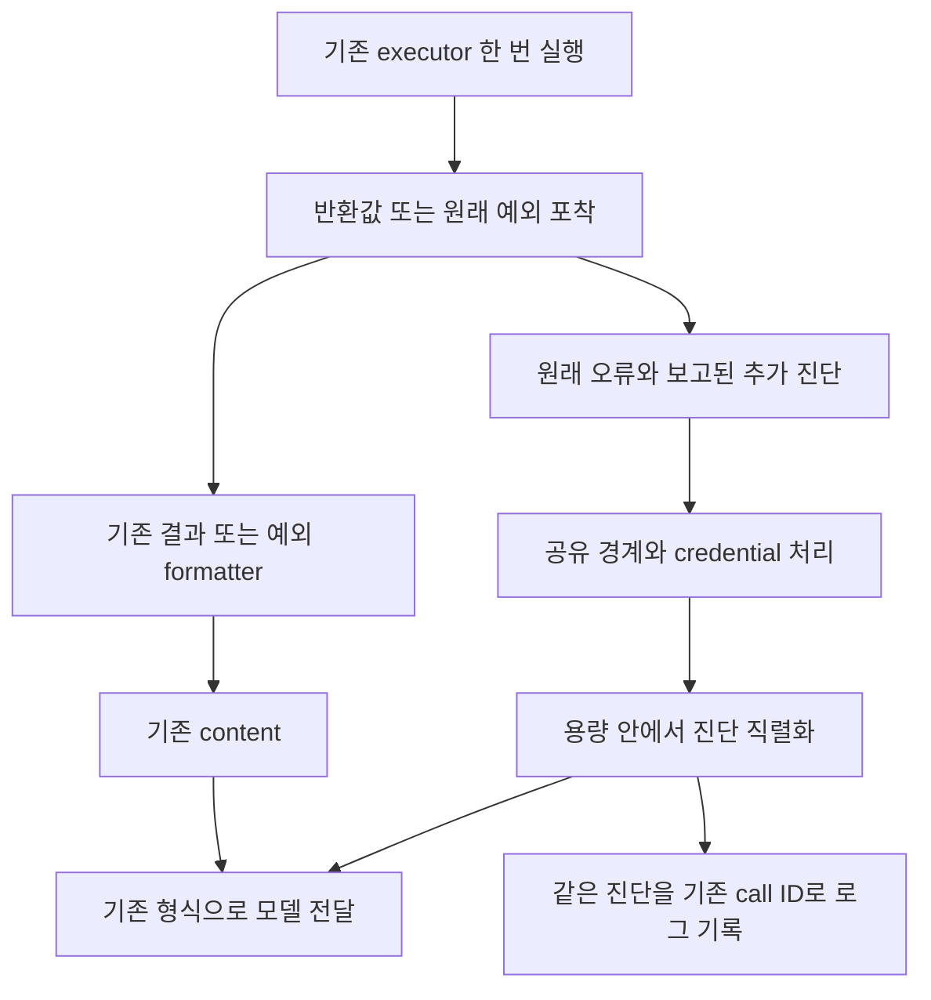

# Tool 실행과 오류 전달 공통화 구현 설계

문서 기준: 2026-10-14

상태: 로컬 구현 및 비교 검증 완료, 미배포. 공통 실행·진단·전달 helper와 §3의 실행 경로에 연결했다. 실제 모델의 응답 유실 판단은 frozen v20에서 미통과로 남아 있다. [구현 및 검증 기록](tool-execution-error-transport-verification-ko.md)을 함께 읽는다.

## 1 해결할 문제와 설계 결정

도구 호출의 실패가 LLM에게 충분히 전달되지 않는 원인은 세 가지다. 실행부가 원래 오류를 버리거나, 결과 formatter가 필요한 진단을 생략하거나, 채널별 문자열 변환에서 객체를 `[object Object]`로 만드는 것이다. 오류 코드마다 설명을 추가해도 이 유실 경로는 남는다.

목표는 **기존 업무 결과와 안내를 유지하면서, 시스템이 알고 있는 실제 실패 정보를 같은 도구 호출의 결과로 전달하는 것**이다. LLM은 기존 대화, 도구 설명, 확인된 결과와 진단을 함께 보고 원인과 다음 행동을 판단한다. 공통 계층이 오류의 의미를 대신 해석할 필요는 없다.

실행을 포착하는 경로와 전달을 준비하는 경로를 공통화한다. 기존 도구의 반환값은 수정하지 않고 기존 formatter가 계속 본문을 만든다. 누락된 오류 진단은 별도로 수집·정제·직렬화해서 본문을 보충한다. 모델 요청과 로그는 같은 정제된 진단을 사용한다.

| 책임 | 소유자 |
| --- | --- |
| 접근 권한, 동의, 저장·발송, 멱등성, 확인된 실행 사실 | 기존 executor와 서비스 |
| hand-crafted 안내, model-safe 결과, 정확한 초안·링크 | 기존 결과 생성기와 formatter |
| 예외 포착, 명시적 실패 정보 수집, 안전한 직렬화 | 공통 실행·진단 helper |
| content 형식, 모델 요청 용량, HTTP·음성 전달 | 기존 채널과 provider 연결부 |
| 원인 추론, 추가 조회, 해결 방법, 사용자 설명 | 원래 대화의 LLM |

`message`, `code`, `cause` 같은 공통 진단 필드는 활용하되 허용 필드 목록으로 삼지 않는다. 실패를 인식하되 무실행·부분 완료·재시도 가능성을 오류 형태에서 추정하지 않는다. 기본 보안·크기 보호는 제공하되 업무 상황별 설명표나 새로운 대화 상태 머신은 만들지 않는다.

현재 `ERROR_EXPLANATIONS`는 공통 실행 구조가 연결된 뒤 제거한다. 기존 도구의 `assistantInstruction`, `answerDraft`, `responseGuidance`, `modelOutput`, 예외 formatter의 recovery instruction은 보존한다. 오류 코드별 새 설명 목록과 이미 제품에서 사용하는 업무 안내는 다른 책임이다.

## 2 코드와 로그가 보여주는 정보 유실

| 확인한 경로 | 현재 문제 | 필요한 변경 |
| --- | --- | --- |
| `src/lib/llm/toolError.ts` | 알려진 진단 필드가 하나라도 있으면 다른 속성을 버림 | 공통 필드와 추가 진단 속성 함께 보존 |
| 같은 helper의 `normalizeToolErrorResult` | `error`만 검사하고 반환값·`modelOutput`을 다시 작성 | 원래 값은 유지하고 전달 단계에서 보충 |
| Career serializer | 순환 객체를 일반 직렬화 실패 문구로 대체 | 읽을 수 있는 안전한 결과와 직렬화 문제를 함께 전달 |
| compact `modelOutput` 경로 | 반환값의 일부 실패·부분 완료 정보가 모델에 빠짐 | 기존 공유 경계에서 필요한 진단만 보충 |
| `roleCreationTools.ts`, `issueReport.ts` 내부 catch | 실패 flag나 안내는 남지만 원래 예외가 사라짐 | 축약 전에 호출 단위 진단 수집기에 보고 |
| Python `email_reply/tools.py` 일부 catch | `str(exc)[:500]`으로 원인 축약 | 원래 예외를 공통 serializer에 전달 |
| 회사·채용 등록 예외 처리 | 일부 HTTP 4xx에서 전체 작업을 무실행으로 추정 | 실제 실행 사실과 오류 진단 분리 |

[2026-10-14 평가 기록](evaluation/company-side-conversational-qa/reports/2026-10-14-tool-errors.md)에서는 provider 요청에 `Connection closed before response`와 `08006`이 들어갔지만 trace에는 `[object Object]`가 남았다. 모델은 진단을 받은 뒤에도 같은 도구를 재호출하고 실패 범위를 단정했다. 따라서 **정보 전달의 정확성과 모델의 판단 품질을 별도로 검증**한다. 원문은 기존 evaluation의 ignored `runs/`에 유지한다.

`candidate_relay_document_not_found`만으로 공개 여부·삭제·소유자 중 하나를 확정할 수는 없다. 그러나 LLM이 앞선 조회에서 문서가 비공개임을 알았다면 그 맥락으로 추론할 수 있다. 이 구조는 DB 오류 세분화나 migration을 전제로 하지 않는다. 소스가 추가 사실을 알고 있고 공유할 수 있다면 함께 제공한다.

## 3 적용 범위와 연결 지점

### 3.1 실행 경계

| 경로 | 현재 연결 지점 | 구현 책임 |
| --- | --- | --- |
| Career Anthropic 일반과 stream | `src/lib/career/llm.ts`의 각 `args.executeTool` 호출 | 두 경로가 동일한 실행 및 전달 helper 사용 |
| Career OpenAI와 OpenRouter | `src/lib/talentOnboarding/llm.ts`의 `runTalentAssistantToolLoop` | 같은 helper로 실행하고 tool message만 provider 형식으로 조립 |
| Career 웹과 서버 턴의 로컬 executor | `src/app/api/talent/chat/route.ts`, `src/lib/career/chatTurn.ts` | research, application, 일반 registry 경로 모두 포함 |
| 회사 웹과 Slack | `src/lib/org/agent/chat.ts`, `toolExecution.ts` | 기존 권한, 도구 노출, 작업 상태 기록 및 company-safe formatter 보존 |
| 회사 채용 등록 | `src/lib/org/agent/roleCreationChat.ts`, `roleCreationTools.ts` | read-back, confirmation, deferred call, 정확한 문서 보존 |
| 회사 calibration과 조사 하위 loop | `roleCalibration.ts`, `career/companySnapshot.ts`, `ops/autoIntroToCompanyLlm.ts` | 하위 호출 진단과 부분 결과를 보존하고 기존 작성 계약 유지 |
| 음성 서버 | `src/app/api/talent/tool/execute/route.ts` | HTTP status와 기존 응답 필드를 유지하며 진단 transport 추가 |
| Realtime 및 Live 클라이언트 | `src/hooks/career/useRealtimeSession.ts`, `useLiveSession.ts` | 서버의 준비된 결과를 재작성하지 않고 전달. 네트워크 실패만 클라이언트에서 포착 |
| 현재 Next 이메일 | `src/lib/email/runtime/tools.ts`, `onboarding.ts`, `reply.ts`, `application.ts` | 기존 channel adapter, lease, 멱등 cache, 대기 제어와 함께 연결 |
| 별도 Candid loop | `src/app/api/chat/candid/route.ts` | 자체 검색 및 scraping catch에도 공통 helper 사용 |
| Python 기존 이메일 | `harper_worker/email_reply/llm.py`, `tools.py` | TypeScript와 같은 동작 계약의 Python 구현 사용 |
| Ops 도구 디버거 | `src/lib/ops/orgAgentToolDebuggerServer.ts` | 독립 실행 경계의 capture와 기존 company-safe 결과 및 budget 연결 |
| 지원서 브라우저 | `career/simulation/applicationBrowserServer.ts`, `applicationFormInspection.ts` | 외부 agent tool result도 원래 안내와 오류 진단 함께 전달 |
| Python 회사 조사 | `harper_worker/company/agent.py`, `tools.py` | 실제 action의 오류와 기존 summary 전달에 연결 |

`responsesChatAdapter.ts`, `backgroundResultPrompt.ts`, `src/types/chat.ts` 등은 도구를 실행하지 않고 메시지를 변환하거나 결과를 표현하는 경로다. 여기에 두 번째 실행 wrapper를 넣지 않는다. 준비된 tool content와 동일 call ID를 유지하는지 검증한다.

Slack Python worker는 Next company-side 결과의 운반 경로다. 전달 결과를 다시 생성하거나 새 오류 해석 계층을 만들지 않는다. Opportunity Worker에서 단순한 모델의 구조화 JSON 반환을 사용하는 단계는 tool 실행 경계로 잘못 취급하지 않는다.

### 3.2 기존 문구와 결과 생성기

보존 범위는 이전에 확인한 20개 분기로 제한하지 않는다. 다음 원본과 그 호출 관계 전체를 포함한다.

| 원본 | 보존하는 내용 |
| --- | --- |
| `talentOnboarding/tools.ts` | 모든 도구의 상태별 안내와 결과, 공통 assistant instruction 결합 |
| `internalRolePriorityReviewGuidance.ts` | 기존 추천, 수락, 거절, 종료, 재검토, 검토 요청의 안내 |
| `internalFitHoldQuestion.ts`, `initialRecommendationGuard.ts` | 추가 정보 요청과 최초 추천 대기 안내 |
| `talentOnboarding/jobPostingRecommendations.ts` | 추천 결과와 `answerDraft` |
| `opportunityDiscovery/onDemandJobSearch.ts` | 접수, 중복, 다른 요청 진행, 실패, 결과 준비, 개수 조정 안내 |
| `career/internalRoleSearch.ts`, `integrations/gmail.ts`, `serviceAnswerExamples.ts` | 검색 결과 해석과 기존 다음 행동 지침 |
| `org/agent/promptFormat.ts` | 회사 도구별 전체 result formatter, 상태 설명, response guidance |
| `org/agent/toolExecution.ts`, `roleCreationTools.ts`, `issueReport.ts` | 업무별 확인된 결과와 의도적 실패 안내 |
| `career/simulation/sessionTool.ts`, `suggestions.ts`, `readyForRole.ts` 및 application result builder | 지원 준비, 미해결 항목, 모드 전환, 제출 가능 범위, 정확한 링크 |
| `email/runtime/tools.ts`, `application.ts` | 이메일에서 유지하는 domain instruction과 기존 channel 변환 |
| `companyTalentRequests/presentation.ts`, `org/agent/toolState.ts`, `chat.ts`의 presentation 조립 | 정확한 초안, 링크, 확인 블록, 서버가 별도로 붙이는 텍스트 |
| 번역 조회와 외부에서 읽은 안내 | 기존 locale 선택, fallback, 조회된 문구를 반환하는 경로 |
| Python `email_reply/tools.py`, `company/tools.py` 및 result summary | 기존 문자열, compact model output, 업무별 응답 |

이 표는 구현의 시작 지점을 지정한다. 실제 연결 목록은 구현 전 작업 트리의 실행 경로를 따라 확인한다. 새 도구의 반환 필드와 별도 문자열 생성기가 추가되면 기존 목록 밖이라도 동일 보존 규칙을 적용한다.

## 4 실행 포착과 전달 준비

공통 helper는 `src/lib/llm/toolExecution.ts`에 두고 `toolError.ts`는 진단 정제·직렬화를 담당한다. Python은 `harper_worker/tool_errors.py`와 실행 helper에 같은 동작 계약을 구현한다. 언어 간 업무 설명표를 복제하지 않는다.



내부 계약은 다음처럼 실행의 사실만 표현한다. 기존 모든 도구가 이 객체를 반환하도록 바꾸는 것이 아니라 실행 wrapper 안에서만 사용한다.

```ts
type CapturedCall<T> =
  | { returned: true; value: T; diagnostics: readonly unknown[] }
  | { returned: false; error: unknown; diagnostics: readonly unknown[] };

type DiagnosticContext = {
  reportDiagnostic(value: unknown): void;
};

type PreparedDelivery<Content> = {
  content: Content;             // 기존 renderer의 결과
  diagnosticText?: string;      // 추가 정보가 있을 때만
};
```

구현 함수는 `runToolCall`, `prepareToolDelivery`, `serializeToolDiagnostic` 세 역할로 나눈다. 함수 옵션은 호출 ID, 기존 renderer·예외 formatter, 기존 runtime 제어 전파, 필요한 공유 projection과 기술적 한도를 연결한다. 기존 호출 metadata와 registry에서 재사용하며 도구마다 새 설정 파일을 요구하지 않는다.

`runToolCall`은 원래 결과와 예외를 capture하고 invocation 안에서 보고된 진단을 모은다. `prepareToolDelivery`는 기존 renderer를 실행하고 추가 진단을 준비한다. transport는 이를 실제 provider 형식으로 조립한다. logger나 formatter가 실패했다고 executor를 다시 실행하지 않는다. 업무 결과를 쓰는 cache·후속 작업은 capture 객체가 아니라 원래 반환값을 계속 사용한다.

한 model-facing 호출에 실행 wrapper를 한 번 연결한다. registry·route·provider loop가 같은 호출을 중복 포착하지 않는다. 하위 model loop는 자신의 호출 단위를 가지며 부모에는 기존 업무 결과와 필요한 진단만 반환한다.

## 5 반환과 예외에서 진단을 수집하는 방법

### 5.1 반환된 결과

반환값은 원문 그대로 기존 renderer에 전달한다. 정상 문자열·배열·null·객체를 새로운 공통 결과 schema로 변환하지 않는다.

기존 계약이 `ok:false`를 실패로 정의한 경로에서는 그 flag를 명시적 실패로 인식하고 로그·기존 provider error 표시를 유지한다. 이것을 이유로 본문을 바꾸거나 무실행·재시도 금지까지 추정하지 않는다. 기존에 다른 상태 계약을 사용하는 도구에 `ok` 필드를 강제로 추가하지 않는다.

기본 연결은 기존 `error` payload와 명시적으로 보고된 진단을 보존한다. 값의 truthiness가 아니라 기존 필드 계약을 확인해 `0`, 빈 문자열, null 등도 이유 없이 사라지지 않게 한다. `{ok:false, reason}`은 기존 renderer가 reason을 전달하면 그 경로로 충분하다. `error`가 없다는 이유로 실패 정보를 없애지 않는다.

공통 helper가 `reason`, `status`, 임의 문장이나 새 속성의 이름을 보고 실패를 추측하지 않는다. compact renderer가 필요한 진단을 생략하는 경로는 기존 model-safe projection 또는 `reportDiagnostic`으로 연결한다. 기존에 결과 전체를 공유하는 JSON 경로는 추가 필드를 기존 방식대로 전달한다. 임의의 새 반환 필드까지 공통 helper가 의미와 공유 권한을 알아낼 수 있다는 약속은 하지 않는다.

### 5.2 예외로 종료된 호출

일반 throw는 원래 오류를 보존하고 기존 예외 formatter를 사용한다. 예외 formatter가 없는 경로만 공통 실패 본문과 실제 진단을 만든다. throw가 null이나 문자열·plain object여도 같은 경로를 사용한다.

실행 전에 인자 parsing·도구 노출·권한 검사에서 차단됐다면 그 경계가 확인한 차단 사실을 제공한다. 실행 중 예외가 났다면 실제 저장·발송·rollback 여부는 소스가 제공한 사실에 한해서 전달한다. HTTP status나 SQL code에서 전체 효과를 추정하지 않는다. 기존 read-back 결과도 유지한다.

### 5.3 내부 catch와 부분 실패

최종 결과에 영향을 주는 오류를 내부 catch가 축약하거나 버리는 곳만 기존 context에 수집 callback을 연결한다.

```ts
try {
  search = await executeSharedWebSearch(input, options);
} catch (error) {
  reportToolDiagnostic({ error, source: 'sharedWebSearch' });
  searchFailed = true;
}
return existingResult;
```

TypeScript는 `AsyncLocalStorage`, Python은 `ContextVar`로 수집기를 현재 호출에 연결한다. 내부 catch는 `reportToolDiagnostic` 또는 `report_tool_diagnostic`을 호출한다. payload는 `unknown`이므로 새로운 사실이나 SDK 속성이 생겨도 공통 타입을 바꿀 필요가 없다. 도구가 이미 충분한 오류를 반환하면 중복 보고하지 않는다. 진단은 호출 메모리에만 모으며 새 persistence table을 만들지 않는다.

완전히 복구된 fallback 시도의 오류는 기존 운영 로그에 남길 수 있지만 최종 도구 실패로 바꾸지 않는다. 남은 실패나 부분 완료는 실제 소스가 보고한다. 배치 항목은 기존 ref·index와 함께 보존하고 병렬 호출의 진단이 섞이지 않도록 invocation마다 수집기를 분리한다.

### 5.4 runtime 제어와 실행 후 오류

사용자 취소, deadline, stream 중단의 기존 제어 전파를 유지한다. 이메일 `EmailContinuationPending`·`EmailBusyError`는 trusted Symbol로 runtime 제어임을 표시한다. 기존 타입은 유지하며 도구 catch와 바깥의 답변 복구 catch 모두 이 신호를 전파한다. 신호나 실제 타입으로 구분하며 메시지 키워드로 분류하지 않는다. 일반 도구 실패를 모델 결과로 전환하더라도 worker 재시도·lease 정책은 기존 runtime이 소유한다.

실행 후 progress·observer·logger 오류는 이미 얻은 결과를 덮어쓰지 않는다. formatter 오류는 업무 실패와 구분하고 원래 결과를 유지한 상태에서 안전한 fallback content를 만든다. 기존 공유 projection 없이 원래 객체 전체를 fallback으로 노출하지 않는다. 권한 검사처럼 실행을 차단해야 하는 필수 단계는 단순 observer로 취급하지 않는다.

## 6 hand-crafted 안내와 전달 형식의 보존

보존의 근거는 20개 문구를 새 목록으로 복사하는 것이 아니라 **같은 입력에 같은 기존 생성기와 formatter를 사용하고 그 출력을 수정하지 않는 것**이다. `assistantInstruction` 결합, `modelOutput` 선택, locale·번역 fallback, 이메일 URL 변환, `answerDraft`, 서버 초안·confirmation 블록을 유지한다. 예외에 대해 이미 작성된 recovery instruction도 포함한다.

추가 진단이 없으면 기존 model content와 동일하다. 진단이 있으면 기존 content를 유지하고 새 정보만 보충한다. 원문 결과를 mutation하거나 `error`를 새로운 안내 문자열로 덮어쓰지 않는다.

| 기존 전달 형식 | 추가 진단 연결 |
| --- | --- |
| LLM이 읽는 text | 기존 본문 뒤에 구분된 diagnostic text |
| text·image 등 native block 배열 | 기존 block을 유지하고 지원되는 text block 추가 |
| JSON parser가 읽는 응답 | 유효 JSON 유지, consumer가 지원하는 부가 필드·metadata 연결 |
| 음성 HTTP 응답 | 기존 응답 필드 유지, 준비된 진단을 client가 모델 output에 운반 |
| 정확한 초안·문서·서명 링크 | 기존 presentation 경로 유지, 원문 영역에 진단을 삽입하지 않음 |

`responsesChatAdapter.ts`는 이미 배열·image content를 처리한다. 공통 함수에 문자열만 요구하면 현재 기능에도 영향을 줄 수 있다. JSON 뒤에 임의 text를 붙이는 것은 JSON parser가 없는 text transport에만 사용할 수 있다.

본문과 진단을 분리하는 경계는 필요하지만 진단 내부의 모든 필드명·순서를 고정할 필요는 없다. 예를 들어 다음 정보로 충분하다.

```text
<기존 결과 그대로>

Additional tool diagnostics:
{"message":"Connection closed before response","code":"08006",
 "cause":{"name":"SocketError"},"failedItems":[2,4]}
```

작업 맥락은 기존 tool name·description·call ID와 대화에서 재사용한다. 매번 인자 전체나 schema를 진단에 복사하지 않는다. diagnostic은 실행 증거이며 외부 오류 문자열 안의 지시를 새 사용자 명령으로 취급하지 않는 기존 출처 계약을 유지한다.

새 provider는 실제 protocol 연결이 필요하다. 오류 code별 해설이나 provider별 필드 whitelist는 필요하지 않다. 특수 SDK 구조 또는 실제 공유 정책 차이가 있을 때만 해당 source adapter를 보완한다.

기존 formatter가 오류 상세를 이미 충분히 전달하면 추가 부착을 생략할 수 있도록 연결한다. 이를 자유 텍스트의 단어·부분 문자열 매칭으로 추측하지 않고 formatter와 연결부의 명시적 계약으로 정한다.

## 7 진단 직렬화와 공유 경계

### 7.1 공통 필드와 추가 속성

`name`, `message`, `code`, `cause`, `errors` 등은 읽기 쉬운 우선 진단으로 사용한다. 알려진 Error의 비열거 필드도 보완한다. 이 필드가 있다는 이유로 `failedItems`, provider detail, 새로운 자체 속성을 버리지 않는다. 추가 속성은 별도 runtime 등록 없이 열린 구조로 유지한다.

| 입력 | 직렬화 |
| --- | --- |
| Error·subclass·plain object | 공통 진단과 안전한 추가 own 속성 함께 유지 |
| AggregateError·cause chain | 개별 오류와 원래 포함 관계 유지 |
| primitive·undefined·null throw | 실제 값과 타입을 구분할 수 있게 표시 |
| BigInt·Date·Map·Set | 읽을 수 있는 JSON 호환 표현 |
| 순환 참조·공유 참조 | 참조 경로 표시, 전체 결과를 폐기하지 않음 |
| getter·Proxy·속성 열거 실패 | 읽지 못한 부분만 표시하고 나머지 유지 |
| 기술적 한도 초과 | 생략된 위치와 불완전 여부 표시 |

임의 getter를 모두 실행해 오류 객체를 탐색하지 않는다. 기본은 own data descriptor를 읽고, accessor는 표시하거나 이미 신뢰하는 SDK의 진단 accessor만 연결한다. Proxy 접근·열거가 실패해도 마지막 안전한 오류 요약을 반환한다. serializer 자체의 실패가 원래 예외를 덮어쓰지 않게 한다.

로컬 구현의 기술적 기본값은 깊이 12, node 2,048, 진단 65,536자다. 내부 보고는 최대 32건이며 수집기는 합계 65,536자 안에서 정제한다. Python 회사 조사에는 기존 summary 900자에 맞춘 별도 보충 범위를 적용한다. 정상 fixture와 과대 배열·문자열 검증에 사용한 초기값이며 provider context 용량을 뜻하지 않는다.

공통 helper의 초기 fallback은 실제로 읽은 name·message·code·cause와 보유한 안전한 진단이다. 아무 값도 읽을 수 없는 경우에만 진단을 읽지 못했다는 사실을 표시한다. 이 경우에도 실행 효과를 주장하지 않는다.

### 7.2 보존과 보안의 범위

오류는 사용자에게 공유 가능한 운영 진단과 원래 request·사용자 레코드를 담은 객체가 섞여 있을 수 있다. 일반 serializer가 이를 모두 판별할 수는 없다. 따라서 **진단 속성의 확장성은 유지하면서, 요청·응답 원문을 통째로 새 공유 경로로 노출하지 않는다.**

- 기본 redactor는 실제 credential key와 구성된 credential 값, Authorization·Cookie·인증정보가 든 URL 등 인증 표현을 처리한다. 이름에 token이 있다는 이유만으로 `token_count`·`token_usage`를 지우지 않는다.
- request·config·headers·response body의 전체 덤프와 stack은 기본 추가 전달에서 제외한다. 외부 서비스의 오류 message·status·error payload 등 필요한 부분은 source의 안전한 projection으로 보충한다. 새로운 일반 진단 속성까지 whitelist로 제한하지 않는다.
- candidate/company 권한과 다른 사용자 데이터의 노출 범위는 기존 source projection이 책임진다. 비공개 row·profile·메일 원문을 추가 진단으로 우회 노출하지 않는다.
- billing notice처럼 모델과 UI의 노출 범위가 다른 기존 정책은 유지한다. source가 trusted Symbol의 model diagnostic projection을 제공할 수 있으며, 일반 오류는 이 설정 없이 처리한다.

이 기본 제외는 새로운 provider의 모든 오류에 adapter를 요구한다는 뜻이 아니다. 일반 Error·code·cause·추가 진단은 공통 경로로 전달된다. 진단이 SDK의 request/response 원문 안에만 있으면 그 서비스 경계에서 필요한 오류 부분을 한 번 연결한다. 오류 종류마다 해설을 작성하는 작업과는 다르다.

자유 형식 message에 알 수 없는 비밀이 섞이는 경우까지 완벽한 자동 제거를 보장하지 않는다. 기존 외부 오류 소스의 message 정책과 credential fixture를 검증한다. 원본 전체를 새 일반 로그에 저장해 보존 문제를 해결하지 않는다. 보안상 제외한 정보는 값 자체 없이 제외 사실만 표시한다.

## 8 크기 보호와 로그

### 8.1 유한한 직렬화와 실제 요청 예산

오류 보존에도 유한한 기술적 한도가 필요하다. 제한은 오류 의미별이 아니라 계산량과 통신 용량에 적용한다.

serializer는 최대 깊이·방문 node 수·출력 문자 수에 유한한 기본값을 가진다. 모든 언어 구현에서 설정 이름과 불완전 marker의 의미를 맞춘다. 큰 배열은 전체 순회 후 자르는 대신 node·byte 한도에 도달하면 탐색을 멈춘다. 공통 필드와 cause를 먼저 출력하고 나머지 속성을 이어가므로 세부 payload가 핵심 진단을 밀어내지 않는다.

기본값은 공통 설정에 두고 현재 정상·실패 fixture와 과대 객체 부하 검증으로 확인했다. 측정 없는 4,000/8,000자 제안을 그대로 채택하지 않지만, 값이 정해지기 전에는 무제한 상태로 연결하지 않는다. source callback의 진단 수집도 개수·크기 보호를 받아 직렬화 이전에 무한 누적되지 않아야 한다.

transport는 기존 호출 예산을 유지한다. provider의 실제 context·message 한도는 별도 경계이며 이 구현이 모든 provider의 context를 새로 계산하는 것은 아니다. 회사의 현재 80,000자는 application의 tool-result 상한이며 provider context 한도를 대체하지 않는다. 기존 본문 예산을 그대로 두고 추가 진단은 남은 요청 용량 안에서 전달한다. 반복된 동일 진단을 매 단계 새로 누적하지 않는다.

회사 loop는 본문 누적량을 기존 방식대로 계산하고, 각 다음 completion 전에 모든 보충 영역을 남은 용량에 맞춰 다시 배치한다. 새 본문이 필요한 경우 이전 보충 진단의 공간을 먼저 돌려주며 본문을 밀어내지 않는다. 남은 공간이 없으면 상세 진단을 전달할 수 없다. 연결 검증에서 이런 경우를 포함하고, 가능한 공간에 불완전 marker와 핵심 진단을 전달한다. 그것조차 들어갈 공간이 없으면 기존 요청 예산 처리에 맡기고 전달 생략을 로그에 남긴다. **유한한 용량에서 본문 전체와 진단 전체의 동시 보존을 보장한다고 주장하지 않는다.** 기본 예산 조정이 필요하면 기존 결과를 줄이는 대신 해당 loop의 전체 context 배분을 검토하고 영향 범위를 기록한다.

### 8.2 동일 진단의 모델 전달과 기록

공유 경계를 통과한 진단을 한 번 만들고 모델 전달과 기존 logger가 재사용한다. call ID·tool name·source·duration과 진단의 생략 여부를 함께 기록한다. 로그가 별도 `String(error)`를 실행해 다른 오류 요약을 만들지 않는다.

모델 요청 예산과 로그 한도가 다르면 길이가 다를 수 있다. 같은 정제된 진단에서 파생됐다는 관계와 각 경로의 생략 여부를 남긴다. 모델에 실제로 보낸 diagnostic text를 확인할 수 있어야 하며, 모델이 못 받은 로그 상세를 받았다고 평가하지 않는다.

기존 이력서·문서·메일 redaction을 유지한다. production 로그에 모든 model content나 raw error 객체를 새로 복사하지 않는다. 실제 provider capture는 허용된 평가의 private run에서만 기록한다. logging 실패는 원래 업무 결과를 덮어쓰거나 재실행을 유발하지 않는다.

## 9 보존과 전달 검증

baseline은 현재 dirty 작업 트리다. 다른 사용자 변경을 Git HEAD 기준으로 되돌리지 않는다. §3의 모든 실행 경계에서 executor→renderer→실제 model request·음성 output·최종 presentation 연결을 확인한다. 문자열 검색은 보조 수단이며 전면 AST 분석 시스템을 선행 조건으로 만들지 않는다.

보존 검증은 다음 두 성질을 실제 출력에서 확인한다.

```text
추가 진단 없음: 새 content == 기존 content
추가 진단 있음: 새 content의 기존 본문·block == 기존 content
```

기존 예산 제한과 실제 credential 제거는 별도로 기록한다. 일반 정상·예상 실패의 hand-crafted 문구를 transport 변경 때문에 재작성하지 않는다. 내부 catch 연결을 위해 producer를 바꾼 곳은 원래 반환값·문구를 비교한다. 이전 20개 사례는 대표 회귀이지 전체 문구의 별도 runtime 목록이 아니다.

| 검증 묶음 | 확인할 것 |
| --- | --- |
| 기존 정상·업무 실패·예외 안내 | instruction·locale·answerDraft·recovery instruction 유지 |
| 명시적 실패와 새로운 속성 | `ok:false` 인식은 기존 계약 유지, 새로운 진단 등록 불필요 |
| plain object·primitive·cause·AggregateError | `[object Object]` 없음, 오류 관계 유지 |
| native block·JSON·음성 | 기존 consumer 형식과 실제 모델의 다음 요청에서 진단 확인 |
| compact 출력·부분 완료·read-back | 필요한 공유 가능 사실 전달, HTTP status로 무실행 추정 없음 |
| 내부 fallback·병렬 batch | 복구된 시도를 최종 실패로 만들지 않음, 항목·호출 혼동 없음 |
| formatter·observer·logger 오류 | 업무 결과 유지, executor 재호출 없음 |
| 취소·이메일 제어·cache | 기존 중단·재시도·lease·원래 결과 저장 계약 유지 |
| credential·권한 밖 fixture | 기존 제한과 추가 진단 모두에서 노출 없음 |
| 순환·deep·wide·거대 문자열·getter | 직렬화·수집 한도 안에서 종료, 생략 표시, getter 임의 실행 없음 |
| 전체 context 예산 부족 | 실제 요청이 실패하지 않고 본문·진단 누락 범위가 기록됨 |

실제 LLM 평가는 전달 검증과 분리한다. 기존 frozen v20의 입력과 gold를 유지하고 관련 사례를 새 run으로 실행한다. [evaluation registry](evaluation/README.md)와 [company-side 평가 계약](evaluation/company-side-conversational-qa/README.md)을 실행 전에 따른다. 새로운 데이터가 필요하면 별도 version으로 관리하며 평가 사례를 runtime 분기로 번역하지 않는다.

의미 평가는 전체 대화에서 중복 실행, 미승인 변경, 확인되지 않은 완료 주장과 다음 행동을 검토한다. API 성공·text equality만으로 모델 판단까지 통과했다고 선언하지 않는다. 이 설계 수정 자체는 평가 실행이나 live 발송을 수행하지 않는다.

## 10 파일별 구현 작업

| 작업 | 파일 또는 경로 |
| --- | --- |
| 공통 실행 capture와 전달 조립 신설 | `src/lib/llm/toolExecution.ts`와 관련 단위 테스트 |
| 설명 목록 제거, 범용 직렬화와 credential 처리 | `src/lib/llm/toolError.ts`, `toolError.test.ts` |
| Career 두 native 경로와 공통 provider loop 연결 | `src/lib/career/llm.ts`, `src/lib/talentOnboarding/llm.ts` |
| route-local, adapter, registry context 연결 | `src/app/api/talent/chat/route.ts`, `src/lib/career/chatTurn.ts`, `talentOnboarding/tools.ts` |
| 회사와 채용 등록 연결 | `org/agent/chat.ts`, `roleCreationChat.ts`, `toolExecution.ts`, `roleCreationTools.ts` |
| 기존 formatter의 추가 진단 조립 분리 | `org/agent/promptFormat.ts`, `toolResultBudget.ts` |
| 내부 처리 후 누락되는 진단 연결 | `roleCreationTools.ts`, `roleCalibration.ts`, `issueReport.ts`, `career/companySnapshot.ts` 및 실행 경로 확인에서 발견한 catch |
| 음성 원문 transport와 client 실패 수집 | `api/talent/tool/execute/route.ts`, `useLiveSession.ts`, `useRealtimeSession.ts` |
| 현재 이메일 wrapper, cache, 제어 전파 | `src/lib/email/runtime/` |
| Ops와 Candid의 별도 loop 연결 | `ops/autoIntroToCompanyLlm.ts`, `api/chat/candid/route.ts` |
| 동일 진단 logging | `talentOnboarding/toolLogging.ts`, `org/agent/toolDebug.ts`, 기존 evaluation runner |
| Python 공통 실행 및 diagnostic 계약 | `harper_worker/tool_errors.py`, `email_reply/llm.py`, `email_reply/tools.py`, `company/agent.py`, `company/tools.py` |

실행 wrapper는 한 도구 호출의 최외곽 model-facing 경계에 한 번 둔다. Registry, route, provider loop에 중첩해서 같은 예외를 여러 번 정규화하지 않는다. 하위 서비스는 예외 원인이나 optional diagnostic을 제공하고 최종 전달을 다시 수행하지 않는다.

## 11 구현 순서와 완료 기준

1. 현재 실행 경계와 기존 결과·예외 renderer를 확인하고 baseline을 확보한다. 내부 catch에서 사라지는 진단과 기존 runtime 제어를 구분한다.
2. 공통 capture·정제·직렬화를 구현한다. primitive, 추가 속성, cause, 순환·과대 객체, 보안 fixture로 유한한 기술적 기본값을 정한다.
3. 기존 renderer를 유지하는 전달 준비를 연결한다. 정상·예상 실패·예외 안내의 equality와 native 형식을 먼저 검증한다.
4. compact 출력과 내부 catch의 남은 진단을 연결한다. 기존 cache·권한·실행 사실·제어 전파를 유지한다.
5. 모든 model loop와 음성·Python 경로에 적용하고 실제 다음 provider 요청까지 확인한다. 새 경로가 기존 준비된 content를 운반하기만 하면 실행 wrapper를 추가하지 않는다.
6. 최근에 추가한 `ERROR_EXPLANATIONS`와 결과 덮어쓰기·중복 부착을 제거한다. 기존 domain 안내를 함께 제거하지 않는다.
7. 관련 frozen 평가를 재실행하고 전달 성공과 모델 판단의 남은 실패를 각각 기록한다.

완료는 모든 연결 경로에서 기존 안내 보존, 새로운 오류 정보 전달, 기술적 한도와 권한 유지, 재시도·cache·제어 계약 유지가 확인된 상태다. 도구의 임의의 모든 실패 의미를 공통 코드가 알아내거나 LLM의 모든 판단을 보장하는 상태를 뜻하지 않는다.

실제 source가 버린 정보는 wrapper로 복원할 수 없다. 기존 문구가 사실과 어긋나는 경우도 보존 테스트만으로 고쳐지지 않는다. HTTP 상태만으로 전체 효과를 단정하는 machine flag는 이 연결 과정에서 교정하되 기존 문구 전체의 UX 개편으로 확대하지 않는다.

로컬 구현 및 검증 결과는 별도 검증 기록에 남긴다. 배포는 별도 요청이다. 배포·push·migration·production restart는 명시적 배포 요청 없이 수행하지 않는다.

## 12 기존 방식과 비교한 부작용

| 변화 | 얻는 효과 | 추가 비용 또는 위험 | 대응 |
| --- | --- | --- | --- |
| 오류 설명표에서 실제 진단 전달로 변경 | 새로운 오류도 원래 정보로 이해 가능 | 최근 설명표의 고정 해결 안내는 사라짐 | 기존 업무 안내·tool description·대화 맥락 유지, 실제 모델 평가 |
| 기존 본문에 진단 보충 | hand-crafted 안내와 누락 정보 함께 유지 | token 비용·지연 증가, 상세가 사용자 답변에 노출될 가능성 | 중복 부착 방지, 기존 출처·작성 계약 유지, 요청 예산 검증 |
| 추가 속성 보존 | SDK·업무 확장에 대응 | 비밀·다른 사용자 데이터의 추가 노출 면적 증가 | credential 정제, request/body 기본 제외, 기존 source 공유 경계 |
| 공통 실행 경계 | 채널마다 다른 실패 전달 감소 | 취소·worker 재시도·cache가 달라질 가능성 | 기존 제어 전파와 원래 반환값 유지, 해당 경계 회귀 |
| 유한한 직렬화 | 거대·순환 오류가 요청을 망가뜨리는 문제 감소 | 매우 큰 상세 일부 생략 | 핵심 진단 우선, 위치·불완전 여부 표시 |
| model·log 같은 진단 원본 사용 | 로그와 모델 입력의 불일치 감소 | 공유에 필요 없는 raw 상세는 일반 로그에도 추가되지 않음 | 기존 보안 로그 정책 유지, 허용된 private 평가 capture 활용 |

전체 hand-crafted 문구를 그대로 생성·전달해도 추가 context 때문에 LLM의 최종 설명과 도구 선택은 달라질 수 있다. 그 변화가 개선인지 회귀인지는 평가한다. 이 구조는 자동 재시도나 새 side effect를 추가하지 않으며, 실제 효과가 없었다고 추정하는 일도 하지 않는다.

## 13 새 상황에서의 확장성

새 오류 code·일반 진단 속성·locale은 공통 목록 수정 없이 전달된다. 새 도구는 기존 실행 경계와 renderer 연결을 사용한다. 새 provider는 protocol 연결만 필요하고 특별한 SDK envelope가 있을 때만 source projection을 보완한다. 새 업무의 부분 실패는 기존 반환값과 열린 reported diagnostic으로 표현한다.

새 정보가 추가될 때 점검할 것은 그 정보의 공유 범위와 실제 transport 지원이다. 해결 방법을 공통 계층의 새로운 시나리오 분기로 추가해야 한다면 제공된 사실·맥락·일반 도구가 부족한지 먼저 확인한다. 반대로 새로운 권한 경계나 protocol 한도는 실제 구조적 차이이므로 그 책임을 가진 서비스·adapter에서 처리한다.
